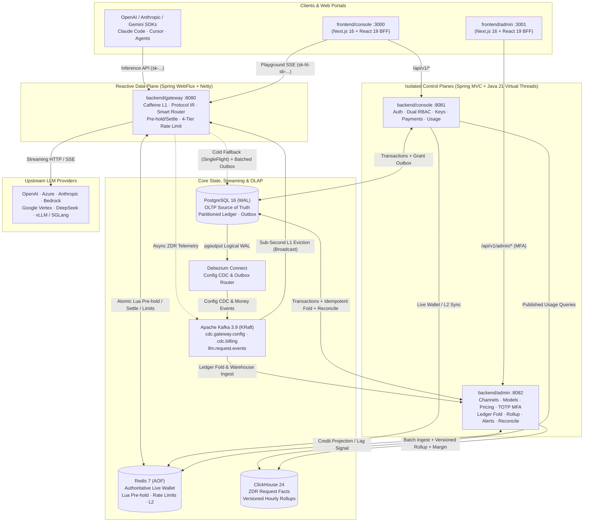

<div align="center">

# ⚡ HyperLLM

**Commercial-Grade Multi-Tenant LLM API Gateway, Intelligent Router & Real-Time Billing MaaS Platform**

<p>
  <a href="./README.md"><strong>English</strong></a> ·
  <a href="./README_zh-CN.md">简体中文</a>
</p>

<p>
  
  
  
  
  
  
  
  
  <a href="./LICENSE"></a>
</p>

<p>
  <a href="#why-hyperllm">Why HyperLLM</a> ·
  <a href="#key-capabilities">Capabilities</a> ·
  <a href="#protocol-matrix">Protocols</a> ·
  <a href="#system-architecture">Architecture</a> ·
  <a href="#quickstart">Quickstart</a> ·
  <a href="#drop-in-sdk-examples">SDK Examples</a> ·
  <a href="#documentation">Documentation</a>
</p>

</div>

---

## Why HyperLLM?

Most LLM proxies start as thin reverse proxies and break down the moment you try to run a real commercial AI platform: concurrent streaming requests overspend prepaid wallets, floating-point drift breaks financial reconciliation, cross-channel routing destroys Prompt Cache hit rates, and sharing one admin backend with public developers widens the blast radius.

**HyperLLM** (`app.pagefault.hyperllm`) is engineered from the ground up as a **full-stack commercial Model-as-a-Service (MaaS) platform** combining a sub-15ms reactive **WebFlux/Netty** data plane, a **Redis-authoritative zero-overspend billing engine**, **Debezium CDC + Outbox** ledger consistency, **ClickHouse** real-time gross-margin OLAP, and **physically isolated Developer Console & Operator Admin portals**.

---

## Key Capabilities

### 🔀 Multi-Protocol Unified Gateway & Canonical IR Translation
- **Drop-In Native Protocols**: Full compatibility with **OpenAI** (Chat, Responses, Embeddings, Images, Audio TTS/STT), **Anthropic Native Messages** (Extended Thinking, Tool Use, Prompt Caching, `count_tokens` — ready for Claude Code, Cursor, and Cline), **Google Gemini**, and **Cohere/Jina Rerank**.
- **Zero-Overhead Homomorphic Passthrough**: When client and upstream protocols match, HyperLLM streams bytes directly with minimal overhead while transparently extracting authoritative SSE usage (auto-injecting and stripping OpenAI `stream_options.include_usage` as needed) with `jtokkit` fallback estimation on mid-stream disconnects.
- **High-Fidelity Bidirectional Translation**: Seamlessly route OpenAI requests to Anthropic/Gemini or Anthropic Messages requests to OpenAI/DeepSeek/self-hosted vLLM via the unified `Canonical IR` pipeline.

### 🎯 Intelligent Routing, Resilience & Prompt Cache Affinity
- **Multi-Strategy Scheduler**: Combine **Priority-Tiered Weighted** routing, **Lowest-Cost Margin Optimization**, and real-time **EWMA P90 TTFT Latency-Aware** routing across multi-provider pools (OpenAI, Azure, Anthropic, AWS Bedrock, Google Vertex, DeepSeek, vLLM/SGLang).
- **Prompt Cache Sticky Sessions**: Hash `org_id + virtual_model + prefix_tokens` with a sliding 5-minute channel affinity so multi-turn agent loops consistently hit upstream KV caches instead of paying full input pricing on every turn.
- **Pre-First-Byte Failover & Distributed Circuit Breaking**: Automatic zero-impact failover retries on `429`/`5xx`/timeouts before the first response byte reaches the caller, backed by per-channel upstream capacity protection and 3-state circuit breakers (`CLOSED` → `OPEN` → `HALF_OPEN`).

### 💰 Commercial Billing, Zero-Overspend Pre-hold & Financial Reconciliation
- **Integer `micro-USD` Precision**: Every balance, rate, budget, and ledger row uses 64-bit integer `micro-USD` (`1 USD = 1,000,000 micros`) with deterministic ceiling rounding — zero floating-point drift.
- **Multi-Dimensional Versioned Pricing**: Time-windowed pricing rules covering input, output, cached read, cached write (5m/1h), reasoning tokens, tiered context lengths (`<=128k` vs `>128k`), per-image/audio/call rates, customer tier multipliers, and per-org contract overrides.
- **Deterministic 3-Tier Entitlement Allocation**: Automatically deducts in strict order:
  1. **Model-Scoped Resource Packs** (Tokens or Calls, earliest expiry first)
  2. **Promotional Vouchers & Bonus Grants** (earliest expiry first)
  3. **Prepaid Cash Wallet**
- **Redis Authoritative Pre-hold & Streaming Settle**: Atomic Lua scripts freeze worst-case cost per batch at admission, renew leases via streaming heartbeats, settle exact cost on completion, reclaim orphaned holds on crash, and protect against ledger lag via backpressure gates (`503 LEDGER_BACKLOG` / `OUTBOX_UNAVAILABLE`).
- **End-to-End Monetization & Accounting**: Global payments (**Stripe**, **Alipay**, **WeChat Pay**) with order-locked FX rates, signed webhooks, redemption code batches, append-only monthly-partitioned `wallet_ledger`, automated reconciliation findings, dual-approval manual adjustments, monthly billing statements, and dual-track invoicing.

### 🛡️ Enterprise Multi-Tenancy, Security & Zero Data Retention (ZDR)
- **Strict Tenant Hierarchy & Dual-Layer RBAC**: `Organization -> Project -> API Key` with `Owner / Admin / Developer / Billing` org roles, project-scoped developer access, IP CIDR allowlists, model allowlists, and per-key quotas.
- **Enterprise Identity & Isolated Admin Plane**: Email OTP, GitHub/Google OAuth, and Enterprise OIDC/SAML SSO on the Developer Console; physically isolated Operator Admin plane enforcing independent HS256 JWT keys/cookies, **TOTP MFA**, and IP CIDR gates.
- **Defense-in-Depth Cryptography**: Customer `sk-...` API keys stored only as salted `HMAC-SHA256` digests (with dual-pepper zero-downtime rotation); upstream provider keys encrypted at rest and in transit with `AES-256-GCM` bound to `channel_id` as AAD and decrypted only in memory microseconds before dispatch.
- **4-Tier Rate Limiting & Monthly Project Budgets**: Sliding-window RPM/TPM/concurrency limits across API Key, Project, Organization, and Upstream Channel layers, plus Project soft-cap alerts and hard-cap enforcement.
- **Zero Data Retention (ZDR) & Pluggable Guardrails**: Prompts and completions never touch PostgreSQL or ClickHouse by default; optional project-level opt-in debug payloads are AES-256-GCM encrypted in an isolated ClickHouse table with automatic 1–7 day TTL deletion; extensible `GuardrailProvider` SPI for DFA keyword filtering, PII masking, and prompt injection defense.

### 📊 Real-Time OLAP Analytics, Alerting & Dual Next.js 16 Portals
- **ClickHouse Deduplicated Analytics**: Versioned hourly rollups guarantee exact usage, P50/P90/P99 TTFT & E2E latency, provider cost, and real-time **Gross Margin** even under Kafka at-least-once redelivery.
- **Proactive Alerting & Observability**: Low-balance and project soft/hard budget alerts delivered via SSRF-hardened HMAC-signed HTTPS Webhooks and SMTP Email, plus full OpenTelemetry tracing, Prometheus metrics, and Grafana dashboards.
- **Dual Modern Web Portals**:
  - **Developer Portal & Console (`frontend/console :3000`)**: Public landing & pricing catalog, interactive multi-model SSE Playground & Arena comparison, workspace/RBAC/API key management, usage dashboards, top-ups, and alert configuration.
  - **Operator Control Center (`frontend/admin :3001`)**: Encrypted channel pools with live health probes, visual virtual model routing & pricing publisher, tenant wallet live inspection, SKU/voucher commerce, gross margin cockpit, and reconciliation/anomaly triage.

---

## Protocol Matrix

| Protocol Family | Endpoints | Native Capabilities | Cross-Protocol Translation |
| :--- | :--- | :--- | :--- |
| **OpenAI Compatible** | `POST /v1/chat/completions`<br>`POST /v1/responses`<br>`POST /v1/embeddings`<br>`POST /v1/images/generations`<br>`POST /v1/audio/speech`<br>`POST /v1/audio/transcriptions` | SSE streaming (`include_usage`), Tool Calling, Structured Outputs (`json_schema`), Vision, Audio | Chat / Responses seamlessly translate to Anthropic, Gemini, and OpenAI-compatible backends |
| **Anthropic Native** | `POST /v1/messages`<br>`POST /v1/messages/count_tokens` | Native SSE event stream, Extended Thinking (`thinking`), Prompt Caching (`cache_control`), Tool Use | First-class support for Claude Code, Cursor & Cline; direct passthrough or translate to OpenAI/DeepSeek |
| **Google Gemini** | `POST /v1beta/models/{model}:generateContent`<br>`POST /v1beta/models/{model}:streamGenerateContent` | Function Calling, System Instructions, Multimodal Parts, Thinking Budget | Direct passthrough to AI Studio / Vertex AI or reverse-translate to OpenAI/Anthropic |
| **Discovery & Search** | `GET /v1/models`<br>`POST /v1/rerank` | Project-authorized model catalog with context metadata; Cohere/Jina/BGE Rerank compatibility | Unified multi-vendor model registry |

---

## System Architecture



---

## Quickstart

### 1. Configure Environment & Start Core Infrastructure

```bash
# Copy local environment template (replace all secrets before production deployment!)
cp .env.example .env

# Start core infrastructure (PostgreSQL 16 logical WAL, Redis 7 AOF, Kafka 3.9 KRaft) + dev tools
docker compose --env-file .env -f infra/docker-compose.yaml --profile tools up -d
```

### 2. Run Backend Services (Java 21 LTS)

```bash
# Build shared modules & run unit tests (no Docker required)
./backend/mvnw -f backend/pom.xml test

# Start Console (:8081) — runs Flyway V1–V8 migrations automatically
HYPERLLM_OTP_DEBUG_ECHO=true ./backend/mvnw -f backend/pom.xml -pl console spring-boot:run

# After Flyway tables exist, start Debezium CDC + ClickHouse pipeline
docker compose --env-file .env -f infra/docker-compose.yaml --profile pipeline up -d

# Start Admin (:8082) and Gateway (:8080) in separate terminals
HYPERLLM_ADMIN_MFA_REQUIRED=false ./backend/mvnw -f backend/pom.xml -pl admin spring-boot:run
./backend/mvnw -f backend/pom.xml -pl gateway spring-boot:run
```

> **Optional Observability Stack**: add `--profile observability` to launch OTel Collector (`:4317/:4318`), Prometheus (`:9090`), and Grafana (`:3100`).

### 3. Run Frontend Portals (Next.js 16 + pnpm 12)

```bash
# Developer Portal & Console -> http://localhost:3000
cd frontend/console && pnpm install && pnpm dev

# Operator Control Center -> http://localhost:3001
cd frontend/admin && pnpm install && pnpm dev
```

### 4. Verify Full Stack

```bash
# Full reactor build + Testcontainers integration tests (PostgreSQL, Redis, Kafka, ClickHouse, WireMock)
./backend/mvnw -f backend/pom.xml verify

# Live-stack end-to-end commercial smoke test
bash scripts/e2e/phase2-smoke.sh
```

---

## Drop-In SDK Examples

### OpenAI Python SDK

```python
from openai import OpenAI

client = OpenAI(
    base_url="http://localhost:8080/v1",
    api_key="sk-your-hyperllm-api-key",
)

stream = client.chat.completions.create(
    model="gpt-4o-mini",
    messages=[{"role": "user", "content": "Explain how Pre-hold prevents wallet overspending."}],
    stream=True,
)
for chunk in stream:
    if chunk.choices and chunk.choices[0].delta.content:
        print(chunk.choices[0].delta.content, end="", flush=True)
```

### Anthropic Native SDK & Claude Code

```bash
# Point Claude Code or Anthropic SDKs directly at HyperLLM
export ANTHROPIC_BASE_URL="http://localhost:8080"
export ANTHROPIC_API_KEY="sk-your-hyperllm-api-key"

curl http://localhost:8080/v1/messages \
  -H "x-api-key: $ANTHROPIC_API_KEY" \
  -H "anthropic-version: 2023-06-01" \
  -H "content-type: application/json" \
  -d '{
    "model": "claude-sonnet-4-5",
    "max_tokens": 512,
    "messages": [{"role": "user", "content": "Hello from HyperLLM!"}]
  }'
```

---

## Repository Modules

| Module | Default Port | Tech Stack & Responsibility |
| :--- | :---: | :--- |
| `backend/common` | — | Integer `micro-USD` math, `UuidV7`, `AesGcmCipher`, `HmacSha256`, `ApiKeyGenerator`, `ErrorCode`, shared Kafka/Redis contracts & 12 atomic Lua scripts |
| `backend/domain` | — | Flyway `V1`–`V8` DDL migrations, monthly partitioned ledger/audit tables, `-Pjooq` generated SQL layer, 35 jOOQ repositories, `PricingResolver` & `EntitlementAllocator` |
| `backend/protocol` | — | `Canonical IR`, OpenAI/Anthropic protocol adapters, streaming SSE usage extraction, `jtokkit` fallback estimation, native protocol error formatter |
| `backend/gateway` | `8080` | Reactive WebFlux data plane (`Caffeine L1 + Redis L2`), Debezium broadcast L1 invalidation, multi-strategy routing, Lua Pre-hold/Settle, 4-tier limits & batched Outbox |
| `backend/console` | `8081` | Developer control plane (MVC + virtual threads), dual-layer RBAC, API keys, live wallet, Stripe/Alipay/WeChat payments, voucher redemption, ClickHouse usage, alerts & OpenAPI 3.1 |
| `backend/admin` | `8082` | Operator control plane (MVC + virtual threads), TOTP MFA, encrypted channel pools & probes, model/pricing orchestration, margin analytics, ledger consumer, rollup, alerts & reconciliation |
| `frontend/console` | `3000` | Next.js 16 + React 19 + Tailwind CSS v4 developer portal, model marketplace, SSE Playground, billing & usage analytics UI |
| `frontend/admin` | `3001` | Next.js 16 + React 19 + Tailwind CSS v4 isolated operator portal for routing, commerce, margin cockpit & financial reconciliation |
| `infra/` | — | Layered Docker Compose profiles, PostgreSQL replication init, Kafka topic init, Debezium connectors, ClickHouse DDL, OTel/Prometheus configs & WireMock stubs |

---

## Documentation

### 🚀 Onboarding & API Contracts (Recommended Starting Point)
- **[Newcomer Takeover & Onboarding Handbook](./docs/onboarding/README.md)** — 8-lesson step-by-step guide teaching every subsystem, Lua script, consistency invariant, BFF pattern, and troubleshooting runbook
- **[OpenAPI 3.1 Specifications](./docs/openapi/README.md)** — Machine-readable API contracts for Swagger UI, Postman, and TypeScript SDK generation:
  - [Gateway Data Plane API (`gateway-api.yaml`)](./docs/openapi/gateway-api.yaml)
  - [Console Developer API (`console-api.yaml`)](./docs/openapi/console-api.yaml)
  - [Admin Operator API (`admin-api.yaml`)](./docs/openapi/admin-api.yaml)

### 📐 Architecture Blueprints & Detailed Design Specs
- [Product & Architecture Proposal](./docs/PROPOSAL.md) · [Phased Implementation Roadmap](./docs/TODO.md)
- [Database Entity & Storage Design](./docs/design/01-database-design.md)
- [Dependencies & Infrastructure Orchestration](./docs/design/02-dependencies-and-infra.md)
- [Backend Auth, REST & Gateway Contracts](./docs/design/03-phase1-backend-contracts.md)
- [Phase 2 Commercial Billing, Redis Authority & Pipeline Specs](./docs/design/04-phase2-design.md)
- [Frontend Engineering & Visual Design Specification](./docs/FRONTEND_DESIGN_SPEC.md)
- [End-to-End Live Smoke Scripts](./scripts/e2e/README.md)

---

## Contributing & License

Contributions are welcome! Please review [CONTRIBUTING.md](./CONTRIBUTING.md) and [AGENTS.md](./AGENTS.md) before opening a pull request.

Licensed under the **[Apache License 2.0](./LICENSE)**.
