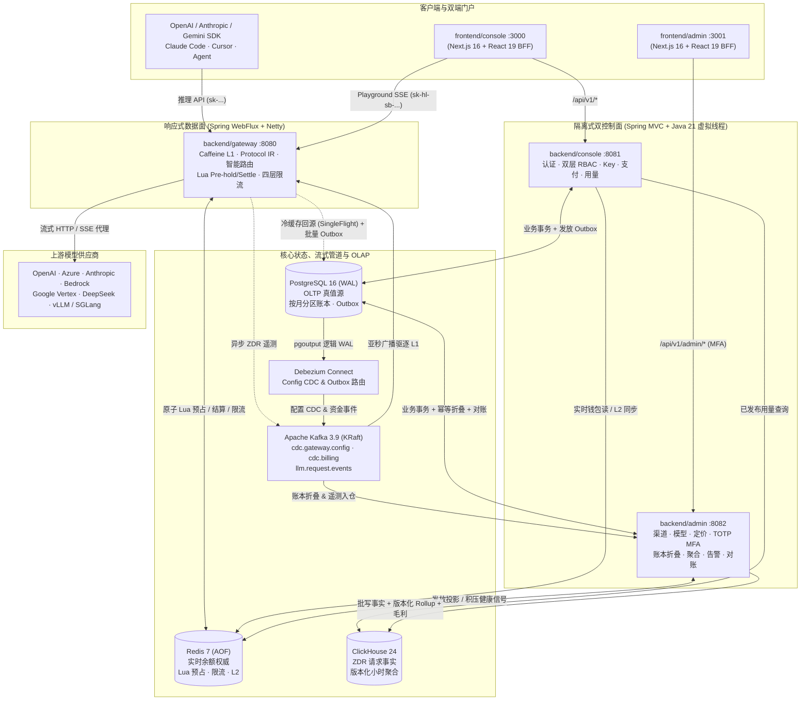

<div align="center">

# ⚡ HyperLLM

**企业级商业化多租户 LLM API 网关、智能路由与实时计费 MaaS 平台**

<p>
  <a href="./README.md">English</a> ·
  <a href="./README_zh-CN.md"><strong>简体中文</strong></a>
</p>

<p>
  
  
  
  
  
  
  
  
  <a href="./LICENSE"></a>
</p>

<p>
  <a href="#为什么选择-hyperllm">核心定位</a> ·
  <a href="#核心能力">核心能力</a> ·
  <a href="#多协议支持矩阵">协议矩阵</a> ·
  <a href="#总体系统架构">系统架构</a> ·
  <a href="#快速开始">快速开始</a> ·
  <a href="#开箱即用的-sdk-调用示例">SDK 示例</a> ·
  <a href="#文档导航">文档导航</a>
</p>

</div>

---

## 为什么选择 HyperLLM？

市面上大多数 LLM 转发代理只解决了“把请求转出去”，一旦进入真实商业化运营便会暴露致命短板：高并发流式调用瞬间把预付费钱包打穿、浮点计费导致财务对账永久差几分钱、跨上游渠道漂移毁掉 Prompt Cache 命中率、运营后台与开发者门户混在一起放大安全风险。

**HyperLLM**（`app.pagefault.hyperllm`）从第一行代码起就面向**商业化 MaaS（Model-as-a-Service）平台**而设计：以亚 15ms 附加延迟的 **WebFlux / Netty** 响应式数据面为入口，以 **Redis Lua 权威预占/流式结算 + Outbox/Debezium CDC 幂等账本** 为金融级资金内核，结合 **ClickHouse 实时毛利 OLAP** 与 **物理隔离的开发者门户 & 运营管理后台**，开箱支撑大规模对外商业化运营。

---

## 核心能力

### 🔀 多协议原生兼容与 `Canonical IR` 双向转译
- **主流协议一站兼容**：完整承接 **OpenAI**（Chat、Responses、Embeddings、Images、Audio TTS/STT）、**Anthropic 原生 Messages**（Extended Thinking、Tool Use、Prompt Caching、`count_tokens` —— 原生支持 Claude Code、Cursor、Cline）、**Google Gemini** 与 **Cohere/Jina Rerank**。
- **同构零损耗透传**：客户端与上游协议一致时直接流式透传字节，自动按需注入并无痕剥离 OpenAI `stream_options.include_usage` 以捕获权威 Usage，并在非标上游或流中断时由内置 `jtokkit` 估算兜底。
- **异构高保真转译**：经由统一 `Canonical IR` 管道，将 OpenAI 请求路由至 Anthropic/Gemini，或将 Claude Code / Anthropic 请求无缝转译至 OpenAI、DeepSeek 及自建 vLLM/SGLang 集群。

### 🎯 智能多策略路由、容灾重试与 Prompt Cache 粘性亲和
- **多策略组合调度**：支持 **分级优先级 + 权重轮询（Priority-Weighted）**、**采购成本最优（Lowest-Cost 毛利最大化）** 与基于近 1 分钟实时 **EWMA P90 TTFT 延迟感知** 路由，横跨 OpenAI、Azure、Anthropic、AWS Bedrock、Google Vertex、DeepSeek 与自建推理集群。
- **Prompt Cache Sticky Session**：对含缓存标记或长上下文前缀的请求按 `org_id + virtual_model + prefix_tokens` 建立 5 分钟滑动粘性亲和，让多轮 Agent 对话持续命中同一上游 KV Cache，大幅降低输入成本与首字延迟。
- **首字节前无感故障重试与熔断**：在向客户端输出首字节前遇到 `429`/`5xx`/超时或通道满载，瞬时切换同级/降级备用渠道重试，客户端完全无感；配合渠道自身容量保护与三态分布式熔断器（`CLOSED` → `OPEN` → `HALF_OPEN`）。

### 💰 商业化计费引擎、并发防超支与全自动对账
- **全链路整型 `micro-USD` 精度**：统一以 64 位有符号整型微美元（`1 USD = 1,000,000 micro-USD`）与确定性向上取整（Ceiling）记账，彻底杜绝浮点误差。
- **多维版本化定价体系**：支持按生效时间窗发布的输入/输出/缓存命中读/缓存创建写/推理思考链 Token 单价、阶梯上下文分段定价（如 `<=128k` vs `>128k`）、图片/音频/按次多模态定价、客户分组折扣与企业大客户单模型协议价覆盖。
- **确定性三顺位抵扣链**：每笔调用严格按以下顺序分摊扣减：
  1. **定向模型资源包**（按 Token 或调用次数，按最早到期优先）
  2. **代金券 / 赠金批次**（按适用范围与最早到期优先）
  3. **现金预付费钱包余额**
- **Redis 权威层 Pre-hold / Settle**：准入时按逐批次原子冻结最大预估费用，流式传输中通过心跳续期滑动 TTL 与租约，结束时按实测用量多退少补；节点宕机自动回收僵尸预占，并内置消费积压门禁（`503 LEDGER_BACKLOG` / `OUTBOX_UNAVAILABLE`）严守资金安全边界。
- **完整商业变现与财务闭环**：支持 **Stripe（USD）**、**支付宝（CNY）**、**微信支付（CNY）** 下单锁定汇率与验签回调、批量兑换码核销、按月分区不可变 `wallet_ledger`、自动化账务对账巡检、运营四眼审批人工调账、月度对账单与双轨开票。

### 🛡️ 企业级多租户、纵深安全与默认零数据留存（ZDR）
- **多租户层级与双层 RBAC**：`Organization -> Project -> API Key` 清晰隔离；组织内区分 `Owner / Admin / Developer / Billing` 四角色，项目级成员授权、IP CIDR 白名单、模型白名单与单 Key 消费限额一应俱全。
- **企业身份认证与隔离式运营域**：开发者控制台支持邮箱 OTP、GitHub/Google OAuth 与企业 OIDC/SAML SSO；运营后台物理独立部署，强制隔离 HS256 JWT 密钥/Cookie、**TOTP MFA 双因素认证** 与内网 CIDR 准入。
- **纵深密钥保护**：客户 `sk-...` API Key 仅存加盐 `HMAC-SHA256` 摘要（支持主副双 Pepper 零停机轮换）；上游厂商密钥采用 `AES-256-GCM` 绑定 `channel_id` AAD 加密，密文穿透 PostgreSQL → Debezium → Kafka → Redis → Caffeine，仅在发出上游 HTTP 请求前于网关内存中瞬时解密。
- **四层分布式限流与项目月预算**：覆盖 API Key、Project、Organization、Upstream Channel 四层滑动窗口 RPM/TPM/并发限流，支持 Project 月度软上限告警与硬上限准入熔断。
- **默认 ZDR 与插拔式内容风控**：默认绝不在数据库或 ClickHouse 落盘任何 Prompt/Completion 正文；支持按非生产项目显式开启加密调试日志（独立 ClickHouse 表 1–7 天 TTL 自动物理销毁）；内置 `GuardrailProvider` SPI 扩展 AC 自动机敏感词、PII 隐私脱敏与 Prompt Injection 拦截。

### 📊 实时 OLAP 经营大盘、告警中心与双端 Next.js 16 应用
- **ClickHouse 版本化去重报表**：采用脏小时队列 + 版本化原子发布，即使 Kafka 发生重复投递也能确保用量、P50/P90/P99 TTFT/端到端延迟、上游采购成本与平台**实时毛利率**绝对准确。
- **主动告警与全链路可观测**：低余额与项目软/硬预算超限告警经由防 SSRF 的 HMAC 签名 HTTPS Webhook 与 SMTP 邮件投递；全后端原生集成 OpenTelemetry 链路追踪、Prometheus 指标与 Grafana 业务大盘。
- **双独立现代化前端应用**：
  - **开发者门户与控制台（`frontend/console :3000`）**：公网着陆页、模型广场与价格表、流式多模型对比 Playground、组织/项目/API Key 管理、用量仪表盘、在线充值与告警规则配置。
  - **平台运营管理后台（`frontend/admin :3001`）**：加密上游渠道池与实时连通性探针、虚拟模型路由编排与版本定价发布、租户实时钱包审视、商品 SKU 与兑换码运营、毛利大盘、支付异常与账务对账中心。

---

## 多协议支持矩阵

| 对外协议族 | 核心端点 | 支持能力要点 | 跨协议转译 |
| :--- | :--- | :--- | :--- |
| **OpenAI 兼容族** | `POST /v1/chat/completions`<br>`POST /v1/responses`<br>`POST /v1/embeddings`<br>`POST /v1/images/generations`<br>`POST /v1/audio/speech`<br>`POST /v1/audio/transcriptions` | 流式 SSE（`include_usage`）、Tool Calling、Structured Outputs (`json_schema`)、Vision、Audio | Chat / Responses 可自动转译至 Anthropic、Gemini 与国产/自建模型 |
| **Anthropic 原生族** | `POST /v1/messages`<br>`POST /v1/messages/count_tokens` | 原生 SSE 事件流、Extended Thinking (`thinking`)、Prompt Caching (`cache_control`)、Tool Use | 完美兼容 Claude Code / Cursor / Cline，支持原生直连或转译至 OpenAI / DeepSeek |
| **Google Gemini 原生族** | `POST /v1beta/models/{model}:generateContent`<br>`POST /v1beta/models/{model}:streamGenerateContent` | Function Calling、System Instruction、多模态 Part、Thinking Budget | 直连 AI Studio / Vertex AI，或反向转译至 OpenAI / Anthropic |
| **模型目录与重排** | `GET /v1/models`<br>`POST /v1/rerank` | 动态返回当前 Project 授权可见模型及上下文元数据；兼容 Cohere / Jina / BGE Rerank | 统一聚合多厂商模型目录 |

---

## 总体系统架构



---

## 快速开始

### 1. 初始化环境变量与核心基础设施

```bash
# 复制本地环境变量模板（生产部署前务必替换所有密钥！）
cp .env.example .env

# 启动核心底座（PostgreSQL 16 逻辑复制、Redis 7 AOF、Kafka 3.9 KRaft）与调试工具
docker compose --env-file .env -f infra/docker-compose.yaml --profile tools up -d
```

### 2. 启动后端服务（Java 21 LTS）

```bash
# 全模块编译并运行纯单元测试（无需 Docker）
./backend/mvnw -f backend/pom.xml test

# 先启动 Console (:8081) 自动执行 Flyway V1–V8 建表迁移
HYPERLLM_OTP_DEBUG_ECHO=true ./backend/mvnw -f backend/pom.xml -pl console spring-boot:run

# Flyway 建表完成后，拉起 Debezium CDC + ClickHouse 管道
docker compose --env-file .env -f infra/docker-compose.yaml --profile pipeline up -d

# 在另外两个终端分别启动 Admin (:8082) 与 Gateway (:8080)
HYPERLLM_ADMIN_MFA_REQUIRED=false ./backend/mvnw -f backend/pom.xml -pl admin spring-boot:run
./backend/mvnw -f backend/pom.xml -pl gateway spring-boot:run
```

> **可选可观测性栈**：追加 `--profile observability` 即可拉起 OTel Collector（`:4317/:4318`）、Prometheus（`:9090`）与 Grafana（`:3100`）。

### 3. 启动双端前端应用（Next.js 16 + pnpm 12）

```bash
# 开发者门户与控制台 -> http://localhost:3000
cd frontend/console && pnpm install && pnpm dev

# 平台运营管理后台 -> http://localhost:3001
cd frontend/admin && pnpm install && pnpm dev
```

### 4. 全链路自动化验证

```bash
# 全量构建 + Testcontainers 容器集成测试（PostgreSQL、Redis、Kafka、ClickHouse、WireMock）
./backend/mvnw -f backend/pom.xml verify

# 活栈端到端商业化全链路冒烟测试
bash scripts/e2e/phase2-smoke.sh
```

---

## 开箱即用的 SDK 调用示例

### OpenAI Python SDK

```python
from openai import OpenAI

client = OpenAI(
    base_url="http://localhost:8080/v1",
    api_key="sk-your-hyperllm-api-key",
)

stream = client.chat.completions.create(
    model="gpt-4o-mini",
    messages=[{"role": "user", "content": "用两句话解释 Pre-hold 预占如何防止并发超支。"}],
    stream=True,
)
for chunk in stream:
    if chunk.choices and chunk.choices[0].delta.content:
        print(chunk.choices[0].delta.content, end="", flush=True)
```

### Anthropic 原生 SDK / Claude Code

```bash
# 直接将 Claude Code 或 Anthropic SDK 指向 HyperLLM 网关
export ANTHROPIC_BASE_URL="http://localhost:8080"
export ANTHROPIC_API_KEY="sk-your-hyperllm-api-key"

curl http://localhost:8080/v1/messages \
  -H "x-api-key: $ANTHROPIC_API_KEY" \
  -H "anthropic-version: 2023-06-01" \
  -H "content-type: application/json" \
  -d '{
    "model": "claude-sonnet-4-5",
    "max_tokens": 512,
    "messages": [{"role": "user", "content": "你好，HyperLLM！"}]
  }'
```

---

## 工程模块结构

| 模块 | 默认端口 | 技术栈与职责 |
| :--- | :---: | :--- |
| `backend/common` | — | `micro-USD` 整型计算、`UuidV7`、`AesGcmCipher`、`HmacSha256`、`ApiKeyGenerator`、`ErrorCode`、跨服务 Kafka/Redis 契约与 12 个原子 Lua 脚本 |
| `backend/domain` | — | Flyway `V1`–`V8` 迁移脚本、按月分区账本/审计表、`-Pjooq` 生成 SQL 层、35 组 jOOQ 仓储、`PricingResolver` 与 `EntitlementAllocator` |
| `backend/protocol` | — | `Canonical IR`、OpenAI/Anthropic 协议适配、流式 SSE Usage 提取、`jtokkit` 估算兜底、原生协议错误格式化 |
| `backend/gateway` | `8080` | WebFlux 响应式数据面（Caffeine L1 + Redis L2）、Debezium 广播 L1 失效、多策略路由、Lua Pre-hold/Settle、四层限流与批量 Outbox |
| `backend/console` | `8081` | 开发者控制面（MVC + 虚拟线程）、双层 RBAC、API Key、实时钱包、Stripe/支付宝/微信支付、兑换码核销、ClickHouse 用量、告警与 OpenAPI 3.1 |
| `backend/admin` | `8082` | 运营控制面（MVC + 虚拟线程）、TOTP MFA、加密渠道池与探针、虚拟模型与定价编排、毛利分析、账本消费折叠、小时聚合、告警投递与自动对账 |
| `frontend/console` | `3000` | Next.js 16 + React 19 + Tailwind CSS v4 开发者门户、模型广场、流式 Playground、账务与用量仪表盘 |
| `frontend/admin` | `3001` | Next.js 16 + React 19 + Tailwind CSS v4 独立运营后台，涵盖渠道/模型/商品运营、毛利大盘与账务对账中心 |
| `infra/` | — | 分层 Docker Compose 编排、PG 逻辑复制脚本、Kafka Topic 初始化、Debezium Connector、ClickHouse DDL、OTel/Prometheus 与 WireMock 桩 |

---

## 文档导航

### 🚀 新手接管手册与 OpenAPI 3.1 契约（推荐首先阅读）
- **[新手接管实战手册（8 课循序渐进）](./docs/onboarding/README.md)** — 从零环境搭建、工程红线、存储全景、Gateway 请求链路、Redis 权威层与 12 个 Lua 脚本，到双控制面、前端 BFF 与排障 Runbook
- **[OpenAPI 3.1 接口契约文档](./docs/openapi/README.md)** — 可直接导入 Swagger UI / Postman / `openapi-typescript` 的标准规范：
  - [Gateway 数据面 API（`gateway-api.yaml`）](./docs/openapi/gateway-api.yaml)
  - [Console 开发者控制面 API（`console-api.yaml`）](./docs/openapi/console-api.yaml)
  - [Admin 运营控制面 API（`admin-api.yaml`）](./docs/openapi/admin-api.yaml)

### 📐 原始架构蓝图与深度设计稿
- [系统规划蓝图（PROPOSAL）](./docs/PROPOSAL.md) · [分阶段实施 TODO 清单](./docs/TODO.md)
- [数据库实体详细设计](./docs/design/01-database-design.md)
- [工程依赖与基础设施编排设计](./docs/design/02-dependencies-and-infra.md)
- [后端认证、REST API 与 Gateway 运行契约](./docs/design/03-phase1-backend-contracts.md)
- [阶段二商业化计费与 Redis 权威层最终方案](./docs/design/04-phase2-design.md)
- [前端开发与视觉设计规范](./docs/FRONTEND_DESIGN_SPEC.md)
- [端到端活栈冒烟脚本说明](./scripts/e2e/README.md)

---

## 参与贡献与开源协议

欢迎提交 Issue 与 Pull Request！开发前请先阅读 [CONTRIBUTING.md](./CONTRIBUTING.md) 与 [AGENTS.md](./AGENTS.md)。

本项目基于 **[Apache License 2.0](./LICENSE)** 协议开源。
