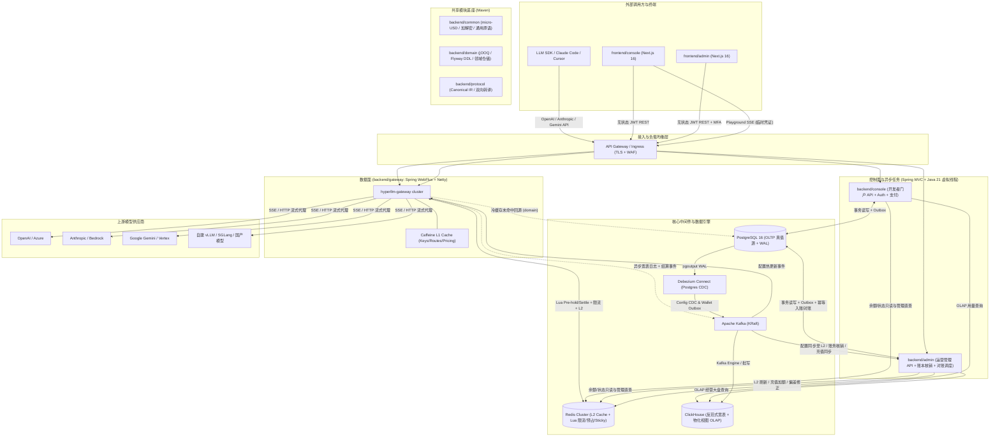
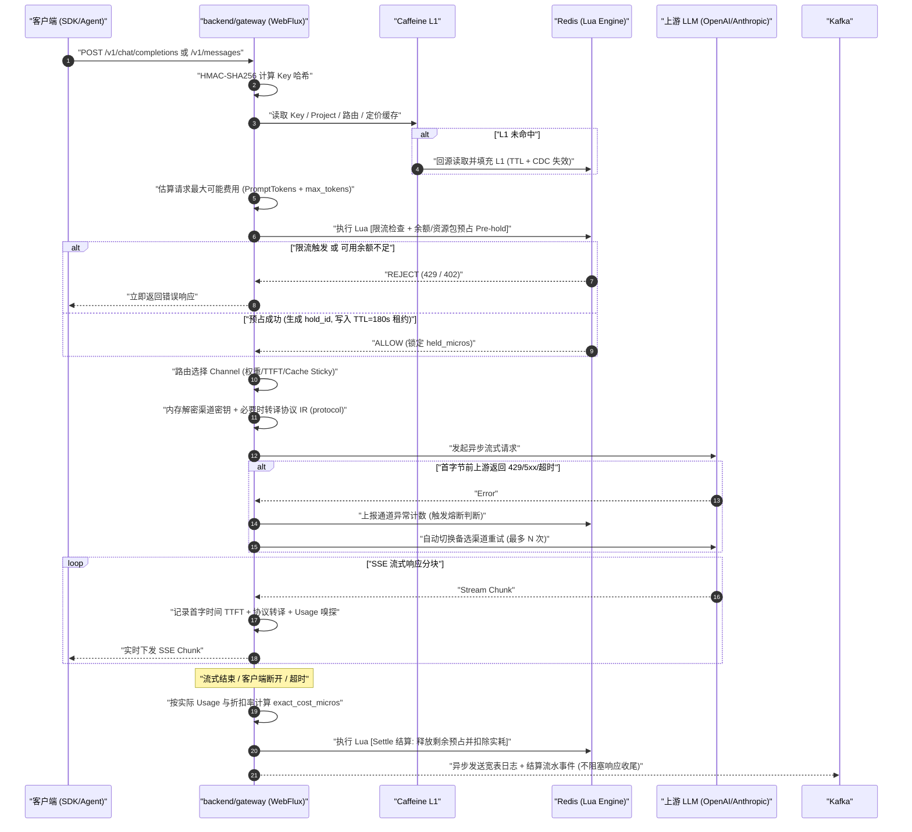

# HyperLLM — 企业级商业化 LLM API 网关（MaaS 平台）规划蓝图

> 本文档基于需求对齐结果与当前仓库实际结构编制，完整覆盖 **1. 功能与业务规划** 与 **2. 架构与实现设计**，作为 **HyperLLM**（`app.pagefault.hyperllm`，Apache-2.0）大仓后续详细设计、数据库建模与分阶段编码的基准蓝图。

> **当前工程基线提示**：仓库目前处于 **Phase 0 脚手架初始化完成、Phase 1 详细设计就绪** 阶段——已建立 `backend/`（Java 21 LTS + Maven Wrapper 6 模块骨架）、`frontend/console` 与 `frontend/admin`（双独立 Next.js 16.4.6 + React 19.3.0 + Tailwind CSS 4.3.3 初始工程）、`infra/` 目录框架与 `docker-compose.yaml` 占位文件及 Apache-2.0 `LICENSE`。**当前研发策略为后端与基础设施先行，暂不实现前端页面开发**（前端选型与页面交付顺延至后端服务及 OpenAPI 契约稳定后另行启动；全阶段执行清单见 [TODO.md](./TODO.md)）。

---

## 0. 已对齐核心决策矩阵

| 维度 | 最终决策 | 关键约束与影响 |
| :--- | :--- | :--- |
| **商业定位** | 对外商业化 SaaS / MaaS API 平台 | 自助注册、预付费充值、按量实时扣费、欠费熔断 |
| **租户层级** | `Organization -> Project -> API Key` | 个人注册自动建默认空间；Org 统一钱包结算，Project 预算隔离与成员 RBAC |
| **计费体系** | 预付费钱包 + 多维定价 + 代金券/资源包 + 分组折扣 | Input/Output/Cached/Reasoning Token 与图片/音视频按次计价；抵扣优先序清晰 |
| **扣费一致性** | Redis Lua 原子预占（Pre-hold）+ 流式结算（Settle） | 入口按估算上限冻结，流式结束按实测 Token 多退少补，Kafka 异步写 Postgres 账本 |
| **市场与支付** | 全球/双语市场，基准币种 `micro-USD`（`10^-6 USD`） | 邮箱 + GitHub/Google OAuth + 企业 SSO；支付抽象支持 Stripe、支付宝/微信、兑换码 |
| **协议范围** | 多原生协议兼容 + 双向协议转换 | OpenAI / Anthropic Messages（含 Thinking & Cache）/ Gemini / Rerank / 多模态 |
| **路由策略** | 多策略智能路由 + 熔断降级 + Prompt Cache 亲和 | 优先级、权重、最低成本、实时 TTFT 调权；429/5xx 自动重试；Sticky Session |
| **隐私与合规** | 默认 ZDR（零正文留存）+ 按需调试日志 + 风控 SPI | ClickHouse 默认仅落盘元数据；支持项目级短期加密调试日志与插拔式 Guardrails |
| **后端架构** | Java 21 LTS + Maven 六模块分离（`app.pagefault.hyperllm`） | `common`/`domain`/`protocol` 为共享底座；数据面 `gateway`（WebFlux Netty）；控制面拆分为 `console` 与 `admin`（Spring MVC + Java 21 虚拟线程），异步核销/对账任务暂由 `admin` 承载（可按需独立进程/拆分 `worker`） |
| **数据管道** | Debezium CDC + Kafka + Redis + ClickHouse | Debezium 专职配置热同步与账务 Outbox；`gateway` 发射反范式宽表事件入 ClickHouse |
| **前端工程** | 双独立 Next.js 16 + React 19 应用（`pnpm@12.21.0`） | `frontend/console`（开发者门户/控制台）与 `frontend/admin`（独立运营后台），均启用 Tailwind CSS v4、Turbopack、`cacheComponents` 与 `partialPrefetching` |
| **安全与鉴权** | 双域无状态 JWT + 分层密钥保护 | `frontend/console` 直连 `backend/console`，`frontend/admin` 直连 `backend/admin`（强制 MFA/内网准入）；客户 `sk-hl-` Key 不可逆 HMAC-SHA256 哈希；上游密钥 AES-256-GCM 密文穿透链路 |

---

## 1. 功能与业务规划

### 1.1 多租户与 RBAC 权限体系

#### 1.1.1 租户实体模型
- **User（用户账号）**：自然人身份载体，支持邮箱验证码、GitHub/Google OAuth、企业 OIDC/SAML 绑定。一个 User 可属于多个 Organization。
- **Organization（组织/工作空间）**：**财务与账单的最高边界**。
  - 新用户注册自动创建名为 `Personal Workspace` 的默认 Organization。
  - 持有唯一钱包（Wallet）、资源包（Resource Packs）、代金券（Vouchers）、客户折扣等级（Tier/Group）与月度/全局限额配置。
- **Project（项目/环境）**：**资源、配置与预算隔离单元**（如 `prod-chatbot`、`staging-agent`）。
  - 可设置独立的 **月度预算上限（Monthly Hard/Soft Cap）**、**模型白名单（Allowed Models）**、**并发/RPM/TPM 限流阈值**及 **ZDR 调试日志开关**。
- **API Key（访问凭证）**：隶属于某个 Project，前缀标识如 `sk-hl-...`。
  - 支持配置有效期、IP 白名单、单 Key 累计消费限额（Quota Limit）、单 Key 速率上限（RPM/TPM）及授权模型子集。

#### 1.1.2 组织内 RBAC 角色矩阵

| 权限项 | Owner（所有者） | Admin（管理员） | Developer（开发者） | Billing（财务） |
| :--- | :---: | :---: | :---: | :---: |
| 解散组织 / 转让 Owner | ✅ | ❌ | ❌ | ❌ |
| 成员邀请、角色变更、移除 | ✅ | ✅（不可改 Owner） | ❌ | ❌ |
| 充值、绑卡、购买资源包、开票 | ✅ | ❌ | ❌ | ✅ |
| 查看用量报表与费用账单明细 | ✅ | ✅ | 仅所属 Project | ✅ |
| 创建/管理 Project 与预算上限 | ✅ | ✅ | ❌ | ❌ |
| 签发/吊销 Project 下 API Key | ✅ | ✅ | ✅ | ❌ |
| 修改 Project 调试日志（Opt-in） | ✅ | ✅ | ❌ | ❌ |
| 使用在线 Playground 调试 | ✅ | ✅ | ✅ | ❌ |

---

### 1.2 计费体系、多维定价与账本逻辑

#### 1.2.1 记账精度与多币种展示
- **内部统一单位**：采用 **微美元（`micro-USD`，`1 USD = 1,000,000 micro-USD`）**，所有数据库金额与 Redis 计数器全部使用 64 位有符号整型（`BIGINT`），彻底杜绝浮点精度误差。
- **充值汇率转换**：支持美元（Stripe）与人民币（支付宝/微信支付）充值。支付下单时锁定实时/固定平台汇率，入账瞬间换算为 `micro-USD` 计入钱包，并保留原始支付币种、金额与汇率快照用于财务对账与开具发票/收据。

#### 1.2.2 多维定价模型（Pricing Rules）
每个虚拟模型（Virtual Model）可配置独立、带生效时间版本（`effective_from`）的定价规则：
1. **文本与推理类（按每百万 Token 定价）**：
   - `input_price_per_1m`：常规输入 Token 单价
   - `output_price_per_1m`：常规输出 Token 单价
   - `cached_input_read_price_per_1m`：提示词缓存命中读取单价（如 Anthropic / OpenAI / DeepSeek Cache Hit）
   - `cached_input_write_price_per_1m`：提示词缓存创建写入单价（如 Anthropic 5m/1h Cache Write）
   - `reasoning_output_price_per_1m`：思考链 Token 单价（兼容单独计价的推理模型）
   - **阶梯上下文定价（Tiered Context Pricing）**：支持配置分段条件（如输入 `<= 128k` vs `> 128k` 使用不同倍率/单价）。
2. **多模态类**：
   - **图像生成/编辑**：按分辨率（如 `1024x1024` / `1792x1024`）与质量档位（Standard/HD）**按次/按张**计价。
   - **语音（TTS / STT）**：TTS 按字符数（每百万字符），STT 按音频时长（每分钟/每秒）或 Token 计价。
   - **向量与重排（Embedding / Rerank）**：按输入 Token 或文档条数计价。
3. **组织折扣与定价覆盖**：
   - 平台支持设置客户分组倍率（如 Standard `1.0x`、VIP `0.95x`、Enterprise 专属协议价），最终扣费公式：
     $$\text{FinalCost} = \lceil \text{RawModelCost} \times \text{OrgModelDiscountRatio} \rceil$$

#### 1.2.3 余额、代金券与资源包扣费优先序
为支撑丰富的商业化运营（拉新赠金、活动满减、大客户包量折扣），扣费按如下**确定性优先级链**执行：
1. **第一顺位：定向模型资源包（Model Token/Call Packs）** — 若该模型在 Org 持有未过期且有余量的定向资源包（按过期时间 `expires_at` 最早优先），优先扣减包内余量。
2. **第二顺位：代金券 / 赠金（Promotional Vouchers / Bonus Balance）** — 若命中适用范围且在有效期内，优先消耗赠金账户（注：赠金不可提现、不可开具增值税发票）。
3. **第三顺位：现金预付费余额（Cash Wallet Balance）** — 扣减用户真实充值金额；若可用现金 + 可用赠金均不足且无可用资源包，触发 `402 Payment Required` / `insufficient_quota` 熔断。

> **欠费熔断与低余额告警**：支持用户配置「低余额阈值 Webhook / 邮件告警」；当可用余额归零时，Redis 立即拦截新请求，已在进行中的长流允许安全收尾或触及硬熔断阈值时截断。

---

### 1.3 协议矩阵与双向转译能力

网关对外提供版本稳定的标准化 API 端点，内部通过 **Canonical LLM IR（统一规范中间表示）** 解耦入口协议与上游协议：

| 对外暴露协议族 | 核心端点 | 支持能力要点 | 跨协议转译支持 |
| :--- | :--- | :--- | :--- |
| **OpenAI 兼容族** | `/v1/chat/completions`<br>`/v1/responses`<br>`/v1/embeddings`<br>`/v1/images/generations`<br>`/v1/audio/speech`<br>`/v1/audio/transcriptions` | 流式 SSE（含 `stream_options.include_usage`）、Tool Calling、Structured Outputs (`json_schema`)、Vision 多图、Audio 输入输出 | Chat / Responses 可自动转译至 Anthropic / Gemini / 国产大模型后端 |
| **Anthropic 原生族** | `/v1/messages`<br>`/v1/messages/count_tokens` | 原生 SSE 事件流（`message_start`, `content_block_delta`, `message_delta`）、Extended Thinking (`thinking` blocks)、Prompt Caching (`cache_control`)、Tool Use | 完美承接 Claude Code / Cursor / Cline 请求，既可透传直连 Anthropic/Bedrock/Vertex，也可转译至 OpenAI/DeepSeek 等模型 |
| **Google Gemini 原生族** | `/v1beta/models/{model}:generateContent`<br>`/v1beta/models/{model}:streamGenerateContent` | Function Calling、System Instruction、多模态 Part、Thinking Budget | 可直连 AI Studio / Vertex AI，或反向转译至 OpenAI/Anthropic 渠道 |
| **检索与模型目录** | `/v1/rerank`<br>`/v1/models` | 兼容 Cohere / Jina / BGE Rerank 协议；`/v1/models` 动态返回当前 Project 授权可见且定价透明的虚拟模型清单 | 统一聚合多厂商模型列表与上下文窗口元数据 |

**协议转译原则**：
- **同构透传优先（Zero-Overhead Passthrough）**：当客户端协议与选定上游渠道协议一致时（如 `/v1/messages` -> Anthropic 直连），仅做头信息校验、密钥替换、Usage 窃听提取与流式字节透传，避免不必要 JSON 反序列化与重序列化开销。
- **异构高保真转译**：协议不一致时，经过 `Inbound Adapter -> Canonical IR -> Outbound Adapter` 管道转换消息角色、`tool_calls`、思考链字段及 SSE 分块事件状态机。

---

### 1.4 智能路由、容灾降级与 Prompt Cache 亲和

#### 1.4.1 核心概念解耦
- **Virtual Model（虚拟模型）**：对外暴露给客户的模型 ID（如 `claude-sonnet-4-5`、`gpt-5`、`deepseek-r1` 或智能聚合别名 `coding-auto`）。
- **Upstream Channel（上游渠道）**：具体的供应商账号/部署实例（如 `Anthropic-Direct-Key1`、`AWS-Bedrock-us-east-1`、`Azure-EastUS2-PoolA`、`SelfHost-vLLM-H100`），附带真实上游模型映射名（`upstream_model_id`）、成本价（用于计算平台毛利）、区域标签与上游自身 RPM/TPM 保护阈值。

#### 1.4.2 多策略路由调度器
同一个 Virtual Model 可绑定多个分级渠道池（Tier 1 主力池 -> Tier 2 备援池 -> Tier 3 兜底池），同池内支持以下组合路由策略：
1. **Priority + Weighted（优先级分组 + 权重轮询）**：优先在最高优先级可用池内按权重分配流量。
2. **Lowest Cost（成本最优）**：在满足 SLA 健康度的渠道中优先选择平台采购单价最低的渠道，最大化毛利率。
3. **Latency / TTFT-Aware（动态延迟感知）**：基于 Redis 滑动窗口内近 1 分钟各渠道的 **P90 TTFT（首字延迟）** 与成功率动态调整路由权重（EWMA 指数加权移动平均）。
4. **Prompt Cache Sticky Session（缓存粘性亲和）**：
   - 当请求包含明确缓存标记（如 Anthropic `cache_control`）或超长 System Prompt / 前缀（超过阈值 Token 数）时，提取 `hash(org_id + virtual_model + prefix_tokens)` 作为粘性键。
   - 路由器优先将后续连续对话/Agent 多轮工具调用路由至 Redis 记录的同一上游 Channel（TTL 默认 5 分钟，每次命中续期），确保上游 KV Cache 命中率，避免每次跨渠道漂移导致重复全额计费与首字变慢。

#### 1.4.3 熔断与安全重试机制
- **首字节前无感重试（Pre-First-Byte Retry）**：向某上游发出请求后，若在**未向客户端发送任何有效正文分块之前**遇到网络超时、连接拒绝、`429 Too Many Requests` 或 `5xx` 异常，立即将该渠道标记为临时冷却并瞬时切换至同级/降级备用渠道重试（可配最大重试次数如 2 次），客户端完全无感。
- **流式中断处理**：一旦已开始向客户端输出 SSE Chunk，不可跨渠道无缝重试，此时关闭流并按已生成输出估算/取实际 Usage 进行精准结算。
- **分布式熔断器**：每个 Channel 维护错误率与连续 429 计数（Closed -> Open 熔断隔离 30s~60s -> Half-Open 探针放行）。

---

### 1.5 限流配额、数据隐私（ZDR）与内容合规

#### 1.5.1 四层分布式限流（Redis Lua）
1. **API Key 级**：RPM、TPM、最大并发数（Max In-Flight）。
2. **Project 级**：项目总 RPM/TPM 与月度美元预算硬/软上限。
3. **Organization 级**：租户级并发池保护（防止单一客户突发流量打垮整个网关）。
4. **Upstream Channel 级**：保护上游账号自身的 Tier 限速（如某官方账号限 4,000 RPM），接近阈值时路由器主动分流至其他健康渠道而非触发 429。

#### 1.5.2 默认 ZDR（零数据留存）与调试模式
- **默认生产策略（ZDR）**：请求与响应 Body 仅在 `backend/gateway`（`hyperllm-gateway`）堆外/堆内内存流转，请求完成后立即释放。发送给 Kafka 与 ClickHouse 的仅包含结构化元数据与计量指标，**绝不落盘任何 Prompt 或 Completion 文本**。
- **可选调试模式（Opt-in Debug Logging）**：允许拥有 Admin/Owner 权限的租户针对特定非生产 Project（或显式开启调试）记录加密后的请求/响应样本（设定强制 TTL 如 3~7 天到期自动物理删除），用于 Playground 排查与 Bad Case 分析。

#### 1.5.3 插拔式内容风控（Guardrails SPI）
网关内置 `GuardrailProvider` 扩展接口，按 Project/国家区域策略按需启用：
- **Pre-Request Hook（同步/低延迟拦截）**：本地高性能 AC 自动机（DFA）敏感词过滤、PII 个人隐私信息（身份证/银行卡/手机号）掩码脱敏、Prompt Injection 规则拦截，或调用外部安全审核服务。
- **Stream Chunk / Post-Response Hook**：流式滑动窗口合规校验，命中高危策略时立即终止流并按策略返回安全替换提示。

---

### 1.6 双端应用功能清单（Next.js 16 + React 19）

#### 1.6.1 开发者门户与控制台（`frontend/console`，`hyperllm-console`）
- **公网门户与模型广场**：中英双语切换、模型目录与实时定价对比表（含价格计算器）、平台状态页（各模型实时可用率与 TTFT 基准）、交互式 API 文档（支持 OpenAI/Anthropic/Gemini/Python/TS/cURL 一键复制）。
- **认证与引导**：邮箱验证码登录、GitHub/Google OAuth、企业 SSO 入口、新用户注册欢迎引导与赠金领取。
- **工作空间与权限**：Org 创建/切换、成员邀请与 RBAC 角色管理、Project 创建与预算/模型白名单配置。
- **API Key 管理**：创建/启用/禁用/吊销 Key、单 Key 限额与到期时间配置、创建瞬间一次性展示明文弹窗。
- **多模态 Playground**：内置对话与 Agent 测试沙盒，支持流式输出实时展示 TTFT/TPOT/Token 消耗/预估费用、同屏多模型对比（Arena 视图）、调试日志回放（仅对开启 Opt-in 的 Project 生效）。
- **用量仪表盘与账务中心**：基于 ClickHouse 的毫秒级图表（按模型/Project/Key 维度的 Token、请求量、错误率、P50/P95/P99 TTFT）、在线充值（Stripe / 支付宝 / 微信 / 兑换码）、资源包购买、钱包流水与月度 PDF 账单/收据下载。

#### 1.6.2 平台运营后台（`frontend/admin`，`hyperllm-admin`，独立内网/VPN域名）
- **上游渠道与密钥池管理**：渠道 CRUD、API Key 加密录入与连通性探测、上游余额监控与自动禁用告警、健康状态与熔断手动恢复。
- **虚拟模型与路由编排**：虚拟模型目录管理、渠道绑定与优先级/权重/成本/TTFT 路由策略可视化配置、协议转译开关与模型别名下线映射。
- **定价与营销引擎**：模型多维单价版本发布（支持定时生效）、客户分组（VIP/大客户）折扣率配置、代金券/兑换码批量生成与模型资源包上架。
- **经营与毛利大盘**：平台总营收、上游采购总成本、实时毛利率（Gross Margin）、各模型/大客户消耗排行、429/5xx 故障热力图。
- **财务对账与风控中心**：人工调账（需二次审批与操作审计日志）、Redis 与 Postgres 账本对账差异巡检面板、敏感词库与 Guardrails 规则配置。

---

## 2. 架构与实现规划

### 2.1 总体系统架构图



---

### 2.2 统一大仓（Monorepo）目录骨架

```text
HyperLLM/
├── AGENTS.md / CLAUDE.md                 # AI 协作规范（当前为空占位，待补充）
├── CONTRIBUTING.md                       # 贡献指南（当前为空占位，待补充）
├── LICENSE                               # Apache License 2.0
├── README.md / README_zh-CN.md           # 中英文项目说明（当前为占位标题，待完善）
├── backend/                              # Java 21 LTS + Maven 六模块工程（groupId: app.pagefault.hyperllm）
│   ├── mvnw / mvnw.cmd / .mvn/           # Maven Wrapper 3.3.4 (Apache Maven 3.9.16)
│   ├── pom.xml                           # 父 POM（已声明 6 模块与 Java 21；[规划] 引入 Spring Boot 3.5.x starter-parent 与依赖锁定）
│   ├── common/                           # hyperllm-common：micro-USD 精度工具、AES/HMAC 加密、通用异常与常量
│   ├── domain/                           # hyperllm-domain：核心领域模型、Flyway DDL（[规划]）、仓储与多租户/计费逻辑
│   ├── protocol/                         # hyperllm-protocol：Canonical LLM IR 与协议解析/双向转译器
│   ├── gateway/                          # hyperllm-gateway：数据面网关（Spring WebFlux + Netty）
│   ├── console/                          # hyperllm-console：开发者门户与控制台后端（Spring MVC + 虚拟线程 + OpenAPI）
│   └── admin/                            # hyperllm-admin：平台运营后台后端（Spring MVC + 虚拟线程 + 异步核销与对账调度）
├── frontend/                             # 双独立 Next.js 16 前端应用（pnpm@12.21.0）
│   ├── console/                          # hyperllm-console：Next.js 16.4.6 + React 19.3.0 + Tailwind CSS 4.3.3
│   │   ├── next.config.ts                # 已开启 cacheComponents、partialPrefetching 与 Turbopack CSS rules
│   │   ├── package.json                  # next 16.4.6 / react 19.3.0 / tailwindcss 4.3.3 / @tailwindcss/turbopack
│   │   ├── pnpm-workspace.yaml           # 构建许可配置（allowBuilds）
│   │   └── src/app/                      # App Router 页面与布局（当前为 create-next-app 初始骨架）
│   └── admin/                            # hyperllm-admin：Next.js 16.4.6 + React 19.3.0 + Tailwind CSS 4.3.3 运营后台
│       ├── next.config.ts                # 已开启 cacheComponents、partialPrefetching 与 Turbopack CSS rules
│       ├── package.json                  # next 16.4.6 / react 19.3.0 / tailwindcss 4.3.3 / @tailwindcss/turbopack
│       ├── pnpm-workspace.yaml           # 构建许可配置（allowBuilds）
│       └── src/app/                      # App Router 页面与布局（当前为 create-next-app 初始骨架）
├── infra/                                # 基础设施编排与运维目录
│   ├── docker-compose.yaml               # 本地全栈中间件编排（当前为 services: 占位，待补全完整定义）
│   ├── debezium/                         # Debezium Postgres Connector 注册 JSON（目录已建，待填充）
│   ├── kafka/                            # Kafka Topic 创建脚本与分区/保留策略（目录已建，待填充）
│   ├── observability/                    # Prometheus + Grafana + OTel Collector 配置（目录已建，待填充）
│   ├── k8s/                              # Helm Charts / HPA / Ingress 模板（目录已建，待填充）
│   └── clickhouse/                       # [规划] ClickHouse 建表与物化视图初始化 SQL
└── docs/
    ├── PROPOSAL.md                       # 本规划蓝图
    ├── TODO.md                           # 全阶段任务实施 TODO 总表
    ├── design/
    │   ├── 01-database-design.md         # 第一阶段（第一部分）详细设计：全领域数据库实体与存储规范
    │   ├── 02-dependencies-and-infra.md  # 第一阶段（第二部分）详细设计：工程依赖矩阵与基础设施编排
    │   └── 03-phase1-backend-contracts.md # 第一阶段（第三部分）详细设计：认证鉴权、Core REST API 与 Gateway MVP 契约
    └── openapi/                          # [规划] backend/console 与 backend/admin 导出的 OpenAPI 3.1 契约文件
```

#### 2.2.1 模块职责边界与当前结构对齐说明
1. **共享层 `common` 与 `domain` 的职责切分**：
   - `backend/common`（`app.pagefault.hyperllm.common`）仅包含无框架强耦合的通用基础能力（`micro-USD` 运算、AES-256-GCM / HMAC-SHA256 工具、基础响应体与错误码）。
   - `backend/domain`（`app.pagefault.hyperllm.domain`）集中维护核心领域模型、jOOQ 生成契约、仓储实现及数据库迁移脚本（Flyway DDL）。`backend/gateway` **直接依赖 `domain`** 复用统一的 API Key / 组织空间 / 余额 / 路由与计费领域能力；高并发下依靠 Caffeine L1 + Redis L2 + Debezium CDC 保证 99.99%+ 请求零阻塞命中缓存，仅在首次请求或冷缓存未命中等极少数情况下切出 Netty EventLoop 回源 Postgres 查询并回填缓存（阻塞影响可忽略）。同时 `gateway` 关闭启动期 Flyway 自动迁移（`spring.flyway.enabled=false`），由控制面统一负责 DDL 演进。
2. **双控制面拆分（`console` vs `admin`）**：
   - 原初期构想将所有管理 API 合并在单一控制面服务中；当前仓库已按安全域与受众清晰拆分为 `backend/console`（面向 `frontend/console` 外部开发者）与 `backend/admin`（面向 `frontend/admin` 内部运营人员），实现认证鉴权域、API 契约与部署边界的彻底隔离。
3. **异步消费与对账任务的宿主安排**：
   - 当前 Maven 多模块中未单独设立 `worker` 子模块；Phase 1–2 期间，Kafka 消费账本入库、Outbox 同步 Redis 与准实时余额对账巡检由 `backend/admin` 内的独立异步调度/消费组件承载（支持通过独立 Spring Profile 单独启动进程而不暴露 HTTP 管理端点）。后续当网关吞吐量增长需要独立水平扩缩容时，再从当前结构中平滑抽离独立的 `backend/worker` 模块。
4. **双独立前端应用现状**：
   - 当前 `frontend/console` 与 `frontend/admin` 各自拥有独立的 `package.json`、`pnpm-lock.yaml` 与 `pnpm-workspace.yaml`，尚未建立 `frontend/` 根级 `packages/ui` 或 `packages/sdk`。现阶段保持双独立应用轻量推进，契约类型可各自独立生成；待页面组件与业务稳定后，再按需演进为统一 `pnpm` Workspace 共享设计系统与 SDK。

---

### 2.3 数据面核心请求链路与流式防超支设计

#### 2.3.1 关键工程约束（缓存优先热路径与冷回源保护）
1. **热路径零阻塞 + 冷缓存 `domain` 回源兜底**：`backend/gateway`（`hyperllm-gateway`）处理万级并发下游请求时，99.99%+ 流量直接命中本地 `Caffeine L1`（毫秒级）或 `Lettuce Reactive Redis L2`，不触达数据库。当遇到首次请求或 L1/L2 冷缓存未命中时，通过独立线程调度器（虚拟线程 / `boundedElastic`）配合进程内 `SingleFlight` 防击穿机制调用 `backend/domain`（jOOQ + JDBC）回源查询 Postgres 并回填缓存，严禁直接在 Netty EventLoop 上执行阻塞 JDBC 调用。
2. **上游连接池隔离**：基于 Reactor Netty `HttpClient` 为不同上游 Provider/Region 配置隔离的 `ConnectionProvider`（长连接复用、DNS 异步解析、合理空闲淘汰时间），并透传背压（Backpressure）防止客户端慢消费撑爆网关堆外内存。
3. **流式 Usage 捕获**：针对 OpenAI 协议，若客户端未传递 `stream_options: {"include_usage": true}`，网关自动注入该参数以获取精准 Usage（返回给客户端时再按原始请求决定是否剥离或保留）；若遇非标上游未返回 Usage 或流中途断连，网关使用内置 `Tiktoken / Tokenizer` 降级估算作为兜底结算。

#### 2.3.2 Pre-hold 与 Settle 时序图



#### 2.3.3 并发 Pre-hold 估算与极端兜底机制
- **预占上限估算**：若请求显式指定 `max_tokens`，预占额 = `估算输入费用 + max_tokens * 输出单价`；若未指定 `max_tokens`，按系统配置的保守安全预占额（如按模型默认单次上限或设定阈值如 `$0.05` 起步，结合用户当前余额取 `min` 或要求最低余额准入阈值）进行预占，避免不传 `max_tokens` 时把整个大额钱包一次性锁死影响并发度。
- **僵尸预占回收（Orphan Hold Lease）**：Redis 中每笔 `hold_id` 写入 ZSET 延迟队列（过期时间戳 = `now + 180s`，长推理模型可设为 `600s` 并由网关心跳续期）。一旦 `backend/gateway` 节点 OOM 或宕机导致未触发 `Settle`，后台异步巡检任务（由 `backend/admin` 异步任务域或独立 Worker Profile 承载）扫描超时 `hold_id` 自动回滚释放冻结额度（或根据已记录心跳补扣）。

---

### 2.4 数据存储与 CDC 管道详细设计

> 完整字段、约束、索引、按月分区与 Redis/ClickHouse 映射请参见第一阶段（第一部分）详细设计文档：[01-database-design.md](./design/01-database-design.md)。

#### 2.4.1 PostgreSQL 16 核心表结构规划（OLTP 真值源）
全库采用 **应用层生成 UUIDv7** 主键、**jOOQ + Spring JDBC** 持久层访问、物理外键（`ON DELETE RESTRICT`）、`VARCHAR + CHECK` 枚举、`TIMESTAMPTZ`（UTC）与软删除（`deleted_at`）规范，开启 `wal_level = logical` 并创建专用 Debezium Publication。核心实体分组如下：
1. **认证、多租户与双层 RBAC 域**（开发者与运营账号物理拆表隔离）：
   - `users`、`user_identities`、`refresh_tokens`、`sso_connections`（开发者门户账号与企业 OIDC/SAML 身份绑定）
   - `admin_users`、`admin_sessions`（平台运营独立账号、TOTP MFA 与会话隔离）
   - `customer_tiers`、`organizations`、`org_members`、`org_invitations`、`projects`、`project_members`、`api_keys`
2. **路由、模型目录与多维定价域**：
   - `providers`、`channels`（含 `base_url_override`、`encrypted_credentials` 与默认采购倍率）、`virtual_models`（含 `visibility` 公开/私有标识）
   - `model_org_grants`（私有模型定向授权）、`model_channel_bindings`（路由 Tier/权重与采购成本覆写）
   - `pricing_rules`（多维版本化定价，含 `tiered_rules_json` 与 `modality_rules_json`）、`org_model_pricing_overrides`（大客户单模型协议价覆盖）
3. **钱包、权益、账本、支付与开票域**：
   - `wallets`、`resource_packs`（第一顺位 Token/次资源包）、`vouchers`、`redemption_codes`、`bonus_grants`（第二顺位分批次过期/限模型赠金）
   - `payment_orders`、`wallet_ledger`（逐笔请求入账 + 按月 `RANGE` 分区，`PRIMARY KEY (id, created_at)` 与 `UNIQUE (idempotency_key, created_at)`）
   - `wallet_adjustments`（人工调账二次审批流，强制四眼约束）、`billing_statements`（月度对账单）、`invoices` 与 `invoice_payment_orders`（支持按充值订单或按月度现金实耗双轨开票）
4. **风控、告警、审计与 Outbox 域**：
   - `guardrail_policies`、`notification_endpoints`、`billing_alert_rules`、`audit_logs`（按月分区）、`outbox_events`

#### 2.4.2 Debezium CDC 职责与 Topic 规划
为避免全库监听带来的 WAL 膨胀与复杂处理，Debezium **仅订阅两类核心 Publication**：
1. **配置与状态表（Config CDC）**：仅订阅网关热路径所需的 12 张配置表——`customer_tiers`, `organizations`, `projects`, `api_keys`, `providers`, `channels`, `virtual_models`, `model_org_grants`, `model_channel_bindings`, `pricing_rules`, `org_model_pricing_overrides`, `guardrail_policies`（明确排除用户登录与账本高频表）。
   - 推入 Kafka Topic：`cdc.gateway.config`（开启 Log Compaction 或分区广播）。
   - 消费动作：`backend/admin` 异步任务消费者（或独立 Worker 进程）同步刷新 Redis L2 Hash；所有 `backend/gateway` 实例通过独立 Consumer Group（每 Pod 一个 Group ID）实时消费事件，**亚秒级剔除/更新本地 Caffeine L1 缓存**（API Key 吊销、限流调低、渠道摘除即时生效）。
2. **账务与状态变更 Outbox 表（Outbox Event Router）**：`outbox_events`。
   - 利用 Debezium Outbox Event Router SMT，将表内事件路由至 `cdc.wallet.topup` 等业务 Topic。
   - **关键保障**：`backend/console` 收到 Stripe/支付宝 Webhook 验签成功后（或 `backend/admin` 执行人工调账/退款时），在**同一个 Postgres 本地事务**中完成 `payment_orders` 更新 + `wallets` 加款 + `wallet_ledger` 记账 + 插入 `outbox_events`。Debezium 捕获 WAL 推送 Kafka，异步消费任务带 `idempotency_key` 在 Redis 执行幂等 `INCRBY`，彻底消除「DB 充值成功但 Redis 加钱失败」的数据分裂。

#### 2.4.3 Redis 键空间（KeySpace）规划
- `gw:cfg:key:{key_hash}` -> Hash（Key 元数据、所属 Org/Project、限流配置、风控策略与有效折扣）
- `gw:cfg:route:{model_code}` -> String/Hash（私有可见授权、绑定渠道池、加密凭证密文、版本化定价快照）
- `gw:cfg:override:{org_id}:{model_code}` -> Hash（大客户单模型协议折扣/固定单价覆盖）
- `gw:wallet:{org_id}` -> Hash（`cash_micros`, `general_bonus_micros`, `held_cash_micros`, `held_bonus_micros`, `status`）
- `gw:bonus:{org_id}` -> ZSET + Hash（按过期时间排序的限时/限模型 `bonus_grants` 批次余量）
- `gw:pack:{org_id}:{model_code}` -> ZSET + Hash（按到期时间排序的可用 `resource_packs` 资源包余量）
- `gw:wallet:hold:{hold_id}` -> Hash（预占详情，配合 ZSET `gw:wallet:holds:exp` 做超时回收）
- `gw:wallet:idem:{event_id}` -> String（TTL 7 天，防止 Debezium Outbox 重复加钱）
- `gw:rl:{rpm|tpm|conc}:{scope}:{id}` -> 滑动窗口 ZSET / 并发计数 String（四层分布式限流）
- `gw:sticky:{hash}` -> String（`channel_id`，TTL 300s，Prompt Cache 亲和绑定）
- `gw:cb:channel:{channel_id}` -> Hash（熔断状态、近 1m 错误率、EWMA TTFT 指标）

#### 2.4.4 ClickHouse 宽表、物化视图与短期调试明细（OLAP）
数据面请求结束后异步发送宽表 JSON 至 Kafka Topic `llm.request.events`（按 `org_id` 分区保证局部顺序，批量压缩 `zstd`/`lz4`）。
ClickHouse 采用 `Kafka Engine` + `Materialized View` 自动摄入至主表（或由独立批写 Consumer 以每 1~3 秒 / 5000 条批量 `INSERT`，背压与容错控制更可控）。核心包含三张表（完整 DDL 见 [01-database-design.md](./design/01-database-design.md#6-clickhouse-24-olap-与调试表设计)）：
1. **`llm_request_events`**：主请求事实宽表（`MergeTree`，按月分区，365 天 TTL，记录消费现金/赠金/资源包拆解、采购成本 `upstream_cost_micros`、重试次数、粘性命中与风控动作，默认严格 ZDR）。
2. **`mv_usage_hourly`**：基于 `AggregatingMergeTree` 与 `SimpleAggregateFunction` / `AggregateFunction` 预聚合的小时级物化视图，支撑毫秒级 P95 TTFT 与毛利大盘查询。
3. **`llm_debug_payloads`**：面向开启 Opt-in 调试的 Project 独立存储 AES-256-GCM 加密的请求/响应样本，利用原生 `TTL expires_at DELETE` 实现 1~7 天到期物理清除，与主业务和 Postgres WAL 完全隔离。

---

### 2.5 资金一致性与异步对账机制

在分布式预付费系统中，Redis 承担高频实时扣减，Postgres 承担持久账本。一致性闭环由三道防线保证：
1. **入账防丢（Outbox + CDC）**：充值、退款、赠金、人工调账全部经 Postgres 事务写入 `outbox_events`，由 Debezium CDC 保证 At-least-once 送达，Redis 端基于 `event_id` 幂等加额。
2. **消费防重（Idempotent Batch Settlement）**：`backend/gateway` 结算时生成全局唯一 `request_id`，异步核销消费者（由 `backend/admin` 异步任务域或独立 Worker 进程承载）批量插入 Postgres `wallet_ledger` 时利用 `ON CONFLICT (idempotency_key) DO NOTHING` 保证 Kafka 重平衡或重放不重复扣款。
3. **周期性准实时对账（Reconciliation Job）**：
   - 定时任务（如每 5 分钟）对近期活跃 Org 核对：
     $$\text{Redis}(\text{cash} + \text{bonus} + \text{held}) \stackrel{?}{=} \text{Postgres}(\text{wallets.balance}) - \text{UnflushedKafkaLag}$$
   - 若存在超出阈值的静默偏差（如极端节点崩溃导致 Redis 已扣但 Kafka 事件未发出），结合 ClickHouse 日志与 Ledger 差额触发告警并自动/人工核对修复。

---

### 2.6 安全设计与鉴权体系

1. **双控制面无状态 JWT 鉴权**：
   - `backend/console` 面向外部开发者/租户签发短时效 Access JWT（如 15 分钟，携带 `user_id`、`org_roles` 摘要或通过轻量缓存校验即时权限）+ 长时效 Refresh Token（存 Postgres 会话表支持强制踢下线与单次轮换防重放），`frontend/console` 通过 HTTPS + 严格 CORS 白名单直连 `backend/console`。
   - `backend/admin` 面向平台内部运营人员签发独立的管理域 JWT，与开发者账号/会话体系彻底隔离；`frontend/admin` 直连 `backend/admin` 并额外强制启用 MFA（TOTP）与管理员 IP/内网网关准入控制。
2. **客户 API Key 保护**：
   - 生成格式：`sk-hl-<8位随机前缀><40位高熵随机串>`。
   - Postgres 仅存 `key_prefix`（用于前端脱敏展示 `sk-hl-ab12...wxyz`）与 `HMAC-SHA256(raw_key, server_pepper)`；支持配置主副双 Pepper 平滑轮换。
3. **上游渠道密钥全链路加密**：
   - 上游厂商 Key 在 `backend/admin` 控制面录入后立即使用全局主密钥执行 **AES-256-GCM 认证加密**（每次随机 12 字节 IV，并将 `channel_id` 绑定为 AAD 防跨行篡改）。
   - 密文存储于 Postgres -> 经 Debezium WAL -> Kafka -> Redis L2 -> Caffeine L1，**中间所有组件均无法看到上游明文密钥**，仅在 `backend/gateway` 发出上游 HTTP 请求前于内存中瞬时解密注入 Header。

---

### 2.7 前端工程与交互实现（`pnpm@12` + Next.js 16 + React 19）

1. **工程底座与框架特性对齐**：
   - `frontend/console`（`hyperllm-console`）与 `frontend/admin`（`hyperllm-admin`）目前为两个独立初始化的 Next.js 应用，技术栈版本统一锁定为 **`next@16.4.6` + `react@19.3.0` + `tailwindcss@4.3.3` + `@tailwindcss/turbopack@4.3.3` + `typescript@^5`**，包管理器统一为 `pnpm@12.21.0`。
   - 两端 `next.config.ts` 已开启 `cacheComponents: true`、`partialPrefetching: true` 与 Turbopack CSS rules，并采用 `LayoutProps<"/">` 等 Next.js 16 类型约定与 Tailwind CSS v4 `@theme inline` 主题变量。编码时须严格遵循各应用 `AGENTS.md` 提示，先查阅本地 `node_modules/next/dist/docs/` 确认 Next.js 16 缓存组件与路由 API 规范。
2. **契约驱动开发（Contract-First）**：
   - `backend/console` 与 `backend/admin` 各自通过 `springdoc-openapi` 生成并导出 OpenAPI 3.1 规范至 `docs/openapi/`（规划）。
   - 现阶段两个前端各自在 `src/lib/api/` 通过 `openapi-typescript` + `openapi-fetch` 生成强类型客户端与数据请求封装；待核心交互与共享设计系统沉淀稳定后，再按需将 `frontend/` 整合为统一 `pnpm` Workspace 抽离 `packages/ui` 与 `packages/sdk`。
3. **Playground 直连数据面 SSE**：
   - 用户在 `frontend/console` Playground 调试时，可通过用户 JWT 向 `backend/console` 换取一个 5 分钟短效、绑定 `sandbox` 权限的临时调用凭证（Ephemeral Token），浏览器使用 `fetch` + `ReadableStream` 直接请求 `backend/gateway` 获取原生 SSE 流，实时计算并渲染 TTFT、吞吐速率（tokens/s）与推理思考过程（Thinking 折叠块）。
4. **国际化与主题**：结合适配 Next.js 16 `cacheComponents` 的 `next-intl` 方案与 Tailwind CSS v4 CSS 变量，支持中英双语切换、明暗主题切换与本地货币格式化展示（如内部 `micro-USD` 按界面偏好折算展示或直接展示 `$0.0042`）。

---

### 2.8 可观测性与基础设施编排

- **链路追踪与指标**：全后端集成 `Micrometer` + `OpenTelemetry`（TraceID 从 `backend/gateway` 入口注入，串联 Redis、上游渠道请求及 Kafka 异步消息 Header），暴露 Prometheus 指标：
  - `gateway_requests_total`（按 model / protocol / status / channel 标签）
  - `gateway_ttft_seconds`、`gateway_e2e_duration_seconds`（直方图）
  - `gateway_upstream_circuit_state`（渠道熔断状态）
  - `gateway_billing_settle_lag`（Kafka 账本核销积压量）
- **本地全栈 Docker Compose（`infra/docker-compose.yaml`）**：采用 `profiles` 分层编排（详情见 [02-dependencies-and-infra.md](./design/02-dependencies-and-infra.md)）：默认仅启动 `postgres:16`（逻辑复制）、`redis:7` 与 `apache/kafka`（KRaft 无 ZK + `kafka-init`）；`--profile pipeline` 追加 `debezium/connect`（`publication.autocreate.mode=filtered`）与 `clickhouse:24`（自动初始化表与物化视图）；`--profile observability` 追加 `otel-collector`、`prometheus` 与 `grafana`（端口 `3100` 错峰避免与前端冲突）；`--profile tools` 可选拉起 `kafka-ui`（端口 `8088`）。

---

## 3. 分阶段实施路线图

| 阶段 | 核心目标 | 关键交付物 |
| :--- | :--- | :--- |
| **Phase 0: 仓库与工程骨架初始化（已完成）** | 确立 Monorepo 边界与前后端技术基线 | 1. 完成 `HyperLLM` 仓库、`LICENSE`（Apache-2.0）及 `README.md` / `README_zh-CN.md` 占位<br>2. 完成 `backend/` Java 21 + Maven Wrapper 6 模块空壳（`common`、`domain`、`protocol`、`gateway`、`console`、`admin`）<br>3. 初始化双独立前端 `frontend/console` 与 `frontend/admin`（Next.js 16.4.6 + React 19.3.0 + Tailwind CSS 4.3.3）<br>4. 建立 `infra/` 目录框架（`debezium/`、`kafka/`、`observability/`、`k8s/`）与 `docker-compose.yaml` 占位 |
| **Phase 1: MVP 基础代理与核心骨架落地** | 跑通端到端调用与基础记账链路（后端先行） | 1. 补全 `backend/pom.xml`（Spring Boot 3.5.x + `starter-parent`、jOOQ/Flyway/WebFlux/MVC/虚拟线程/Testcontainers）及各模块依赖；补全 `infra/docker-compose.yaml` 与 `.env.example`<br>2. 在 `backend/domain` 落地 Postgres 核心表 `V1`–`V3` Flyway 迁移脚本并打通 `-Pjooq` 代码生成<br>3. 在 `backend/protocol` 与 `backend/gateway`（WebFlux）实现 OpenAI `/v1/chat/completions` 与 Anthropic `/v1/messages` 同构透传、Debezium Config CDC 联动失效、简化版 Redis 扣费与 Kafka 异步写 `wallet_ledger`（详情见 [03-phase1-backend-contracts.md](./design/03-phase1-backend-contracts.md)）<br>4. 在 `backend/console` 与 `backend/admin` 实现双域 JWT 登录、Org/Project/Key/Channel/Model/Pricing CRUD 与测试充值接口（暂不实现前端页面，通过 OpenAPI/curl/集成测试验证闭环） |
| **Phase 2: 商业化计费与数据管道闭环** | 实现高并发防超支、CDC 热同步与 OLAP 报表 | 1. `backend/gateway` 实现 Redis Lua 限流器与 `Pre-hold / Settle` 原子扣费引擎（含超时租约回收）<br>2. Debezium Config CDC + Wallet Outbox 流水线、`gateway` Caffeine L1 亚秒级失效与 `backend/admin` 异步核销落账<br>3. `infra/clickhouse/` 宽表与物化视图上线，控制面暴露用量/毛利查询 API<br>4. `backend/console` 对接 Stripe / 支付宝 / 兑换码支付链路与代金券/资源包优先抵扣 |
| **Phase 3: 智能路由、全协议与企业级治理** | 提升平台毛利、高可用性与大客户能力 | 1. `backend/protocol` 补全双向协议转译引擎（OpenAI / Anthropic / Gemini / Embeddings / Images / Audio / Rerank）<br>2. `backend/gateway` 实现 TTFT 感知路由、熔断器、首字节前重试与 Prompt Cache Sticky Session<br>3. 企业 SSO（OIDC/SAML）、项目级 Opt-in 调试日志、Guardrails SPI<br>4. `backend/admin` 完善运营后台核心 API（渠道监控、定价版本、毛利分析、调账二次审批、自动对账中心） |
| **Phase 4: 压测调优与生产交付** | 验证高并发 SLA 与可运维性 | 1. K6/Gatling 模拟万级并发 SSE 长连接与防穿仓混沌压测（Gateway 额外耗时 P99 < 15ms）<br>2. 完善 `infra/k8s/` Helm Charts、HPA 弹性扩缩容策略与 `infra/observability/` Grafana 告警面板；按吞吐需要评估从 `admin` 独立拆出 `backend/worker` 模块 |
| **Frontend Track（暂缓）** | 待后端与 OpenAPI 契约稳定后启动双端 UI | 1. 敲定 `frontend/console`（`3000`）与 `frontend/admin`（`3001`）UI 组件库、鉴权状态层与 `openapi-fetch` SDK 生成<br>2. 交付开发者门户/Playground/用量账务页面与独立运营后台管理界面 |

---

## 4. 详细设计进度与后续细化建议

1. **第一阶段（第一部分）：数据库实体设计（已完成）**：已在 [01-database-design.md](./design/01-database-design.md) 完成全领域 PostgreSQL 16（OLTP）、ClickHouse 24（OLAP）与 Redis 7 实体结构、约束、分区及 Flyway 分期规划。
2. **第一阶段（第二部分）：工程依赖与基础设施编排（已完成）**：已在 [02-dependencies-and-infra.md](./design/02-dependencies-and-infra.md) 明确 Spring Boot 3.5.x 父子 POM 依赖矩阵、`gateway` 复用 `domain` 冷回源规范、`-Pjooq` 生成流程、`docker-compose.yaml` 分层编排与全栈端口表。
3. **第一阶段（第三部分）：后端运行契约（已完成）**：已在 [03-phase1-backend-contracts.md](./design/03-phase1-backend-contracts.md) 明确双域认证/JWT/加解密规范、`console`/`admin` Core REST API 清单，以及 `gateway` 同构透传、Debezium Config CDC 联动 L1 失效与简化 Redis + Kafka `wallet_ledger` 记账链路（注：本地验证 CDC 热失效时需同时启动 Compose `--profile pipeline`）。
4. **当前工程落地入口（[TODO.md](./TODO.md)）**：前端开发（`frontend/console` 与 `frontend/admin`）当前暂缓，接下来按 [TODO.md](./TODO.md) 中 **Phase 1（1.1–1.6）** 顺序优先推进根目录基建、父子 POM、Flyway `V1`–`V3` + `-Pjooq`、后端各服务编码与集成测试验证。
5. **Phase 2/3/Frontend 深化规范（后续）**：依次细化 Phase 2 完整版 `Pre-hold / Settle` + 资源包/多批代金券 Redis Lua 原子脚本、Phase 3 `Canonical IR` 双向协议转译状态机，以及后端稳定后的前端选型与页面交互契约。
