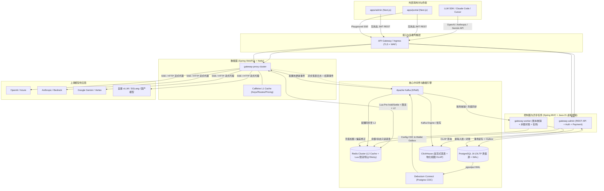
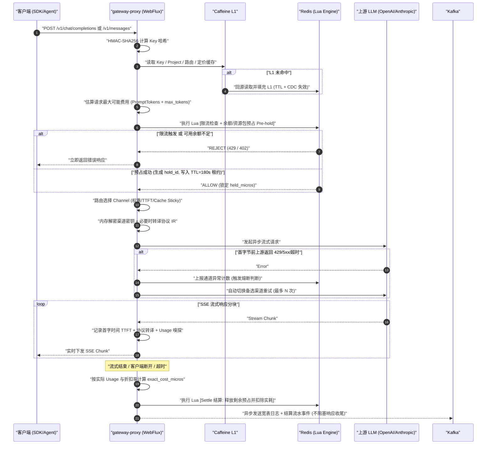

# 企业级商业化 LLM API 网关（MaaS 平台）规划蓝图

> 本文档基于需求对齐结果编制，完整覆盖 **1. 功能与业务规划** 与 **2. 架构与实现设计**，作为统一大仓（Monorepo）后续详细设计、数据库建模与分阶段编码的基准蓝图。

---

## 0. 已对齐核心决策矩阵

| 维度 | 最终决策 | 关键约束与影响 |
| :--- | :--- | :--- |
| **商业定位** | 对外商业化 SaaS / MaaS API 平台 | 自助注册、预付费充值、按量实时扣费、欠费熔断 |
| **租户层级** | `Organization -> Project -> API Key` | 个人注册自动建默认空间；Org 统一钱包结算，Project 预算隔离与成员 RBAC |
| **计费体系** | 预付费钱包 + 多维定价 + 代金券/资源包 + 分组折扣 | Input/Output/Cached/Reasoning Token 与图片/音视频按次计价；抵扣优先序清晰 |
| **扣费一致性** | Redis Lua 原子预占（Pre-hold）+ 流式结算（Settle） | 入口按估算上限冻结，流式结束按实测 Token 多退少补，Kafka 异步写 Postgres 账本 |
| **市场与支付** | 全球/双语市场，基准币种 `micro-USD`（`10^-6 USD`） | 邮箱 + GitHub/Google OAuth + 企业 SSO；支付抽象支持 Stripe、支付宝/微信、兑换码 |
| **协议范围** | 多原生协议兼容 + 双向协议转换 | OpenAI / Anthropic Messages（含 Thinking & Cache）/ Gemini / Rerank / 多模态 |
| **路由策略** | 多策略智能路由 + 熔断降级 + Prompt Cache 亲和 | 优先级、权重、最低成本、实时 TTFT 调权；429/5xx 自动重试；Sticky Session |
| **隐私与合规** | 默认 ZDR（零正文留存）+ 按需调试日志 + 风控 SPI | ClickHouse 默认仅落盘元数据；支持项目级短期加密调试日志与插拔式 Guardrails |
| **后端架构** | 多模块分离（Java 21 LTS + Maven） | 数据面 `gateway-proxy`（WebFlux Netty）；控制面/Worker（Spring MVC + 虚拟线程） |
| **数据管道** | Debezium CDC + Kafka + Redis + ClickHouse | Debezium 专职配置热同步与账务 Outbox；网关发射反范式宽表事件入 ClickHouse |
| **前端工程** | `pnpm` Workspace Monorepo 双应用 | `apps/portal`（开发者门户/官网）+ `apps/admin`（独立运营后台），共享 `ui` 与 `sdk` |
| **安全与鉴权** | 前端直连 Spring Boot 无状态 JWT + 分层密钥保护 | 客户 `sk-` Key 不可逆 HMAC-SHA256 哈希；上游密钥 AES-256-GCM 密文穿透链路 |

---

## 1. 功能与业务规划

### 1.1 多租户与 RBAC 权限体系

#### 1.1.1 租户实体模型
- **User（用户账号）**：自然人身份载体，支持邮箱验证码、GitHub/Google OAuth、企业 OIDC/SAML 绑定。一个 User 可属于多个 Organization。
- **Organization（组织/工作空间）**：**财务与账单的最高边界**。
  - 新用户注册自动创建名为 `Personal Workspace` 的默认 Organization。
  - 持有唯一钱包（Wallet）、资源包（Resource Packs）、代金券（Vouchers）、客户折扣等级（Tier/Group）与月度/全局限额配置。
- **Project（项目/环境）**：**资源、配置与预算隔离单元**（如 `prod-chatbot`、`staging-agent`）。
  - 可设置独立的 **月度预算上限（Monthly Hard/Soft Cap）**、**模型白名单（Allowed Models）**、**并发/RPM/TPM 限流阈值**及 **ZDR 调试日志开关**。
- **API Key（访问凭证）**：隶属于某个 Project，前缀标识如 `sk-gw-...`。
  - 支持配置有效期、IP 白名单、单 Key 累计消费限额（Quota Limit）、单 Key 速率上限（RPM/TPM）及授权模型子集。

#### 1.1.2 组织内 RBAC 角色矩阵

| 权限项 | Owner（所有者） | Admin（管理员） | Developer（开发者） | Billing（财务） |
| :--- | :---: | :---: | :---: | :---: |
| 解散组织 / 转让 Owner | ✅ | ❌ | ❌ | ❌ |
| 成员邀请、角色变更、移除 | ✅ | ✅（不可改 Owner） | ❌ | ❌ |
| 充值、绑卡、购买资源包、开票 | ✅ | ❌ | ❌ | ✅ |
| 查看用量报表与费用账单明细 | ✅ | ✅ | 仅所属 Project | ✅ |
| 创建/管理 Project 与预算上限 | ✅ | ✅ | ❌ | ❌ |
| 签发/吊销 Project 下 API Key | ✅ | ✅ | ✅ | ❌ |
| 修改 Project 调试日志（Opt-in） | ✅ | ✅ | ❌ | ❌ |
| 使用在线 Playground 调试 | ✅ | ✅ | ✅ | ❌ |

---

### 1.2 计费体系、多维定价与账本逻辑

#### 1.2.1 记账精度与多币种展示
- **内部统一单位**：采用 **微美元（`micro-USD`，`1 USD = 1,000,000 micro-USD`）**，所有数据库金额与 Redis 计数器全部使用 64 位有符号整型（`BIGINT`），彻底杜绝浮点精度误差。
- **充值汇率转换**：支持美元（Stripe）与人民币（支付宝/微信支付）充值。支付下单时锁定实时/固定平台汇率，入账瞬间换算为 `micro-USD` 计入钱包，并保留原始支付币种、金额与汇率快照用于财务对账与开具发票/收据。

#### 1.2.2 多维定价模型（Pricing Rules）
每个虚拟模型（Virtual Model）可配置独立、带生效时间版本（`effective_from`）的定价规则：
1. **文本与推理类（按每百万 Token 定价）**：
   - `input_price_per_1m`：常规输入 Token 单价
   - `output_price_per_1m`：常规输出 Token 单价
   - `cached_input_read_price_per_1m`：提示词缓存命中读取单价（如 Anthropic / OpenAI / DeepSeek Cache Hit）
   - `cached_input_write_price_per_1m`：提示词缓存创建写入单价（如 Anthropic 5m/1h Cache Write）
   - `reasoning_output_price_per_1m`：思考链 Token 单价（兼容单独计价的推理模型）
   - **阶梯上下文定价（Tiered Context Pricing）**：支持配置分段条件（如输入 `<= 128k` vs `> 128k` 使用不同倍率/单价）。
2. **多模态类**：
   - **图像生成/编辑**：按分辨率（如 `1024x1024` / `1792x1024`）与质量档位（Standard/HD）**按次/按张**计价。
   - **语音（TTS / STT）**：TTS 按字符数（每百万字符），STT 按音频时长（每分钟/每秒）或 Token 计价。
   - **向量与重排（Embedding / Rerank）**：按输入 Token 或文档条数计价。
3. **组织折扣与定价覆盖**：
   - 平台支持设置客户分组倍率（如 Standard `1.0x`、VIP `0.95x`、Enterprise 专属协议价），最终扣费公式：
     $$\text{FinalCost} = \lceil \text{RawModelCost} \times \text{OrgModelDiscountRatio} \rceil$$

#### 1.2.3 余额、代金券与资源包扣费优先序
为支撑丰富的商业化运营（拉新赠金、活动满减、大客户包量折扣），扣费按如下**确定性优先级链**执行：
1. **第一顺位：定向模型资源包（Model Token/Call Packs）** — 若该模型在 Org 持有未过期且有余量的定向资源包（按过期时间 `expires_at` 最早优先），优先扣减包内余量。
2. **第二顺位：代金券 / 赠金（Promotional Vouchers / Bonus Balance）** — 若命中适用范围且在有效期内，优先消耗赠金账户（注：赠金不可提现、不可开具增值税发票）。
3. **第三顺位：现金预付费余额（Cash Wallet Balance）** — 扣减用户真实充值金额；若可用现金 + 可用赠金均不足且无可用资源包，触发 `402 Payment Required` / `insufficient_quota` 熔断。

> **欠费熔断与低余额告警**：支持用户配置「低余额阈值 Webhook / 邮件告警」；当可用余额归零时，Redis 立即拦截新请求，已在进行中的长流允许安全收尾或触及硬熔断阈值时截断。

---

### 1.3 协议矩阵与双向转译能力

网关对外提供版本稳定的标准化 API 端点，内部通过 **Canonical LLM IR（统一规范中间表示）** 解耦入口协议与上游协议：

| 对外暴露协议族 | 核心端点 | 支持能力要点 | 跨协议转译支持 |
| :--- | :--- | :--- | :--- |
| **OpenAI 兼容族** | `/v1/chat/completions`<br>`/v1/responses`<br>`/v1/embeddings`<br>`/v1/images/generations`<br>`/v1/audio/speech`<br>`/v1/audio/transcriptions` | 流式 SSE（含 `stream_options.include_usage`）、Tool Calling、Structured Outputs (`json_schema`)、Vision 多图、Audio 输入输出 | Chat / Responses 可自动转译至 Anthropic / Gemini / 国产大模型后端 |
| **Anthropic 原生族** | `/v1/messages`<br>`/v1/messages/count_tokens` | 原生 SSE 事件流（`message_start`, `content_block_delta`, `message_delta`）、Extended Thinking (`thinking` blocks)、Prompt Caching (`cache_control`)、Tool Use | 完美承接 Claude Code / Cursor / Cline 请求，既可透传直连 Anthropic/Bedrock/Vertex，也可转译至 OpenAI/DeepSeek 等模型 |
| **Google Gemini 原生族** | `/v1beta/models/{model}:generateContent`<br>`/v1beta/models/{model}:streamGenerateContent` | Function Calling、System Instruction、多模态 Part、Thinking Budget | 可直连 AI Studio / Vertex AI，或反向转译至 OpenAI/Anthropic 渠道 |
| **检索与模型目录** | `/v1/rerank`<br>`/v1/models` | 兼容 Cohere / Jina / BGE Rerank 协议；`/v1/models` 动态返回当前 Project 授权可见且定价透明的虚拟模型清单 | 统一聚合多厂商模型列表与上下文窗口元数据 |

**协议转译原则**：
- **同构透传优先（Zero-Overhead Passthrough）**：当客户端协议与选定上游渠道协议一致时（如 `/v1/messages` -> Anthropic 直连），仅做头信息校验、密钥替换、Usage 窃听提取与流式字节透传，避免不必要 JSON 反序列化与重序列化开销。
- **异构高保真转译**：协议不一致时，经过 `Inbound Adapter -> Canonical IR -> Outbound Adapter` 管道转换消息角色、`tool_calls`、思考链字段及 SSE 分块事件状态机。

---

### 1.4 智能路由、容灾降级与 Prompt Cache 亲和

#### 1.4.1 核心概念解耦
- **Virtual Model（虚拟模型）**：对外暴露给客户的模型 ID（如 `claude-sonnet-4-5`、`gpt-5`、`deepseek-r1` 或智能聚合别名 `coding-auto`）。
- **Upstream Channel（上游渠道）**：具体的供应商账号/部署实例（如 `Anthropic-Direct-Key1`、`AWS-Bedrock-us-east-1`、`Azure-EastUS2-PoolA`、`SelfHost-vLLM-H100`），附带真实上游模型映射名（`upstream_model_id`）、成本价（用于计算平台毛利）、区域标签与上游自身 RPM/TPM 保护阈值。

#### 1.4.2 多策略路由调度器
同一个 Virtual Model 可绑定多个分级渠道池（Tier 1 主力池 -> Tier 2 备援池 -> Tier 3 兜底池），同池内支持以下组合路由策略：
1. **Priority + Weighted（优先级分组 + 权重轮询）**：优先在最高优先级可用池内按权重分配流量。
2. **Lowest Cost（成本最优）**：在满足 SLA 健康度的渠道中优先选择平台采购单价最低的渠道，最大化毛利率。
3. **Latency / TTFT-Aware（动态延迟感知）**：基于 Redis 滑动窗口内近 1 分钟各渠道的 **P90 TTFT（首字延迟）** 与成功率动态调整路由权重（EWMA 指数加权移动平均）。
4. **Prompt Cache Sticky Session（缓存粘性亲和）**：
   - 当请求包含明确缓存标记（如 Anthropic `cache_control`）或超长 System Prompt / 前缀（超过阈值 Token 数）时，提取 `hash(org_id + virtual_model + prefix_tokens)` 作为粘性键。
   - 路由器优先将后续连续对话/Agent 多轮工具调用路由至 Redis 记录的同一上游 Channel（TTL 默认 5 分钟，每次命中续期），确保上游 KV Cache 命中率，避免每次跨渠道漂移导致重复全额计费与首字变慢。

#### 1.4.3 熔断与安全重试机制
- **首字节前无感重试（Pre-First-Byte Retry）**：向某上游发出请求后，若在**未向客户端发送任何有效正文分块之前**遇到网络超时、连接拒绝、`429 Too Many Requests` 或 `5xx` 异常，立即将该渠道标记为临时冷却并瞬时切换至同级/降级备用渠道重试（可配最大重试次数如 2 次），客户端完全无感。
- **流式中断处理**：一旦已开始向客户端输出 SSE Chunk，不可跨渠道无缝重试，此时关闭流并按已生成输出估算/取实际 Usage 进行精准结算。
- **分布式熔断器**：每个 Channel 维护错误率与连续 429 计数（Closed -> Open 熔断隔离 30s~60s -> Half-Open 探针放行）。

---

### 1.5 限流配额、数据隐私（ZDR）与内容合规

#### 1.5.1 四层分布式限流（Redis Lua）
1. **API Key 级**：RPM、TPM、最大并发数（Max In-Flight）。
2. **Project 级**：项目总 RPM/TPM 与月度美元预算硬/软上限。
3. **Organization 级**：租户级并发池保护（防止单一客户突发流量打垮整个网关）。
4. **Upstream Channel 级**：保护上游账号自身的 Tier 限速（如某官方账号限 4,000 RPM），接近阈值时路由器主动分流至其他健康渠道而非触发 429。

#### 1.5.2 默认 ZDR（零数据留存）与调试模式
- **默认生产策略（ZDR）**：请求与响应 Body 仅在 `gateway-proxy` 堆外/堆内内存流转，请求完成后立即释放。发送给 Kafka 与 ClickHouse 的仅包含结构化元数据与计量指标，**绝不落盘任何 Prompt 或 Completion 文本**。
- **可选调试模式（Opt-in Debug Logging）**：允许拥有 Admin/Owner 权限的租户针对特定非生产 Project（或显式开启调试）记录加密后的请求/响应样本（设定强制 TTL 如 3~7 天到期自动物理删除），用于 Playground 排查与 Bad Case 分析。

#### 1.5.3 插拔式内容风控（Guardrails SPI）
网关内置 `GuardrailProvider` 扩展接口，按 Project/国家区域策略按需启用：
- **Pre-Request Hook（同步/低延迟拦截）**：本地高性能 AC 自动机（DFA）敏感词过滤、PII 个人隐私信息（身份证/银行卡/手机号）掩码脱敏、Prompt Injection 规则拦截，或调用外部安全审核服务。
- **Stream Chunk / Post-Response Hook**：流式滑动窗口合规校验，命中高危策略时立即终止流并按策略返回安全替换提示。

---

### 1.6 双端应用功能清单（Next.js + React）

#### 1.6.1 开发者门户与官网（`apps/portal`）
- **公网门户与模型广场**：中英双语切换、模型目录与实时定价对比表（含价格计算器）、平台状态页（各模型实时可用率与 TTFT 基准）、交互式 API 文档（支持 OpenAI/Anthropic/Gemini/Python/TS/cURL 一键复制）。
- **认证与引导**：邮箱验证码登录、GitHub/Google OAuth、企业 SSO 入口、新用户注册欢迎引导与赠金领取。
- **工作空间与权限**：Org 创建/切换、成员邀请与 RBAC 角色管理、Project 创建与预算/模型白名单配置。
- **API Key 管理**：创建/启用/禁用/吊销 Key、单 Key 限额与到期时间配置、创建瞬间一次性展示明文弹窗。
- **多模态 Playground**：内置对话与 Agent 测试沙盒，支持流式输出实时展示 TTFT/TPOT/Token 消耗/预估费用、同屏多模型对比（Arena 视图）、调试日志回放（仅对开启 Opt-in 的 Project 生效）。
- **用量仪表盘与账务中心**：基于 ClickHouse 的毫秒级图表（按模型/Project/Key 维度的 Token、请求量、错误率、P50/P95/P99 TTFT）、在线充值（Stripe / 支付宝 / 微信 / 兑换码）、资源包购买、钱包流水与月度 PDF 账单/收据下载。

#### 1.6.2 平台运营后台（`apps/admin`，独立内网/VPN域名）
- **上游渠道与密钥池管理**：渠道 CRUD、API Key 加密录入与连通性探测、上游余额监控与自动禁用告警、健康状态与熔断手动恢复。
- **虚拟模型与路由编排**：虚拟模型目录管理、渠道绑定与优先级/权重/成本/TTFT 路由策略可视化配置、协议转译开关与模型别名下线映射。
- **定价与营销引擎**：模型多维单价版本发布（支持定时生效）、客户分组（VIP/大客户）折扣率配置、代金券/兑换码批量生成与模型资源包上架。
- **经营与毛利大盘**：平台总营收、上游采购总成本、实时毛利率（Gross Margin）、各模型/大客户消耗排行、429/5xx 故障热力图。
- **财务对账与风控中心**：人工调账（需二次审批与操作审计日志）、Redis 与 Postgres 账本对账差异巡检面板、敏感词库与 Guardrails 规则配置。

---

## 2. 架构与实现规划

### 2.1 总体系统架构图



---

### 2.2 统一大仓（Monorepo）目录骨架

```text
llm-gateway/
├── backend/                              # Java 21 LTS + Maven 多模块工程
│   ├── pom.xml                           # 父 POM（统一 Spring Boot 3.4+/3.5+ BOM 与依赖锁定）
│   ├── gateway-common/                   # 域模型、micro-USD 工具、AES/HMAC 加密、Canonical IR
│   ├── gateway-protocol/                 # 协议解析器与双向转换器（OpenAI/Anthropic/Gemini/Rerank）
│   ├── gateway-proxy/                    # 数据面（Spring WebFlux + Netty）
│   ├── gateway-admin/                    # 控制面（Spring MVC + 虚拟线程 + OpenAPI 导出）
│   └── gateway-worker/                   # 异步任务面（Kafka 账本消费、Outbox 同步、对账巡检）
├── frontend/                             # pnpm Workspace Monorepo
│   ├── pnpm-workspace.yaml
│   ├── package.json
│   ├── apps/
│   │   ├── portal/                       # Next.js App Router 开发者门户与官网
│   │   └── admin/                        # Next.js App Router 独立运营后台
│   └── packages/
│       ├── ui/                           # 共享设计系统（Tailwind + shadcn/ui + ECharts/Recharts）
│       ├── sdk/                          # 基于 gateway-admin OpenAPI 自动生成的 TS 客户端
│       └── config/                       # 共享 ESLint / TypeScript / Tailwind 配置
├── infra/                                # 基础设施编排与运维脚本
│   ├── docker-compose.yml                # 本地全栈中间件一键拉起
│   ├── debezium/                         # Debezium Postgres Connector 注册 JSON
│   ├── clickhouse/                       # ClickHouse 建表与物化视图初始化 SQL
│   ├── kafka/                            # Topic 创建脚本与分区/保留策略
│   ├── observability/                    # Prometheus + Grafana + OTel Collector 配置
│   └── k8s/                              # Helm Charts / HPA / Ingress 模板
└── docs/
    ├── PROPOSAL.md                       # 本规划蓝图
    └── openapi/                          # 导出的 OpenAPI 3.1 契约文件
```

---

### 2.3 数据面核心请求链路与流式防超支设计

#### 2.3.1 关键工程约束（WebFlux 非阻塞黄金法则）
1. **零阻塞热路径**：`gateway-proxy` 所有线程为 Netty EventLoop，热路径严禁调用任何 JDBC/阻塞 IO；所有配置读取全部命中本地 `Caffeine L1`（毫秒级）或 `Lettuce Reactive Redis L2`。
2. **上游连接池隔离**：基于 Reactor Netty `HttpClient` 为不同上游 Provider/Region 配置隔离的 `ConnectionProvider`（长连接复用、DNS 异步解析、合理空闲淘汰时间），并透传背压（Backpressure）防止客户端慢消费撑爆网关堆外内存。
3. **流式 Usage 捕获**：针对 OpenAI 协议，若客户端未传递 `stream_options: {"include_usage": true}`，网关自动注入该参数以获取精准 Usage（返回给客户端时再按原始请求决定是否剥离或保留）；若遇非标上游未返回 Usage 或流中途断连，网关使用内置 `Tiktoken / Tokenizer` 降级估算作为兜底结算。

#### 2.3.2 Pre-hold 与 Settle 时序图



#### 2.3.3 并发 Pre-hold 估算与极端兜底机制
- **预占上限估算**：若请求显式指定 `max_tokens`，预占额 = `估算输入费用 + max_tokens * 输出单价`；若未指定 `max_tokens`，按系统配置的保守安全预占额（如按模型默认单次上限或设定阈值如 `$0.05` 起步，结合用户当前余额取 `min` 或要求最低余额准入阈值）进行预占，避免不传 `max_tokens` 时把整个大额钱包一次性锁死影响并发度。
- **僵尸预占回收（Orphan Hold Lease）**：Redis 中每笔 `hold_id` 写入 ZSET 延迟队列（过期时间戳 = `now + 180s`，长推理模型可设为 `600s` 并由网关心跳续期）。一旦 `gateway-proxy` 节点 OOM 或宕机导致未触发 `Settle`，`gateway-worker` 扫描超时 `hold_id` 自动回滚释放冻结额度（或根据已记录心跳补扣）。

---

### 2.4 数据存储与 CDC 管道详细设计

#### 2.4.1 PostgreSQL 16 核心表结构规划（OLTP 真值源）
需开启 `wal_level = logical` 并创建专用 Debezium Publication。核心表分组如下：
1. **租户与认证域**：
   - `users` (`id`, `email`, `password_hash`, `oauth_bindings`, `locale`, `status`, `created_at`)
   - `organizations` (`id`, `name`, `slug`, `owner_user_id`, `tier_code`, `discount_ratio_bps`, `status`, `version`)
   - `org_members` (`org_id`, `user_id`, `role`, `joined_at`)
   - `projects` (`id`, `org_id`, `name`, `monthly_budget_micros`, `allowed_models`, `rpm_limit`, `tpm_limit`, `zdr_debug_enabled`, `guardrail_policy`)
   - `api_keys` (`id`, `project_id`, `org_id`, `key_prefix`, `key_hash` UNIQUE, `name`, `rpm_limit`, `tpm_limit`, `quota_limit_micros`, `expires_at`, `status`, `version`)
2. **路由与模型定价域**：
   - `providers` (`id`, `code`, `protocol_type`, `base_url`)
   - `channels` (`id`, `provider_id`, `name`, `encrypted_credentials`, `region`, `model_mapping_json`, `weight`, `priority`, `cost_ratio`, `rpm_limit`, `tpm_limit`, `status`)
   - `virtual_models` (`id`, `model_code` UNIQUE, `display_name`, `capability_type`, `routing_strategy`, `sticky_cache_enabled`, `context_window`, `status`)
   - `model_channel_bindings` (`virtual_model_id`, `channel_id`, `priority_tier`, `weight`, `upstream_model_name`)
   - `pricing_rules` (`id`, `virtual_model_id`, `input_price_micros_1m`, `output_price_micros_1m`, `cache_read_micros_1m`, `cache_write_micros_1m`, `reasoning_micros_1m`, `per_call_micros`, `tiered_rules_json`, `effective_from`)
3. **钱包、账本与商品域**：
   - `wallets` (`org_id` PK, `cash_balance_micros`, `bonus_balance_micros`, `total_recharged_micros`, `total_consumed_micros`, `updated_at`, `version`)
   - `wallet_ledger` (`id`, `org_id`, `project_id`, `api_key_id`, `ledger_type` [`RECHARGE`|`CONSUME`|`BONUS`|`REFUND`|`ADJUST`], `idempotency_key` UNIQUE, `cash_delta_micros`, `bonus_delta_micros`, `balance_after_micros`, `ref_request_id`, `ref_order_id`, `created_at`)
   - `resource_packs` (`id`, `org_id`, `pack_type`, `applicable_models`, `remaining_units`, `total_units`, `expires_at`, `status`)
   - `vouchers` & `redemption_codes` (`id`, `code_hash`, `amount_micros`, `applicable_models`, `expires_at`, `redeemed_org_id`)
   - `payment_orders` (`id`, `org_id`, `channel` [`STRIPE`|`ALIPAY`|`WECHAT`], `pay_currency`, `pay_amount_minor`, `fx_rate`, `credit_micros`, `status`, `external_tx_id`)
   - `outbox_events` (`id`, `aggregate_type`, `aggregate_id`, `event_type`, `payload_json`, `created_at`)

#### 2.4.2 Debezium CDC 职责与 Topic 规划
为避免全库监听带来的 WAL 膨胀与复杂处理，Debezium **仅订阅两类核心表**：
1. **配置与状态表（Config CDC）**：`organizations`, `projects`, `api_keys`, `virtual_models`, `channels`, `model_channel_bindings`, `pricing_rules`。
   - 推入 Kafka Topic：`cdc.gateway.config`（开启 Log Compaction 或分区广播）。
   - 消费动作：`gateway-worker` 同步刷新 Redis L2 Hash；所有 `gateway-proxy` 实例通过独立 Consumer Group（每 Pod 一个 Group ID）实时消费事件，**亚秒级剔除/更新本地 Caffeine L1 缓存**（API Key 吊销、限流调低、渠道摘除即时生效）。
2. **账务与状态变更 Outbox 表（Outbox Event Router）**：`outbox_events`。
   - 利用 Debezium Outbox Event Router SMT，将表内事件路由至 `cdc.wallet.topup` 等业务 Topic。
   - **关键保障**：控制面收到 Stripe/支付宝 Webhook 验签成功后，在**同一个 Postgres 本地事务**中完成 `payment_orders` 更新 + `wallets` 加款 + `wallet_ledger` 记账 + 插入 `outbox_events`。Debezium 捕获 WAL 推送 Kafka，`gateway-worker` 消费后带 `idempotency_key` 在 Redis 执行幂等 `INCRBY`，彻底消除「DB 充值成功但 Redis 加钱失败」的数据分裂。

#### 2.4.3 Redis 键空间（KeySpace）规划
- `gw:cfg:key:{key_hash}` -> Hash（Key 元数据、所属 Org/Project、限流配置、权限列表）
- `gw:cfg:route:{virtual_model}` -> JSON/Hash（绑定渠道列表、加密凭证密文、定价快照）
- `gw:wallet:{org_id}` -> Hash（`cash_micros`, `bonus_micros`, `held_micros`, `status`, `discount_bps`）
- `gw:wallet:hold:{hold_id}` -> String/Hash（预占详情，配合 ZSET `gw:wallet:holds:exp` 做超时回收）
- `gw:wallet:idem:{event_id}` -> String（TTL 7 天，防止 Debezium Outbox 重复加钱）
- `gw:pack:{org_id}:{model}` -> ZSET/Hash（按到期时间排序的可用资源包余量）
- `gw:rl:rpm:{scope}:{id}` / `gw:rl:tpm:{scope}:{id}` -> 滑动窗口 ZSET 或令牌桶 Hash
- `gw:rl:conc:{scope}:{id}` -> 并发计数 String（请求进 `INCR`、出 `DECR` 并配合连接租约）
- `gw:sticky:{hash}` -> String（`channel_id`，TTL 300s，Prompt Cache 亲和绑定）
- `gw:cb:channel:{channel_id}` -> Hash（熔断状态、近 1m 错误率、EWMA TTFT 指标）

#### 2.4.4 ClickHouse 宽表与物化视图设计（OLAP）
数据面请求结束后异步发送宽表 JSON 至 Kafka Topic `llm.request.events`（按 `org_id` 分区保证局部顺序，批量压缩 `zstd`/`lz4`）。
ClickHouse 采用 `Kafka Engine` + `Materialized View` 自动摄入至主表（或由独立批写 Consumer 以每 1~3 秒 / 5000 条批量 `INSERT`，背压与容错控制更可控）：

```sql
-- 主请求事实宽表（默认 ZDR：无 Prompt/Completion 明文）
CREATE TABLE llm_request_events (
    event_date       Date DEFAULT toDate(created_at),
    created_at       DateTime64(3, 'UTC'),
    request_id       String,
    trace_id         String,
    org_id           UUID,
    project_id       UUID,
    api_key_id       UUID,
    virtual_model    LowCardinality(String),
    provider         LowCardinality(String),
    channel_id       UUID,
    upstream_model   LowCardinality(String),
    inbound_protocol LowCardinality(String),
    is_stream        UInt8,
    http_status      UInt16,
    error_code       LowCardinality(String),
    prompt_tokens    UInt32,
    cached_read_tokens  UInt32,
    cached_write_tokens UInt32,
    completion_tokens   UInt32,
    reasoning_tokens    UInt32,
    cost_micros         Int64,   -- 客户实付（微美元）
    upstream_cost_micros Int64,  -- 平台采购成本（用于毛利分析）
    pack_deducted_units Int64,
    ttft_ms          UInt32,     -- 首字延迟
    tpot_ms          Float32,    -- 每 Token 平均生成耗时
    duration_ms      UInt32,
    client_ip_prefix String,
    region           LowCardinality(String)
) ENGINE = MergeTree()
PARTITION BY toYYYYMM(event_date)
ORDER BY (org_id, project_id, event_date, created_at, request_id)
TTL event_date + INTERVAL 365 DAY;

-- 小时级预聚合物化视图（支撑毫秒级门户图表与经营毛利大盘）
CREATE MATERIALIZED VIEW mv_usage_hourly
ENGINE = SummingMergeTree()
PARTITION BY toYYYYMM(hour_bucket)
ORDER BY (org_id, project_id, api_key_id, virtual_model, channel_id, hour_bucket)
AS SELECT
    toStartOfHour(created_at) AS hour_bucket,
    org_id,
    project_id,
    api_key_id,
    virtual_model,
    channel_id,
    count() AS request_count,
    countIf(http_status >= 200 AND http_status < 300) AS success_count,
    sum(prompt_tokens) AS sum_prompt_tokens,
    sum(cached_read_tokens) AS sum_cached_tokens,
    sum(completion_tokens) AS sum_completion_tokens,
    sum(cost_micros) AS sum_cost_micros,
    sum(upstream_cost_micros) AS sum_upstream_cost_micros,
    quantileState(0.95)(ttft_ms) AS ttft_p95_state
FROM llm_request_events
GROUP BY org_id, project_id, api_key_id, virtual_model, channel_id, hour_bucket;
```

---

### 2.5 资金一致性与异步对账机制

在分布式预付费系统中，Redis 承担高频实时扣减，Postgres 承担持久账本。一致性闭环由三道防线保证：
1. **入账防丢（Outbox + CDC）**：充值、退款、赠金、人工调账全部经 Postgres 事务写入 `outbox_events`，由 Debezium CDC 保证 At-least-once 送达，Redis 端基于 `event_id` 幂等加额。
2. **消费防重（Idempotent Batch Settlement）**：`gateway-proxy` 结算时生成全局唯一 `request_id`，`gateway-worker` 批量插入 Postgres `wallet_ledger` 时利用 `ON CONFLICT (idempotency_key) DO NOTHING` 保证 Kafka 重平衡或重放不重复扣款。
3. **周期性准实时对账（Reconciliation Job）**：
   - 定时任务（如每 5 分钟）对近期活跃 Org 核对：
     $$\text{Redis}(\text{cash} + \text{bonus} + \text{held}) \stackrel{?}{=} \text{Postgres}(\text{wallets.balance}) - \text{UnflushedKafkaLag}$$
   - 若存在超出阈值的静默偏差（如极端节点崩溃导致 Redis 已扣但 Kafka 事件未发出），结合 ClickHouse 日志与 Ledger 差额触发告警并自动/人工核对修复。

---

### 2.6 安全设计与鉴权体系

1. **控制台无状态 JWT 鉴权**：
   - `gateway-admin` 统一签发短时效 Access JWT（如 15 分钟，携带 `user_id`、`org_roles` 摘要或通过轻量缓存校验即时权限）+ 长时效 Refresh Token（存 Postgres 会话表支持强制踢下线与单次轮换防重放）。
   - `apps/portal` 与 `apps/admin` 客户端通过 HTTPS + 严格 CORS 白名单直连 `gateway-admin`；其中 `apps/admin` 额外强制启用 MFA（TOTP）与管理员 IP/内网网关准入控制。
2. **客户 API Key 保护**：
   - 生成格式：`sk-gw-<8位随机前缀><40位高熵随机串>`。
   - Postgres 仅存 `key_prefix`（用于前端脱敏展示 `sk-gw-ab12...wxyz`）与 `HMAC-SHA256(raw_key, server_pepper)`；支持配置主副双 Pepper 平滑轮换。
3. **上游渠道密钥全链路加密**：
   - 上游厂商 Key 在控制面录入后立即使用全局主密钥执行 **AES-256-GCM 认证加密**（每次随机 12 字节 IV，并将 `channel_id` 绑定为 AAD 防跨行篡改）。
   - 密文存储于 Postgres -> 经 Debezium WAL -> Kafka -> Redis L2 -> Caffeine L1，**中间所有组件均无法看到上游明文密钥**，仅在 `gateway-proxy` 发出上游 HTTP 请求前于内存中瞬时解密注入 Header。

---

### 2.7 前端工程与交互实现（pnpm + Next.js + React）

1. **契约驱动开发（Contract-First）**：`gateway-admin` 通过 `springdoc-openapi` 自动生成标准 OpenAPI 3.1 规范；`packages/sdk` 使用 `openapi-typescript` + `openapi-fetch` 生成强类型客户端与 React Query Hooks，消除前后端接口联调误差。
2. **Playground 直连数据面 SSE**：
   - 用户在 `apps/portal` Playground 调试时，可通过用户 JWT 向 `gateway-admin` 换取一个 5 分钟短效、绑定 `sandbox` 权限的临时调用凭证（Ephemeral Token），浏览器使用 `fetch` + `ReadableStream` 直接请求 `gateway-proxy` 获取原生 SSE 流，实时计算并渲染 TTFT、吞吐速率（tokens/s）与推理思考过程（Thinking 折叠块）。
3. **国际化与主题**：采用 `next-intl` 支持中英双语切换与本地货币格式化展示（如内部 `micro-USD` 按界面偏好折算展示或直接展示 `$0.0042`）。

---

### 2.8 可观测性与基础设施编排

- **链路追踪与指标**：全后端集成 `Micrometer` + `OpenTelemetry`（TraceID 从 `gateway-proxy` 入口注入，串联 Redis、上游渠道请求及 Kafka 异步消息 Header），暴露 Prometheus 指标：
  - `gateway_requests_total`（按 model / protocol / status / channel 标签）
  - `gateway_ttft_seconds`、`gateway_e2e_duration_seconds`（直方图）
  - `gateway_upstream_circuit_state`（渠道熔断状态）
  - `gateway_billing_settle_lag`（Kafka 账本核销积压量）
- **本地全栈 Docker Compose（`infra/docker-compose.yml`）**：包含 `postgres:16`（启用逻辑复制）、`kafka`（KRaft 单节点开发模式）、`debezium/connect`、`redis:7`、`clickhouse/clickhouse-server:24`、`prometheus`、`grafana` 与一键初始化脚本，确保本地两条命令即可拉起全链路联调环境。

---

## 3. 分阶段实施路线图

| 阶段 | 核心目标 | 关键交付物 |
| :--- | :--- | :--- |
| **Phase 1: MVP 基础代理与工程骨架** | 跑通端到端调用与基础记账链路 | 1. 建立 Maven + pnpm Monorepo 骨架与 `infra/docker-compose.yml`<br>2. Postgres 核心表 Flyway 迁移脚本<br>3. `gateway-proxy`（WebFlux）实现 OpenAI `/v1/chat/completions` 与 Anthropic `/v1/messages` 基础代理与密钥加密解密<br>4. `gateway-admin` 基础 JWT 登录、Org/Project/Key CRUD 与控制台基础页面 |
| **Phase 2: 商业化计费与数据管道闭环** | 实现高并发防超支、CDC 热同步与 OLAP 报表 | 1. Redis Lua 限流器与 `Pre-hold / Settle` 原子扣费引擎（含超时租约回收）<br>2. Debezium Config CDC + Wallet Outbox 流水线与 Caffeine L1 亚秒级失效<br>3. 宽表事件直入 ClickHouse + 物化视图，Portal 用量仪表盘上线<br>4. Stripe / 支付宝 / 兑换码支付链路与代金券/资源包优先抵扣 |
| **Phase 3: 智能路由、全协议与企业级治理** | 提升平台毛利、高可用性与大客户能力 | 1. 双向协议转译引擎（OpenAI / Anthropic / Gemini / Embeddings / Images / Audio / Rerank）<br>2. TTFT 感知路由、熔断器、首字节前重试与 Prompt Cache Sticky Session<br>3. 企业 SSO（OIDC/SAML）、项目级 Opt-in 调试日志、Guardrails SPI<br>4. `apps/admin` 完整运营后台（渠道监控、定价版本、毛利大盘、自动对账中心） |
| **Phase 4: 压测调优与生产交付** | 验证高并发 SLA 与可运维性 | 1. K6/Gatling 模拟万级并发 SSE 长连接与防穿仓混沌压测（Gateway 额外耗时 P99 < 15ms）<br>2. 完善 K8s Helm Charts、HPA 弹性扩缩容策略与生产 Grafana 告警面板 |

---

## 4. 下一步细化建议

您可以根据当前关注点继续细化本提案的特定章节：
1. **数据库与接口详细设计**：进一步补全完整 Flyway SQL DDL、Redis Lua 完整脚本逻辑及 Core REST API 清单。
2. **协议转译规范**：细化 OpenAI Responses / Chat Completions 与 Anthropic Messages（`thinking` + `tool_use` + `cache_control`）之间的字段映射与流式状态机边界用例。
3. **工程初始化**：确认提案后，即可在当前 Monorepo 根目录开始脚手架搭建与 `docker-compose.yml` 编排验证。
