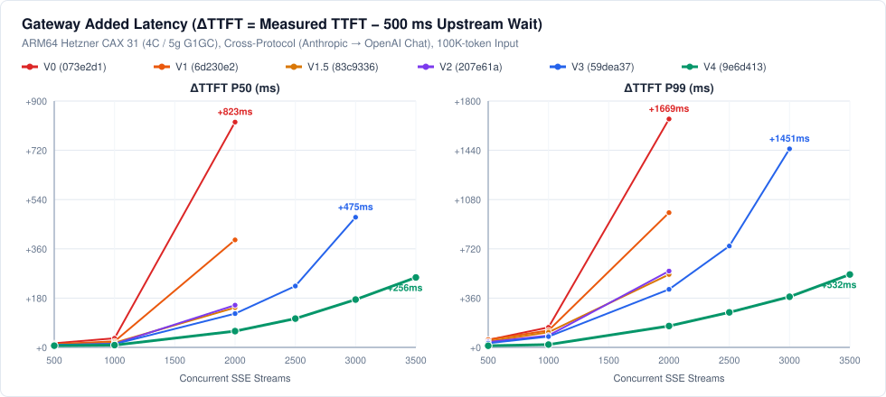
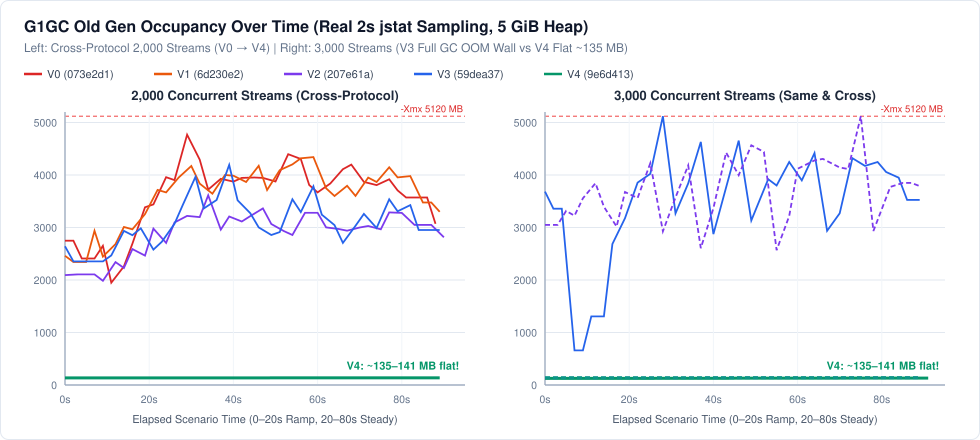
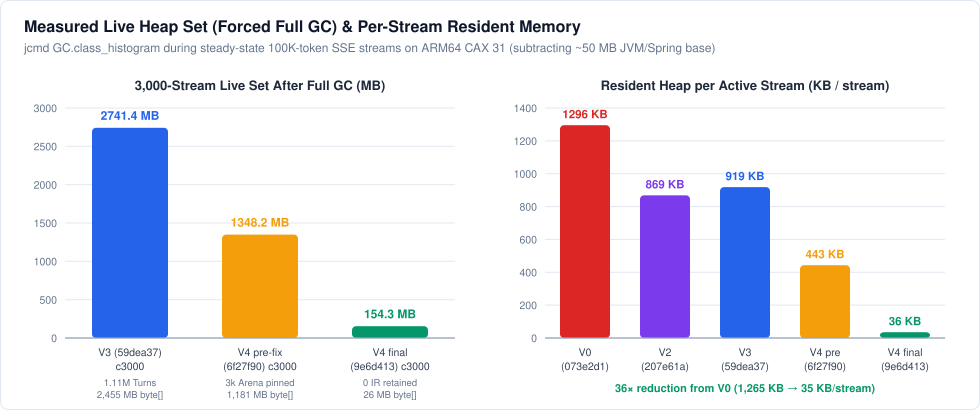
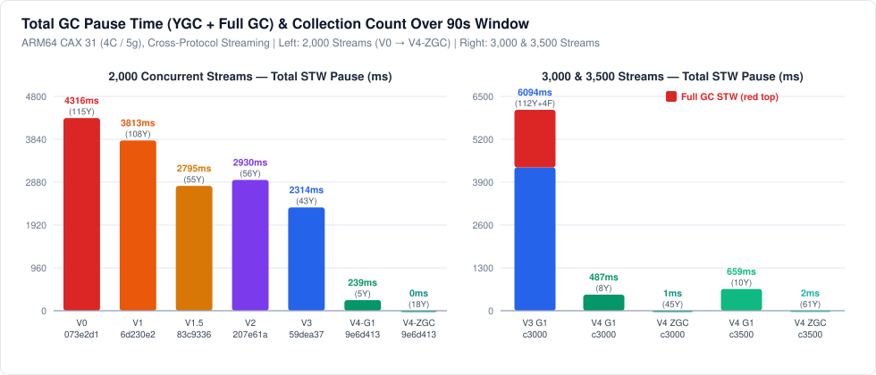
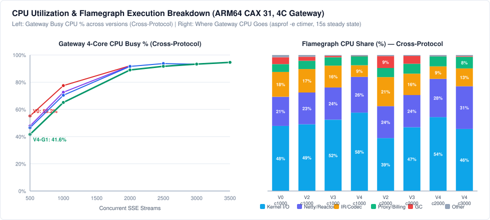
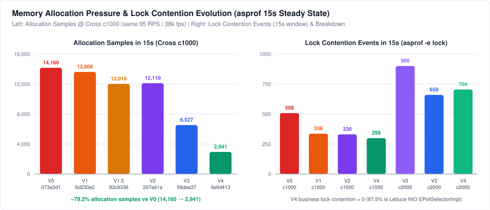

# 02. 六代性能优化演进报告（ARM64 Hetzner `CAX 31`，4C / 5g）

本报告记录在 **Hetzner Cost-Optimized `CAX 31`**（8 vCPU ARM64 Neoverse-N1，网关硬隔离 `4 vCPU / 5 GiB` 堆，同套 `mock-upstream` / `loadgen` / `run-suite.sh`）上，对 HyperLLM 网关 **6 个典型里程碑版本**进行的完整同口径重跑结果（共 **43 个有效场景**，全部满足 `0 错误`、`%steal = 0.00`、`maintained = 100%`、`valid = yes`）。

> **说明**：全文所有 TTFT 均为**网关净增耗时 `ΔTTFT = 实测首帧时间 − 500 ms`**；统一 IR 之前的 `V0 / V1 / V1.5` 仅测跨协议（`Anthropic → OpenAI Chat`），统一 IR 之后的 `V2 / V3 / V4` 同时测同协议（`same`）与跨协议（`cross`）。原始汇总表见 [arm64-campaign-summary.csv](./data/arm64-campaign-summary.csv)。

---

## 一、六代版本演进总览

| 代次 | Commit | 优化主题 | 跨协议 `c2000` `ΔTTFT` P50 / P99 | 跨协议 `c2000` YGC / 停顿 | `c2000` 老年代峰值 | 单流常驻存活集 | 4C/5g 稳态上限 |
| :--: | :-- | :--- | --: | --: | --: | --: | --: |
| **V0** | `073e2d1` | 原始全 DOM 基线（16MB 缓冲 + ARM64 Epoll） | +823.3 / +1,669.1 ms | 115 / 4,316 ms | 4,768 MB | **~1,265 KB/流** | ~1,000 |
| **V1** | `6d230e2` | P0/P1 控制面、Lua 预加载与热路径修复 | +392.5 / +984.1 ms | 108 / 3,813 ms | 4,340 MB | — | ~1,500 |
| **V1.5** | `83c9336` | 大请求流式解析 + EventLoop 卸载（含已退役同协议直通，仅测跨协议） | +145.4 / +532.9 ms | 55 / 2,795 ms | 3,618 MB | — | ~2,000 |
| **V2** | `207e61a` | **统一 Canonical IR 单一路径**（退役直通，双协议统一进 IR） | +154.4 / +557.7 ms | 56 / 2,930 ms | 3,614 MB | ~848 KB/流 | 2,000 |
| **V3** | `59dea37` | 帧路径优化（零拷贝分帧、无树帧解码、模板出帧、chunk 合并） | +123.2 / +424.1 ms | 43 / 2,314 ms | 4,192 MB | ~897 KB/流（c3000 占 2.74 GB + 4–5 FGC） | 2,500 |
| **V4-G1** | `9e6d413` | **全链路性能重构最终版**（IR 窗口释放 + 零拷贝切片 + 堆外直写 + Push 流式 + 双向断链） | **+59.3 / +156.3 ms** | **5 / 239 ms** | **137 MB** | **~35 KB/流**（c3000 仅 154 MB） | **3,500** |
| **V4-ZGC** | `9e6d413` | 全链路重构最终版 + **Generational ZGC** | +78.8 / +255.4 ms | **18 / 0 ms**（c3500: **2 ms**） | 430 MB | 同上 | **3,500** |

---

## 二、核心演进图表

### 2.1 网关净增延迟 `ΔTTFT`（P50 / P99）

- 在 `cross c2000` 同并发下，网关自身首字延迟从 V0 的 **`+823.3 ms / +1,669.1 ms`** 一路压降至 V4 的 **`+59.3 ms / +156.3 ms`**（P50 降 **92.8%**，P99 降 **90.6%**）。
- 即便把并发再翻近一倍推到 **`c3500`**，V4 的 `ΔTTFT` P99（`+512.8 / +532.5 ms`）仍低于 V2 在 `c2000` 时的水平（`+557.7 ms`）。

### 2.2 老年代内存占用时间序列折线图（真实 `jstat -gc` 2s 采样）

- 左图（`cross c2000`）：`V0 → V3` 的老年代在 20s ramp 期间一路冲上 **3.6–4.8 GB** 锯齿震荡，频繁触发 Concurrent Mark 与 Mixed GC；而 **V4 是一条贴底 `137 MB` 的水平直线**。
- 右图（`c3000`）：`V3` 在同/跨协议下双双撞穿 `5,120 MB` 堆顶并引发 **4–5 次 Full GC**；**V4 在同/跨协议下老年代全程稳定在 `131–141 MB`**（占 5g 堆仅 2.7%），**0 Full / 0 Mixed / 0 Concurrent GC**。

### 2.3 真实存活集与单流常驻堆内存（`jcmd GC.class_histogram`）

| 审计节点（稳态强制 Full GC 后） | 活跃流数 | GC 前老年代 | **Full GC 后真实存活集** | 活跃 `byte[]` | `CanonicalTurn` / `TextPart` | `RequestByteArena` | 扣底座后单流常驻 |
| :--- | --: | --: | --: | --: | --: | --: | --: |
| `V0 (073e2d1)` @ cross c1000 | 998 | 2,642.0 MB | **1,315.2 MB** | 1,169.6 MB | 732,190 / 366,460（2,006 `CanonicalRequest`） | — | **~1,265 KB/流** |
| `V2 (207e61a)` @ cross c2000 | 1,939 | 3,513.5 MB | **1,746.6 MB** | 1,557.7 MB | 各 727,810（1,994 `CanonicalRequest`） | — | **~848 KB/流** |
| `V3 (59dea37)` @ same c3000 | 2,919 | 4,585.5 MB | **2,741.4 MB** | 2,454.6 MB | 各 1,110,692（3,042 `CanonicalRequest`） | — | **~897 KB/流** |
| `V4 pre-fix (6f27f90)` @ same c3000 | 2,929 | 2,885.6 MB | **1,348.2 MB** | 1,180.7 MB | 各 1,095（3 `CanonicalRequest`） | **3,000（钉住 1.18 GB）** | ~433 KB/流 |
| **`V4 final (9e6d413)` @ same c3000** | **2,931** | **145.7 MB** | **154.3 MB** | **26.2 MB** | **各 1,241（3 `CanonicalRequest`）** | **45（0.00 MB）** | **~35 KB/流（−36×）** |

> **关键发现**：`V0` 在 1,000 并发下竟同时存活了 **2,006 个 `CanonicalRequest`**（规范化前与规范化后两份图并存），单流高达 1.26 MB；`V4` 的 `6f27f90` 先把 `CanonicalTurn` 清零（111 万 → 1,095），再用现场直方图抓出 Netty `HttpServerOperations.inbound (FluxReceive)` 经由 `DataBufferUtils.join` 向下游单向钉住 3,000 个 `RequestByteArena` 的隐蔽链条，`9e6d413` 双向断链后存活集彻底塌陷至 **154.3 MB**。

### 2.4 GC 停顿与次数演进（G1GC + Generational ZGC）

### 2.5 CPU 占用与火焰图 CPU 构成演进

### 2.6 内存分配压力与锁竞争演进

---

## 三、全量 ARM64 数据明细（全部 `ΔTTFT`，`valid = yes`）

### 3.1 统一 IR 之前：跨协议（`Anthropic → OpenAI Chat`）基线演进（`V0 / V1 / V1.5`）

| 版本 | 并发 | RPS | 帧率 (fps) | `ΔTTFT` P50 / P99 | StreamTPS P50 | 网关 / Infra / Mock / LG CPU | 堆峰 / 老年代 (MB) | YGC / 暂停 | Conc / Mixed / Full |
| :-- | --: | --: | --: | --: | --: | --: | --: | --: | :--: |
| **V0** (`073e2d1`) | 500 | 47.68 | 19,073 | +15.3 / +54.6 ms | 200.5 | 55.2 / 51.3 / 28.7 / 35.4% | 4276 / 3053 | 19 / 836 ms | 6 / 7 / 0 |
| **V0** (`073e2d1`) | 1000 | 94.67 | 37,867 | +33.4 / +146.2 ms | 200.5 | 77.5 / 57.0 / 41.5 / 53.8% | 4099 / 3460 | 28 / 1,629 ms | 14 / 14 / 0 |
| **V0** (`073e2d1`) | 2000 | 175.32 | 70,127 | **+823.3 / +1,669.1 ms** | 201.1 | 92.1 / **63.7** / 62.8 / 51.8% | 4932 / **4768** | **115 / 4,316 ms** | 32 / 34 / 0 |
| **V1** (`6d230e2`) | 500 | 47.70 | 19,080 | +11.9 / +56.6 ms | 200.5 | 54.4 / 48.9 / 28.9 / 35.3% | 4226 / 2826 | 14 / 696 ms | 4 / 6 / 0 |
| **V1** (`6d230e2`) | 1000 | 95.23 | 38,093 | +22.1 / +123.5 ms | 200.5 | 76.8 / 52.2 / 42.3 / 55.2% | 4230 / 3328 | 28 / 1,457 ms | 14 / 14 / 0 |
| **V1** (`6d230e2`) | 2000 | 182.15 | 72,860 | +392.5 / +984.1 ms | 200.7 | 91.9 / **54.5** / 64.9 / 52.7% | 4694 / 4340 | 108 / 3,813 ms | 34 / 35 / 0 |
| **V1.5** (`83c9336`) | 500 | 47.70 | 19,080 | +9.3 / +43.6 ms | 200.5 | 53.9 / 48.9 / 28.8 / 36.0% | 3802 / 2334 | 12 / 591 ms | 4 / 6 / 0 |
| **V1.5** (`83c9336`) | 1000 | 95.27 | 38,107 | +17.3 / +110.7 ms | 200.5 | 75.4 / 52.2 / 42.6 / 56.0% | 4090 / 2676 | 20 / 1,268 ms | 10 / 10 / 0 |
| **V1.5** (`83c9336`) | 2000 | **187.42** | 74,967 | **+145.4 / +532.9 ms** | 200.7 | 91.6 / 57.8 / 64.4 / 62.9% | 4492 / 3618 | **55 / 2,795 ms** | 22 / 23 / 0 |

### 3.2 统一 Canonical IR 后：同/跨双协议演进（`V2 / V3 / V4-G1`）

| 版本 | 协议 | 并发 | RPS | 帧率 (fps) | `ΔTTFT` P50 / P99 | StreamTPS P50 | 网关 CPU | 堆峰 / 老年代 (MB) | YGC / 暂停 | Full / Conc / Mixed | Direct |
| :-- | :--: | --: | --: | --: | --: | --: | --: | --: | --: | :--: | --: |
| **V2** (`207e61a`) | same | 500 | 47.70 | 19,128 | +10.1 / +33.6 ms | 201.0 | 53.4% | 4122 / 2370 | 13 / 575 ms | 0 / 4 / 4 | 24.7 MB |
| **V2** (`207e61a`) | same | 1000 | 95.10 | 38,135 | +16.8 / +128.3 ms | 201.0 | 76.3% | 4108 / 2604 | 20 / 1,316 ms | 0 / 10 / 10 | 24.6 MB |
| **V2** (`207e61a`) | same | 2000 | 186.30 | 74,706 | +183.2 / +640.3 ms | 201.2 | 91.9% | 4448 / 3422 | 57 / 3,065 ms | 0 / 24 / 23 | 24.7 MB |
| **V2** (`207e61a`) | cross | 500 | 47.67 | 19,067 | +8.9 / +38.6 ms | 200.5 | 47.8% | 4440 / 2878 | 10 / 604 ms | 0 / 4 / 6 | 24.7 MB |
| **V2** (`207e61a`) | cross | 1000 | 95.32 | 38,127 | +12.8 / +86.1 ms | 200.5 | 72.6% | 4138 / 2684 | 19 / 1,290 ms | 0 / 10 / 9 | 24.7 MB |
| **V2** (`207e61a`) | cross | 2000 | 187.03 | 74,813 | +154.4 / +557.7 ms | 200.8 | 91.9% | 4474 / 3614 | 56 / 2,930 ms | 0 / 24 / 23 | 24.7 MB |
| **V3** (`59dea37`) | same | 500 | 47.70 | 19,128 | +10.1 / +33.7 ms | 201.0 | 51.4% | 3736 / 2550 | 13 / 520 ms | 0 / 4 / 5 | 24.7 MB |
| **V3** (`59dea37`) | same | 1000 | 95.12 | 38,142 | +16.0 / +95.0 ms | 201.0 | 73.9% | 4248 / 3308 | 16 / 1,084 ms | 0 / 6 / 8 | 24.6 MB |
| **V3** (`59dea37`) | same | 2000 | 186.98 | 74,980 | +140.0 / +488.5 ms | 200.8 | 91.6% | 4362 / 3808 | 43 / 2,336 ms | 0 / 18 / 19 | 24.6 MB |
| **V3** (`59dea37`) | same | 2500 | 230.42 | 92,397 | +290.5 / +990.5 ms | 200.0 | 93.7% | 4571 / 4227 | 80 / 3,659 ms | 0 / 24 / 29 | 24.7 MB |
| **V3** (`59dea37`) | same | 3000 | 268.48 | 107,662 | +505.9 / +1,490.7 ms | 199.9 | 94.8% | **5120 / 5120** | 105 / 4,327 ms | **5 (1891ms)** / 34 / 18 | 40.7 MB |
| **V3** (`59dea37`) | cross | 500 | 47.70 | 19,080 | +9.0 / +30.6 ms | 200.5 | 46.5% | 4585 / 3525 | 8 / 462 ms | 0 / 2 / 6 | 40.7 MB |
| **V3** (`59dea37`) | cross | 1000 | 95.38 | 38,153 | +12.3 / +79.2 ms | 200.5 | 70.4% | 4034 / 2770 | 15 / 1,011 ms | 0 / 8 / 7 | 40.7 MB |
| **V3** (`59dea37`) | cross | 2000 | 187.42 | 74,967 | +123.2 / +424.1 ms | 200.2 | 91.6% | 4462 / 4192 | 43 / 2,314 ms | 0 / 20 / 19 | 40.7 MB |
| **V3** (`59dea37`) | cross | 2500 | 231.55 | 92,620 | +224.1 / +740.2 ms | 199.4 | 93.7% | 4490 / 4282 | 72 / 3,145 ms | 0 / 26 / 29 | 40.7 MB |
| **V3** (`59dea37`) | cross | 3000 | 268.50 | 107,400 | +475.3 / +1,450.8 ms | 199.6 | 93.2% | **5119 / 5119** | 112 / 4,347 ms | **4 (1747ms)** / 30 / 25 | 40.7 MB |
| **V4-G1** (`9e6d413`) | same | 500 | 47.70 | 19,128 | **+7.8 / +15.6 ms** | 201.0 | **47.9%** | 3158 / **167** | **3 / 44 ms** | 0 / 2 / 1 | 33.0 MB |
| **V4-G1** (`9e6d413`) | same | 1000 | 95.32 | 38,222 | **+9.7 / +41.4 ms** | 201.0 | **68.2%** | 3199 / **139** | **3 / 97 ms** | 0 / 2 / 0 | 33.0 MB |
| **V4-G1** (`9e6d413`) | same | 2000 | **189.18** | 75,863 | **+60.2 / +149.8 ms** | 200.8 | **89.2%** | 3041 / **139** | **6 / 291 ms** | **0 / 0 / 1** | 41.0 MB |
| **V4-G1** (`9e6d413`) | same | 2500 | **234.60** | 94,075 | **+105.1 / +250.5 ms** | 200.3 | **91.6%** | 3153 / **126** | **7 / 376 ms** | **0 / 0 / 0** | 49.0 MB |
| **V4-G1** (`9e6d413`) | same | 3000 | **277.43** | 111,251 | **+176.8 / +378.6 ms** | 199.1 | **93.6%** | 3086 / **131** | **8 / 508 ms** | **0 / 0 / 0** | 49.0 MB |
| **V4-G1** (`9e6d413`) | same | 3500 | **304.72** | 122,191 | **+262.5 / +512.8 ms** | 189.9 | 94.4% | 3205 / **134** | **9 / 652 ms** | **0 / 0 / 0** | 61.0 MB |
| **V4-G1** (`9e6d413`) | cross | 500 | 47.72 | 19,087 | **+6.2 / +12.0 ms** | 200.5 | **41.6%** | 3186 / **135** | **2 / 35 ms** | **0 / 0 / 0** | 45.0 MB |
| **V4-G1** (`9e6d413`) | cross | 1000 | 95.38 | 38,153 | **+8.3 / +20.3 ms** | 200.5 | **65.1%** | 3175 / **135** | **3 / 69 ms** | **0 / 0 / 0** | 45.0 MB |
| **V4-G1** (`9e6d413`) | cross | 2000 | **189.02** | 75,607 | **+59.3 / +156.3 ms** | 200.2 | **89.0%** | 3183 / **137** | **5 / 239 ms** | **0 / 0 / 0** | 45.0 MB |
| **V4-G1** (`9e6d413`) | cross | 2500 | **234.13** | 93,653 | **+105.2 / +255.5 ms** | 199.5 | **91.7%** | 3209 / **139** | **7 / 402 ms** | **0 / 0 / 0** | 53.0 MB |
| **V4-G1** (`9e6d413`) | cross | 3000 | **277.75** | 111,100 | **+174.6 / +370.0 ms** | 198.9 | **93.3%** | 3181 / **141** | **8 / 487 ms** | **0 / 0 / 0** | 57.0 MB |
| **V4-G1** (`9e6d413`) | cross | 3500 | **298.08** | 119,233 | **+255.5 / +532.5 ms** | 185.3 | 94.6% | 3213 / **144** | **10 / 659 ms** | **0 / 0 / 0** | 61.0 MB |

### 3.3 `V4` Generational ZGC 对比（`9e6d413`，`-XX:+UseZGC -XX:+ZGenerational`，5g 堆）

| 协议 | 并发 | RPS | 帧率 (fps) | `ΔTTFT` P50 / P99 | StreamTPS P50 | 网关 CPU | 堆峰 / 老年代 (MB) | ZGC 暂停次数 / 总 STW | Full GC | Direct |
| :--: | --: | --: | --: | --: | --: | --: | --: | --: | :--: | --: |
| same | 2000 | 187.07 | 75,014 | +126.8 / +338.6 ms | 200.0 | 93.5% | 4210 / 200 | 21 / **1 ms** | 0 | 41.0 MB |
| same | 3000 | 272.55 | 109,293 | +280.6 / +559.6 ms | 198.7 | 93.8% | 3460 / 408 | 46 / **1 ms** | 0 | 49.0 MB |
| same | 3500 | 283.10 | 113,523 | +365.7 / +720.8 ms | 178.9 | 95.3% | 3500 / 630 | 62 / **2 ms** | 0 | 61.0 MB |
| cross | 2000 | 186.07 | 74,427 | +78.8 / +255.4 ms | 200.0 | 90.4% | 3386 / 430 | 18 / **0 ms** | 0 | 45.0 MB |
| cross | 3000 | 273.95 | 109,580 | +271.5 / +575.7 ms | 199.2 | 93.7% | 3424 / 520 | 45 / **1 ms** | 0 | 69.0 MB |
| cross | 3500 | 293.08 | 117,233 | +380.2 / +768.3 ms | 187.4 | 94.7% | 2778 / 768 | 61 / **2 ms** | 0 | 73.0 MB |

> **选型解读**：在 4 核 ARM64 上，V4 经重构后 G1GC 90s 内仅有 5–10 次 Young GC（老年代仅 135 MB），G1GC 几乎没有读屏障 CPU 开销，因此 **`ΔTTFT` 更低、吞吐略高（`304.7` vs `283.1 RPS` @ c3500）**；若业务对 **亚毫秒级 STW 零停顿**（如超敏感实时语音/交互场景）有刚性诉求且 CPU 核心充裕（≥6–8 核），可一键通过 `GATEWAY_GC=zgc` 将 90s 总 STW 压至 `0–2 ms`。

---

## 四、逐代火焰图驱动优化闭环（含全部原始交互式 HTML 火焰图）

> GitHub 不直接内联渲染 HTML 火焰图，点击下方链接下载后用任意浏览器打开即可缩放、搜索与逐层下钻。所有火焰图均来自同机 15s 稳态 `async-profiler 4.0` 原始采样。

### 4.1 `V0 (073e2d1) → V1 (6d230e2)`：剥离 Redis Lua 与 Reactor 杂项开销

- **V0 改造前火焰图定位**（@ `cross c1000`：[CPU](./figures/flamegraphs/v0-073e2d1-cross-c1000-cpu.html) / [Alloc](./figures/flamegraphs/v0-073e2d1-cross-c1000-alloc.html) / [Lock](./figures/flamegraphs/v0-073e2d1-cross-c1000-lock.html)）：
  - 锁火焰图出现 `DefaultRedisScript.getSha1`（1.0%）与 `ReferenceQueue.remove/enqueue`（4.6%），总锁事件 `508`；`EPollSelectorImpl.clearInterrupt` 占 `396` 次（78.0%）；
  - `cross c2000` 下 `infra` 核（Redis/PG/Kafka）CPU 飙到 **63.7%**，大量算力浪费在无限制租户的滚动窗口 Lua 清理与热路径无节流 lazy reclaim。
- **代码改动**（`58eb9ca`、`a9d62b3`、`decfbd2`、`6d230e2`）：静态预加载 Redis Lua 脚本、无限制租户跳过窗口 Lua 计算、热路径 lazy reclaim 节流、`switchIfEmpty(Mono.error)` 改惰性构造。
- **V1 改造后火焰图验证**（@ `cross c1000`：[CPU](./figures/flamegraphs/v1-6d230e2-cross-c1000-cpu.html) / [Alloc](./figures/flamegraphs/v1-6d230e2-cross-c1000-alloc.html) / [Lock](./figures/flamegraphs/v1-6d230e2-cross-c1000-lock.html)）：
  - `DefaultRedisScript.getSha1` 与 `ReferenceQueue` 锁竞争**归零**，总锁事件 `508 → 336`（−33.9%）；
  - `cross c2000` 下 infra CPU **`63.7% → 54.5%`（−9.2 pp）**，`ΔTTFT` P50 **`+823.3 → +392.5 ms`（−52.3%）**，CPU 火焰图中 GC 占比从 `5.05% → 2.91%`。

### 4.2 `V1 (6d230e2) → V1.5 (83c9336) → V2 (207e61a)`：大请求流式卸载与统一 Canonical IR

- **V1 改造前火焰图定位**：
  - `V1` 分配火焰图（`13,608` 样本）中，`Jackson` 占 **51.1%**、`LinkedHashMap(+Entry)` 占 **9.65%**、`UTF8JsonGenerator._writeStringSegment` 占 CPU **4.47%**——401 KB 大请求同步在 Netty EventLoop 上做全量 DOM 树解析，导致 `cross c2000` 的 `ΔTTFT` P99 仍高达 `+984.1 ms`。
- **代码改动**（`83c9336`、`b490694`、`207e61a`）：
  - `83c9336` 改为大请求 `JsonParser` 流式解析并卸载出 Netty EventLoop（同时曾引入同协议直通）；
  - `b490694` + `207e61a` 正式退役同协议直通、强制全流量统一走 Canonical IR 并补齐厂商私有字段无损保留。
- **V1.5 / V2 改造后火焰图验证**（V1.5 @ `c1000`：[CPU](./figures/flamegraphs/v1_5-83c9336-cross-c1000-cpu.html) / [Alloc](./figures/flamegraphs/v1_5-83c9336-cross-c1000-alloc.html) / [Lock](./figures/flamegraphs/v1_5-83c9336-cross-c1000-lock.html)；V2 @ `c1000`：[CPU](./figures/flamegraphs/v2-207e61a-cross-c1000-cpu.html) / [Alloc](./figures/flamegraphs/v2-207e61a-cross-c1000-alloc.html) / [Lock](./figures/flamegraphs/v2-207e61a-cross-c1000-lock.html)；V2 @ `c2000`：[CPU](./figures/flamegraphs/v2-207e61a-cross-c2000-cpu.html) / [Alloc](./figures/flamegraphs/v2-207e61a-cross-c2000-alloc.html) / [Lock](./figures/flamegraphs/v2-207e61a-cross-c2000-lock.html)）：
  - `Jackson` 分配占比 `51.1% → 42.5%`，`cross c2000` 下 YGC 次数直接腰斩（**`108 → 56` 次**），`ΔTTFT` P50 **`+392.5 → +154.4 ms`**、P99 **`+984.1 → +557.7 ms`**；
  - V2 统一 IR 后同/跨协议几乎完全同价（`c2000` 均为 91.9% CPU、57/56 YGC），但 `V2 @ c2000` 火焰图清晰暴露出下一代瓶颈：分配仍高达 **`23,827` 样本**（`byte[]` 57.1%、`Arrays.copyOf` 25.8%、`SseEventSplitter` 23.5%、`LinkedHashMap` 8.4%），GC 占 CPU **8.76%**。

### 4.3 `V2 (207e61a) → V3 (59dea37)`：帧路径零拷贝分帧与模板化出帧

- **代码改动**（`7519410`..`59dea37`）：零拷贝 SSE 分帧游标、Chat/Anthropic 帧解码去 `JsonNode` 树、模板化出帧、按上游 chunk 合并 `writev`、收窄每流文本累计缓冲、编码结果 slice 交付。
- **V3 改造后火焰图验证**（@ `c1000`：[CPU](./figures/flamegraphs/v3-59dea37-cross-c1000-cpu.html) / [Alloc](./figures/flamegraphs/v3-59dea37-cross-c1000-alloc.html) / [Lock](./figures/flamegraphs/v3-59dea37-cross-c1000-lock.html)；@ `c2000`：[CPU](./figures/flamegraphs/v3-59dea37-cross-c2000-cpu.html) / [Alloc](./figures/flamegraphs/v3-59dea37-cross-c2000-alloc.html) / [Lock](./figures/flamegraphs/v3-59dea37-cross-c2000-lock.html)）：
  - `c1000` 分配样本 **`12,110 → 6,527`（−46.1%）**，`c2000` 分配样本 **`23,827 → 13,069`（−45.2%）**；
  - `Arrays.copyOf` 从 `25.8% → 5.4%`，`LinkedHashMap` 彻底跌出 Top 5；GC 占 CPU 从 `8.76% → 5.70%`；
  - 但 `V3 @ c2000` 火焰图与 `c3000` 存活集审计仍暴露出三大根因：
    1. **`StringUTF16` 占分配 20.3%**、`byte[]` 仍占 **55.3%**、`UTF8JsonGenerator._writeStringSegment` 占 CPU **3.89%**（请求体仍在做大量 String 解码 + 堆内重编码）；
    2. **`c3000` 真实存活集高达 `2,741.4 MB`**（111 万个 `CanonicalTurn / TextPart` 在整个 10s 流期间未释放），触发 **4–5 次 Full GC**；
    3. 锁火焰图中出现 `OutboxQueue.admissionPaused`（`synchronized`）与 `DelayedWorkQueue.offer`（每流 `Flux.interval` 心跳）。

### 4.4 `V3 (59dea37) → V4 (9e6d413)`：全链路性能重构（IR 窗口释放 + 零拷贝切片 + 堆外直写 + Push 流式 + 双向断链）

- **代码改动**（`ded129f`、`6e237eb`、`5189642`、`ec73c6a`、`6f27f90`、`9e6d413`）：
  1. 重试窗口关闭即释放 IR（`RequestIrHolder`）+ `DetachUpstreamOperator` **双向断链** + `RequestByteArena.clear()` 彻底切断 Netty `FluxReceive` 下行保留链；
  2. 纯 Java `ByteSink` + `JsonUtf8Text`（RFC 3629 UTF-8 与规范转义校验零拷贝切片）+ `ValidatedJsonObject` + 融合单遍 token 估算；
  3. 堆外池化 `NettyByteBufSink` 直写上游请求体与下游 SSE 帧 + 分段 `RequestByteArena`（>512 KB 切 256 KB 分页防 Humongous）；
  4. 四协议统一零分配 Push 流式管道（`StreamEventSink`）+ `switchOnFirst` 首帧单次 `markServed` + 复用 `readScratch`；
  5. 路由 L1 预解析 `ParsedRouteMetadata` + 无锁 CAS `OutboxQueue` + 共享 1s `LeaseHeartbeatRegistry` + `Lease` 内嵌 `heldLegs` 免结算 Redis `HGET`。
- **V4 改造后火焰图验证**（@ `c1000`：[CPU](./figures/flamegraphs/v4-9e6d413-cross-c1000-cpu.html) / [Alloc](./figures/flamegraphs/v4-9e6d413-cross-c1000-alloc.html) / [Lock](./figures/flamegraphs/v4-9e6d413-cross-c1000-lock.html)；@ `c2000`：[CPU](./figures/flamegraphs/v4-9e6d413-cross-c2000-cpu.html) / [Alloc](./figures/flamegraphs/v4-9e6d413-cross-c2000-alloc.html) / [Lock](./figures/flamegraphs/v4-9e6d413-cross-c2000-lock.html)；@ `c3000`：[CPU](./figures/flamegraphs/v4-9e6d413-cross-c3000-cpu.html) / [Alloc](./figures/flamegraphs/v4-9e6d413-cross-c3000-alloc.html) / [Lock](./figures/flamegraphs/v4-9e6d413-cross-c3000-lock.html)）：
  - **分配再砍半以上**：`c1000` `6,527 → 2,941`（**较 V0 降 79.2%**），`c2000` `13,069 → 5,936`（**较 V2 降 75.1%**）；`StringUTF16` 从 `20.3% → 3.1%`，`Arrays.copyOf` 从 `5.4% → 1.9%`，`byte[]` 占比从 `55.3% → 30.4%`；
  - **CPU 热点彻底让位给内核网络**：`c2000` 下 `Protocol IR / Jackson / Codec` CPU 占比从 **`15.72% → 9.19%`**，`UTF8JsonGenerator._writeStringSegment`（原 3.89%）**彻底从 Top 5 消失**（取而代之的是轻量扫描 `JsonUtf8Text.scanValidatedSlice` 2.07%），`GC` 占比从 **`5.70% → 0.18%`（降 31×）**；`Netty Epoll / Kernel I/O` + `Netty/Reactor` 合占 **82.5%**；
  - **业务锁全面归零**：`c2000` 锁火焰图中 `OutboxQueue.admissionPaused` 与 `DelayedWorkQueue.offer` **全部消失**，剩余锁事件 87.5% 来自 Lettuce 默认 JDK NIO `EPollSelectorImpl.clearInterrupt` 唤醒锁（15s 仅 704 次 ≈ 47 次/秒）。

---

## 五、全部 30 份原始交互式 HTML 火焰图索引

| 版本与场景 | CPU (`ctimer`, 15s) | 内存分配 (`alloc`, 15s) | 锁竞争 (`lock`, 15s) |
| :--- | :--- | :--- | :--- |
| `V0 (073e2d1)` @ cross c1000 | [CPU (5,029 样本)](./figures/flamegraphs/v0-073e2d1-cross-c1000-cpu.html) | [Alloc (14,160 样本)](./figures/flamegraphs/v0-073e2d1-cross-c1000-alloc.html) | [Lock (508 事件)](./figures/flamegraphs/v0-073e2d1-cross-c1000-lock.html) |
| `V1 (6d230e2)` @ cross c1000 | [CPU (4,986 样本)](./figures/flamegraphs/v1-6d230e2-cross-c1000-cpu.html) | [Alloc (13,608 样本)](./figures/flamegraphs/v1-6d230e2-cross-c1000-alloc.html) | [Lock (336 事件)](./figures/flamegraphs/v1-6d230e2-cross-c1000-lock.html) |
| `V1.5 (83c9336)` @ cross c1000 | [CPU (4,812 样本)](./figures/flamegraphs/v1_5-83c9336-cross-c1000-cpu.html) | [Alloc (12,016 样本)](./figures/flamegraphs/v1_5-83c9336-cross-c1000-alloc.html) | [Lock (327 事件)](./figures/flamegraphs/v1_5-83c9336-cross-c1000-lock.html) |
| `V2 (207e61a)` @ cross c1000 | [CPU (4,867 样本)](./figures/flamegraphs/v2-207e61a-cross-c1000-cpu.html) | [Alloc (12,110 样本)](./figures/flamegraphs/v2-207e61a-cross-c1000-alloc.html) | [Lock (330 事件)](./figures/flamegraphs/v2-207e61a-cross-c1000-lock.html) |
| `V2 (207e61a)` @ cross c2000 | [CPU (5,846 样本)](./figures/flamegraphs/v2-207e61a-cross-c2000-cpu.html) | [Alloc (23,827 样本)](./figures/flamegraphs/v2-207e61a-cross-c2000-alloc.html) | [Lock (900 事件)](./figures/flamegraphs/v2-207e61a-cross-c2000-lock.html) |
| `V3 (59dea37)` @ cross c1000 | [CPU (4,526 样本)](./figures/flamegraphs/v3-59dea37-cross-c1000-cpu.html) | [Alloc (6,527 样本)](./figures/flamegraphs/v3-59dea37-cross-c1000-alloc.html) | [Lock (275 事件)](./figures/flamegraphs/v3-59dea37-cross-c1000-lock.html) |
| `V3 (59dea37)` @ cross c2000 | [CPU (5,857 样本)](./figures/flamegraphs/v3-59dea37-cross-c2000-cpu.html) | [Alloc (13,069 样本)](./figures/flamegraphs/v3-59dea37-cross-c2000-alloc.html) | [Lock (659 事件)](./figures/flamegraphs/v3-59dea37-cross-c2000-lock.html) |
| `V4 (9e6d413)` @ cross c1000 | [CPU (4,195 样本)](./figures/flamegraphs/v4-9e6d413-cross-c1000-cpu.html) | [Alloc (2,941 样本)](./figures/flamegraphs/v4-9e6d413-cross-c1000-alloc.html) | [Lock (299 事件)](./figures/flamegraphs/v4-9e6d413-cross-c1000-lock.html) |
| `V4 (9e6d413)` @ cross c2000 | [CPU (5,659 样本)](./figures/flamegraphs/v4-9e6d413-cross-c2000-cpu.html) | [Alloc (5,936 样本)](./figures/flamegraphs/v4-9e6d413-cross-c2000-alloc.html) | [Lock (704 事件)](./figures/flamegraphs/v4-9e6d413-cross-c2000-lock.html) |
| `V4 (9e6d413)` @ cross c3000 | [CPU (5,691 样本)](./figures/flamegraphs/v4-9e6d413-cross-c3000-cpu.html) | [Alloc (8,529 样本)](./figures/flamegraphs/v4-9e6d413-cross-c3000-alloc.html) | [Lock (1,379 事件)](./figures/flamegraphs/v4-9e6d413-cross-c3000-lock.html) |
