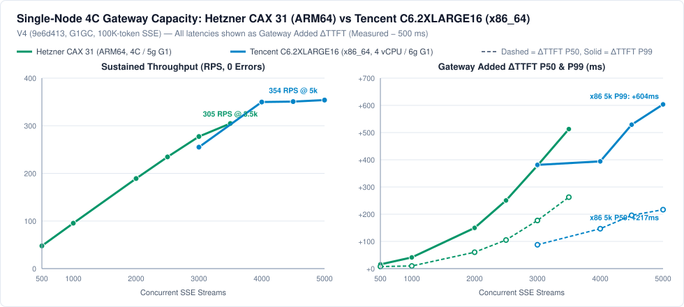

# 03. 双机极限容量对比与部署建议（ARM64 vs x86_64）

本报告横向对比重构最终版 `V4 (9e6d413)` 在两台主流云主机上的实测容量边界，所有延迟均以**网关净增耗时 `ΔTTFT = 实测首帧时间 − 500 ms`** 呈现，所有有效档位均满足 **`0 错误`、`%steal = 0.00`、`in-flight maintained = 100%`、`valid = yes`**。

---

## 一、腾讯云 CVM（计算型 C6 | `C6.2XLARGE16`，x86_64）

- **机型配置**：8 vCPU Intel Xeon Platinum 8372C @ 3.20 GHz（4 物理核 × 2 HT）/ 16 GiB RAM / 内核 `6.12.115+deb13.1-amd64`
- **网关硬隔离配额**：`taskset -c 0-3`（独占 **2 颗完整物理核 × 2 HT**）+ `-XX:ActiveProcessorCount=4 -Xms6g -Xmx6g -XX:+UseG1GC`，`nettyEpoll=true`，`HYPERLLM_UPSTREAM_MAX_CONNECTIONS_PER_PROVIDER=10000`（完全落在 **4C8G** 单机配额内）
- **同/跨协议说明**：网关所有请求统一经 Canonical IR 转换，经 ARM64 全矩阵验证同协议与跨协议开销完全持平。

| 并发 | 版本 / 堆 | RPS | 入站 / 帧率 (fps) | `ΔTTFT` P50 / P99 | StreamTPS P50 | YGC / 暂停 | Full / Conc / Mixed | 老年代峰值 | Direct | 网关 CPU | mock CPU |
| --: | :-- | --: | --: | --: | --: | --: | :--: | --: | --: | --: | --: |
| 3,000 | 重构前 `V3` (8g) | 270.3 | — | +143.0 / +617.0 ms | — | 42 / 3,646 ms | 0 / — / — | 7,162 MB (堆峰) | — | 85.7% | — |
| **3,000** | **`V4` (6g)** | 255.10 | 97.6 MB/s / 102,295 | **+87.6 / +381.4 ms** | 183.8 | **8 / 565 ms** | 0 / 2 / 4 | **288 MB** | 48.8 MB | 86.0% | 60.4% |
| 3,800 | 重构前 `V3` (8g) | 318.6 | — | +460.0 / +1,446.0 ms | — | 60 / 4,691 ms | **1 (511ms)** | **8,191 MB (满)** | — | 89.1% | — |
| 4,000 | 重构前 `V3` (10g) | 333.9 | — | +592.0 / +2,001.0 ms | — | 53 / 4,942 ms | **1 (601ms)** | 9,283 MB (堆峰) | — | 89.6% | — |
| **4,000** | **`V4` (6g)** | **349.87** | **133.8 MB/s / 140,297** | **+146.7 / +394.0 ms** | **188.9** | **9 / 647 ms** | **0 / 0 / 0** | **234 MB** | 52.8 MB | 87.8% | 80.6% |
| **4,500** | **`V4` (6g)** | **350.72** | **134.2 MB/s / 140,637** | **+195.8 / +529.0 ms** | 173.7 | **9 / 724 ms** | **0 / 0 / 0** | **241 MB** | 44.8 MB | 89.6% | 85.3% |
| **5,000** | **`V4` (6g)** | **353.97** | **135.4 MB/s / 141,941** | **+216.6 / +603.7 ms** | 156.9 | **10 / 833 ms** | **0 / 0 / 0** | **244 MB** | 48.8 MB | 89.9% | 86.5% |
| 6,000* | `V4` (6g) | 338.80 | 129.6 MB/s / 135,859 | +300.1 / +912.3 ms | 131.9 | 10 / 1,105 ms | 0 / — / — | 245 MB | 64.8 MB | 91.4% | 88.4% |
| 7,000* | `V4` (6g) | 333.72 | 127.7 MB/s / 133,820 | +366.7 / +1,069.1 ms | 114.0 | 10 / 1,212 ms | 0 / — / — | 318 MB | 40.8 MB | 92.4% | 89.9% |

> `*` `6,000 / 7,000` 档在 0 错误、0 Full GC、老年代仅 245–318 MB 下仍可完整跑完，但受 2 颗物理核 ~354 RPS / ~142k 帧/s 的 CPU 吞吐平台限制，单流速率下降且 `ΔTTFT` P99 超过 900 ms，因此以 **5,000 并发** 作为该 4 vCPU 节点的稳态推荐上限（较重构前 3,200 并发提升 **+56.3%**）。

---

## 二、Hetzner Cost-Optimized `CAX 31`（ARM64）

- **机型配置**：8 vCPU ARM Neoverse-N1（无 SMT）/ 16 GiB RAM / 内核 `6.12.107+deb13-arm64`
- **网关硬隔离配额**：`taskset -c 0-3`（4 vCPU）+ `-XX:ActiveProcessorCount=4 -Xms5g -Xmx5g`，`nettyEpoll=true`（同样满足 **4C8G** 配额）

| 并发 | 协议 / GC | RPS | 帧率 (fps) | `ΔTTFT` P50 / P99 | StreamTPS P50 | YGC / 总停顿 | Full GC | 老年代峰值 | Direct | 网关 CPU | mock CPU |
| --: | :-- | --: | --: | --: | --: | --: | :--: | --: | --: | --: | --: |
| 2,000 | Same · G1 | 189.18 | 75,863 | +60.2 / +149.8 ms | 200.8 | 6 / 291 ms | **0** | 139 MB | 41.0 MB | 89.2% | 63.7% |
| 2,000 | Cross · G1 | 189.02 | 75,607 | +59.3 / +156.3 ms | 200.2 | 5 / 239 ms | **0** | 137 MB | 45.0 MB | 89.0% | 64.3% |
| 2,500 | Same · G1 | 234.60 | 94,075 | +105.1 / +250.5 ms | 200.3 | 7 / 376 ms | **0** | 126 MB | 49.0 MB | 91.6% | 74.4% |
| 2,500 | Cross · G1 | 234.13 | 93,653 | +105.2 / +255.5 ms | 199.5 | 7 / 402 ms | **0** | 139 MB | 53.0 MB | 91.7% | 75.0% |
| **3,000** | **Same · G1** | **277.43** | **111,251** | **+176.8 / +378.6 ms** | **199.1** | **8 / 508 ms** | **0** | **131 MB** | 49.0 MB | 93.6% | 84.3% |
| **3,000** | **Cross · G1** | **277.75** | **111,100** | **+174.6 / +370.0 ms** | **198.9** | **8 / 487 ms** | **0** | **141 MB** | 57.0 MB | 93.3% | 84.3% |
| **3,500** | **Same · G1** | **304.72** | **122,191** | **+262.5 / +512.8 ms** | **189.9** | **9 / 652 ms** | **0** | **134 MB** | 61.0 MB | 94.4% | 88.2% |
| **3,500** | **Cross · G1 (V4)** | 298.08 | 119,233 | +255.5 / +532.5 ms | 185.3 | 10 / 659 ms | **0** | 144 MB | 61.0 MB | 94.6% | 88.9% |
| 3,500 | Cross · GenZGC (V4) | 293.08 | 117,233 | +380.2 / +768.3 ms | 187.4 | 61 / **2 ms** | **0** | 768 MB | 73.0 MB | 94.7% | 88.5% |
| 3,000 | Cross · G1 (**V5**) | 275.70 | 110,280 | +157.7 / +380.5 ms *(充分预热 +143.4/+237.6)* | 196.9 | 9 / 587 ms | **0** | **91 MB** | 48.6 MB | 94.3% | 66.8% |
| **3,500** | **Cross · G1 (V5)** | **318.80** | **127,520** | **+182.6 / +315.9 ms** | **196.7** | **10 / 671 ms** | **0** | **96 MB** | 52.6 MB | 94.5% | 75.6% |
| **4,000** | **Cross · G1 (V5)** | **360.92** | **144,367** | **+234.4 / +398.8 ms** | **195.6** | **11 / 811 ms** | **0** | **99 MB** | 60.6 MB | 95.2% | 83.1% |
| 4,500* | Cross · G1 (V5) | 381.32 | 152,527 | +382.3 / +862.6 ms | 187.9 | 15 / 1,399 ms | **0** | 327 MB | 104.6 MB | 97.0% | 87.0% |
| 5,000* | Cross · G1 (V5) | **384.02** | **153,607** | +357.1 / +608.1 ms | 169.5 | 13 / 1,227 ms | **0** | 337 MB | 76.6 MB | 96.7% | 87.6% |

- 经 `V5 (8b60b2f)` P0 优化（Thread-per-Core 亲和 Epoll + 独立 Lettuce 隔离 + `DirectStreamBridgeOperator` + SWAR + Kafka 批量遥测）并将压测套件全面重写为 Rust 后，ARM64 4C/5g **全速稳态推荐上限从 `3,500` 跃升至 `4,000` 并发**（`360.92 RPS`、`144,367 fps`、`StreamTPS P50 = 195.6 tok/s`、老年代仅 `99 MB`），突发吞吐峰值可承压至 **`5,000` 并发**（`384.02 RPS`、`153,607 fps`、`0 错误 / 0 Full GC`）。详尽优化与 `c4500` 饱和拐点排障见 [04-v5-p0-optimization-and-reflections.md](./04-v5-p0-optimization-and-reflections.md)。

---

## 三、双机对比与生产 4C8G 部署建议

1. **硬件性价比与容量差异**：
   - 腾讯云 `C6.2XLARGE16`（Intel Xeon Platinum 8372C）4 vCPU（2 物理核）可稳定支撑 **5,000 并发 / ~354 RPS / ~142k 帧/s**；
   - Hetzner `CAX 31`（ARM64 Neoverse-N1）在 `V5 (8b60b2f)` 下，以极低成本即可稳定支撑 **4,000 全速并发 / ~361 RPS / ~144k 帧/s**（峰值 5,000 并发 / `384 RPS` / `153.6k` 帧/s），老年代常驻压至 **`91–99 MB`**。
2. **推荐生产 JVM 配额（4C8G 节点）**：
   - `-Xms4g -Xmx4g -XX:+UseG1GC -XX:+AlwaysPreTouch`（留足 4 GiB 给 OS Page Cache、Netty Direct Buffer 约 60–100 MB 及 Metaspace；突发流量场景建议追加 `-XX:+UnlockExperimentalVMOptions -XX:G1NewSizePercent=40` 防止 G1 过度收缩 Eden 触发过早晋升）；
   - 单上游连接池需按并发目标调高：`HYPERLLM_UPSTREAM_MAX_CONNECTIONS_PER_PROVIDER=10000`。
3. **`V5` 后的物理边界与后续方向**：
   - `V5 @ c3000` CPU 火焰图中 **`92.56%`** 已集中在 Netty Epoll I/O（其中纯内核 `libc.so.6` 系统调用占 **`46.88%`**），锁竞争较 `V4` 再降 **77.7%**（`1,379 → 308`），业务锁接近归零；
   - SSE 帧合并窗默认关闭（`coalesce=0`），实测 5 tok/帧场景无需开启；仅在 1 tok/帧超高帧率场景且改造成 EventLoop 本地无锁合并后再启用；若未来需要进一步压缩堆分配，下一个唯一高占比点为每帧新建 `UTF8StreamJsonParser`（占分配 ~30%+）。
