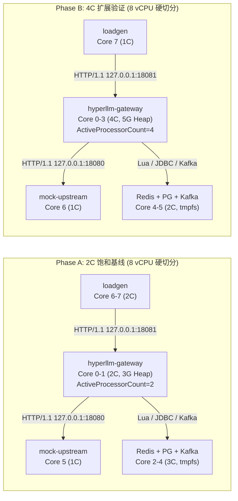

# HyperLLM Gateway ARM64 KVM 基线压力测试与剖析报告

- **测试日期**：2026-11-25
- **代码基线**：`main@1174a6f`（包含 `38c13d9` 字节长度 Token 估算、`073e2d1` ARM64 Netty Epoll 优化、`1174a6f` Go 压测工具套件）
- **被测服务**：`hyperllm-gateway`（Spring Boot 3.5.16 / WebFlux / Reactor Netty / Java 21 LTS）
- **交互式火焰图附件**（可直接用浏览器打开）：
  - CPU 火焰图 (`ctimer`)：[cpu-2c.html](./artifacts/cpu-2c.html)
  - 内存分配火焰图 (`alloc`)：[alloc-2c.html](./artifacts/alloc-2c.html)
  - 锁竞争火焰图 (`lock`)：[lock-2c.html](./artifacts/lock-2c.html)

---

## 核心结论摘要

1. **稳定性与零泄漏验证通过**：2C 与 4C 全套 20+ 组压测（总计 10 万+ 请求，含 1,000 并发 SSE 长连接与 100 并发中途强断）**100% HTTP 200（`err=0`）**；跑完 4C 全套后 Netty Direct Memory 仅 **`21.6 MB`**、G1 Old Gen 仅 **`40.3 MB`**、**0 次 Full GC**，80,224 条账务 Outbox 全部落库无丢弃。
2. **吞吐与并发实测基线**：
   - **非流式短包天花板（S1）**：2C 独占核热机峰值 **`1,081 RPS`**；4C 独占核同样停在 **`1,073 RPS`**（并非网关到顶，而是单实例 Redis 在 ~1,100 RPS 打满单核）。
   - **流式 SSE 并发能力（S2a/S2b）**：4C 稳态扛住 **1,000 并发流 / `877 RPS` / `27,095 SSE 帧/秒`**（Mock TTFT=100ms 时网关 P50 TTFT 为 `175.4ms`）；500 并发下同协议透传（`115.5ms`）与 **Anthropic → OpenAI 跨协议转换（`116.3ms`）** 表现几乎一致，跨协议转换开销极低。
   - **Coding Agent 大上下文（S3）**：4C 下 50KB (+16 tools) 达 **`729 RPS`**（P99 `59.4ms`），200KB (+16 tools) 达 **`509 RPS`**（P99 `80.9ms`）。
3. **`async-profiler 4.0` 揭示的真实瓶颈（颠覆预设直觉）**：
   - 常规包下 **Jackson 仅占 `3.61%` CPU**、**AES-GCM/HMAC 加密仅占 `1.08%` CPU**（ARMv8 硬件指令已生效）。
   - **头号性能 Bug（白白烧掉 `~21%` 网关总 CPU + `25%` 堆内存分配）**：`RedisScript.of(new ClassPathResource(...))` 在 Spring Boot Fat JAR 里每次执行 `eval` 都会触发 `ResourceScriptSource.isModified()` → **抛出完整栈的 `FileNotFoundException`** → 回退走 `NestedUrlConnection.getLastModified()` 调 `statx()` 系统调用，每请求 5~7 次！
   - **系统级第一天花板（单线程 Redis）**：每请求发 **6~7 次** Redis 往返/重 Lua 脚本（含每请求扫过期 ZSET 的 `reclaimExpired`），导致单机 Redis 在 ~1,100 RPS 时单核 CPU 飙至 `72%~95%`。
   - **次要浪费（`~3.2%` CPU）**：4 处 `.switchIfEmpty(Mono.error(new ...))` 急切求值，每次正常请求都白白构造 4 个完整 JVM 异常栈。
   - **真实线上 Bug**：S4 客户端中途断开 SSE 时，`GatewayExceptionHandler` 试图向已提交 `200 OK` 的响应写 500 JSON，每次断流都打满 `ERROR` 堆栈 + `UnsupportedOperationException`。

---

## 一、服务器硬件与运行环境配置

测试主机位于芬兰赫尔辛基，为共享宿主机 KVM 虚拟化 ARM64 实例（控制端位于国内，两地公网 RTT ≈ 200ms）：

| 项目 | 实测规格 / 版本 |
| :--- | :--- |
| **主机名 / 架构** | `debian-cax31-hel-1` / `aarch64` (ARM64) |
| **操作系统 / 内核** | Debian GNU/Linux 13 (`trixie`), `Linux 6.12.107+deb13-arm64 #1 SMP` |
| **虚拟化平台** | QEMU / KVM |
| **CPU** | 8 vCPU **ARM Neoverse-N1**（8 cores / socket，无 SMT 超线程 `Thread(s) per core: 1`，单 NUMA node `0-7`） |
| **关键 CPU 指令集 Flags** | `fp asimd evtstrm aes pmull sha1 sha2 crc32 atomics fphp asimdhp cpuid asimdrdm lrcpc dcpop asimddp`（确认支持硬件 AES-GCM、SHA-256 与 ARMv8.1 LSE Atomics） |
| **内存 / Swap** | 15 GiB RAM（压测前空闲可用 13 GiB），Swap `0B` |
| **磁盘** | `152.6G` `QEMU HARDDISK`（SSD，`ROTA=0`，剩余 139G） |
| **JVM** | OpenJDK `21.0.13.1` (build `21.0.13.1+2-1-deb13u1-Debian`, 64-Bit Server VM) |
| **Go 工具链** | `go1.24.4 linux/arm64` |
| **Docker** | Docker `29.10.0`（所有容器均使用原生 `linux/arm64` 镜像，零 QEMU 模拟） |
| **性能剖析与监控** | `Async-profiler 4.0` (`linux-arm64`), `sysstat 12.7.5` (`mpstat`) |
| **端口避让** | 检测到宿主机 `127.0.0.1:8080` 已被 `1Panel-jenkins` 占用，本次压测将 `hyperllm-gateway` 运行在 **`18081`** 端口，Mock Upstream 运行在 **`18080`** 端口 |

---

## 二、压测前准备与前置优化

### 2.1 代码与运行时前置优化

1. **彻底移除 BPE Tokenizer（`38c13d9`）**：消除热路径上纯 Java `jtokkit` 分词及流式 `StringBuilder` 文本缓冲，改用 O(1) 字节长度估算。
2. **补齐 ARM64 原生 Netty Epoll（`073e2d1`）**：
   - 在 `backend/gateway/pom.xml` 显式加入 `io.netty:netty-transport-native-epoll`（`<classifier>linux-aarch_64</classifier>`），防止 Reactor Netty（入站 Server、出站 WebClient）与 Lettuce（Redis 响应式客户端）在 ARM64 Linux 上静默退化为 JDK NIO。
   - 在 `GatewayConfiguration` 加入启动诊断日志，压测启动时实证输出：
     ```text
     HyperLLM Gateway runtime: os=Linux arch=aarch64 cpus=2 maxHeapMB=3072 nettyEpoll=true epollCause=none upstreamMaxConnPerProvider=5000
     HyperLLM Gateway runtime: os=Linux arch=aarch64 cpus=4 maxHeapMB=5120 nettyEpoll=true epollCause=none upstreamMaxConnPerProvider=5000
     ```
3. **对齐入站编解码缓冲上限**：在 `backend/gateway/src/main/resources/application.yml` 增加 `spring.codec.max-in-memory-size: ${GATEWAY_MAX_IN_MEMORY_SIZE:16MB}`（默认 256KB 会拒绝大上下文与多模态请求）。
4. **上游连接池与采样开关**：
   - 默认 `hyperllm.upstream.max-connections-per-provider=200` 在高并发 SSE 下会触发 `PoolAcquirePendingLimitException`，压测时通过环境变量调至 **`5000`**。
   - 压测未启动 `otel-collector`，将 `OTEL_TRACES_SAMPLING_PROBABILITY=0` 关闭无效追踪上报。

### 2.2 Linux KVM 内核与网络调优（`benchmark/scripts/sysctl-bench.sh`）

```bash
sysctl -w net.core.somaxconn=65535
sysctl -w net.core.netdev_max_backlog=65535
sysctl -w net.ipv4.tcp_max_syn_backlog=65535
sysctl -w net.ipv4.ip_local_port_range="1024 65535"
sysctl -w net.ipv4.tcp_tw_reuse=1
sysctl -w net.ipv4.tcp_fin_timeout=15
sysctl -w fs.file-max=1048576
ulimit -n 65535
```

### 2.3 精简基础设施栈与零依赖 Go 压测套件

- **基础设施（`benchmark/infra/docker-compose.bench.yml` + `docker-compose.bench.tmpfs.yml`）**：
  - 仅启动网关热路径必需的 3 个容器：`postgres:16-alpine`、`redis:7-alpine`、`apache/kafka:3.9.0`（不启 Debezium、ClickHouse、Kafka-UI）。
  - 全部使用 `network_mode: host` 走 Linux loopback，规避 Docker bridge NAT / `nf_conntrack` 表瓶颈。
  - 本次基线启用 `BENCH_TMPFS=1`（Redis 关闭 AOF `--appendonly no --save ""`，Postgres / Kafka 数据挂 `tmpfs` 内存盘，关闭 `fsync`），专门剥离 KVM 虚拟块存储抖动，测出纯计算/网络/协议栈天花板。
- **Go 压测工具（`benchmark/cmd/`，纯标准库零外部依赖）**：
  - `mock-upstream`：支持 OpenAI Chat、OpenAI Responses、Anthropic Messages、Google Gemini 四套协议（非流式 + SSE），响应体与 SSE 帧在启动时预序列化为静态 `[]byte`，请求体使用 `sync.Pool` 8KB 缓冲零分配流式消费，支持 `POST /_mock/config` 运行时热切 TTFT / chunks / interval。
  - `loadgen`：支持四协议请求构造、大包 Agent 多轮对话 + JSON Schema tools 生成（`-payload-kb` / `-tools`）、JIT 预热（`-warmup`）、精确无锁纳秒分位统计（Min/Mean/P50/P90/P95/P99/P99.9/Max，含 TTFT 与 TPOT）及中途断流模拟（`-abort-after-chunks`）。
  - `bench-seed`：幂等生成压测租户、\$100M 余额钱包、无流控限制的 Live API Key（精确 `HmacSha256` 摘要）、3 条 AES-256-GCM 加密上游渠道与 4 个虚拟模型。

---

## 三、压力测试方案设计（「降核硬隔离」同机饱和法）

### 3.1 为什么不跨公网压测、也不用本地 WSL

1. **避免 200ms 跨国 RTT 失真**：网关单请求需 6~7 次串行 Redis 交互，跨 200ms 仅网络空等就超 1.2s；且本地发压受 Little's Law 与公网丢包限速，测不出网关自身毫秒级开销。
2. **避免本地 WSL2 瓶颈**：WSL2 虚拟磁盘与网桥 I/O 性能远低于原生 Linux。
3. **同机防抢核机制**：在单台 8C16G 上直接“混跑”会导致发压器、Mock、Redis 和网关互相抢 CPU。因此采用 **Scaled-Down Saturation（降核硬隔离饱和法）**——用 `taskset` + Docker `--cpuset-cpus` + JVM `-XX:ActiveProcessorCount` 将 8 核硬切分，确保**只让被测网关先跑到饱和，其余所有辅助组件 CPU 均有充足余量**，同时对比 2C → 4C 验证多核扩展性。

### 3.2 CPU 核硬隔离拓扑



### 3.3 JVM 启动参数

```bash
# Phase A (2C) / Phase B (4C)
taskset -c 0-1 java \
  -XX:ActiveProcessorCount=2 -Xms3g -Xmx3g \
  -XX:+UseG1GC -XX:+AlwaysPreTouch \
  -XX:+UnlockDiagnosticVMOptions -XX:+DebugNonSafepoints \
  -Dio.netty.leakDetection.level=disabled \
  -jar backend/gateway/target/hyperllm-gateway-1.0-SNAPSHOT.jar
```

### 3.4 压测场景矩阵

| 场景编号 | 协议与路由 | 模式与 Mock 参数 | 请求体大小 | 并发梯度 | 测试目标 |
| :--- | :--- | :--- | :---: | :---: | :--- |
| **S1** | OpenAI Chat → OpenAI Chat | 非流式，Mock `0ms` | `219 B` | 32 / 64 / 128 | 网关纯入口处理吞吐天花板（RPS）与热路径 CPU 极限 |
| **S2a** | OpenAI Chat → OpenAI Chat | SSE 流式，`TTFT=100ms`, `30 chunks @ 30ms` | `218 B` | 200 / 500 / 1000 | 同协议透传流式并发承载力、TTFT 附加延迟、TPOT 抖动、堆外内存 |
| **S2b** | Anthropic → OpenAI Chat | SSE 流式，`TTFT=100ms`, `30 chunks @ 30ms` | `199 B` | 200 / 500 | 跨协议 Canonical IR 转换 + 流式状态机编解码额外开销 |
| **S3** | OpenAI Chat → OpenAI Chat | 非流式，Mock `0ms` | `52 KB` / `206 KB` (+16 tools) | 32 | Coding Agent 大上下文 + 多工具 Schema 下 Jackson 解析与 GC 压力 |
| **S4** | OpenAI Chat → OpenAI Chat | SSE 流式，`TTFT=50ms`, 读 5 帧强断 | `218 B` | 100 | 客户端中途断连背压、连接释放、流式估算结算与错误处理健壮性 |

---

## 四、完整压测结果（2C vs 4C）

### 4.1 重要观测：JVM JIT C2 预热对 S1 的影响（2C 对比）

Phase A 首次冷启动后仅用 5s warmup 跑 S1，C2 尚未完成编译，随后充分预热复测 S1，性能直接翻倍：

| 测试状态（2C 独占核） | 并发 | 请求数 | 错误数 | **RPS** | Latency P50 | Latency P95 | Latency P99 |
| :--- | :---: | :---: | :---: | :---: | :---: | :---: | :---: |
| 冷启动首轮（仅 5s warmup） | 64 | 4,492 | 0 | 299.45 | 191.61 ms | 331.21 ms | 399.27 ms |
| 冷启动次轮 | 128 | 7,884 | 0 | 525.49 | 236.59 ms | 304.62 ms | 398.49 ms |
| **热机复测（C2 稳态）** | **32** | 9,170 | 0 | **916.91** | **32.80 ms** | **49.33 ms** | **61.94 ms** |
| **热机复测（C2 稳态）** | **64** | 10,710 | 0 | **1,070.91** | **57.59 ms** | **73.91 ms** | **104.94 ms** |
| **热机复测（C2 稳态）** | **128** | 10,817 | 0 | **1,081.36** | **115.28 ms** | **141.84 ms** | **169.47 ms** |

> 因此 Phase B（4C）在正式记录前加入了独立的 **15 秒全速 JIT 预热**（预热期 486 RPS → 正式稳态 1,073 RPS）。

### 4.2 全场景详细性能数据（2C 稳态 vs 4C 稳态，每组持续 15s，全部 `err=0`）

| 场景 | 核数 | 请求数 | **RPS** | **SSE Events/s** | 读吞吐 | Latency Min / P50 / P95 / P99 / Max (ms) | TTFT P50 / P95 / P99 (ms) | TPOT P50 / P99 (ms) |
| :--- | :---: | :---: | :---: | :---: | :---: | :---: | :---: | :---: |
| **S1 Non-stream c64** (219B) | 2C (热) | 10,710 | **1,070.91** | - | 0.39 MB/s | 38.4 / 57.6 / 73.9 / 104.9 / 119.8 | - | - |
| **S1 Non-stream c64** (219B) | 4C | 12,861 | **857.29** | - | 0.31 MB/s | 49.1 / 73.8 / 88.2 / 97.7 / 169.5 | - | - |
| **S1 Non-stream c128** (219B) | 2C (热) | 10,817 | **1,081.36** | - | 0.40 MB/s | 80.9 / 115.3 / 141.8 / 169.5 / 194.1 | - | - |
| **S1 Non-stream c128** (219B) | 4C | 16,108 | **1,073.41** | - | 0.39 MB/s | 85.3 / 116.2 / 139.3 / 189.6 / 210.8 | - | - |
| **S2a OpenAI SSE c200** | 2C | 2,730 | **181.96** | 5,570.39 | 1.00 MB/s | 140.4 / 1098.2 / 1199.9 / 1226.2 / 1354.4 | 164.9 / 249.7 / 285.2 | 30.05 / 34.18 |
| **S2a OpenAI SSE c200** | 4C | 2,834 | **188.87** | 5,922.41 | 1.07 MB/s | 122.1 / 1030.0 / 1046.7 / 1059.2 / 1066.5 | **109.5 / 123.3 / 131.9** | 29.71 / 32.00 |
| **S2a OpenAI SSE c500** | 2C | 5,556 | **370.28** | 11,581.96 | 2.09 MB/s | 147.1 / 1340.6 / 1566.9 / 1602.2 / 1628.5 | 361.9 / 553.0 / 625.7 | 31.79 / 39.42 |
| **S2a OpenAI SSE c500** | 4C | 7,149 | **476.16** | 14,687.92 | 2.65 MB/s | 119.1 / 1038.1 / 1123.1 / 1191.3 / 1229.4 | **115.5 / 181.8 / 209.0** | 29.80 / 34.12 |
| **S2a OpenAI SSE c1000** | 2C | 8,158 | **543.33** | 16,972.76 | 3.06 MB/s | 797.6 / 1732.4 / 1938.0 / 2028.3 / 2141.5 | 683.9 / 867.1 / 911.8 | 35.93 / 42.05 |
| **S2a OpenAI SSE c1000** | 4C | 13,179 | **877.19** | **27,094.90** | **4.89 MB/s** | 160.7 / 1112.7 / 1269.3 / 1365.3 / 1462.4 | **175.4 / 337.1 / 384.8** | **30.26 / 34.66** |
| **S2b Ant→OAI SSE c200** | 2C | 2,816 | **187.69** | 6,555.72 | 0.80 MB/s | 112.5 / 1033.9 / 1074.4 / 1095.5 / 1116.2 | 112.9 / 142.5 / 159.3 | 26.35 / 29.21 |
| **S2b Ant→OAI SSE c200** | 4C | 2,810 | **187.26** | 6,594.21 | 0.80 MB/s | 114.9 / 1030.4 / 1047.5 / 1058.0 / 1068.1 | **109.7 / 123.3 / 130.0** | 26.31 / 29.23 |
| **S2b Ant→OAI SSE c500** | 2C | 5,756 | **383.44** | 13,497.95 | 1.64 MB/s | 231.9 / 1283.3 / 1416.1 / 1496.2 / 1562.7 | 303.0 / 443.2 / 493.4 | 27.94 / 32.33 |
| **S2b Ant→OAI SSE c500** | 4C | 7,180 | **478.26** | **16,623.01** | 2.02 MB/s | 121.9 / 1039.9 / 1080.3 / 1103.6 / 1136.0 | **116.3 / 154.1 / 172.3** | **26.39 / 29.16** |
| **S3 Agent 50KB c32** (52.5KB) | 2C | 10,299 | **686.58** | - | 0.25 MB/s | 24.5 / 44.8 / 62.6 / 110.2 / 140.0 | - | - |
| **S3 Agent 50KB c32** (52.5KB) | 4C | 10,941 | **729.33** | - | 0.27 MB/s | 29.0 / 43.0 / 51.7 / **59.4** / 125.1 | - | - |
| **S3 Agent 200KB c32** (206.7KB) | 2C | 6,675 | **444.97** | - | 0.16 MB/s | 29.4 / 70.4 / 94.0 / 140.1 / 175.8 | - | - |
| **S3 Agent 200KB c32** (206.7KB) | 4C | 7,641 | **509.35** | - | 0.19 MB/s | 42.3 / 62.1 / 73.3 / **80.9** / 91.5 | - | - |
| **S4 Abort@5chunks c100** | 2C | 7,095 | **473.00** | 2,350.92 | 0.43 MB/s | 63.1 / 208.7 / 254.2 / 272.8 / 303.4 | 91.8 / 129.5 / 146.9 | 30.09 / 41.25 |
| **S4 Abort@5chunks c100** | 4C | 7,990 | **532.58** | 2,652.88 | 0.48 MB/s | 64.3 / 184.2 / 205.1 / 237.2 / 276.5 | **64.7 / 85.0 / 115.3** | 30.03 / 31.70 |

### 4.3 分核 CPU 利用率（`mpstat -P ALL 1`）与瓶颈归因

全程所有场景 **`%steal = 0.00%`**，数据零虚拟化抖动污染：

| 场景 | Gateway 核利用率 | Infra 核利用率（Redis+PG+Kafka） | Mock 核利用率 | Loadgen 核利用率 | 瓶颈归属 |
| :--- | :--- | :--- | :---: | :---: | :--- |
| **2C `S1_c128`** | Core 0-1: **100% / 100%** (`0% idle`) | Core 2-4: 62% / 46% / 65% | Core 5: 9% | Core 6-7: 10% / 6% | **2C Gateway 满载** |
| **2C `S2a_c1000`** | Core 0-1: **95% / 94%** | Core 2-4: 40% / 26% / 29% | Core 5: 29% | Core 6-7: 20% / 17% | **2C Gateway 满载** |
| **4C `S1_c128`** | Core 0-3: 40% / 73% / 41% / 39% | Core 4-5: **85% / 87%** | Core 6: 11% | Core 7: 17% | **单线程 Redis 触顶** |
| **4C `S2a_c1000`** | Core 0-3: **92% / 92% / 89% / 88%** | Core 4-5: 60% / 68% | Core 6: 59% | Core 7: 49% | **4C Gateway 接近满载（27k 帧/s）** |
| **4C `S3_50kb_c32`** | Core 0-3: 46% / 50% / 82% / 50% | Core 4-5: **97% / 99%** | Core 6: 16% | Core 7: 18% | **Infra 2 核打满（Redis 主导）** |

**`docker stats` 瞬时拆解（4C `S1_c128` 期间）**：

| 容器 | CPU 占用（单核=100%） | 内存占用 |
| :--- | :---: | :---: |
| `hyperllm-bench-redis` | **72.28%**（峰值触及单核上限） | `271.9 MiB` |
| `hyperllm-bench-postgres` | `25.39%` | `1.19 GiB` |
| `hyperllm-bench-kafka` | `20.79%` | `610.5 MiB` |

> **关键解释**：单线程 Redis 在 ~1,100 RPS 承担 **~6,600–7,700 次/秒** 复杂 Lua 执行（每请求 6~7 次 Redis 往返），因此 4C `S1` 被单实例 Redis 锁在 1,073 RPS；而在 **S2a 1,000 并发流式场景** 中，单流持续 ~1s（RPS=877 尚未顶穿 Redis 单核），4C 网关顺利吃满 4 核（~90%），吞吐较 2C 提升 **+62%**（`543 → 877 RPS`，`16,973 → 27,095 SSE 帧/秒`），且 TTFT P50 从 `683.9ms` 骤降至 **`175.4ms`**。

---

## 五、JVM 内存、GC 与持久化观测（Prometheus 实测）

| 指标（整轮 10 场景跑完后采集） | Phase A（2C · `3G Heap`） | Phase B（4C · `5G Heap`） | 评估 |
| :--- | :---: | :---: | :--- |
| 累计堆对象分配 (`jvm_gc_memory_allocated_bytes_total`) | `44.69 GB` | `60.06 GB` | 单请求分配偏高，主要源于 `RedisScript` 反复建 URL 与异常对象（见第六节） |
| 晋升老年代 (`jvm_gc_memory_promoted_bytes_total`) | `74.61 MB` (`0.17%`) | `40.72 MB` (`0.068%`) | 极健康，99.8%+ 对象在 Eden 回收 |
| **G1 Young GC 次数 (`G1 Evacuation Pause`)** | `28 次` | `21 次` | 约每 8~10 秒一次 |
| **G1 Young GC 总耗时 / 均值 / 最大 STW** | `1.832s` / `65.4ms` / **`122ms`** | `1.014s` / `48.3ms` / **`78ms`** | 5G 堆 + 4C 下 GC 停顿非常平稳 |
| **Full GC 次数** | **`0`** | **`0`** | 零 Full GC |
| **G1 Old Gen 占用** | `90.2 MB` | **`40.3 MB`** | 无内存泄漏 |
| **Netty Direct Memory (`direct`)** | `17.3 MB` (`29 buffers`) | **`21.6 MB`** (`33 buffers`) | 1,000 并发 SSE 下零堆外泄漏 |
| Metaspace / Compressed Class Space | `116.1 MB` / `12.8 MB` | `116.3 MB` / `12.8 MB` | 稳定 |
| JVM 活跃线程 / 峰值线程 | `40` / `44` | `44` / `49` | 极轻量（纯 Reactive + 少量后台/Outbox/Kafka 线程） |
| Postgres `outbox_events` 落库行数（2C 全套后） | `80,224 行`（0 丢弃 / 0 次 503） | 正常 | 单线程批量写 Outbox 轻松消化 |
| Redis Key 数 / 内存（2C 全套后） | `322,395 keys` / `178.6 MB` | `271.9 MB` | `hold_done`/`settle_proof` 等 1h TTL 凭证约占 ~2.2KB/请求 |

---

## 六、`async-profiler 4.0` 剖析结果与火焰图

在 2C 稳态（`S1_prof_c64`，实测 `1,015 RPS`）期间，使用 KVM/ARM64 无 PMU 依赖的 `-e ctimer`、`-e alloc`、`-e lock` 分别采样，生成交互式火焰图与完整调用栈：

- CPU 火焰图：[docs/benchmark/artifacts/cpu-2c.html](./artifacts/cpu-2c.html)
- Alloc 火焰图：[docs/benchmark/artifacts/alloc-2c.html](./artifacts/alloc-2c.html)
- Lock 火焰图：[docs/benchmark/artifacts/lock-2c.html](./artifacts/lock-2c.html)

### 6.1 CPU（`ctimer`）按组件拆解（Total samples = `1,386`）

| CPU 占比 | 样本数 | 组件 / 根因 |
| :---: | :---: | :--- |
| **34.42%** | 477 | Redis / Lettuce 响应式协议栈（含每请求 6~7 次编解码与调度） |
| **17.97%** | 249 | Inbound WebFlux / Reactor Netty HTTP Server |
| **14.86%** *(+ ~6% `fill_in_stack_trace` = **~21%**)* | 206 *(+ 83)* | **`DefaultRedisScript.getSha1()` → `ResourceScriptSource.isModified()` → 抛 `FileNotFoundException` + `NestedUrlConnection` `statx`！** |
| **8.87%** | 123 | JVM / GC / Netty Core 公共开销 |
| **7.86%** | 109 | Upstream WebClient (Reactor Netty) |
| **4.55%** | 63 | Kafka Producer / Consumer |
| **3.61%** | 50 | **Jackson JSON 解析/序列化**（常规小包下并非第一瓶颈） |
| **3.46%** | 48 | `OutboxWriter` → Postgres JDBC 批量写 |
| **3.17%** | 44 | **业务热路径急切 `Mono.error(new ...)` 异常栈构造** |
| **1.08%** | 15 | Crypto (`AesGcmCipher` + `HmacSha256`，已走 ARMv8 硬件指令) |
| **0.14%** | 2 | 其余 Gateway 业务逻辑 |

### 6.2 内存分配（`alloc`）按组件拆解（Total samples = `4,320`）

| 分配占比 | 组件 / 根因 |
| :---: | :--- |
| **33.82%** | Redis / Lettuce 响应式通信（`byte[]`, `HeapByteBuffer`, `CommandArgs`） |
| **24.95%** | **`RedisScript.getSha1()` 反复构造 `URL` / `JarFileUrlKey` / `NestedUrlConnection` / `FileNotFoundException`！** |
| **11.57%** | Inbound WebFlux HTTP Server |
| **11.06%** | `OutboxWriter` → Postgres JDBC |
| **5.86%** | Upstream WebClient |
| **5.05%** | Jackson JSON 解析/序列化 |
| **2.43%** | 急切 `Mono.error(new ...)` 异常对象分配 |
| **2.04%** | Crypto (`AesGcmCipher` / `HmacSha256`) |
| **2.04%** | Kafka Producer / Consumer |
| **1.18%** | 其他（含 `CostMath` 中的 `BigInteger` 约 `0.83%`） |

### 6.3 锁竞争（`lock`）拆解

- `84.42%` 为后台 Kafka Producer/Consumer 内部协调锁（非 Netty EventLoop 热路径）；
- `8.23%` 为 `LettuceConnectionFactory.getOrCreateSharedReactiveConnection` 中的 `ReentrantLock`；
- `OutboxQueue` 的 `synchronized` 锁在 2C 1,050 RPS 下仅占 `0.06%`，暂未成为瓶颈（待突破 3,000+ RPS 后再复核）。

### 6.4 铁证调用栈摘录

**热点 A：`DefaultRedisScript.getSha1()` 每次调用都在 71MB Fat JAR 上抛 `FileNotFoundException` + `statx()`**

```text
org/springframework/data/redis/core/script/DefaultReactiveScriptExecutor.eval
 -> org/springframework/data/redis/core/script/DefaultRedisScript.getSha1
  -> org/springframework/scripting/support/ResourceScriptSource.isModified
   -> org/springframework/scripting/support/ResourceScriptSource.retrieveLastModifiedTime
    -> org/springframework/core/io/AbstractFileResolvingResource.lastModified
     -> org/springframework/core/io/AbstractFileResolvingResource.getFileForLastModifiedCheck
      -> org/springframework/util/ResourceUtils.getFile
       -> java/io/FileNotFoundException.<init> (FULL STACK TRACE!)
    [catch 后回退]:
    -> org/springframework/boot/loader/net/protocol/jar/JarUrlConnection.getLastModified
     -> org/springframework/boot/loader/net/protocol/nested/NestedUrlConnection.getLastModified
      -> java/nio/file/Files.getLastModifiedTime (statx syscall on 71MB JAR!)
```

**热点 B：热路径 4 处急切 `Mono.error(new ...)`，100% 正常请求也在执行 `fillInStackTrace()`**

```text
1) GatewayProxyService.authenticateCaller -> new HyperLlmException(AUTH_INVALID_KEY)   (15 samples)
2) GatewayProxyService.proxy              -> new HyperLlmException(MODEL_NOT_FOUND)    (14 samples)
3) PreHoldService.transition              -> new IllegalStateException(...)            (10 samples)
4) EntitlementMirrorService.read          -> new IllegalStateException(...)            ( 5 samples)
```

---

## 七、核心瓶颈、真实 Bug 与优化路线图（按 ROI 排序）

| 优先级 | 问题 | 代码位置 | 根因与修复方案 | 预期收益 |
| :---: | :--- | :--- | :--- | :--- |
| **P0-1** | **Lua 脚本热路径反复 `statx` + 抛 `FileNotFoundException`** | `GatewayConfiguration.java`, `ChannelCapacityService.java` | 将 `RedisScript.of(new ClassPathResource(...), ...)` 改为启动时一次性读成 `String`，调用 `RedisScript.of(scriptString, ...)`（走 `StaticScriptSource`，`isModified()` 恒为 `false`） | **直接释放 ~21% 网关 CPU + ~25% 堆内存分配**（改动 <20 行） |
| **P0-2** | **单实例 Redis 6~7 次 Lua/req 在 ~1,100 RPS 触顶** | `GatewayProxyService.java`, `PreHoldService.java`, `ChannelCapacityService.java` | ① 移除热路径每次请求的 `reclaimExpired(...)`（已有后台 `HoldReclaimScheduler`）；② 渠道未配置 RPM/TPM/并发上限时跳过 `channelCapacity.acquire/release`（直接减 2 次 Lua）；③ 后续评估将 `snapshot + admit` 合并为单次 Lua | **将单机 Redis 天花板从 ~1,100 RPS 拉升至 2,500–4,500+ RPS** |
| **P1-1** | **热路径 4 处急切构造异常栈** | `GatewayProxyService.java`, `PreHoldService.java`, `EntitlementMirrorService.java` | `.switchIfEmpty(Mono.error(new ...))` 全部改为懒求值 `.switchIfEmpty(Mono.error(() -> new ...))` | **释放 ~3.2% CPU + ~2.4% 分配** |
| **P1-2** | **S4 客户端断流打满 `ERROR` 日志与 `UnsupportedOperationException`** | `GatewayExceptionHandler.java` | SSE 客户端中途断流触发 `AbortedException` / `StacklessClosedChannelException`，被 `handleUnexpected` 捕获并试图向已提交 `200 OK` 响应写 500 JSON。增加对 `exchange.getResponse().isCommitted()` 与断连异常的静默放行 | 消除高并发断流日志风暴与无效异常处理 CPU |
| **P2-1** | **大上下文（S3 200KB）Jackson DOM 树开销** | `protocol/codec/*` | 常规小包 Jackson 仅占 `3.6%`，但 200KB Agent 大包时占比上升；可在完成 P0/P1 后针对同协议透传路径做“只提取 `model`/`stream`/局部改写，免全量 AST 反序列化”优化 | 显著提升 50KB~500KB Agent 大包吞吐 |
| **P2-2** | **`CostMath` 频繁构造 `BigInteger` + 每请求 AES 解密** | `CostMath.java`, `GatewayProxyService.decryptChannelApiKey` | `CostMath` 常规范围内可用 `long` 快速路径（防溢出检查后回退 `BigInteger`）；渠道解密后的 `apiKey` 可随 `GatewayModelRoute` 缓存在 L1（受限内存/受 CDC 失效保护） | 再省 ~1.5% CPU + 减少短命对象 |

---

## 八、当前基线下的 8C16G 单机容量估算

- **短请求 / 高 RPS 场景**：
  - 当前未优化基线受单机 Redis（6~7 次 Lua/req）限制，系统上限约 **`~1,100 RPS`**；
  - 落地 P0-1 + P0-2 后，预计单台 8C16G（或 Gateway 独立 8C + 独立 Redis）可提升至 **`3,000–5,000+ RPS`**。
- **真实 LLM 流式长连接场景**（假设平均单流持续 `10s`、`30 chunk/s`）：
  - 4C 实测稳态扛 **`1,000` 并发流（`27,095 chunk/s`）** 且堆外内存仅 `21.6 MB`、Old Gen 仅 `40.3 MB`；
  - 推算独占 8C16G 节点在**未优化基线**下即可稳定承载 **`~1,800–2,000` 活跃并发 SSE 流（`~50,000 chunk/s`）**；完成 P0/P1 优化后预计可达 **`3,000–5,000+` 活跃并发流**。

---

## 九、一键复现步骤

在 ARM64 Linux 服务器克隆本仓库后执行：

```bash
# 1. 编译打包 gateway JAR（已内置 ARM64 Netty Native Epoll）
./backend/mvnw -B -f backend/pom.xml package -pl common,domain,protocol,gateway -am -DskipTests

# 2. 初始化精简基础设施（tmpfs 零盘抖动模式，绑定 Core 2-4）、迁移 V1..V9、写入种子数据
BENCH_TMPFS=1 BENCH_INFRA_CPUS=2-4 ./benchmark/scripts/setup-server.sh

# 3. 启动 Phase A（2C 独占核 Core 0-1，端口 18081）
GATEWAY_PORT=18081 GATEWAY_CPUS=0-1 GATEWAY_CPU_COUNT=2 GATEWAY_HEAP=3g ./benchmark/scripts/run-gateway.sh

# 4. 执行全套 S1~S4 压测（含 mpstat 分核监控与 JSON/Prometheus 输出）
TAG=2c-tmpfs TARGET=http://127.0.0.1:18081 MOCK_CPUS=5 LOADGEN_CPUS=6-7 WARMUP=5s DURATION=15s ./benchmark/scripts/run-suite.sh

# 5. 压测期间采集 KVM/ARM64 安全火焰图（ctimer / alloc / lock）
./benchmark/scripts/profile.sh all 10 /tmp/profiles-2c
```
