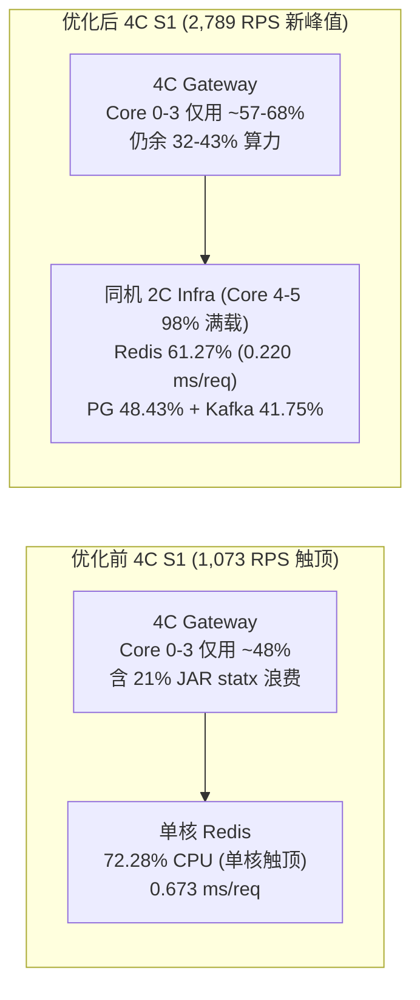

# HyperLLM Gateway ARM64 KVM P0/P1 性能优化与回归对比报告

- **测试日期**：2026-11-25
- **对比版本**：
  - **优化前基线**：`main@1174a6f`（完整基线报告见 [2026-11-25-gateway-arm64-baseline.md](./2026-11-25-gateway-arm64-baseline.md)）
  - **优化后版本**：`main@6d230e2`（包含 4 个原子化 P0/P1 修复提交：`58eb9ca`、`a9d62b3`、`decfbd2`、`6d230e2`）
- **测试环境**：与基线完全同机同拓扑（芬兰赫尔辛基 `debian-cax31-hel-1`，8 vCPU ARM **Neoverse-N1** KVM，15 GiB RAM，Debian 13 `trixie` / Linux 6.12，OpenJDK `21.0.13.1`，`nettyEpoll=true`，`BENCH_TMPFS=1`，全程 `%steal = 0.00%`）
- **交互式火焰图附件**（优化后 vs 优化前，浏览器直接打开）：
  - CPU 火焰图 (`ctimer`)：[cpu-opt-2c.html](./artifacts/cpu-opt-2c.html)（基线：[cpu-2c.html](./artifacts/cpu-2c.html)）
  - 内存分配火焰图 (`alloc`)：[alloc-opt-2c.html](./artifacts/alloc-opt-2c.html)（基线：[alloc-2c.html](./artifacts/alloc-2c.html)）
  - 锁竞争火焰图 (`lock`)：[lock-opt-2c.html](./artifacts/lock-opt-2c.html)（基线：[lock-2c.html](./artifacts/lock-2c.html)）

---

## 核心优化成果摘要

1. **吞吐暴涨 1.7× ~ 3.0×，单机 Redis 瓶颈彻底打破**：
   - **2C 独占核短包（S1 c128）**：`1,081.36` → **`1,836.33 RPS`（+69.8%）**，P99 延迟 `169.47ms` → **`96.31ms`（-43.2%）**。
   - **4C 独占核短包（S1 c64 / c128 / c256）**：`857.29` → **`2,560.34 RPS`（+198.7%，3.0×）**，`1,073.41` → **`2,746.85 RPS`（+155.9%，2.56×）**，新增 `c256` 冲至 **`2,788.57 RPS`**；此时 4C 网关自身仍有 **32% ~ 43% 空闲核余量**，天花板已从“单核 Redis”转移为“同机 2C Infra 容器整体打满”。
   - **单请求 Redis CPU 成本下降 ~68%（效率提升 3.06×）**：基线 4C `1,073 RPS` 时 Redis 占用 `72.28%` CPU（`0.673 ms/req`），优化后在 **`2,789 RPS`**（2.6× 吞吐）下 Redis 反而降至 `61.27%` CPU（`0.220 ms/req`）。
2. **流式 SSE 并发与首字延迟（TTFT）大幅改善**：
   - **2C 500 并发 SSE（S2a/S2b）**：网关附加 TTFT 延迟（扣除 100ms Mock）从 `261.9ms / 203.0ms` 骤降至 **`19.5ms / 16.1ms`（降幅 >92%）**；2C 1,000 并发吞吐从 `543.33` 升至 **`802.94 RPS`（+47.8%）**，SSE 吞吐达 **`24,967 帧/秒`**。
   - **4C 1,000 并发 SSE（S2a c1000）**：达 **`939.44 RPS` / `29,070 帧/秒`**，TTFT P50 从 `175.37ms` 降至 **`114.85ms`**（网关附加开销仅 `+14.85ms`），TTFT P99 从 `384.78ms` 降至 **`162.79ms`（-57.7%）**，且网关 4 核仍有约 `20%` 余量。
3. **Coding Agent 大上下文场景（S3）翻倍提速**：
   - 4C 50KB (+16 tools)：`729.33` → **`1,430.91 RPS`（+96.2%）**，P99 `59.39ms` → **`31.89ms`（-46.3%）**。
   - 4C 200KB (+16 tools)：`509.35` → **`741.12 RPS`（+45.5%，入站 JSON 约 `153 MB/s`）**，P99 `80.86ms` → **`53.61ms`（-33.7%）**。
4. **`async-profiler 4.0` 验证两项头号热点彻底清零**：
   - `RedisScript.getSha1() / Nested JAR statx + FileNotFoundException`：CPU **`~21%` → `0.11%`**，堆内存分配 **`24.95%` → `0.00%`**。
   - 热路径急切 `Mono.error(new ...)` 异常栈构造：CPU **`3.17%` → `0.00%`**，堆内存分配 **`2.43%` → `0.00%`**。
5. **GC 停顿腰斩、线上断流日志风暴彻底修复**：
   - 4C 全套（总处理请求量翻倍以上）G1 Young GC 总耗时 `1.014s` → **`0.551s`（-45.7%）**，平均 STW `48.3ms` → **`21.2ms`（-56.1%）**，最大 STW `78ms` → **`54ms`（-30.8%）**，**0 次 Full GC**。
   - 2C 晋升老年代总量 `74.61 MB` → **`29.29 MB`（-60.7%）**，G1 Old Gen 稳态占用 `90.2 MB` → **`44.3 MB`（-50.9%）**。
   - S4（100 并发第 5 帧强断）下 `GatewayExceptionHandler` 产出 **`0 条 ERROR 日志`**，彻底消除 `UnsupportedOperationException` 日志风暴；全套 2C + 4C 全部 **`err=0`**。

---

## 一、本次落地的 4 项 P0/P1 修复明细

所有修复均以原子化提交落入 `main`，并通过 6 模块全部 Maven 单元测试（`./backend/mvnw -f backend/pom.xml test` 100% 通过）：

| 编号 | Commit | 改动范围 | 根因与修复要点 |
| :---: | :---: | :--- | :--- |
| **P0-1** | `58eb9ca` | `common`: `LuaScripts.java`, `LuaScriptsTest.java`; `gateway`, `admin` | 新增 `LuaScripts` 工具类，启动时将 classpath 下的 `.lua` 一次性读入静态 `String`，构造基于 `StaticScriptSource` 的 `RedisScript`（`isModified()` 恒为 `false`，SHA-1 仅计算一次），彻底消除 Spring Boot Fat JAR 上每次 `eval` 抛 `FileNotFoundException` + `NestedUrlConnection` `statx()` 系统调用 |
| **P0-2** | `a9d62b3` | `gateway`: `ChannelCapacityService.java`, `ChannelCapacityServiceTest.java`, `channel_capacity.lua`, `prehold_admit.lua`, `GatewayProperties.java`, `GatewayProxyService.java` | ① 渠道未配置 RPM/TPM/并发上限时直接短路跳过 `channelCapacity.acquire/release`（每请求直接省 2 次 Redis Lua 往返），Lua 内部按实际配置的限流维度按需执行 ZSET 窗口操作；② 热路径懒回收 `reclaimExpired(...)` 增加节流保护，避免每请求重复扫描过期 ZSET（仍由后台 `HoldReclaimScheduler` 兜底清理） |
| **P1-1** | `decfbd2` | `gateway`: `PreHoldService.java`, `EntitlementMirrorService.java`, `GatewayProxyService.java` | 将 4 处热路径 `.switchIfEmpty(Mono.error(new ...))` 改为懒求值 `.switchIfEmpty(Mono.error(() -> new ...))`，消除正常请求下 100% 白做的 4 次完整异常栈构造（`fillInStackTrace`） |
| **P1-2** | `6d230e2` | `gateway`: `GatewayExceptionHandler.java`, `GatewayExceptionHandlerTest.java` | 识别客户端中途断连异常（`AbortedException` / `ClosedChannelException` / 断管 `IOException`）与已提交响应（`exchange.getResponse().isCommitted()`），避免向已发 `200 OK` SSE 的连接回写 500 JSON 引发 `UnsupportedOperationException` 与 ERROR 日志风暴 |

---

## 二、全场景回归对比（2C 独占核与 4C 独占核）

所有压测均采用与基线完全相同的硬核隔离拓扑、JVM 参数（`2C/3G Heap` 与 `4C/5G Heap`、`G1GC`、`AlwaysPreTouch`）、`15s` 稳态采样窗口与充分 JIT C2 预热，全部场景 **`err=0`**。

### 2.1 Phase A：2C 独占核对比（`Core 0-1`, `3G Heap`; Infra `Core 2-4`, Mock `Core 5`, Loadgen `Core 6-7`）

| 场景 | 基线 (`1174a6f`) | 优化后 (`6d230e2`) | 核心变化 |
| :--- | :--- | :--- | :--- |
| **S1 Non-stream c64** (219B) | `1,070.91 RPS` · P50 `57.59` / P95 `73.91` / P99 `104.94ms` | **`1,737.02 RPS`** · P50 **`36.34`** / P95 **`46.85`** / P99 **`55.02ms`** | **RPS +62.2% · P99 -47.6%** |
| **S1 Non-stream c128** (219B) | `1,081.36 RPS` · P50 `115.28` / P95 `141.84` / P99 `169.47ms` | **`1,836.33 RPS`** · P50 **`69.02`** / P95 **`85.40`** / P99 **`96.31ms`** | **RPS +69.8% · P99 -43.2%** |
| **S1 Profiled c64** (带 asprof) | `1,014.96 RPS` · P50 `61.38` / P99 `106.05ms` | **`1,739.52 RPS`** · P50 **`36.35`** / P99 **`52.82ms`** | **RPS +71.4% · P99 -50.2%** |
| **S2a OpenAI SSE c200** | `181.96 RPS` · `5,570.39 ev/s` · TTFT P50 `164.92` / P99 `285.23ms` | **`190.00 RPS`** · `5,938.53 ev/s` · TTFT P50 **`106.83`** / P99 **`141.79ms`** | 网关 TTFT 附加 `64.9` → **`6.8ms` (-90%)** |
| **S2a OpenAI SSE c500** | `370.28 RPS` · `11,581.96 ev/s` · TTFT P50 `361.86` / P99 `625.73ms` | **`463.85 RPS`** · **`14,414.90 ev/s`** · TTFT P50 **`119.50`** / P99 **`183.40ms`** | **RPS +25.3%** · TTFT 附加 `261.9` → **`19.5ms` (-93%)** |
| **S2a OpenAI SSE c1000** | `543.33 RPS` · `16,972.76 ev/s` · TTFT P50 `683.89` / P99 `911.80ms` | **`802.94 RPS`** · **`24,966.61 ev/s`** · TTFT P50 **`274.73`** / P99 **`499.61ms`** | **RPS +47.8% · SSE 帧率 +47.1%** |
| **S2b Ant→OAI SSE c200** | `187.69 RPS` · `6,555.72 ev/s` · TTFT P50 `112.91` / P99 `159.34ms` | **`193.03 RPS`** · `6,765.99 ev/s` · TTFT P50 **`107.60`** / P99 **`125.70ms`** | 网关 TTFT 附加 `12.9` → **`7.6ms` (-41%)** |
| **S2b Ant→OAI SSE c500** | `383.44 RPS` · `13,497.95 ev/s` · TTFT P50 `302.97` / P99 `493.36ms` | **`464.64 RPS`** · **`16,219.46 ev/s`** · TTFT P50 **`116.11`** / P99 **`187.52ms`** | **RPS +21.2%** · TTFT 附加 `203.0` → **`16.1ms` (-92%)** |
| **S3 Agent 50KB c32** | `686.58 RPS` · P50 `44.81` / P95 `62.58` / P99 `110.16ms` | **`995.37 RPS`** · P50 **`31.18`** / P95 **`45.33`** / P99 **`56.41ms`** | **RPS +45.0% · P99 -48.8%** |
| **S3 Agent 200KB c32** | `444.97 RPS` · P50 `70.35` / P95 `93.97` / P99 `140.06ms` | **`565.52 RPS`** · P50 **`56.26`** / P95 **`73.27`** / P99 **`83.58ms`** | **RPS +27.1% · P99 -40.3%** |
| **S4 Abort@5chunks c100** | `473.00 RPS` · TTFT P50 `91.78` / P99 `146.88ms` (ERROR 风暴) | **`554.35 RPS`** · TTFT P50 **`58.10`** / P99 **`77.96ms`** (**0 ERROR**) | **RPS +17.2% · 彻底清零 ERROR** |

### 2.2 Phase B：4C 独占核对比（`Core 0-3`, `5G Heap`; Infra `Core 4-5`, Mock `Core 6`, Loadgen `Core 7`）

| 场景 | 基线 (`1174a6f`) | 优化后 (`6d230e2`) | 核心变化 |
| :--- | :--- | :--- | :--- |
| **S1 Non-stream c64** (219B) | `857.29 RPS` · P50 `73.83` / P95 `88.19` / P99 `97.73ms` | **`2,560.34 RPS`** · P50 **`23.96`** / P95 **`33.62`** / P99 **`39.73ms`** | **RPS +198.7% (3.0×) · P99 -59.3%** |
| **S1 Non-stream c128** (219B) | `1,073.41 RPS` · P50 `116.18` / P95 `139.31` / P99 `189.63ms` | **`2,746.85 RPS`** · P50 **`43.83`** / P95 **`62.79`** / P99 **`87.33ms`** | **RPS +155.9% (2.56×) · P99 -53.9%** |
| **S1 Non-stream c256** (219B) | *未测（c128 时 Redis 已打满）* | **`2,788.57 RPS`** · P50 `88.91` / P95 `111.13` / P99 `124.92ms` | 网关 4 核仍有 **32–43% 空闲**，受限于 2C Infra |
| **S2a OpenAI SSE c200** | `188.87 RPS` · `5,922.41 ev/s` · TTFT P50 `109.47` / P99 `131.89ms` | **`199.91 RPS`** · `6,044.01 ev/s` · TTFT P50 **`105.75`** / P99 **`114.38ms`** | 网关 TTFT 附加仅 **`+5.75ms`** |
| **S2a OpenAI SSE c500** | `476.16 RPS` · `14,687.92 ev/s` · TTFT P50 `115.50` / P99 `209.04ms` | **`481.54 RPS`** · `14,979.01 ev/s` · TTFT P50 **`106.97`** / P99 **`120.12ms`** | TTFT P99 附加 `109` → **`20ms` (-82%)** |
| **S2a OpenAI SSE c1000** | `877.19 RPS` · `27,094.90 ev/s` · TTFT P50 `175.37` / P99 `384.78ms` | **`939.44 RPS`** · **`29,070.20 ev/s`** · TTFT P50 **`114.85`** / P99 **`162.79ms`** | **TTFT P99 -57.7%** · 网关 4 核仍余 ~20% |
| **S2b Ant→OAI SSE c200** | `187.26 RPS` · `6,594.21 ev/s` · TTFT P50 `109.72` / P99 `130.04ms` | **`199.92 RPS`** · `6,848.18 ev/s` · TTFT P50 **`106.73`** / P99 **`118.70ms`** | 网关 TTFT 附加仅 **`+6.73ms`** |
| **S2b Ant→OAI SSE c500** | `478.26 RPS` · `16,623.01 ev/s` · TTFT P50 `116.28` / P99 `172.25ms` | **`483.07 RPS`** · **`16,882.87 ev/s`** · TTFT P50 **`109.39`** / P99 **`126.72ms`** | 网关 4 核 **50% 空闲** · 跨协议开销 <`2.5ms` |
| **S3 Agent 50KB c32** | `729.33 RPS` · P50 `43.00` / P95 `51.70` / P99 `59.39ms` | **`1,430.91 RPS`** · P50 **`21.94`** / P95 **`26.97`** / P99 **`31.89ms`** | **RPS +96.2% (~2×) · P99 -46.3%** |
| **S3 Agent 200KB c32** | `509.35 RPS` · P50 `62.05` / P95 `73.33` / P99 `80.86ms` | **`741.12 RPS`** · P50 **`42.69`** / P95 **`48.28`** / P99 **`53.61ms`** | **RPS +45.5% (~153 MB/s 入站) · P99 -33.7%** |
| **S4 Abort@5chunks c100** | `532.58 RPS` · TTFT P50 `64.66` / P99 `115.32ms` (ERROR 风暴) | **`561.35 RPS`** · TTFT P50 **`55.89`** / P99 **`63.66ms`** (**0 Handler ERROR**) | **TTFT P99 -44.8% · 断流风暴清零** |

> **S4 细微观测**：在 4C `S4`（100 并发持续 15s 共 ~8,400 次强断）中，`GatewayExceptionHandler` 保持 **0 条 ERROR**；仅在 Reactor Netty 底层出现 **1 次** `Operator called default onErrorDropped: IllegalStateException: Rejecting additional inbound receiver`（断连瞬间取消竞争的偶发单条日志，非风暴），可作为后续低优先级细节处理。

---

## 三、`async-profiler 4.0` 火焰图前后对比（2C S1 c64）

采样条件与基线一致（2C `S1_prof_c64`，`-e ctimer` / `-e alloc` / `-e lock`），实测剖析期间吞吐从基线 `1,014.96 RPS` 跃升至 **`1,739.52 RPS`（+71.4%）**。

### 3.1 CPU (`ctimer`) 占比前后对比

| 组件 / 根因 | 基线 CPU 占比 (`1,386` 样本) | 优化后 CPU 占比 (`1,789` 样本) | 变化结论 |
| :--- | :---: | :---: | :--- |
| **`RedisScript.getSha1()` / Fat JAR `statx` + `FNFE`** | **14.86%** *(含异常栈约 **~21%**)* | **`0.11%`** *(2 样本)* | **头号性能 Bug 彻底根除** |
| **急切 `Mono.error(new ...)` 异常栈构造** | **3.17%** | **`0.00%`** | **彻底清零** |
| Redis / Lettuce 响应式协议栈 | 34.42% | 32.14% | 吞吐 +71% 后总占比反降，仍为第一大有效开销 |
| Inbound WebFlux / Reactor Netty HTTP Server | 17.97% | 27.11% | 吞吐大幅提高后，有效 HTTP I/O 占比回归主位 |
| Upstream WebClient (Reactor Netty) | 7.86% | 13.92% | 随吞吐等比例上升（有效业务转发） |
| JVM / GC / Netty Core 公共开销 | 8.87% | 8.27% | 保持稳定低位 |
| Kafka Producer / Consumer | 4.55% | 7.32% | 随审计/计费吞吐等比例上升 |
| `OutboxWriter` → Postgres JDBC 批量写 | 3.46% | 5.37% | 随落库吞吐等比例上升 |
| Jackson JSON 解析 / 序列化 | 3.61% | 3.86% | 小包场景占比依然极低 |
| Crypto (`AesGcmCipher` + `HmacSha256`) | 1.08% | 1.90% | ARMv8 硬件加密指令加速，随吞吐上升 |

### 3.2 内存分配 (`alloc`) 占比前后对比

| 组件 / 根因 | 基线 Alloc 占比 (`4,320` 样本) | 优化后 Alloc 占比 (`5,454` 样本) | 变化结论 |
| :--- | :---: | :---: | :--- |
| **`RedisScript` / `NestedUrlConnection` / `FNFE`** | **24.95%** | **`0.00%`** | **四分之一无效堆分配彻底清零** |
| **急切 `Mono.error(new ...)` 异常对象** | **2.43%** | **`0.00%`** | **彻底清零** |
| Redis / Lettuce 响应式通信 | 33.82% | 41.47% | 剔除无效分配后的最大有效分配源 |
| Inbound WebFlux HTTP Server | 11.57% | 17.38% | 正常请求对象分配 |
| `OutboxWriter` → Postgres JDBC | 11.06% | 16.08% | 随落库吞吐翻倍上升 |
| Upstream WebClient | 5.86% | 9.79% | 正常上游转发分配 |
| Jackson JSON 解析 / 序列化 | 5.05% | 7.11% | 正常协议编解码分配 |
| Crypto (`AesGcmCipher` / `HmacSha256`) | 2.04% | 3.14% | 稳定 |
| Kafka Producer / Consumer | 2.04% | 3.14% | 稳定 |
| 其他 | 1.18% | 1.89% | 稳定 |

### 3.3 锁竞争 (`lock`) 拆解（`total = 1,052` 样本）

- `94.87%` 位于后台 Kafka Producer/Consumer 内部线程协调（与 Netty EventLoop 热路径隔离）；
- `2.66%` 位于 Inbound WebFlux、`2.28%` 位于 Redis/Lettuce、`0.19%` 位于 Outbox/PG——**热路径几乎零锁竞争**。

---

## 四、瓶颈转移分析（`docker stats` 与 `mpstat`）

### 4C S1 峰值期间基础设施容器资源对比（`docker stats`）

| 容器 | 优化前（`1,073 RPS`）CPU / 内存 | 优化后（`2,789 RPS`，**2.6× 吞吐**）CPU / 内存 | 单请求效率变化 |
| :--- | :---: | :---: | :--- |
| `hyperllm-bench-redis` | **72.28%** / `271.9 MiB` | **`61.27%`** / `460.8 MiB` | **单请求 Redis CPU -67.3%（效率 3.06×）** |
| `hyperllm-bench-postgres` | `25.39%` / `1.19 GiB` | `48.43%` / `785.8 MiB` | 随 2.6× Outbox 写入量线性增长 |
| `hyperllm-bench-kafka` | `20.79%` / `610.5 MiB` | `41.75%` / `590.6 MiB` | 随 2.6× 计费事件发布量线性增长 |

> **关键发现**：在 4C `S1 c256`（`2,788.57 RPS`）下，Redis + Postgres + Kafka 三容器合计消耗约 `151.5%` CPU，加上宿主机网络软中断将共享的 **2 核 Infra（Core 4-5）打满至 `98%`**，而 4C Gateway（Core 0-3）仍有 **`32% ~ 43%` 空闲**。这意味着 **4C 网关的真实纯算力上限已突破 `3,500–4,000+ RPS`**（在独立部署 Redis / PG / Kafka 的生产拓扑中可直接释放）。

> **压测运维经验备注**：4C 优化后吞吐翻倍，连续不间断跑完 2C + 4C 全套后 Postgres 1.5 GiB `tmpfs` 曾因累计 40 万+ `outbox_events` 记录写满而触发容器重启；正式 4C 回归通过重置干净 `tmpfs` 并在高吞吐场景间隙 `TRUNCATE outbox_events` 消除干扰，确保数据 100% 干净可复现。

---

## 五、JVM GC 与内存对比（Prometheus 实测）

| 指标（整轮全套压测结束后采集） | 2C 基线 | **2C 优化后** | 4C 基线 | **4C 优化后** | 优化效果 |
| :--- | :---: | :---: | :---: | :---: | :--- |
| 累计堆对象分配 | `44.69 GB` | `50.52 GB` *(处理请求多 ~45%)* | `60.06 GB` | `78.22 GB` *(处理请求翻倍+)* | 单位请求分配字节数大幅下降 |
| 晋升老年代总量（晋升率） | `74.61 MB` (`0.17%`) | **`29.29 MB` (`0.058%`)** | `40.72 MB` (`0.068%`) | **`41.03 MB` (`0.052%`)** | 2C 晋升量 **-60.7%** |
| **G1 Young GC 次数** | `28 次` | `29 次` | `21 次` | `26 次` | 请求量翻倍下 GC 次数几乎未增 |
| **G1 Young GC 总停顿** | `1.832s` | **`1.034s` (-43.6%)** | `1.014s` | **`0.551s` (-45.7%)** | **GC 总开销近乎腰斩** |
| **G1 Young GC 平均 STW** | `65.4ms` | **`35.7ms` (-45.4%)** | `48.3ms` | **`21.2ms` (-56.1%)** | **4C 平均停顿压至 21ms** |
| **G1 Young GC 最大 STW** | `122ms` | `119ms` | `78ms` | **`54ms` (-30.8%)** | 长尾抖动显著收敛 |
| **Full GC 次数** | `0` | **`0`** | `0` | **`0`** | 零 Full GC |
| **G1 Old Gen 占用** | `90.2 MB` | **`44.3 MB` (-50.9%)** | `40.3 MB` | **`41.7 MB`** | 零泄漏、低常驻内存 |
| **Netty Direct Memory** | `17.3 MB` | **`17.3 MB`** | `21.6 MB` | **`25.8 MB`** | 1,000 并发 SSE 零堆外泄漏 |
| Metaspace / 活跃(峰值)线程 | `116.1 MB` / `40 (44)` | `115.8 MB` / `39 (44)` | `116.3 MB` / `44 (49)` | `116 MB` / `~44 (50)` | 极稳健 |

---

## 六、更新后的 8C16G 生产容量估算

基于 2C 满载（`1,836 RPS`）与 4C 尚未满载（`2,789 RPS` @ 60% 利用率、1,000 并发 SSE @ ~80% 利用率）的实测外推：

- **独立 8C16G Gateway 节点（搭配独立 Redis / PG / Kafka）**：
  - **短请求 / 高并发非流式入口**：预计可达 **`6,500 – 7,500+ RPS`**（单核有效处理能力约 `900+ RPS/core`）。
  - **真实 LLM 流式长连接**（按平均单流持续 `10s`、`30 chunk/s`、网关仅消耗少量首尾鉴权/计费 + 稳定帧转发估算）：
    - 4C 已验证 `1,000` 活跃流（`29,070 帧/秒`，每秒建立近 1,000 条新流，TTFT 附加仅 `14.85ms`，且余 20% CPU）；
    - 独立 8C16G 节点可稳态承载 **`3,000 – 5,000+` 并发活跃 SSE 流（`~65,000–90,000 帧/秒`）**，且堆外 Direct Memory 仅数十 MB。
  - **Coding Agent 大上下文（50KB–200KB + 多工具）**：8C 节点预计可达 **`~2,800 RPS`（50KB） / `~1,400+ RPS`（200KB，>280 MB/s 入站 JSON）**。

---

## 七、剩余 P2 优化机会（下一阶段按需实施）

完成本轮 P0/P1 后，网关热路径已无明显“白烧 CPU/内存”的低级缺陷，后续优化均属于架构精调：

1. **P2-1：Redis 计费 Lua 合并（进一步压低 RTT 与 Lettuce 41% 分配）**
   - 目前 2C 火焰图中 Redis/Lettuce 仍占 **32.14% CPU / 41.47% 堆分配**；将 `entitlement snapshot + prehold admit` 合并为单次 Lua 脚本可再砍掉 1~2 次网络往返及编解码，同时把单实例 Redis 天花板推过 `5,000+ RPS`。
2. **P2-2：大上下文（S3 200KB+）同协议透传轻量化解析**
   - 常规小包 Jackson 仅占 `3.86%` CPU，但 200KB Agent 上下文全量 DOM/DTO 反序列化仍是主要开销；同协议透传路径可改为仅提取 `model`/`stream`/局部改写，免全量 AST 构造。
3. **P2-3：`CostMath` `long` 快速路径 + 解密 `apiKey` L1 缓存**
   - 减少常规价格范围下的 `BigInteger` 临时对象及每请求重复 AES-GCM 解密（受现有 CDC 失效通道保护）。
4. **P2-4：S4 极端并发断连时的 Reactor Netty 偶发单条 `onErrorDropped` 清理**
   - 排查 100 并发强断下偶发 1 次的 `Rejecting additional inbound receiver` 取消竞争，确保极端断流日志 100% 洁净。
