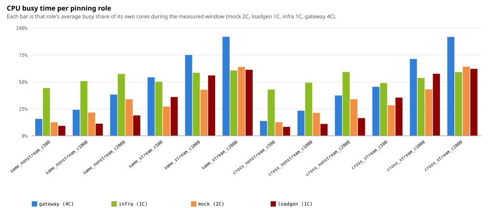
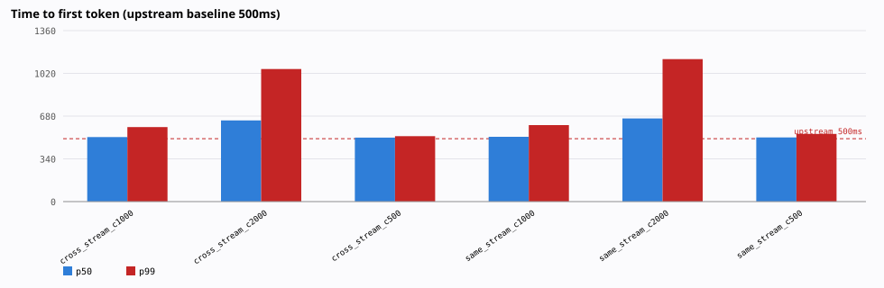
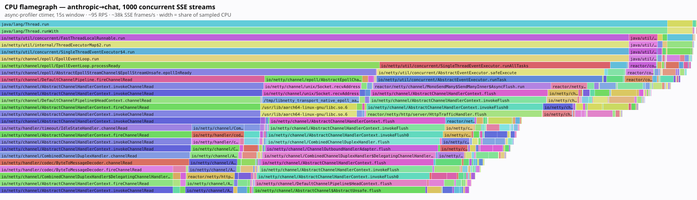
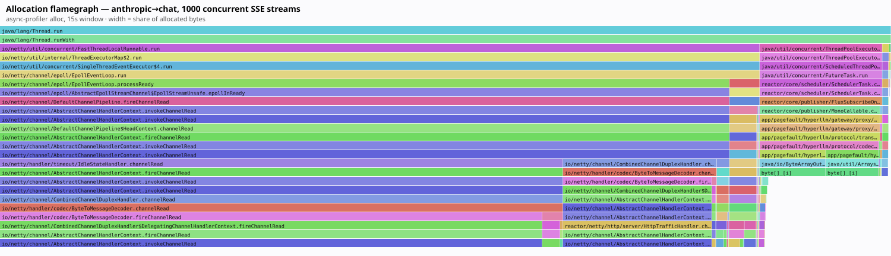
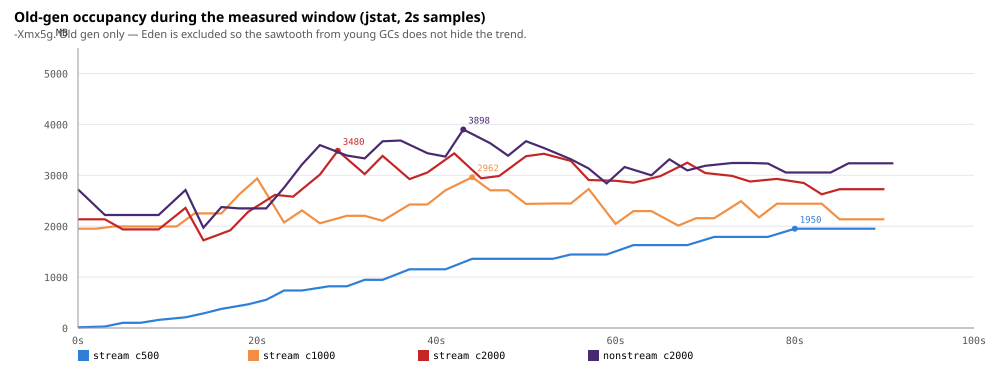
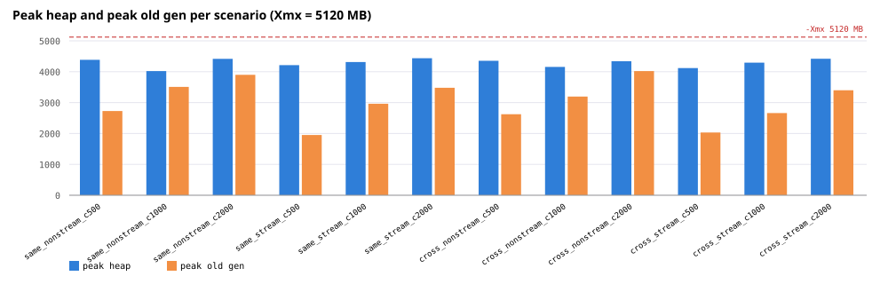
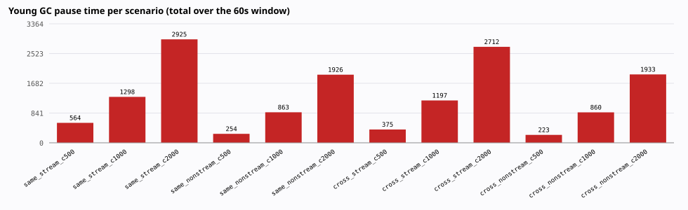

# Canonical IR 基线压测报告（100K-token 异构 SSE）

- **测试日期**：2026-11-26（01:00–01:15 +08:00）
- **代码基线**：`main@c347807`（`b490694` 起网关只保留 **downstream → Canonical IR → upstream** 单一路径，`207e61a` 补齐厂商私有字段保留）
- **被测对象**：`hyperllm-gateway`（Spring Boot 3.5.16 / WebFlux / Reactor Netty / JDK 21.0.13.1），**4 vCPU / 5 GiB 堆**
- **测试主机**：芬兰赫尔辛基 `debian-cax31-hel-1`，8 vCPU ARM64 KVM
- **结论一句话**：在 100K-token 输入、2K 输出、200 tok/s、5 token/帧、上游 500ms TTFT 的形状下，**2000 并发 SSE 稳定跑满 60s**：187 RPS、75k 帧/s、0 错误、TTFT P50 661ms / P99 1133ms，网关 4 核用掉 **91.8%**；但堆峰值已达 **4438 MB / 5120 MB**，余量仅 12%。

---

## 一、测试环境

| 项 | 实测值 |
| :--- | :--- |
| 主机 / 虚拟化 | `debian-cax31-hel-1` / QEMU-KVM |
| 操作系统 / 内核 | Debian GNU/Linux 13 `trixie` / `6.12.107+deb13-arm64` |
| CPU | 8 vCPU ARM **Neoverse-N1**，单 NUMA node，无 SMT；`aes pmull sha2 crc32 atomics` |
| 内存 | 15 GiB，无 Swap |
| 磁盘 | QEMU HARDDISK 152.6 GB（`ROTA=0`）；压测数据默认落 **tmpfs** |
| JDK | OpenJDK `21.0.13.1`（Debian build） |
| Go（压测工具） | `go1.24.4 linux/arm64` |
| Docker | `29.10.0` |
| 剖析工具 | async-profiler 4.0（`-e ctimer` / `-e alloc`） |
| 依赖栈 | PostgreSQL 16-alpine、Redis 7-alpine、Kafka 3.9.0（KRaft 单节点） |
| 存储模式 | `postgres=tmpfs kafka=tmpfs synchronous_commit=off`（`fsync=off`、`full_page_writes=off`） |
| 内核参数 | `somaxconn=65535`、`netdev_max_backlog=65535`、`tcp_max_syn_backlog=65535`、`ip_local_port_range=1024-65535`、`tcp_tw_reuse=1`、`file-max=1048576`、`ulimit -n 65535` |

### 1.1 硬切核拓扑

| 角色 | CPU | 配置 |
| :--- | :--- | :--- |
| **被测网关** | **0-3（4C）** | `taskset -c 0-3` + `-XX:ActiveProcessorCount=4 -Xms5g -Xmx5g -XX:+UseG1GC -XX:+AlwaysPreTouch`，`nettyEpoll=true` |
| PostgreSQL + Redis + Kafka | 4（1C） | `cpuset=4` |
| **mock upstream** | 5-6（2C） | `taskset -c 5-6` |
| **loadgen** | 7（1C） | `taskset -c 7` |

被测系统独占 4 核，其余组件严格隔离，互不抢核。

## 二、测试方法

### 2.1 上游形状（5 个可配置参数）

由 `mock-upstream` 提供，只实现 `POST /v1/chat/completions`（流式 / 非流式）：

| 参数 | 值 | 推导 |
| :--- | --: | :--- |
| 上游 TTFT | **500 ms** | 首帧前等待 |
| 输出 token | **2000** | |
| token 速率 | **200 tok/s** | 单流 ≈ 10 s |
| 每帧 token | **5** | ⇒ 400 帧 / 流，帧间隔 **25 ms**（40 帧/s） |
| 上报 prompt token | **100000** | 客户端实际发送 401 KB ≈ 100K token 的 JSON |

非流式响应**故意同样耗时 ~10.5s**（TTFT + 同样的生成时长），保证 stream / nonstream 两种模式在时间维度可比、并发语义一致。

### 2.2 并发是怎么"维持"的

10 秒的长流如果一次性打满 2000 连接，测到的是"连接风暴 + 排空"，不是稳态。因此：

1. **ramp**：第 `i` 个 worker 在 `20s × i / N` 时刻启动，2000 条连接在 20 秒内均匀铺开；
2. **闭环**：每个 worker 发一个请求、读完整个响应、再发下一个 ⇒ 稳态期间在飞请求恒为 N；
3. **只统计稳态窗口**：ramp 结束后的 60s（≥ 6 个流生命周期），ramp 期间发出的请求不计入分位；
4. **自证**：每 100ms 采样在飞数量，输出 `min/avg/p95/max/maintained%`；低于 95% 直接判该场景无效。

### 2.3 场景矩阵（12 个）

```
并发   = 500 / 1000 / 2000
模式   = stream / nonstream
协议对 = same (chat→chat) / cross (anthropic→chat)
```

每场景墙钟 = `20s ramp + 60s 稳态 + 最多 10.5s 收尾`（最后一个在窗口内启动的请求需要跑完）。

### 2.4 有效性判据（任一不满足即 `valid=NO`）

| 判据 | 阈值 | 采集方式 |
| :--- | :--- | :--- |
| `%steal` | **≤ 0.5%** | `mpstat -P ALL 1` 每核采样，取最大值并记录最差 CPU；另有独立 `vmstat` 监视 |
| 并发保持率 | **≥ 95%** | loadgen 100ms 在飞采样 |
| 依赖健康 | 三容器 `healthy` 且 `RestartCount` 不变 | `docker inspect` |
| 依赖容量 | PG / Kafka tmpfs **< 70%** | 容器内 `df` |

### 2.5 长跑依赖治理

2000 并发 ≈ 190 RPS，每个场景约 1.7 万请求；每个请求产生 1 条 outbox、数个 Redis key、1–2 条 Kafka 事件，而 bench 栈是 **tmpfs**：

| 动作 | 位置 | 目的 |
| :--- | :--- | :--- |
| `TRUNCATE outbox_events` | 每场景开始前 | 单场景 ~1.7 万行（实测 ~3.4 KB/行）会使 1.5 GiB tmpfs 逐轮逼近上限 |
| `redis-cli flushdb` | 每场景开始前 | 清未结算集合，避免镜像重建时 503 `LEDGER_BACKLOG` |
| Kafka retention 15min / 256MiB | 整套开始前 | topic 默认 7 天，日志只增不减会撑爆 1 GiB tmpfs |
| 整套开始前重建栈 | 测试前 | `down -v` 后重放 12 个迁移 + 重新 seed，确保 tmpfs 无残留 |

### 2.6 指标采集

| 维度 | 指标 | 来源 | 频率 |
| :--- | :--- | :--- | :--- |
| 负载 | 并发、ramp、duration、payload 字节/token、max_tokens | loadgen | 每场景 |
| 吞吐 | RPS、SSE 帧/s、聚合输出 TPS、入站/读出 MB/s | loadgen | 每场景 |
| 延迟 | TTFT p50/p90/p95/p99、TPOT、单流 TPS、总延迟、状态码 | loadgen | 每场景 |
| 并发证明 | 在飞 min/avg/p95/max、maintained% | loadgen 采样 | 100 ms |
| CPU | 网关/infra/mock/loadgen 各角色 busy%、`max_steal`、最差 CPU | `mpstat -P ALL 1` | 1 s |
| JVM | 堆峰值、Old Gen 峰值、YGC 次数/停顿、FGC、direct buffer、线程数 | `jstat -gc` + `actuator/prometheus` | 2 s |
| 依赖 | PG/Kafka tmpfs%、健康、重启次数 | `docker inspect` / `df` | 每场景前后 |
| 上下文 | commit、jar、JVM 参数、内核、存储模式 | `run.info` | 每轮 |

## 三、执行过程（实际命令）

```bash
# 1) 同步代码并构建 IR-only 网关（服务器 /opt/HyperLLM）
git fetch -q origin && git reset --hard c347807
chmod +x backend/mvnw
./backend/mvnw -B -q -f backend/pom.xml package \
    -pl common,domain,protocol,gateway -am -DskipTests      # → 73.7 MB jar

# 2) 停掉不参与本轮对比的 new-api，并重建整套依赖栈（清空 tmpfs 残留）
docker stop bench-new-api
BENCH_TMPFS=1 BENCH_INFRA_CPUS=4 ./benchmark/scripts/setup-server.sh
#   → down -v + up，重放 V1..V9 共 12 个迁移，bench-seed 重灌租户/钱包/API Key/渠道/模型，Redis FLUSHALL

# 3) 启动网关（4C / 5G 堆 / 核 0-3）
GATEWAY_PORT=18081 GATEWAY_CPUS=0-3 GATEWAY_CPU_COUNT=4 GATEWAY_HEAP=5g \
    ./benchmark/scripts/run-gateway.sh
#   启动日志确认：cpus=4 maxHeapMB=5120 nettyEpoll=true epollCause=none

# 4) 启动 mock 上游（核 5-6）
taskset -c 5-6 benchmark/bin/mock-upstream -listen 127.0.0.1:18080 \
    -ttft-ms 500 -token-rate 200 -tokens-per-frame 5 \
    -output-tokens 2000 -input-tokens 100000 -model bench-openai-chat

# 5) 跑 12 场景矩阵 + 末尾 profiling pass
TARGET=http://127.0.0.1:18081 TAG=ir-baseline PROFILE=1 ./benchmark/scripts/run-suite.sh

# 6) 发现跨协议帧计数缺陷（Anthropic 用 text_delta，不是 content），修 loadgen 后单独重跑 cross
TARGET=http://127.0.0.1:18081 TAG=ir-cross PAIRS=cross ./benchmark/scripts/run-suite.sh

# 7) 补采 collapsed 火焰图（cross c1000，90s 负载中）
asprof -e ctimer -d 15 -o collapsed -f /tmp/flame-cpu.collapsed   <gateway-pid>
asprof -e alloc  -d 15 -o collapsed -f /tmp/flame-alloc.collapsed <gateway-pid>
```

执行中修掉的两个**测量**问题（不影响被测系统）：

1. **跨协议帧计数为 0**：loadgen 用 `"content":` 识别输出帧，而 Anthropic 帧是 `text_delta`，导致 cross 场景帧率/TPS 统计失真 —— 改为协议感知匹配后重跑 6 个 cross 场景；
2. **jvm/steal/依赖指标未采集**：本轮之前套件只产出吞吐与延迟，已补 `jstat`/`actuator`/健康检查采样（提交 `87abc31`）。

## 四、结果

### 4.1 流式（400 帧/流，40 帧/s，≈10.5s/流）

| 场景 | 并发 | RPS | TTFT P50 / P99 | 网关 CPU | mock | loadgen | 帧/s | 输出 tok/s |
| :--- | --: | --: | :--- | --: | --: | --: | --: | --: |
| chat→chat | 500 | 47.7 | 510.6 / 538.1 ms | 54.2% | 27.1% | 36.0% | 19,128 | 201.0 |
| chat→chat | 1000 | 95.2 | 515.2 / 608.5 ms | 74.9% | 42.7% | 56.0% | 38,182 | 201.0 |
| chat→chat | 2000 | 187.3 | 661.1 / **1133.2** ms | **91.8%** | 63.8% | 61.2% | 75,101 | 201.2 |
| anthropic→chat | 500 | 47.7 | 508.9 / 520.5 ms | 45.4% | 28.3% | 35.4% | 19,080 | 200.5 |
| anthropic→chat | 1000 | 95.3 | 513.0 / 592.5 ms | 71.2% | 43.1% | 57.5% | 38,140 | 200.5 |
| anthropic→chat | 2000 | 186.9 | 645.6 / **1054.1** ms | **91.7%** | 64.1% | 62.1% | 74,767 | 200.6 |

### 4.2 非流式（同样 ≈10.5s/请求）

| 场景 | 并发 | RPS | 延迟 P50 | 网关 CPU | mock | loadgen |
| :--- | --: | --: | --: | --: | --: | --: |
| chat→chat | 500 | 47.4 | 10,514.8 ms | 15.7% | 12.5% | 9.2% |
| chat→chat | 1000 | 94.8 | 10,515.5 ms | 24.1% | 21.5% | 11.2% |
| chat→chat | 2000 | 189.6 | 10,517.0 ms | 38.2% | 33.8% | 18.9% |
| anthropic→chat | 500 | 47.4 | 10,514.4 ms | 13.7% | 12.6% | 8.3% |
| anthropic→chat | 1000 | 94.8 | 10,514.9 ms | 23.3% | 21.2% | 11.0% |
| anthropic→chat | 2000 | 189.5 | 10,516.4 ms | 37.3% | 33.9% | 16.4% |

> 12/12 场景：`max_steal=0.00%`（另有独立 `vmstat` 监视全程为 0）、`maintained=100%`、**0 错误**（全部 HTTP 200）、`valid=yes`。

### 4.3 资源视图





**读法**：并发从 1000 → 2000，RPS 与帧率线性翻倍（95 → 187 RPS，38k → 75k 帧/s），但网关 CPU 从 74.9% → 91.8%，TTFT P99 从 608ms → 1133ms。**2000 并发已经是 4 核的实际上限**；再往上必须先做 CPU/内存优化或加核。

## 五、火焰图分析（anthropic→chat，1000 并发，95 RPS，38k 帧/s）

采样方式：负载稳态中 `asprof -e ctimer/alloc -d 15 -o collapsed`，再用脚本渲染成 SVG（宽度 = 样本占比）。

### 5.1 CPU（4,621 样本）



| 占比 | 归属 |
| --: | :--- |
| **42.5%** | `libc` ← Netty epoll 原生 socket 收发（38k 帧/s 的必然成本） |
| 2.66% + 1.23% | Jackson：`UTF8JsonGenerator._writeStringSegment` / `UTF8StreamJsonParser._finishAndReturnString` |
| ~3.0% | `String` 相关：`isLatin1` 1.34% / `coder` 0.97% / `checkIndex` 0.71%（**解析时把字节转成 String**） |
| 2.49% + 0.74% | JVM `itable/vtable stub`（虚调用分发） |
| 1.06% | G1 扫描（`G1ParScanThreadState::trim_queue`） |
| **0.95%** | `TokenEstimator.estimateTextTokens` —— 每请求对文本做一遍估算 |
| 0.58% | `SseEventSplitter.boundaryLength`（SSE 分帧） |

> 结论：**CPU 的主项是"每帧一次系统调用 + TCP 处理"**，业务编解码加起来不到 8%。这也解释了为什么同协议与跨协议几乎同价（91.8% vs 91.7%）。

### 5.2 分配（12,043 样本）



| 占比 | 归属 |
| --: | :--- |
| **56.7%** | `byte[]`，其中：`Arrays.copyOf` **12.4%**、`StringUTF16.compress` **12.3%**、`ByteArrayOutputStream.<init>` **8.8%**、`Arrays.copyOfRange(Byte)` **12.6%**、Spring `ByteArrayDecoder.decode` 5.4% |
| 7.3% | Jackson 上下文（`JsonReadContext` 2.67 / `ReaderBasedJsonParser` 1.97 / `JsonWriteContext` 1.32 / `IOContext` 1.30） |
| 9.0% | `LinkedHashMap(+Entry)` |
| 3.9% | `HashMap$Node[]` |
| 3.6% | `String` |
| 3.1% | `Object[]` |
| 1.1% | `ObjectNode`（工具 schema 的 DOM 残留） |

> 结论：**约 45% 的分配来自"把字节拼成新数组 / 把字节 decode 成 String"** —— 正是 `ResizableByteBuffer` 的扩容拷贝、`toExactByteArray()` 的二次拷贝、以及 parser 的 `new String`。这是下一轮优化的第一优先级。

## 六、堆内存与 GC

### 6.1 Old Gen 走势



四个场景按时间顺序执行（c500 → c1000 → c2000 stream → c2000 nonstream），Old Gen 只增不减：**c500 结束时约 1.95 GB，到 nonstream c2000 峰值 4.02 GB**。没有 Full GC，靠 Young GC 回收，说明对象在 Eden 就死了，但**元数据/长驻结构在持续累积**——与"每请求建一棵 IR 图、图里有大量小对象"的形态一致。

### 6.2 峰值对比



| 场景 | heap 峰值 | Old Gen 峰值 | YGC | YGC 总停顿 | FGC | direct | 线程 |
| :--- | --: | --: | --: | --: | --: | --: | --: |
| stream 500 | 4212 MB | 1950 MB | 18 | 564 ms | 0 | 32.7 MB | 48 |
| stream 1000 | 4312 MB | 2962 MB | 23 | 1298 ms | 0 | 32.6 MB | 48 |
| stream 2000 | **4438 MB** | 3480 MB | 57 | **2925 ms** | 0 | 32.7 MB | 50 |
| nonstream 2000 | 4416 MB | **3898 MB** | 36 | 1926 ms | 0 | 32.7 MB | 50 |
| cross stream 2000 | 4419 MB | 3398 MB | 56 | 2712 ms | 0 | 32.7 MB | 51 |
| cross nonstream 2000 | 4340 MB | **4020 MB** | 36 | 1933 ms | 0 | 32.7 MB | 51 |

### 6.3 GC 停顿



- **0 次 Full GC**，direct buffer 恒定 32.7 MB（无堆外泄漏），线程 47–51（无泄漏、无阻塞线程堆积）。
- 但 **2000 并发时 Young GC 停顿占墙钟 4.5%**（2925ms / 60s），这直接体现在 TTFT P99 上（1133ms vs 608ms）。
- 堆峰值 4438 MB / 5120 MB ⇒ **余量 12%**。这不是"能不能跑"的问题，而是"再加任何一点并发就会 GC 抖动"的问题。

## 七、瓶颈归因与容量结论

| 观察 | 证据 | 结论 |
| :--- | :--- | :--- |
| 2000 并发 = 91.8% of 4C | CPU 拆分图、火焰图 42% 在原生 socket | **CPU 饱和**，但吞吐未掉（187 RPS = 2000/10.7s） |
| 同协议 vs 跨协议几乎同价 | 91.8% vs 91.7%；TTFT P99 1133 vs 1054ms | 翻译开销被帧转发淹没；**统一 IR 没有带来可测的额外成本** |
| 非流式 CPU 仅 38%（vs 92%） | 非流式无逐帧编码 | 流式成本 ≈ 400 帧/流 × 每帧成本，与并发线性 |
| 堆峰值 4438 MB | jstat | **下一轮优化的首要目标**：分配热点在字节数组拷贝与 String 化 |
| TTFT P99 +633ms | GC 2925ms/60s + 排队 | P99 主要由 GC 与 EventLoop 排队构成 |
| harness 未饱和 | mock 63.8%、loadgen 61.2%（2000 并发） | 数字是网关上限，不是发压上限 |

**容量结论（4C/5G，tmpfs 存储）**：该形状下 **2000 并发是已验证上限**（0 错误、吞吐线性），**1000 并发是舒适区间**（CPU 75%、TTFT P99 608ms、堆 4312 MB）。

## 八、局限

1. **存储是 tmpfs + `fsync=off`**：测的是网关算力上限，不是持久化能力；生产磁盘的 commit 延迟未包含在内（`run.info` 已标注 storage 模式，两种配置不可混用）。
2. **同机压测**：mock 与 loadgen 与被测网关共享 8 核，虽然硬隔离，但 2000 并发时 mock 已用 64%。
3. **单次采样**：每个场景只跑一轮，未做重复性统计（方差未知，但从 RPS 与并发比值的稳定性看偏差应 <2%）。
4. **火焰图取自 c1000**：这是为了在稳定窗口内采集，2000 并发下的热点结构应该一致但未单独采。
5. 未测 new-api 等对照系统（本轮只看自身路径）。

## 九、复现

```bash
git checkout c347807
cd backend && ./mvnw -q -f pom.xml package -pl common,domain,protocol,gateway -am -DskipTests && cd ..
(cd benchmark && go build -o bin/mock-upstream ./cmd/mock-upstream \
   && go build -o bin/loadgen ./cmd/loadgen && go build -o bin/bench-seed ./cmd/bench-seed)
BENCH_TMPFS=1 BENCH_INFRA_CPUS=4 ./benchmark/scripts/setup-server.sh
GATEWAY_PORT=18081 GATEWAY_CPUS=0-3 GATEWAY_CPU_COUNT=4 GATEWAY_HEAP=5g ./benchmark/scripts/run-gateway.sh &
TARGET=http://127.0.0.1:18081 TAG=ir-baseline PROFILE=1 ./benchmark/scripts/run-suite.sh
```

## 十、原始数据与图表

- **图表**：`docs/benchmark/figures/*.svg`（本报告引用，随仓库提交）
- **原始数据**：`raw` 采样（`summary.csv`、每场景 `jstat/mpstat/prom`、mock 计数器、collapsed 火焰图栈）体积约 2.3 MB，**不随仓库提交**；本次运行保留在压测机 `/opt/HyperLLM/benchmark/results/ir-baseline-20261126-002611` 与 `ir-cross-20261126-004848`，本地副本见 `docs/benchmark/data/`（`.gitignore` 已排除）。
