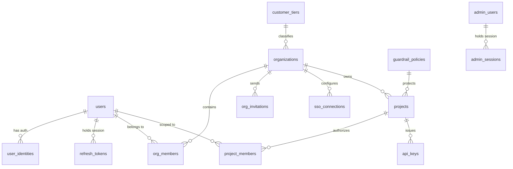
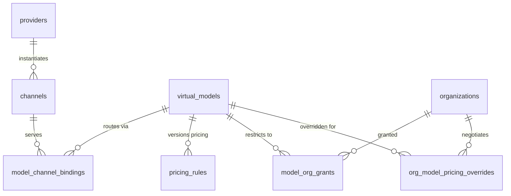
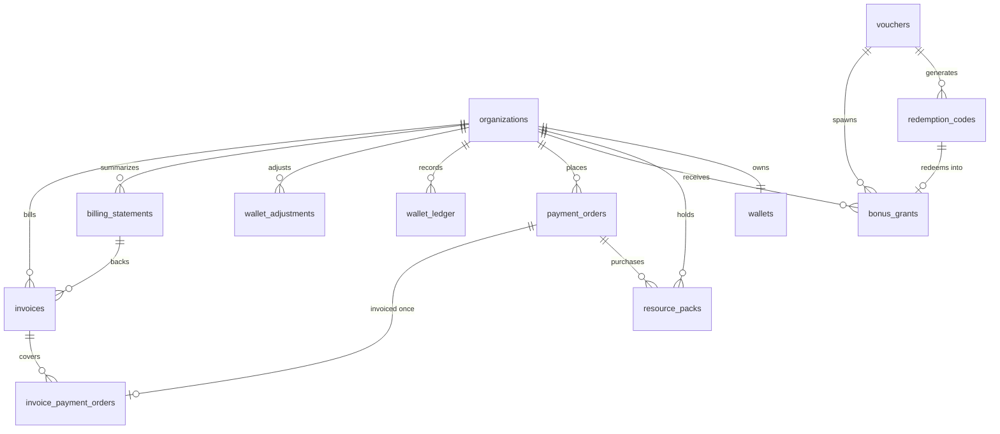

# HyperLLM 第一阶段（第一部分）详细设计：数据库实体与存储规范

> 本文档是 **HyperLLM**（`app.pagefault.hyperllm`）在 [PROPOSAL.md](../PROPOSAL.md) 基础上完成的第一阶段（第一部分）详细设计，基于 `/grill-me` 对齐的 13 项核心决策，完整定义全领域 **PostgreSQL 16（OLTP）**、**ClickHouse 24（OLAP）** 与 **Redis 7（热态扣费/路由缓存）** 的实体模型、约束规范、分区策略、Debezium CDC 订阅边界及分阶段 Flyway 落地顺序。

---

## 1. 已对齐核心建模决策矩阵

| 决策域 | 最终对齐方案 | 工程约束与影响 |
| :--- | :--- | :--- |
| **设计范围** | 全领域实体设计 + 核心规范 | 本阶段完成全平台实体/字段/索引/关系定义；编码阶段按 Phase 分批编写 Flyway 脚本落地 |
| **主键策略** | 应用层生成 **UUIDv7**（PostgreSQL `UUID`） | 高 48 位为毫秒时间戳，兼顾分布式零协调、防枚举与 B-Tree 顺序写入性能，并与 ClickHouse `UUID` 原生对齐 |
| **持久层技术栈** | **jOOQ + Spring JDBC**（SQL-first + 纯 Java `record` 领域模型） | 配合 Flyway 契约生成代码，天然支持 `JSONB`、`RANGE` 分区与 `ON CONFLICT` 批量核销；`gateway` 直接依赖 `domain` 复用统一领域模型与仓储，热路径靠 L1+L2 零阻塞命中，仅极低比例冷缓存穿透时切出 EventLoop 回源查库 |
| **约束与演进** | 物理外键（`ON DELETE RESTRICT`）+ `VARCHAR` 枚举（`CHECK`）+ 软删除（`deleted_at` + `status`） | 保障财务与配置参照完整、防误删；避免原生 PG `ENUM` 演进阻塞 Flyway 与 Debezium Schema 同步 |
| **账号域隔离** | **物理拆表隔离**：开发者（`users`）vs 运营管理员（`admin_users`） | 严格匹配 `backend/console` 与 `backend/admin` 双控制面及独立 JWT 密钥域，彻底消除账号混淆或提权面 |
| **租户授权粒度** | **`org_members` + `project_members`** 双层授权 | `OWNER`/`ADMIN` 默认覆盖全组织项目；`DEVELOPER` 通过 `project_members` 精确控制可访问与管理 Key 的 Project 范围 |
| **渠道与采购成本** | `channels`（连接覆写 + 密文凭证）+ `model_channel_bindings`（路由权重 + 采购成本覆写） | 默认继承渠道统一采购折扣倍率，支持在模型绑定粒度覆写精确采购倍率/单价 JSON，支撑 `upstream_cost_micros` 精准毛利核算 |
| **折扣与协议价** | `customer_tiers` + `organizations` 默认折扣 + `org_model_pricing_overrides` | 支持分组批量调价、组织级统一折扣及大客户针对特定模型的协议折扣或固定覆写单价 |
| **模型权限与风控** | `virtual_models.visibility`（`PUBLIC` / `RESTRICTED`）+ `model_org_grants`；独立 `guardrail_policies` | 支撑企业私有/定制微调模型定向授权，以及可被多个 Project 复用的内容风控策略 |
| **资源包与赠金** | 第一顺位 `resource_packs`（Token/次）与第二顺位 `bonus_grants`（`micro-USD`）物理分离 | 分别对应不同抵扣顺位与计量单位；`bonus_grants` 支持多批独立过期时间与适用模型范围，`wallets.bonus_balance_micros` 保留汇总快照 |
| **账本粒度与分区** | `wallet_ledger` 逐笔请求入账 + **按月 `RANGE` 分区** | 以网关请求事件时间戳作为确定性 `created_at`，`PRIMARY KEY (id, created_at)` 与 `UNIQUE (idempotency_key, created_at)` 兼顾跨月重试幂等与冷数据分区卸载 |
| **账单与发票** | 双轨建模：`billing_statements`（月度对账单）+ `invoices`（正式发票/收据）+ `invoice_payment_orders` | 支持按充值订单或按月度现金实耗汇总开票，严格剔除赠金金额并通过关联表防止重复开票 |
| **调试日志存储** | ClickHouse 独立加密明细表 `llm_debug_payloads`（原生 TTL 1~7 天） | 仅对开启 Opt-in 的 Project 落盘密文样本，避免大文本 Prompt 膨胀 Postgres WAL 与 Debezium 复制槽 |

---

## 2. 全局通用列与数据类型约定

1. **金额与计数单位**：
   - 所有美元金额列统一使用 `BIGINT`，命名后缀为 `_micros`（`1 USD = 1,000,000 micro-USD`）。
   - 外部法币支付金额使用 `BIGINT`，后缀为 `_minor`（最小货币单位，如美分、人民币分），汇率使用 `NUMERIC(18, 8)`。
   - 折扣率与采购倍率使用 `INTEGER`，后缀为 `_bps`（基点，Basis Points：`10000` 表示 `1.0000x`，`9500` 表示 `0.95x`）。
2. **时间与时区**：所有时间戳统一使用 `TIMESTAMPTZ`，存储与计算均以 **UTC** 为准。
3. **软删除与部分唯一索引**：支持逻辑删除的表统一包含 `status VARCHAR(32)` 与 `deleted_at TIMESTAMPTZ`，业务唯一键使用部分唯一索引（如 `WHERE deleted_at IS NULL`），允许同名资源在归档/删除后重新创建而不破坏历史外键。
4. **乐观锁与变更追踪**：核心配置表与钱包聚合表包含 `version BIGINT NOT NULL DEFAULT 0`；除只追加表外均包含 `created_at` 与 `updated_at`。
5. **敏感信息保护**：
   - 客户 API Key 仅存 `key_prefix` 与 `HMAC-SHA256(raw_key, pepper)`（`key_hash`），绝不落盘明文。
   - 上游渠道凭证、企业 SSO 私钥、管理员 TOTP Secret 均采用 **AES-256-GCM**（`BYTEA` 存版本头 + 12B IV + 密文 + 16B Auth Tag，并绑定表记录 ID 作为 AAD）。

---

## 3. 实体关系图（ER Diagrams）

### 3.1 认证、多租户与双层 RBAC 域



### 3.2 模型目录、上游渠道、路由与多维定价域



### 3.3 钱包、权益、账本、支付与开票域



---

## 4. PostgreSQL 16 核心表结构详细设计

### 4.1 域 A：认证与会话域（`console` 与 `admin` 物理隔离）

#### 1. `users`（开发者用户主表）[Phase 1]
| 列名 | 类型 | 约束 / 默认值 | 说明 |
| :--- | :--- | :--- | :--- |
| `id` | `UUID` | `PRIMARY KEY` | UUIDv7 |
| `email` | `VARCHAR(320)` | `NOT NULL` | 部分唯一：`UNIQUE (lower(email)) WHERE deleted_at IS NULL` |
| `email_verified_at` | `TIMESTAMPTZ` | `NULL` | 邮箱验证完成时间 |
| `display_name` | `VARCHAR(120)` | `NOT NULL` | 展示名称 |
| `avatar_url` | `VARCHAR(512)` | `NULL` | 头像链接 |
| `locale` | `VARCHAR(16)` | `NOT NULL DEFAULT 'en-US'` | 界面语言偏好（`zh-CN` / `en-US`） |
| `preferred_currency` | `VARCHAR(8)` | `NOT NULL DEFAULT 'USD'` | 展示币种偏好（`USD` / `CNY`） |
| `default_org_id` | `UUID` | `NULL` | 最近/默认工作空间（仅普通索引，避免与 `organizations.owner_user_id` 成环） |
| `status` | `VARCHAR(32)` | `NOT NULL DEFAULT 'ACTIVE' CHECK (status IN ('ACTIVE','SUSPENDED','DELETED'))` | 账号状态 |
| `last_login_at` | `TIMESTAMPTZ` | `NULL` | 最近登录时间 |
| `deleted_at` | `TIMESTAMPTZ` | `NULL` | 软删除时间 |
| `version` | `BIGINT` | `NOT NULL DEFAULT 0` | 乐观锁版本 |
| `created_at` | `TIMESTAMPTZ` | `NOT NULL DEFAULT now()` | 创建时间 |
| `updated_at` | `TIMESTAMPTZ` | `NOT NULL DEFAULT now()` | 更新时间 |

#### 2. `user_identities`（开发者身份认证凭据绑定）[Phase 1]
| 列名 | 类型 | 约束 / 默认值 | 说明 |
| :--- | :--- | :--- | :--- |
| `id` | `UUID` | `PRIMARY KEY` | UUIDv7 |
| `user_id` | `UUID` | `NOT NULL REFERENCES users(id) ON DELETE RESTRICT` | 所属用户 |
| `provider` | `VARCHAR(32)` | `NOT NULL CHECK (provider IN ('PASSWORD','GITHUB','GOOGLE','SSO_OIDC','SSO_SAML'))` | 认证提供方 |
| `provider_subject` | `VARCHAR(255)` | `NOT NULL` | 外部唯一 Subject / NameID（密码登录存 `user_id::text`） |
| `sso_connection_id` | `UUID` | `NULL REFERENCES sso_connections(id) ON DELETE RESTRICT` | 所属企业 SSO 配置 |
| `password_hash` | `VARCHAR(255)` | `NULL` | Argon2id / BCrypt 哈希，仅 `PASSWORD` 模式有值 |
| `provider_email` | `VARCHAR(320)` | `NULL` | 外部平台返回的邮箱快照 |
| `metadata_json` | `JSONB` | `NOT NULL DEFAULT '{}'` | 外部档案附加属性 |
| `last_used_at` | `TIMESTAMPTZ` | `NULL` | 最近使用时间 |
| `created_at` | `TIMESTAMPTZ` | `NOT NULL DEFAULT now()` | 创建时间 |
| `updated_at` | `TIMESTAMPTZ` | `NOT NULL DEFAULT now()` | 更新时间 |
- **唯一索引**：
  - `UNIQUE (provider, provider_subject) WHERE sso_connection_id IS NULL`
  - `UNIQUE (sso_connection_id, provider_subject) WHERE sso_connection_id IS NOT NULL`
  - 索引 `(user_id)`

#### 3. `refresh_tokens`（开发者会话轮换与强踢表）[Phase 1]
| 列名 | 类型 | 约束 / 默认值 | 说明 |
| :--- | :--- | :--- | :--- |
| `id` | `UUID` | `PRIMARY KEY` | UUIDv7 |
| `user_id` | `UUID` | `NOT NULL REFERENCES users(id) ON DELETE RESTRICT` | 所属用户 |
| `token_family_id` | `UUID` | `NOT NULL` | 会话族 ID，检测到重放已轮换令牌时吊销整族 |
| `token_hash` | `VARCHAR(128)` | `NOT NULL UNIQUE` | Refresh Token SHA-256 摘要 |
| `client_ip` | `INET` | `NULL` | 登录客户端 IP |
| `user_agent` | `VARCHAR(512)` | `NULL` | UA 描述 |
| `expires_at` | `TIMESTAMPTZ` | `NOT NULL` | 过期时间 |
| `rotated_at` | `TIMESTAMPTZ` | `NULL` | 轮换消费时间 |
| `revoked_at` | `TIMESTAMPTZ` | `NULL` | 主动吊销/踢下线时间 |
| `created_at` | `TIMESTAMPTZ` | `NOT NULL DEFAULT now()` | 创建时间 |
- **索引**：`(user_id, revoked_at)`、`(token_family_id)`、`(expires_at)`

#### 4. `sso_connections`（企业 OIDC / SAML 配置）[Phase 3]
| 列名 | 类型 | 约束 / 默认值 | 说明 |
| :--- | :--- | :--- | :--- |
| `id` | `UUID` | `PRIMARY KEY` | UUIDv7 |
| `org_id` | `UUID` | `NOT NULL REFERENCES organizations(id) ON DELETE RESTRICT` | 所属组织 |
| `protocol` | `VARCHAR(16)` | `NOT NULL CHECK (protocol IN ('OIDC','SAML'))` | SSO 协议 |
| `domain` | `VARCHAR(255)` | `NOT NULL` | 绑定企业邮箱域名（部分唯一 `WHERE deleted_at IS NULL`） |
| `display_name` | `VARCHAR(120)` | `NOT NULL` | 展示名称（如 `Okta Corp SSO`） |
| `config_json` | `JSONB` | `NOT NULL` | Issuer URL、Client ID、IdP Certificate/ACS 配置 |
| `encrypted_secrets` | `BYTEA` | `NULL` | AES-256-GCM 加密的 Client Secret 等私密凭证 |
| `enforce_sso` | `BOOLEAN` | `NOT NULL DEFAULT FALSE` | 是否强制该域名用户仅通过 SSO 登录 |
| `default_role` | `VARCHAR(32)` | `NOT NULL DEFAULT 'DEVELOPER' CHECK (default_role IN ('ADMIN','DEVELOPER','BILLING'))` | JIT 自动入组默认角色 |
| `status` | `VARCHAR(32)` | `NOT NULL DEFAULT 'ACTIVE' CHECK (status IN ('ACTIVE','DISABLED'))` | 状态 |
| `deleted_at` | `TIMESTAMPTZ` | `NULL` | 软删除时间 |
| `version` | `BIGINT` | `NOT NULL DEFAULT 0` | 乐观锁 |
| `created_at` / `updated_at` | `TIMESTAMPTZ` | `NOT NULL DEFAULT now()` | 审计时间 |

#### 5. `admin_users`（内部运营管理员表 - `admin` 域独立）[Phase 1]
| 列名 | 类型 | 约束 / 默认值 | 说明 |
| :--- | :--- | :--- | :--- |
| `id` | `UUID` | `PRIMARY KEY` | UUIDv7 |
| `username` | `VARCHAR(64)` | `NOT NULL` | 运营用户名（部分唯一 `WHERE deleted_at IS NULL`） |
| `email` | `VARCHAR(320)` | `NOT NULL` | 内部邮箱（部分唯一 `WHERE deleted_at IS NULL`） |
| `password_hash` | `VARCHAR(255)` | `NOT NULL` | Argon2id 哈希 |
| `role` | `VARCHAR(32)` | `NOT NULL CHECK (role IN ('SUPER_ADMIN','OPS','FINANCE','AUDITOR'))` | 运营角色 |
| `totp_secret_encrypted` | `BYTEA` | `NULL` | AES-256-GCM 加密的 TOTP MFA 密钥 |
| `mfa_enabled` | `BOOLEAN` | `NOT NULL DEFAULT FALSE` | 是否已完成 MFA 绑定 |
| `recovery_codes_hash_json` | `JSONB` | `NULL` | 一次性应急恢复码哈希集合 |
| `allowed_cidrs` | `CIDR[]` | `NULL` | 可选运营管理员 IP/VPN 白名单 |
| `status` | `VARCHAR(32)` | `NOT NULL DEFAULT 'ACTIVE' CHECK (status IN ('ACTIVE','LOCKED','DISABLED'))` | 状态 |
| `last_login_at` | `TIMESTAMPTZ` | `NULL` | 最近登录时间 |
| `deleted_at` | `TIMESTAMPTZ` | `NULL` | 软删除时间 |
| `version` | `BIGINT` | `NOT NULL DEFAULT 0` | 乐观锁 |
| `created_at` / `updated_at` | `TIMESTAMPTZ` | `NOT NULL DEFAULT now()` | 审计时间 |

#### 6. `admin_sessions`（运营后台独立会话表）[Phase 1]
| 列名 | 类型 | 约束 / 默认值 | 说明 |
| :--- | :--- | :--- | :--- |
| `id` | `UUID` | `PRIMARY KEY` | UUIDv7 |
| `admin_user_id` | `UUID` | `NOT NULL REFERENCES admin_users(id) ON DELETE RESTRICT` | 所属运营人员 |
| `token_hash` | `VARCHAR(128)` | `NOT NULL UNIQUE` | 会话令牌摘要 |
| `mfa_verified_at` | `TIMESTAMPTZ` | `NULL` | TOTP 验证通过时间 |
| `client_ip` | `INET` | `NOT NULL` | 登录源 IP |
| `user_agent` | `VARCHAR(512)` | `NULL` | UA |
| `expires_at` | `TIMESTAMPTZ` | `NOT NULL` | 过期时间 |
| `revoked_at` | `TIMESTAMPTZ` | `NULL` | 吊销时间 |
| `created_at` | `TIMESTAMPTZ` | `NOT NULL DEFAULT now()` | 创建时间 |

---

### 4.2 域 B：多租户、项目与 API Key 域

#### 7. `customer_tiers`（客户分组折扣字典，纳入 Config CDC）[Phase 1/2]
| 列名 | 类型 | 约束 / 默认值 | 说明 |
| :--- | :--- | :--- | :--- |
| `id` | `UUID` | `PRIMARY KEY` | UUIDv7 |
| `tier_code` | `VARCHAR(32)` | `NOT NULL` | `STANDARD`、`VIP`、`ENTERPRISE`（部分唯一 `WHERE deleted_at IS NULL`） |
| `display_name` | `VARCHAR(64)` | `NOT NULL` | 展示名称 |
| `default_discount_bps` | `INTEGER` | `NOT NULL DEFAULT 10000 CHECK (default_discount_bps > 0 AND default_discount_bps <= 20000)` | 默认折扣基点（10000=1.00x） |
| `default_org_concurrency` | `INTEGER` | `NOT NULL DEFAULT 50 CHECK (default_org_concurrency > 0)` | 默认组织最大并发配额 |
| `description` | `TEXT` | `NULL` | 分组说明 |
| `deleted_at` | `TIMESTAMPTZ` | `NULL` | 软删除时间 |
| `version` | `BIGINT` | `NOT NULL DEFAULT 0` | 乐观锁 |
| `created_at` / `updated_at` | `TIMESTAMPTZ` | `NOT NULL DEFAULT now()` | 审计时间 |

#### 8. `organizations`（组织 / 工作空间，纳入 Config CDC）[Phase 1]
| 列名 | 类型 | 约束 / 默认值 | 说明 |
| :--- | :--- | :--- | :--- |
| `id` | `UUID` | `PRIMARY KEY` | UUIDv7 |
| `name` | `VARCHAR(120)` | `NOT NULL` | 组织名称（个人注册默认 `Personal Workspace`） |
| `slug` | `VARCHAR(80)` | `NOT NULL` | 全局唯一标识（部分唯一 `WHERE deleted_at IS NULL`） |
| `owner_user_id` | `UUID` | `NOT NULL REFERENCES users(id) ON DELETE RESTRICT` | 当前所有者 |
| `tier_id` | `UUID` | `NOT NULL REFERENCES customer_tiers(id) ON DELETE RESTRICT` | 所属客户等级 |
| `discount_ratio_bps` | `INTEGER` | `NULL CHECK (discount_ratio_bps IS NULL OR (discount_ratio_bps > 0 AND discount_ratio_bps <= 20000))` | 组织级折扣覆写，为空时继承 `tier.default_discount_bps` |
| `max_concurrency` | `INTEGER` | `NOT NULL DEFAULT 50 CHECK (max_concurrency > 0)` | 组织级总并发保护上限 |
| `is_personal` | `BOOLEAN` | `NOT NULL DEFAULT FALSE` | 是否个人默认空间 |
| `status` | `VARCHAR(32)` | `NOT NULL DEFAULT 'ACTIVE' CHECK (status IN ('ACTIVE','SUSPENDED','CLOSED'))` | 状态（欠费封禁或风控冻结为 `SUSPENDED`） |
| `deleted_at` | `TIMESTAMPTZ` | `NULL` | 软删除时间 |
| `version` | `BIGINT` | `NOT NULL DEFAULT 0` | 乐观锁 |
| `created_at` / `updated_at` | `TIMESTAMPTZ` | `NOT NULL DEFAULT now()` | 审计时间 |

#### 9. `org_members`（组织成员 RBAC 关系）[Phase 1]
| 列名 | 类型 | 约束 / 默认值 | 说明 |
| :--- | :--- | :--- | :--- |
| `id` | `UUID` | `PRIMARY KEY` | UUIDv7 |
| `org_id` | `UUID` | `NOT NULL REFERENCES organizations(id) ON DELETE RESTRICT` | 所属组织 |
| `user_id` | `UUID` | `NOT NULL REFERENCES users(id) ON DELETE RESTRICT` | 用户 ID |
| `role` | `VARCHAR(32)` | `NOT NULL CHECK (role IN ('OWNER','ADMIN','DEVELOPER','BILLING'))` | 组织内角色 |
| `joined_at` | `TIMESTAMPTZ` | `NOT NULL DEFAULT now()` | 加入时间 |
| `updated_at` | `TIMESTAMPTZ` | `NOT NULL DEFAULT now()` | 更新时间 |
- **约束与索引**：`UNIQUE (org_id, user_id)`；索引 `(user_id)`。

#### 10. `org_invitations`（组织成员邀请）[Phase 1]
| 列名 | 类型 | 约束 / 默认值 | 说明 |
| :--- | :--- | :--- | :--- |
| `id` | `UUID` | `PRIMARY KEY` | UUIDv7 |
| `org_id` | `UUID` | `NOT NULL REFERENCES organizations(id) ON DELETE RESTRICT` | 所属组织 |
| `email` | `VARCHAR(320)` | `NOT NULL` | 被邀请邮箱 |
| `role` | `VARCHAR(32)` | `NOT NULL CHECK (role IN ('ADMIN','DEVELOPER','BILLING'))` | 邀请角色 |
| `project_ids` | `UUID[]` | `NOT NULL DEFAULT '{}'` | 预授权限的 Project 集合（主要面向 `DEVELOPER`） |
| `token_hash` | `VARCHAR(128)` | `NOT NULL UNIQUE` | 邀请令牌摘要 |
| `invited_by_user_id` | `UUID` | `NOT NULL REFERENCES users(id) ON DELETE RESTRICT` | 邀请发起人 |
| `expires_at` | `TIMESTAMPTZ` | `NOT NULL` | 过期时间 |
| `accepted_at` | `TIMESTAMPTZ` | `NULL` | 接受时间 |
| `status` | `VARCHAR(32)` | `NOT NULL DEFAULT 'PENDING' CHECK (status IN ('PENDING','ACCEPTED','EXPIRED','REVOKED'))` | 邀请状态 |
| `created_at` | `TIMESTAMPTZ` | `NOT NULL DEFAULT now()` | 创建时间 |

#### 11. `projects`（项目隔离单元，纳入 Config CDC）[Phase 1]
| 列名 | 类型 | 约束 / 默认值 | 说明 |
| :--- | :--- | :--- | :--- |
| `id` | `UUID` | `PRIMARY KEY` | UUIDv7 |
| `org_id` | `UUID` | `NOT NULL REFERENCES organizations(id) ON DELETE RESTRICT` | 所属组织 |
| `name` | `VARCHAR(120)` | `NOT NULL` | 项目名称（同 Org 下部分唯一 `WHERE deleted_at IS NULL`） |
| `environment` | `VARCHAR(32)` | `NOT NULL DEFAULT 'PRODUCTION' CHECK (environment IN ('PRODUCTION','STAGING','DEVELOPMENT'))` | 环境标识 |
| `monthly_hard_cap_micros` | `BIGINT` | `NULL CHECK (monthly_hard_cap_micros IS NULL OR monthly_hard_cap_micros >= 0)` | 月度消费硬上限（触发 429/402 拦截） |
| `monthly_soft_cap_micros` | `BIGINT` | `NULL CHECK (monthly_soft_cap_micros IS NULL OR monthly_soft_cap_micros >= 0)` | 月度预算软告警阈值 |
| `allowed_models` | `TEXT[]` | `NULL` | 为空表示允许全部可用模型；非空为 `model_code` 白名单 |
| `rpm_limit` | `INTEGER` | `NULL CHECK (rpm_limit IS NULL OR rpm_limit > 0)` | 项目总 RPM 上限 |
| `tpm_limit` | `INTEGER` | `NULL CHECK (tpm_limit IS NULL OR tpm_limit > 0)` | 项目总 TPM 上限 |
| `max_concurrency` | `INTEGER` | `NULL CHECK (max_concurrency IS NULL OR max_concurrency > 0)` | 项目总并发上限 |
| `zdr_debug_enabled` | `BOOLEAN` | `NOT NULL DEFAULT FALSE` | Opt-in 调试日志开关（默认严格 ZDR） |
| `zdr_debug_ttl_days` | `SMALLINT` | `NOT NULL DEFAULT 3 CHECK (zdr_debug_ttl_days BETWEEN 1 AND 7)` | 调试样本留存天数（1~7 天） |
| `guardrail_policy_id` | `UUID` | `NULL REFERENCES guardrail_policies(id) ON DELETE RESTRICT` | 绑定的内容风控策略 |
| `status` | `VARCHAR(32)` | `NOT NULL DEFAULT 'ACTIVE' CHECK (status IN ('ACTIVE','PAUSED','ARCHIVED'))` | 状态 |
| `deleted_at` | `TIMESTAMPTZ` | `NULL` | 软删除时间 |
| `version` | `BIGINT` | `NOT NULL DEFAULT 0` | 乐观锁 |
| `created_at` / `updated_at` | `TIMESTAMPTZ` | `NOT NULL DEFAULT now()` | 审计时间 |

#### 12. `project_members`（项目级成员显式授权）[Phase 1]
| 列名 | 类型 | 约束 / 默认值 | 说明 |
| :--- | :--- | :--- | :--- |
| `id` | `UUID` | `PRIMARY KEY` | UUIDv7 |
| `project_id` | `UUID` | `NOT NULL REFERENCES projects(id) ON DELETE RESTRICT` | 项目 ID |
| `org_id` | `UUID` | `NOT NULL REFERENCES organizations(id) ON DELETE RESTRICT` | 所属组织 |
| `user_id` | `UUID` | `NOT NULL REFERENCES users(id) ON DELETE RESTRICT` | 授权用户（主要约束 `DEVELOPER` 可见范围） |
| `granted_by_user_id` | `UUID` | `NULL REFERENCES users(id) ON DELETE RESTRICT` | 授权人 |
| `created_at` | `TIMESTAMPTZ` | `NOT NULL DEFAULT now()` | 授权时间 |
- **约束与索引**：`UNIQUE (project_id, user_id)`；索引 `(org_id, user_id)`。

#### 13. `api_keys`（API 访问凭证，纳入 Config CDC）[Phase 1]
| 列名 | 类型 | 约束 / 默认值 | 说明 |
| :--- | :--- | :--- | :--- |
| `id` | `UUID` | `PRIMARY KEY` | UUIDv7 |
| `project_id` | `UUID` | `NOT NULL REFERENCES projects(id) ON DELETE RESTRICT` | 所属项目 |
| `org_id` | `UUID` | `NOT NULL REFERENCES organizations(id) ON DELETE RESTRICT` | 冗余组织 ID（热路径与报表免 JOIN） |
| `created_by_user_id` | `UUID` | `NULL REFERENCES users(id) ON DELETE RESTRICT` | 签发者 |
| `name` | `VARCHAR(120)` | `NOT NULL` | Key 备注名 |
| `key_prefix` | `VARCHAR(24)` | `NOT NULL` | 脱敏前缀（如 `sk-hl-ab12...wxyz`） |
| `key_hash` | `VARCHAR(128)` | `NOT NULL UNIQUE` | `HMAC-SHA256(raw_key, pepper)` |
| `pepper_version` | `SMALLINT` | `NOT NULL DEFAULT 1` | 主副 Pepper 轮换版本号 |
| `allowed_models` | `TEXT[]` | `NULL` | 单 Key 授权模型子集 |
| `ip_whitelist` | `CIDR[]` | `NULL` | 允许调用来源 IP/CIDR |
| `rpm_limit` | `INTEGER` | `NULL CHECK (rpm_limit IS NULL OR rpm_limit > 0)` | 单 Key RPM 上限 |
| `tpm_limit` | `INTEGER` | `NULL CHECK (tpm_limit IS NULL OR tpm_limit > 0)` | 单 Key TPM 上限 |
| `max_concurrency` | `INTEGER` | `NULL CHECK (max_concurrency IS NULL OR max_concurrency > 0)` | 单 Key 最大并发 |
| `quota_limit_micros` | `BIGINT` | `NULL CHECK (quota_limit_micros IS NULL OR quota_limit_micros >= 0)` | 单 Key 累计消费硬限额 |
| `expires_at` | `TIMESTAMPTZ` | `NULL` | 有效期截止时间 |
| `last_used_at` | `TIMESTAMPTZ` | `NULL` | 最近调用时间（异步低频刷新） |
| `status` | `VARCHAR(32)` | `NOT NULL DEFAULT 'ACTIVE' CHECK (status IN ('ACTIVE','DISABLED','REVOKED'))` | 状态 |
| `deleted_at` | `TIMESTAMPTZ` | `NULL` | 软删除时间 |
| `version` | `BIGINT` | `NOT NULL DEFAULT 0` | 乐观锁 |
| `created_at` / `updated_at` | `TIMESTAMPTZ` | `NOT NULL DEFAULT now()` | 审计时间 |
- **索引**：`UNIQUE (key_hash)`、`(project_id, status) WHERE deleted_at IS NULL`、`(org_id)`。

---

### 4.3 域 C：模型目录、渠道池、路由与定价域

#### 14. `providers`（上游供应商定义，纳入 Config CDC）[Phase 1]
| 列名 | 类型 | 约束 / 默认值 | 说明 |
| :--- | :--- | :--- | :--- |
| `id` | `UUID` | `PRIMARY KEY` | UUIDv7 |
| `code` | `VARCHAR(32)` | `NOT NULL UNIQUE` | `OPENAI`, `AZURE_OPENAI`, `ANTHROPIC`, `AWS_BEDROCK`, `GOOGLE_GEMINI`, `VERTEX_AI`, `VLLM`, `DEEPSEEK` |
| `display_name` | `VARCHAR(80)` | `NOT NULL` | 展示名 |
| `protocol_family` | `VARCHAR(32)` | `NOT NULL CHECK (protocol_family IN ('OPENAI','ANTHROPIC','GEMINI','COHERE_RERANK'))` | 默认出站协议族 |
| `default_base_url` | `VARCHAR(512)` | `NULL` | 默认 API Base URL |
| `auth_scheme` | `VARCHAR(32)` | `NOT NULL CHECK (auth_scheme IN ('BEARER','X_API_KEY','AZURE_API_KEY','AWS_SIGV4','GCP_OAUTH'))` | 鉴权签名模式 |
| `status` | `VARCHAR(32)` | `NOT NULL DEFAULT 'ACTIVE' CHECK (status IN ('ACTIVE','DISABLED'))` | 状态 |
| `created_at` / `updated_at` | `TIMESTAMPTZ` | `NOT NULL DEFAULT now()` | 审计时间 |

#### 15. `channels`（上游渠道与密钥池，纳入 Config CDC）[Phase 1]
| 列名 | 类型 | 约束 / 默认值 | 说明 |
| :--- | :--- | :--- | :--- |
| `id` | `UUID` | `PRIMARY KEY` | UUIDv7 |
| `provider_id` | `UUID` | `NOT NULL REFERENCES providers(id) ON DELETE RESTRICT` | 所属供应商 |
| `name` | `VARCHAR(120)` | `NOT NULL` | 渠道标识名（如 `Anthropic-Direct-Key1`） |
| `region` | `VARCHAR(64)` | `NULL` | 区域标签（如 `us-east-1`） |
| `base_url_override` | `VARCHAR(512)` | `NULL` | 覆盖 `providers.default_base_url`（Azure/自建集群专用） |
| `encrypted_credentials` | `BYTEA` | `NOT NULL` | AES-256-GCM 密文 JSON（含 API Key / AK+SK / SA JSON，AAD 绑定 `id`） |
| `credential_key_version` | `SMALLINT` | `NOT NULL DEFAULT 1` | 主加密密钥轮换版本号 |
| `default_cost_discount_bps` | `INTEGER` | `NOT NULL DEFAULT 10000 CHECK (default_cost_discount_bps >= 0)` | 默认采购成本倍率（10000=1.00x 基准价） |
| `rpm_limit` | `INTEGER` | `NULL CHECK (rpm_limit IS NULL OR rpm_limit > 0)` | 上游账号自身 RPM 保护阈值 |
| `tpm_limit` | `INTEGER` | `NULL CHECK (tpm_limit IS NULL OR tpm_limit > 0)` | 上游账号自身 TPM 保护阈值 |
| `max_concurrency` | `INTEGER` | `NULL CHECK (max_concurrency IS NULL OR max_concurrency > 0)` | 上游并发连接上限 |
| `health_check_model` | `VARCHAR(120)` | `NULL` | 连通性探针测试模型名 |
| `status` | `VARCHAR(32)` | `NOT NULL DEFAULT 'ACTIVE' CHECK (status IN ('ACTIVE','DISABLED','CIRCUIT_OPEN','EXHAUSTED'))` | 渠道状态 |
| `deleted_at` | `TIMESTAMPTZ` | `NULL` | 软删除时间 |
| `version` | `BIGINT` | `NOT NULL DEFAULT 0` | 乐观锁 |
| `created_at` / `updated_at` | `TIMESTAMPTZ` | `NOT NULL DEFAULT now()` | 审计时间 |

#### 16. `virtual_models`（对外虚拟模型目录，纳入 Config CDC）[Phase 1]
| 列名 | 类型 | 约束 / 默认值 | 说明 |
| :--- | :--- | :--- | :--- |
| `id` | `UUID` | `PRIMARY KEY` | UUIDv7 |
| `model_code` | `VARCHAR(120)` | `NOT NULL` | 对外模型 ID（部分唯一 `WHERE deleted_at IS NULL`） |
| `display_name` | `VARCHAR(120)` | `NOT NULL` | 门户展示名 |
| `provider_badge` | `VARCHAR(64)` | `NULL` | 展示厂商标签 |
| `capability_type` | `VARCHAR(32)` | `NOT NULL CHECK (capability_type IN ('CHAT','REASONING','EMBEDDING','IMAGE','AUDIO_TTS','AUDIO_STT','RERANK'))` | 模型能力类型 |
| `native_protocol` | `VARCHAR(32)` | `NOT NULL CHECK (native_protocol IN ('OPENAI','ANTHROPIC','GEMINI','RERANK'))` | 首选兼容协议 |
| `context_window` | `INTEGER` | `NOT NULL CHECK (context_window > 0)` | 上下文窗口长度 |
| `max_output_tokens` | `INTEGER` | `NULL CHECK (max_output_tokens IS NULL OR max_output_tokens > 0)` | 最大输出 Token |
| `supports_tools` | `BOOLEAN` | `NOT NULL DEFAULT FALSE` | 支持工具调用 |
| `supports_vision` | `BOOLEAN` | `NOT NULL DEFAULT FALSE` | 支持视觉输入 |
| `supports_thinking` | `BOOLEAN` | `NOT NULL DEFAULT FALSE` | 支持思考链输出 |
| `supports_prompt_cache` | `BOOLEAN` | `NOT NULL DEFAULT FALSE` | 支持 Prompt Cache |
| `routing_strategy` | `VARCHAR(32)` | `NOT NULL DEFAULT 'PRIORITY_WEIGHTED' CHECK (routing_strategy IN ('PRIORITY_WEIGHTED','LOWEST_COST','TTFT_AWARE'))` | 路由策略 |
| `sticky_cache_enabled` | `BOOLEAN` | `NOT NULL DEFAULT FALSE` | 是否启用 Prompt Cache 粘性亲和 |
| `sticky_ttl_seconds` | `INTEGER` | `NOT NULL DEFAULT 300 CHECK (sticky_ttl_seconds > 0)` | 粘性绑定 TTL |
| `visibility` | `VARCHAR(32)` | `NOT NULL DEFAULT 'PUBLIC' CHECK (visibility IN ('PUBLIC','RESTRICTED'))` | 可见范围（私有模型需授权 `model_org_grants`） |
| `fallback_model_code` | `VARCHAR(120)` | `NULL` | 模型下线迁移目标别名 |
| `status` | `VARCHAR(32)` | `NOT NULL DEFAULT 'ACTIVE' CHECK (status IN ('ACTIVE','DEPRECATED','DISABLED'))` | 状态 |
| `metadata_json` | `JSONB` | `NOT NULL DEFAULT '{}'` | 能力标签、描述与默认 Pre-hold 保底参数 |
| `deleted_at` | `TIMESTAMPTZ` | `NULL` | 软删除时间 |
| `version` | `BIGINT` | `NOT NULL DEFAULT 0` | 乐观锁 |
| `created_at` / `updated_at` | `TIMESTAMPTZ` | `NOT NULL DEFAULT now()` | 审计时间 |

#### 17. `model_org_grants`（`RESTRICTED` 私有模型组织授权表，纳入 Config CDC）[Phase 3]
| 列名 | 类型 | 约束 / 默认值 | 说明 |
| :--- | :--- | :--- | :--- |
| `id` | `UUID` | `PRIMARY KEY` | UUIDv7 |
| `virtual_model_id` | `UUID` | `NOT NULL REFERENCES virtual_models(id) ON DELETE RESTRICT` | 私有模型 ID |
| `org_id` | `UUID` | `NOT NULL REFERENCES organizations(id) ON DELETE RESTRICT` | 被授权组织 ID |
| `granted_by_admin_id` | `UUID` | `NULL REFERENCES admin_users(id) ON DELETE RESTRICT` | 审批授权运营人员 |
| `expires_at` | `TIMESTAMPTZ` | `NULL` | 可选有效期 |
| `created_at` | `TIMESTAMPTZ` | `NOT NULL DEFAULT now()` | 创建时间 |
- **约束**：`UNIQUE (virtual_model_id, org_id)`

#### 18. `model_channel_bindings`（模型-渠道绑定与采购成本覆写，纳入 Config CDC）[Phase 1]
| 列名 | 类型 | 约束 / 默认值 | 说明 |
| :--- | :--- | :--- | :--- |
| `id` | `UUID` | `PRIMARY KEY` | UUIDv7 |
| `virtual_model_id` | `UUID` | `NOT NULL REFERENCES virtual_models(id) ON DELETE RESTRICT` | 虚拟模型 |
| `channel_id` | `UUID` | `NOT NULL REFERENCES channels(id) ON DELETE RESTRICT` | 上游渠道 |
| `upstream_model_name` | `VARCHAR(160)` | `NOT NULL` | 发往该渠道的真实上游模型名 |
| `priority_tier` | `SMALLINT` | `NOT NULL DEFAULT 1 CHECK (priority_tier >= 1)` | 优先级池（1=主力池，2=备援池，3=兜底池） |
| `weight` | `INTEGER` | `NOT NULL DEFAULT 100 CHECK (weight > 0)` | 同池加权轮询权重 |
| `cost_discount_bps_override` | `INTEGER` | `NULL CHECK (cost_discount_bps_override IS NULL OR cost_discount_bps_override >= 0)` | 可选覆写 `channels.default_cost_discount_bps` |
| `upstream_pricing_override_json` | `JSONB` | `NULL` | 可选覆写精确上游采购单价（如自建 GPU 折算成本） |
| `extra_headers_json` | `JSONB` | `NOT NULL DEFAULT '{}'` | 绑定级附加请求头 |
| `status` | `VARCHAR(32)` | `NOT NULL DEFAULT 'ACTIVE' CHECK (status IN ('ACTIVE','DISABLED'))` | 绑定状态 |
| `deleted_at` | `TIMESTAMPTZ` | `NULL` | 软删除时间 |
| `version` | `BIGINT` | `NOT NULL DEFAULT 0` | 乐观锁 |
| `created_at` / `updated_at` | `TIMESTAMPTZ` | `NOT NULL DEFAULT now()` | 审计时间 |
- **部分唯一索引**：`UNIQUE (virtual_model_id, channel_id) WHERE deleted_at IS NULL`

#### 19. `pricing_rules`（多维版本化定价规则，纳入 Config CDC）[Phase 1]
| 列名 | 类型 | 约束 / 默认值 | 说明 |
| :--- | :--- | :--- | :--- |
| `id` | `UUID` | `PRIMARY KEY` | UUIDv7 |
| `virtual_model_id` | `UUID` | `NOT NULL REFERENCES virtual_models(id) ON DELETE RESTRICT` | 虚拟模型 |
| `billing_mode` | `VARCHAR(32)` | `NOT NULL CHECK (billing_mode IN ('TOKEN','PER_CALL','IMAGE','AUDIO_CHAR','AUDIO_DURATION'))` | 主计费模式 |
| `input_price_micros_1m` | `BIGINT` | `NOT NULL DEFAULT 0 CHECK (input_price_micros_1m >= 0)` | 常规输入每百万 Token 单价 |
| `output_price_micros_1m` | `BIGINT` | `NOT NULL DEFAULT 0 CHECK (output_price_micros_1m >= 0)` | 常规输出每百万 Token 单价 |
| `cache_read_price_micros_1m` | `BIGINT` | `NOT NULL DEFAULT 0 CHECK (cache_read_price_micros_1m >= 0)` | Prompt Cache 读取每百万 Token 单价 |
| `cache_write_price_micros_1m` | `BIGINT` | `NOT NULL DEFAULT 0 CHECK (cache_write_price_micros_1m >= 0)` | Prompt Cache 写入每百万 Token 单价 |
| `reasoning_price_micros_1m` | `BIGINT` | `NOT NULL DEFAULT 0 CHECK (reasoning_price_micros_1m >= 0)` | 思考链输出每百万 Token 单价 |
| `per_call_micros` | `BIGINT` | `NOT NULL DEFAULT 0 CHECK (per_call_micros >= 0)` | 按次/Rerank 保底单价 |
| `tiered_rules_json` | `JSONB` | `NOT NULL DEFAULT '[]'` | 阶梯上下文条件规则（按输入长度分段倍率或单价） |
| `modality_rules_json` | `JSONB` | `NOT NULL DEFAULT '{}'` | 图像分辨率/质量挡位、TTS 字符、STT 时长多维规则 |
| `effective_from` | `TIMESTAMPTZ` | `NOT NULL` | 生效起始时间 |
| `effective_to` | `TIMESTAMPTZ` | `NULL` | 生效截止时间（为空代表长期有效） |
| `created_by_admin_id` | `UUID` | `NULL REFERENCES admin_users(id) ON DELETE RESTRICT` | 发布人 |
| `created_at` | `TIMESTAMPTZ` | `NOT NULL DEFAULT now()` | 创建时间 |
- **约束与索引**：`CHECK (effective_to IS NULL OR effective_to > effective_from)`；索引 `(virtual_model_id, effective_from DESC)`（应用层写事务对 `virtual_models` 行加锁校验时间窗不重叠）。

#### 20. `org_model_pricing_overrides`（大客户单模型协议价覆盖，纳入 Config CDC）[Phase 2]
| 列名 | 类型 | 约束 / 默认值 | 说明 |
| :--- | :--- | :--- | :--- |
| `id` | `UUID` | `PRIMARY KEY` | UUIDv7 |
| `org_id` | `UUID` | `NOT NULL REFERENCES organizations(id) ON DELETE RESTRICT` | 组织 ID |
| `virtual_model_id` | `UUID` | `NOT NULL REFERENCES virtual_models(id) ON DELETE RESTRICT` | 虚拟模型 ID |
| `override_mode` | `VARCHAR(32)` | `NOT NULL CHECK (override_mode IN ('DISCOUNT_BPS','FIXED_PRICING'))` | 覆写模式 |
| `discount_ratio_bps` | `INTEGER` | `NULL CHECK (discount_ratio_bps IS NULL OR (discount_ratio_bps > 0 AND discount_ratio_bps <= 20000))` | 模型级专属折扣基点 |
| `fixed_pricing_json` | `JSONB` | `NULL` | `FIXED_PRICING` 模式下覆盖各维度单价 |
| `effective_from` | `TIMESTAMPTZ` | `NOT NULL` | 生效时间 |
| `effective_to` | `TIMESTAMPTZ` | `NULL` | 结束时间 |
| `status` | `VARCHAR(32)` | `NOT NULL DEFAULT 'ACTIVE' CHECK (status IN ('ACTIVE','DISABLED'))` | 状态 |
| `created_by_admin_id` | `UUID` | `NULL REFERENCES admin_users(id) ON DELETE RESTRICT` | 配置人 |
| `deleted_at` | `TIMESTAMPTZ` | `NULL` | 软删除时间 |
| `version` | `BIGINT` | `NOT NULL DEFAULT 0` | 乐观锁 |
| `created_at` / `updated_at` | `TIMESTAMPTZ` | `NOT NULL DEFAULT now()` | 审计时间 |

---

### 4.4 域 D：钱包、资源包、代金券、账本、支付与开票域

#### 21. `wallets`（组织资金钱包主表）[Phase 1]
| 列名 | 类型 | 约束 / 默认值 | 说明 |
| :--- | :--- | :--- | :--- |
| `org_id` | `UUID` | `PRIMARY KEY REFERENCES organizations(id) ON DELETE RESTRICT` | 组织唯一钱包 |
| `cash_balance_micros` | `BIGINT` | `NOT NULL DEFAULT 0 CHECK (cash_balance_micros >= 0)` | 现金预付费余额（可开票实付资金） |
| `bonus_balance_micros` | `BIGINT` | `NOT NULL DEFAULT 0 CHECK (bonus_balance_micros >= 0)` | 有效赠金/代金券汇总快照（不可提现、不可开票） |
| `total_recharged_micros` | `BIGINT` | `NOT NULL DEFAULT 0 CHECK (total_recharged_micros >= 0)` | 累计现金充值 |
| `total_bonus_granted_micros` | `BIGINT` | `NOT NULL DEFAULT 0 CHECK (total_bonus_granted_micros >= 0)` | 累计获赠金额 |
| `total_consumed_cash_micros` | `BIGINT` | `NOT NULL DEFAULT 0 CHECK (total_consumed_cash_micros >= 0)` | 累计现金消耗 |
| `total_consumed_bonus_micros` | `BIGINT` | `NOT NULL DEFAULT 0 CHECK (total_consumed_bonus_micros >= 0)` | 累计赠金消耗 |
| `low_balance_threshold_micros` | `BIGINT` | `NULL CHECK (low_balance_threshold_micros IS NULL OR low_balance_threshold_micros >= 0)` | 快捷低余额告警门槛 |
| `version` | `BIGINT` | `NOT NULL DEFAULT 0` | 乐观锁 |
| `updated_at` | `TIMESTAMPTZ` | `NOT NULL DEFAULT now()` | 更新时间 |

#### 22. `resource_packs`（第一顺位：定向模型资源包）[Phase 2]
| 列名 | 类型 | 约束 / 默认值 | 说明 |
| :--- | :--- | :--- | :--- |
| `id` | `UUID` | `PRIMARY KEY` | UUIDv7 |
| `org_id` | `UUID` | `NOT NULL REFERENCES organizations(id) ON DELETE RESTRICT` | 所属组织 |
| `pack_name` | `VARCHAR(120)` | `NOT NULL` | 资源包名称 |
| `unit_type` | `VARCHAR(32)` | `NOT NULL CHECK (unit_type IN ('TOKENS','CALLS'))` | 抵扣单位 |
| `applicable_models` | `TEXT[]` | `NOT NULL` | 适用虚拟模型 `model_code` 集合 |
| `total_units` | `BIGINT` | `NOT NULL CHECK (total_units > 0)` | 总配额单位 |
| `remaining_units` | `BIGINT` | `NOT NULL CHECK (remaining_units >= 0 AND remaining_units <= total_units)` | 剩余单位 |
| `purchase_order_id` | `UUID` | `NULL REFERENCES payment_orders(id) ON DELETE RESTRICT` | 购买订单（赠送包可为空） |
| `expires_at` | `TIMESTAMPTZ` | `NOT NULL` | 过期时间（按最早到期优先扣减） |
| `status` | `VARCHAR(32)` | `NOT NULL DEFAULT 'ACTIVE' CHECK (status IN ('ACTIVE','EXHAUSTED','EXPIRED','REVOKED'))` | 状态 |
| `version` | `BIGINT` | `NOT NULL DEFAULT 0` | 乐观锁 |
| `created_at` / `updated_at` | `TIMESTAMPTZ` | `NOT NULL DEFAULT now()` | 审计时间 |
- **索引**：`(org_id, status, expires_at)`

#### 23. `vouchers`（代金券 / 赠金模板）[Phase 2]
| 列名 | 类型 | 约束 / 默认值 | 说明 |
| :--- | :--- | :--- | :--- |
| `id` | `UUID` | `PRIMARY KEY` | UUIDv7 |
| `name` | `VARCHAR(120)` | `NOT NULL` | 活动/券名称 |
| `voucher_type` | `VARCHAR(32)` | `NOT NULL CHECK (voucher_type IN ('SIGNUP_BONUS','PROMO_CODE','CAMPAIGN'))` | 券类型 |
| `amount_micros` | `BIGINT` | `NOT NULL CHECK (amount_micros > 0)` | 单张面额 |
| `applicable_models` | `TEXT[]` | `NULL` | 为空全模型可用；非空限制特定 `model_code` |
| `valid_days` | `INTEGER` | `NULL CHECK (valid_days IS NULL OR valid_days > 0)` | 自领取/兑换起有效天数 |
| `fixed_expires_at` | `TIMESTAMPTZ` | `NULL` | 固定统一过期时间（与 `valid_days` 二选一） |
| `max_redemptions_total` | `INTEGER` | `NULL CHECK (max_redemptions_total IS NULL OR max_redemptions_total > 0)` | 活动总发放上限 |
| `max_redemptions_per_org` | `INTEGER` | `NOT NULL DEFAULT 1 CHECK (max_redemptions_per_org > 0)` | 单组织限领次数 |
| `status` | `VARCHAR(32)` | `NOT NULL DEFAULT 'ACTIVE' CHECK (status IN ('ACTIVE','PAUSED','ENDED'))` | 状态 |
| `created_by_admin_id` | `UUID` | `NULL REFERENCES admin_users(id) ON DELETE RESTRICT` | 创建人 |
| `version` | `BIGINT` | `NOT NULL DEFAULT 0` | 乐观锁 |
| `created_at` / `updated_at` | `TIMESTAMPTZ` | `NOT NULL DEFAULT now()` | 审计时间 |

#### 24. `redemption_codes`（批量兑换码池）[Phase 2]
| 列名 | 类型 | 约束 / 默认值 | 说明 |
| :--- | :--- | :--- | :--- |
| `id` | `UUID` | `PRIMARY KEY` | UUIDv7 |
| `voucher_id` | `UUID` | `NOT NULL REFERENCES vouchers(id) ON DELETE RESTRICT` | 所属券模板 |
| `code_hash` | `VARCHAR(128)` | `NOT NULL UNIQUE` | `HMAC-SHA256(code, pepper)` |
| `code_hint` | `VARCHAR(24)` | `NULL` | 运营脱敏显示前缀（如 `HL26-****-9X2A`） |
| `redeemed_org_id` | `UUID` | `NULL REFERENCES organizations(id) ON DELETE RESTRICT` | 兑换组织 |
| `redeemed_by_user_id` | `UUID` | `NULL REFERENCES users(id) ON DELETE RESTRICT` | 兑换操作人 |
| `redeemed_at` | `TIMESTAMPTZ` | `NULL` | 兑换时间 |
| `expires_at` | `TIMESTAMPTZ` | `NULL` | 兑换截止时间 |
| `status` | `VARCHAR(32)` | `NOT NULL DEFAULT 'UNUSED' CHECK (status IN ('UNUSED','REDEEMED','EXPIRED','VOIDED'))` | 状态 |
| `created_at` | `TIMESTAMPTZ` | `NOT NULL DEFAULT now()` | 生成时间 |

#### 25. `bonus_grants`（第二顺位：组织赠金/代金券独立批次余额）[Phase 2]
| 列名 | 类型 | 约束 / 默认值 | 说明 |
| :--- | :--- | :--- | :--- |
| `id` | `UUID` | `PRIMARY KEY` | UUIDv7 |
| `org_id` | `UUID` | `NOT NULL REFERENCES organizations(id) ON DELETE RESTRICT` | 所属组织 |
| `grant_source` | `VARCHAR(32)` | `NOT NULL CHECK (grant_source IN ('SIGNUP','VOUCHER','ADMIN_GRANT','COMPENSATION'))` | 发放来源 |
| `voucher_id` | `UUID` | `NULL REFERENCES vouchers(id) ON DELETE RESTRICT` | 关联券模板 |
| `redemption_code_id` | `UUID` | `NULL REFERENCES redemption_codes(id) ON DELETE RESTRICT` | 关联兑换码 |
| `applicable_models` | `TEXT[]` | `NULL` | 为空表示全模型通用；非空仅限指定模型消费 |
| `initial_micros` | `BIGINT` | `NOT NULL CHECK (initial_micros > 0)` | 初始发放额 |
| `remaining_micros` | `BIGINT` | `NOT NULL CHECK (remaining_micros >= 0 AND remaining_micros <= initial_micros)` | 剩余可用额 |
| `expires_at` | `TIMESTAMPTZ` | `NULL` | 过期时间（优先消费即将过期的批次） |
| `status` | `VARCHAR(32)` | `NOT NULL DEFAULT 'ACTIVE' CHECK (status IN ('ACTIVE','EXHAUSTED','EXPIRED','REVOKED'))` | 状态 |
| `version` | `BIGINT` | `NOT NULL DEFAULT 0` | 乐观锁 |
| `created_at` / `updated_at` | `TIMESTAMPTZ` | `NOT NULL DEFAULT now()` | 审计时间 |
- **索引**：`(org_id, status, expires_at)`

#### 26. `payment_orders`（在线充值与资源包购买订单）[Phase 2]
| 列名 | 类型 | 约束 / 默认值 | 说明 |
| :--- | :--- | :--- | :--- |
| `id` | `UUID` | `PRIMARY KEY` | UUIDv7 |
| `order_no` | `VARCHAR(64)` | `NOT NULL UNIQUE` | 业务订单号 |
| `org_id` | `UUID` | `NOT NULL REFERENCES organizations(id) ON DELETE RESTRICT` | 购买组织 |
| `created_by_user_id` | `UUID` | `NOT NULL REFERENCES users(id) ON DELETE RESTRICT` | 下单人 |
| `order_type` | `VARCHAR(32)` | `NOT NULL CHECK (order_type IN ('WALLET_TOPUP','RESOURCE_PACK_PURCHASE'))` | 订单类型 |
| `payment_channel` | `VARCHAR(32)` | `NOT NULL CHECK (payment_channel IN ('STRIPE','ALIPAY','WECHAT_PAY'))` | 支付渠道 |
| `pay_currency` | `VARCHAR(8)` | `NOT NULL` | 实付法币（`USD` / `CNY`） |
| `pay_amount_minor` | `BIGINT` | `NOT NULL CHECK (pay_amount_minor > 0)` | 实付最小货币单位 |
| `fx_rate` | `NUMERIC(18,8)` | `NOT NULL CHECK (fx_rate > 0)` | 下单锁定汇率（`pay_currency -> USD`） |
| `credit_micros` | `BIGINT` | `NOT NULL CHECK (credit_micros >= 0)` | 折算入账 `micro-USD`（资源包订单可为 0） |
| `invoiceable_amount_minor` | `BIGINT` | `NOT NULL DEFAULT 0 CHECK (invoiceable_amount_minor >= 0)` | 可开票实付金额 |
| `pack_spec_json` | `JSONB` | `NULL` | 购买资源包时的规格快照 |
| `external_tx_id` | `VARCHAR(160)` | `NULL` | 第三方支付渠道流水号 |
| `idempotency_key` | `VARCHAR(128)` | `NOT NULL UNIQUE` | 支付下单幂等键 |
| `status` | `VARCHAR(32)` | `NOT NULL DEFAULT 'PENDING' CHECK (status IN ('PENDING','PAID','FAILED','CLOSED','REFUNDED'))` | 订单状态 |
| `paid_at` | `TIMESTAMPTZ` | `NULL` | 支付回调确认时间 |
| `expires_at` | `TIMESTAMPTZ` | `NOT NULL` | 支付超时关闭时间 |
| `version` | `BIGINT` | `NOT NULL DEFAULT 0` | 乐观锁 |
| `created_at` / `updated_at` | `TIMESTAMPTZ` | `NOT NULL DEFAULT now()` | 审计时间 |
- **部分唯一索引**：`UNIQUE (payment_channel, external_tx_id) WHERE external_tx_id IS NOT NULL`；索引 `(org_id, created_at DESC)`。

#### 27. `wallet_ledger`（不可变核心账本 —— 按月 `RANGE` 分区）[Phase 1]
| 列名 | 类型 | 约束 / 默认值 | 说明 |
| :--- | :--- | :--- | :--- |
| `id` | `UUID` | `NOT NULL` | UUIDv7（与 `created_at` 组成联合主键） |
| `org_id` | `UUID` | `NOT NULL REFERENCES organizations(id) ON DELETE RESTRICT` | 所属组织 |
| `project_id` | `UUID` | `NULL REFERENCES projects(id) ON DELETE RESTRICT` | 关联项目（仅消费流水有值） |
| `api_key_id` | `UUID` | `NULL REFERENCES api_keys(id) ON DELETE RESTRICT` | 关联 Key（仅消费流水有值） |
| `ledger_type` | `VARCHAR(32)` | `NOT NULL CHECK (ledger_type IN ('RECHARGE','CONSUME','BONUS_GRANT','BONUS_EXPIRE','REFUND','ADJUST'))` | 账本流水类型 |
| `idempotency_key` | `VARCHAR(160)` | `NOT NULL` | 幂等键（消费取 `req:{request_id}`，充值取 `order:{order_id}`） |
| `cash_delta_micros` | `BIGINT` | `NOT NULL DEFAULT 0` | 现金余额变动（消费为负，入账为正） |
| `bonus_delta_micros` | `BIGINT` | `NOT NULL DEFAULT 0` | 赠金余额变动 |
| `pack_delta_units` | `BIGINT` | `NOT NULL DEFAULT 0` | 资源包单位变动 |
| `cash_balance_after_micros` | `BIGINT` | `NULL` | 同步事务场景填实时余额；异步批写 `CONSUME` 置空免除串行锁 |
| `bonus_balance_after_micros` | `BIGINT` | `NULL` | 同步事务场景填实时赠金余额 |
| `allocation_detail_json` | `JSONB` | `NULL` | 精确记录命中的 `resource_pack_id` / `bonus_grant_id` 分摊扣减明细 |
| `ref_request_id` | `VARCHAR(64)` | `NULL` | 关联网关/ClickHouse `request_id` |
| `ref_order_id` | `UUID` | `NULL REFERENCES payment_orders(id) ON DELETE RESTRICT` | 关联支付订单 |
| `ref_adjustment_id` | `UUID` | `NULL REFERENCES wallet_adjustments(id) ON DELETE RESTRICT` | 关联人工调账单 |
| `description` | `VARCHAR(255)` | `NULL` | 摘要说明 |
| `created_at` | `TIMESTAMPTZ` | `NOT NULL` | **分区键**：`CONSUME` 流水必须取网关请求原始事件时间，确保跨月重放落入同一分区 |
- **表分区与约束**：
  - `PARTITION BY RANGE (created_at)`（按自然月预建 `wallet_ledger_YYYY_MM` 子分区，另建定时巡检任务提前 2 个月建好未来分区）
  - `PRIMARY KEY (id, created_at)`
  - `UNIQUE (idempotency_key, created_at)`（与 `ON CONFLICT (idempotency_key, created_at) DO NOTHING` 配合实现 Kafka 批写精确幂等）
  - 索引：`(org_id, created_at DESC)`、`(project_id, created_at DESC) WHERE project_id IS NOT NULL`、`(ref_request_id) WHERE ref_request_id IS NOT NULL`

#### 28. `wallet_adjustments`（运营人工调账与二次审批流）[Phase 3]
| 列名 | 类型 | 约束 / 默认值 | 说明 |
| :--- | :--- | :--- | :--- |
| `id` | `UUID` | `PRIMARY KEY` | UUIDv7 |
| `org_id` | `UUID` | `NOT NULL REFERENCES organizations(id) ON DELETE RESTRICT` | 目标组织 |
| `adjustment_type` | `VARCHAR(32)` | `NOT NULL CHECK (adjustment_type IN ('CASH_CREDIT','CASH_DEBIT','BONUS_CREDIT','BONUS_DEBIT','RECONCILE_FIX'))` | 调账类型 |
| `amount_micros` | `BIGINT` | `NOT NULL CHECK (amount_micros > 0)` | 调账正数金额 |
| `reason` | `TEXT` | `NOT NULL` | 调账业务原因 |
| `evidence_ref` | `VARCHAR(255)` | `NULL` | 工单/流水凭证链接 |
| `requested_by_admin_id` | `UUID` | `NOT NULL REFERENCES admin_users(id) ON DELETE RESTRICT` | 发起人 |
| `approved_by_admin_id` | `UUID` | `NULL REFERENCES admin_users(id) ON DELETE RESTRICT` | 复核审批人 |
| `status` | `VARCHAR(32)` | `NOT NULL DEFAULT 'PENDING_APPROVAL' CHECK (status IN ('PENDING_APPROVAL','APPROVED','REJECTED','EXECUTED'))` | 审批状态 |
| `rejection_reason` | `TEXT` | `NULL` | 驳回理由 |
| `executed_at` | `TIMESTAMPTZ` | `NULL` | 记账执行时间 |
| `version` | `BIGINT` | `NOT NULL DEFAULT 0` | 乐观锁 |
| `created_at` / `updated_at` | `TIMESTAMPTZ` | `NOT NULL DEFAULT now()` | 审计时间 |
- **表级四眼约束**：`CHECK (approved_by_admin_id IS NULL OR approved_by_admin_id <> requested_by_admin_id)`

#### 29. `billing_statements`（月度用量与消耗对账单）[Phase 2/3]
| 列名 | 类型 | 约束 / 默认值 | 说明 |
| :--- | :--- | :--- | :--- |
| `id` | `UUID` | `PRIMARY KEY` | UUIDv7 |
| `org_id` | `UUID` | `NOT NULL REFERENCES organizations(id) ON DELETE RESTRICT` | 所属组织 |
| `billing_month` | `CHAR(7)` | `NOT NULL CHECK (billing_month ~ '^[0-9]{4}-[0-9]{2}$')` | 账期（`YYYY-MM`） |
| `currency` | `VARCHAR(8)` | `NOT NULL DEFAULT 'USD'` | 展示主币种 |
| `total_requests` | `BIGINT` | `NOT NULL DEFAULT 0` | 月总请求量 |
| `total_cost_micros` | `BIGINT` | `NOT NULL DEFAULT 0` | 总消耗折算（现金 + 赠金） |
| `cash_consumed_micros` | `BIGINT` | `NOT NULL DEFAULT 0` | 现金实际消耗（可开票基数） |
| `bonus_consumed_micros` | `BIGINT` | `NOT NULL DEFAULT 0` | 赠金抵扣消耗 |
| `recharged_micros` | `BIGINT` | `NOT NULL DEFAULT 0` | 本月累计充值 |
| `breakdown_json` | `JSONB` | `NOT NULL DEFAULT '{}'` | 按 Project / Virtual Model 汇总快照 |
| `pdf_storage_ref` | `VARCHAR(512)` | `NULL` | 归档 PDF 引用 |
| `status` | `VARCHAR(32)` | `NOT NULL DEFAULT 'DRAFT' CHECK (status IN ('DRAFT','FINALIZED'))` | 结账状态 |
| `finalized_at` | `TIMESTAMPTZ` | `NULL` | 月结定稿时间 |
| `created_at` / `updated_at` | `TIMESTAMPTZ` | `NOT NULL DEFAULT now()` | 审计时间 |
- **约束**：`UNIQUE (org_id, billing_month)`

#### 30. `invoices` 与 `invoice_payment_orders`（双轨开票实体）[Phase 2/3]
- **`invoices`**：
  | 列名 | 类型 | 约束 / 默认值 | 说明 |
  | :--- | :--- | :--- | :--- |
  | `id` | `UUID` | `PRIMARY KEY` | UUIDv7 |
  | `invoice_no` | `VARCHAR(64)` | `NOT NULL UNIQUE` | 全局唯一发票/收据编号 |
  | `org_id` | `UUID` | `NOT NULL REFERENCES organizations(id) ON DELETE RESTRICT` | 开票组织 |
  | `invoice_basis` | `VARCHAR(32)` | `NOT NULL CHECK (invoice_basis IN ('RECHARGE_ORDER','MONTHLY_CASH_CONSUMPTION'))` | 开票依据（充值订单 vs 月度现金消耗） |
  | `statement_id` | `UUID` | `NULL REFERENCES billing_statements(id) ON DELETE RESTRICT` | 按月结消耗开票时关联（若按月开票建议部分唯一 `WHERE status <> 'VOIDED'`） |
  | `currency` | `VARCHAR(8)` | `NOT NULL` | 发票币种（`USD` / `CNY`） |
  | `subtotal_minor` | `BIGINT` | `NOT NULL CHECK (subtotal_minor > 0)` | 不含税金额（严格排除赠金） |
  | `tax_minor` | `BIGINT` | `NOT NULL DEFAULT 0 CHECK (tax_minor >= 0)` | 税额 |
  | `total_minor` | `BIGINT` | `NOT NULL CHECK (total_minor > 0)` | 价税合计 |
  | `billing_profile_json` | `JSONB` | `NOT NULL` | 开票抬头、税号、邮箱、地址快照 |
  | `line_items_json` | `JSONB` | `NOT NULL` | 发票明细行快照 |
  | `status` | `VARCHAR(32)` | `NOT NULL DEFAULT 'REQUESTED' CHECK (status IN ('REQUESTED','ISSUED','VOIDED'))` | 开票状态 |
  | `issued_at` | `TIMESTAMPTZ` | `NULL` | 开具时间 |
  | `pdf_storage_ref` | `VARCHAR(512)` | `NULL` | 电子发票文件引用 |
  | `version` | `BIGINT` | `NOT NULL DEFAULT 0` | 乐观锁 |
  | `created_at` / `updated_at` | `TIMESTAMPTZ` | `NOT NULL DEFAULT now()` | 审计时间 |
- **`invoice_payment_orders`**：`(payment_order_id UUID PRIMARY KEY REFERENCES payment_orders(id) ON DELETE RESTRICT, invoice_id UUID NOT NULL REFERENCES invoices(id) ON DELETE RESTRICT, created_at TIMESTAMPTZ NOT NULL DEFAULT now())`，以数据库唯一约束杜绝同一笔充值订单重复开票（作废发票时需显式释放或另设历史表）。

---

### 4.5 域 E：内容风控、告警通知、操作审计与 Debezium Outbox 域

#### 31. `guardrail_policies`（可复用风控策略，纳入 Config CDC）[Phase 3]
| 列名 | 类型 | 约束 / 默认值 | 说明 |
| :--- | :--- | :--- | :--- |
| `id` | `UUID` | `PRIMARY KEY` | UUIDv7 |
| `org_id` | `UUID` | `NULL REFERENCES organizations(id) ON DELETE RESTRICT` | 为空代表平台公共风控模板；非空代表租户私有策略 |
| `name` | `VARCHAR(120)` | `NOT NULL` | 策略名称 |
| `pii_masking_enabled` | `BOOLEAN` | `NOT NULL DEFAULT FALSE` | 是否开启 PII 脱敏 |
| `pii_types` | `TEXT[]` | `NOT NULL DEFAULT '{}'` | `CN_ID_CARD`, `PHONE`, `BANK_CARD`, `EMAIL` 等 |
| `keyword_blocklist_json` | `JSONB` | `NOT NULL DEFAULT '[]'` | AC 自动机敏感词库与分组配置 |
| `prompt_injection_guard` | `BOOLEAN` | `NOT NULL DEFAULT FALSE` | Prompt 注入规则检测开关 |
| `external_provider_config_json` | `JSONB` | `NULL` | 外部 Guardrail SPI 配置与超时降级模式（`FAIL_OPEN` / `FAIL_CLOSED`） |
| `action_on_hit` | `VARCHAR(32)` | `NOT NULL DEFAULT 'BLOCK' CHECK (action_on_hit IN ('BLOCK','MASK','AUDIT_ONLY'))` | 命中处理动作 |
| `status` | `VARCHAR(32)` | `NOT NULL DEFAULT 'ACTIVE' CHECK (status IN ('ACTIVE','DISABLED'))` | 状态 |
| `deleted_at` | `TIMESTAMPTZ` | `NULL` | 软删除时间 |
| `version` | `BIGINT` | `NOT NULL DEFAULT 0` | 乐观锁 |
| `created_at` / `updated_at` | `TIMESTAMPTZ` | `NOT NULL DEFAULT now()` | 审计时间 |

#### 32. `notification_endpoints` 与 `billing_alert_rules`（低余额与预算告警）[Phase 2]
- **`notification_endpoints`**：`id (UUID PK)`, `org_id (UUID FK)`, `channel_type ('EMAIL'|'WEBHOOK')`, `target (VARCHAR(512))`, `encrypted_signing_secret (BYTEA)`, `status`, `deleted_at`, `created_at`, `updated_at`
- **`billing_alert_rules`**：`id (UUID PK)`, `org_id (UUID FK)`, `project_id (UUID NULL FK)`, `alert_type ('LOW_BALANCE'|'PROJECT_SOFT_CAP'|'PROJECT_HARD_CAP')`, `threshold_micros (BIGINT)`, `endpoint_ids (UUID[])`, `cooldown_minutes (INTEGER DEFAULT 60)`, `last_triggered_at (TIMESTAMPTZ)`, `status`, `created_at`, `updated_at`

#### 33. `audit_logs`（不可变操作审计日志 —— 按月 `RANGE` 分区）[Phase 1/3]
| 列名 | 类型 | 约束 / 默认值 | 说明 |
| :--- | :--- | :--- | :--- |
| `id` | `UUID` | `NOT NULL` | UUIDv7 |
| `actor_type` | `VARCHAR(32)` | `NOT NULL CHECK (actor_type IN ('USER','ADMIN','SYSTEM'))` | 操作主体类型 |
| `actor_id` | `UUID` | `NULL` | 对应 `users.id` 或 `admin_users.id` |
| `org_id` | `UUID` | `NULL` | 涉及组织 ID（便于租户侧独立查看组织审计流） |
| `action` | `VARCHAR(80)` | `NOT NULL` | 动作标识（如 `API_KEY.REVOKE`, `CHANNEL.CREATE`, `WALLET.ADJUST_APPROVE`） |
| `resource_type` | `VARCHAR(64)` | `NOT NULL` | 目标资源表/实体 |
| `resource_id` | `VARCHAR(64)` | `NULL` | 目标主键 |
| `diff_json` | `JSONB` | `NULL` | 脱敏前后字段对比（严禁记录任何明文密码/密钥） |
| `client_ip` | `INET` | `NULL` | 来源 IP |
| `trace_id` | `VARCHAR(64)` | `NULL` | 链路 TraceID |
| `created_at` | `TIMESTAMPTZ` | `NOT NULL DEFAULT now()` | **分区键** |
- **分区与主键**：`PARTITION BY RANGE (created_at)`、`PRIMARY KEY (id, created_at)`；索引 `(org_id, created_at DESC) WHERE org_id IS NOT NULL`、`(actor_type, actor_id, created_at DESC)`。

#### 34. `outbox_events`（Debezium Transactional Outbox）[Phase 2]
| 列名 | 类型 | 约束 / 默认值 | 说明 |
| :--- | :--- | :--- | :--- |
| `id` | `UUID` | `PRIMARY KEY` | UUIDv7（Debezium Outbox 幂等 `event_id`） |
| `aggregatetype` | `VARCHAR(64)` | `NOT NULL` | 路由 Topic 后缀（`wallet.topup`, `wallet.adjust`, `pack.grant`, `bonus.grant`） |
| `aggregateid` | `VARCHAR(64)` | `NOT NULL` | Kafka Partition Key（统一填 `org_id::text` 保证单组织顺序） |
| `type` | `VARCHAR(64)` | `NOT NULL` | 领域事件类型 |
| `payload` | `JSONB` | `NOT NULL` | 完整自包含变更载荷（含 `idempotency_key`、delta 金额/单位、`expires_at` 等） |
| `created_at` | `TIMESTAMPTZ` | `NOT NULL DEFAULT now()` | 创建时间（定时任务清理 N 天前已投递记录，或启用写入即删模式） |

---

## 5. Debezium CDC Publication 订阅边界

为控制 PostgreSQL WAL 体积并保证 `backend/gateway` 缓存绝对纯净，Debezium 仅维护以下两个专用 Publication：

1. **`pub_hyperllm_config`（配置热同步 -> Topic `cdc.gateway.config`）**：
   - 仅订阅网关数据面所需的 **12 张配置表**：`customer_tiers`, `organizations`, `projects`, `api_keys`, `providers`, `channels`, `virtual_models`, `model_org_grants`, `model_channel_bindings`, `pricing_rules`, `org_model_pricing_overrides`, `guardrail_policies`。
   - **明确排除**：`users`、`user_identities`、`refresh_tokens`、`admin_users`、`admin_sessions`、`org_members`、`project_members`、`payment_orders`、`wallet_ledger`、`audit_logs` 等高频或纯控制面表，杜绝登录与账务写入冲击网关内存缓存。
2. **`pub_hyperllm_outbox`（账务可靠投递 -> Outbox Event Router SMT）**：
   - 仅订阅 `outbox_events`，配合 `idempotency_key` 驱动 Redis 幂等加额与资源包/赠金加载。

---

## 6. ClickHouse 24 OLAP 与调试表设计

### 6.1 `llm_request_events`（请求事实宽表，默认严格 ZDR）

```sql
CREATE TABLE llm_request_events (
    event_date            Date DEFAULT toDate(created_at),
    created_at            DateTime64(3, 'UTC'),
    request_id            String,
    trace_id              String,
    org_id                UUID,
    project_id            UUID,
    api_key_id            UUID,
    user_id               Nullable(UUID),
    virtual_model         LowCardinality(String),
    provider              LowCardinality(String),
    channel_id            UUID,
    upstream_model        LowCardinality(String),
    inbound_protocol      LowCardinality(String),
    is_stream             UInt8,
    http_status           UInt16,
    error_code            LowCardinality(String),
    retry_count           UInt8,
    is_sticky_hit         UInt8,
    guardrail_action      LowCardinality(String),
    is_debug_logged       UInt8,
    prompt_tokens         UInt32,
    cached_read_tokens    UInt32,
    cached_write_tokens   UInt32,
    completion_tokens     UInt32,
    reasoning_tokens      UInt32,
    cost_micros           Int64,
    cash_cost_micros      Int64,
    bonus_cost_micros     Int64,
    upstream_cost_micros  Int64,
    pack_deducted_units   Int64,
    ttft_ms               UInt32,
    tpot_ms               Float32,
    duration_ms           UInt32,
    client_ip_prefix      String,
    region                LowCardinality(String)
) ENGINE = MergeTree()
PARTITION BY toYYYYMM(event_date)
ORDER BY (org_id, project_id, event_date, created_at, request_id)
TTL event_date + INTERVAL 365 DAY DELETE;
```

### 6.2 `mv_usage_hourly`（小时级预聚合物化视图）

> 采用 `AggregatingMergeTree` 与 `SimpleAggregateFunction` / `AggregateFunction` 状态组合，确保后台 Merge 时 `quantileState(0.95)(ttft_ms)` 等高分位指标可正确聚合。

```sql
CREATE TABLE mv_usage_hourly (
    hour_bucket              DateTime('UTC'),
    org_id                   UUID,
    project_id               UUID,
    api_key_id               UUID,
    virtual_model            LowCardinality(String),
    channel_id               UUID,
    request_count            SimpleAggregateFunction(sum, UInt64),
    success_count            SimpleAggregateFunction(sum, UInt64),
    sum_prompt_tokens        SimpleAggregateFunction(sum, UInt64),
    sum_cached_tokens        SimpleAggregateFunction(sum, UInt64),
    sum_completion_tokens    SimpleAggregateFunction(sum, UInt64),
    sum_cost_micros          SimpleAggregateFunction(sum, Int64),
    sum_cash_cost_micros     SimpleAggregateFunction(sum, Int64),
    sum_bonus_cost_micros    SimpleAggregateFunction(sum, Int64),
    sum_upstream_cost_micros SimpleAggregateFunction(sum, Int64),
    ttft_p95_state           AggregateFunction(quantile(0.95), UInt32)
) ENGINE = AggregatingMergeTree()
PARTITION BY toYYYYMM(hour_bucket)
ORDER BY (org_id, project_id, api_key_id, virtual_model, channel_id, hour_bucket);

CREATE MATERIALIZED VIEW mv_usage_hourly_mv TO mv_usage_hourly AS
SELECT
    toStartOfHour(created_at) AS hour_bucket,
    org_id,
    project_id,
    api_key_id,
    virtual_model,
    channel_id,
    toUInt64(1) AS request_count,
    toUInt64(http_status >= 200 AND http_status < 300) AS success_count,
    toUInt64(prompt_tokens) AS sum_prompt_tokens,
    toUInt64(cached_read_tokens) AS sum_cached_tokens,
    toUInt64(completion_tokens) AS sum_completion_tokens,
    cost_micros AS sum_cost_micros,
    cash_cost_micros AS sum_cash_cost_micros,
    bonus_cost_micros AS sum_bonus_cost_micros,
    upstream_cost_micros AS sum_upstream_cost_micros,
    quantileState(0.95)(ttft_ms) AS ttft_p95_state
FROM llm_request_events
GROUP BY org_id, project_id, api_key_id, virtual_model, channel_id, hour_bucket;
```

### 6.3 `llm_debug_payloads`（Opt-in 短期加密调试明细表）

```sql
CREATE TABLE llm_debug_payloads (
    created_at                 DateTime64(3, 'UTC'),
    org_id                     UUID,
    project_id                 UUID,
    request_id                 String,
    encryption_key_version     UInt16,
    encrypted_request_payload  String,   -- AES-256-GCM Base64，AAD = project_id || ':' || request_id
    encrypted_response_payload String,
    payload_bytes              UInt32,
    expires_at                 DateTime('UTC')
) ENGINE = MergeTree()
PARTITION BY toYYYYMMDD(created_at)
ORDER BY (org_id, project_id, created_at, request_id)
TTL expires_at DELETE;
```

---

## 7. Redis 7 热态数据结构与 PG 实体映射

| Redis Key | 类型 | 来源实体（PG） | 核心字段 / 用途 |
| :--- | :--- | :--- | :--- |
| `gw:cfg:key:{key_hash}` | `Hash` | `api_keys` + `projects` + `organizations` + `customer_tiers` + `guardrail_policies` | 鉴权、允许模型集合、IP 白名单、3 层限流阈值、ZDR 调试开关、有效折扣率 |
| `gw:cfg:route:{model_code}` | `String` (JSON) / `Hash` | `virtual_models` + `model_org_grants` + `model_channel_bindings` + `channels` + `providers` + `pricing_rules` | 私有可见授权列表、分级渠道池、AES-256-GCM 密文凭证、生效版本定价、采购成本快照 |
| `gw:cfg:override:{org_id}:{model_code}` | `Hash` | `org_model_pricing_overrides` | 大客户单模型协议折扣/固定单价覆盖 |
| `gw:wallet:{org_id}` | `Hash` | `wallets` | `cash_micros`、`general_bonus_micros`、`held_cash_micros`、`held_bonus_micros`、`status` |
| `gw:bonus:{org_id}` | `ZSET` + `Hash` | `bonus_grants` | 按 `expires_at` 排序的限时/限模型赠金批次余量（`remaining_micros`、`applicable_models`） |
| `gw:pack:{org_id}:{model_code}` | `ZSET` + `Hash` | `resource_packs` | 按 `expires_at` 排序的定向模型资源包余量（`remaining_units`、`unit_type`） |
| `gw:wallet:hold:{hold_id}` | `Hash` | 运行时临时态 | 预占明细（`org_id`、`cash_held`、`bonus_held`、`pack_held`） |
| `gw:wallet:holds:exp` | `ZSET` | 运行时延迟队列 | `member = hold_id`，`score = expire_epoch_ms`，供异步巡检回收僵尸预占 |
| `gw:wallet:idem:{event_id}` | `String` | `outbox_events` | TTL 7 天，防止 Debezium Outbox 重复加款 |
| `gw:rl:{rpm\|tpm\|conc}:{scope}:{id}` | `ZSET` / `String` | `api_keys` / `projects` / `organizations` / `channels` | 四层分布式速率与并发控制 |
| `gw:sticky:{hash}` | `String` | 运行时态 | 粘性亲和绑定的 `channel_id`（TTL 默认 300s） |
| `gw:cb:channel:{channel_id}` | `Hash` | `channels` + 运行时指标 | 熔断状态（`CLOSED`/`OPEN`/`HALF_OPEN`）、错误率、EWMA TTFT |

---

## 8. Flyway 分阶段迁移规划（`backend/domain/src/main/resources/db/migration`）

1. **`V1__init_auth_and_tenants.sql`（Phase 1）**：`users`、`user_identities`、`refresh_tokens`、`admin_users`、`admin_sessions`、`customer_tiers`（预置 `STANDARD` 行）、`organizations`、`org_members`、`org_invitations`、`projects`、`project_members`、`api_keys`（其中 `user_identities.sso_connection_id` 与 `projects.guardrail_policy_id` 先建可空 `UUID` 列）。
2. **`V2__init_models_channels_pricing.sql`（Phase 1）**：`providers`（预置主流协议方模板）、`channels`、`virtual_models`、`model_channel_bindings`、`pricing_rules`。
3. **`V3__init_wallets_ledger_and_audit.sql`（Phase 1）**：`wallets`、`wallet_ledger`（含 `RANGE` 分区与默认近期月分区；`ref_order_id`、`ref_adjustment_id` 先建可空 `UUID` 列）、`audit_logs`（按月分区）。
4. **`V4__init_commercial_billing_outbox.sql`（Phase 2）**：`payment_orders`、`resource_packs`、`vouchers`、`redemption_codes`、`bonus_grants`、`org_model_pricing_overrides`、`notification_endpoints`、`billing_alert_rules`、`outbox_events`；同时补齐 `wallet_ledger.ref_order_id -> payment_orders(id)` 外键。
5. **`V5__init_governance_sso_invoices.sql`（Phase 3）**：`sso_connections`、`model_org_grants`、`guardrail_policies`、`wallet_adjustments`、`billing_statements`、`invoices`、`invoice_payment_orders`；同时通过 `ALTER TABLE` 补齐 `user_identities.sso_connection_id`、`projects.guardrail_policy_id` 与 `wallet_ledger.ref_adjustment_id` 外键约束。
