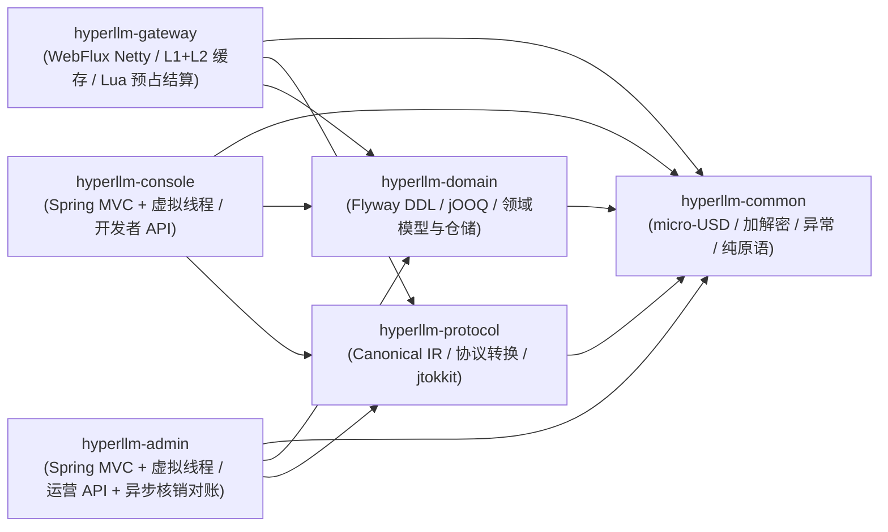

# HyperLLM 第一阶段（第二部分）详细设计：工程依赖与基础设施编排

> 本文档是 **HyperLLM**（`app.pagefault.hyperllm`）继 [01-database-design.md](./01-database-design.md) 之后的第一阶段（第二部分）工程底座与基础设施设计规范，基于 `/grill-me` 对齐的 8 项核心决策，完整定义 **Backend Maven 多模块依赖矩阵**、**jOOQ 代码生成机制**、**`gateway` 缓存优先与冷回源模型**、**前后端与中间件端口约定** 以及 **`infra/docker-compose.yaml` 分层编排方案**。

---

## 1. 已对齐工程与基建决策矩阵

| 决策域 | 最终对齐方案 | 工程约束与影响 |
| :--- | :--- | :--- |
| **Spring Boot 基线** | **Spring Boot 3.5.x** + `spring-boot-starter-parent`（Java 21 LTS） | 原生支持 Java 21 虚拟线程，与 jOOQ、Flyway、Springdoc、Testcontainers、Micrometer OTel 生态完全兼容 |
| **模块依赖与回源策略** | **`gateway` 直接依赖 `domain`**；热路径 Caffeine L1 + Redis L2 零阻塞，冷未命中时切出 EventLoop 回源 `domain` 查 Postgres | 单机万级并发下 99.99%+ 请求全量命中缓存，仅极低比例首次请求/冷缓存穿透才查数据库，兼顾领域模型复用与整体吞吐性能 |
| **jOOQ 代码生成** | 显式 Maven Profile（`-Pjooq`）+ Testcontainers Postgres 16 生成并提交至受控源码目录 | 100% 兼容 Postgres 原生分区表、`TEXT[]`、`CIDR[]`、`JSONB` 与部分唯一索引；日常 `mvn test`/`compile` 零 Docker 秒级构建；仅控制面运行 Flyway，`gateway` 关闭启动期迁移 |
| **Java 编码库规范** | Java 21 `record`（不可变领域/DTO/IR）+ 轻量 Lombok（`@Slf4j`/`@RequiredArgsConstructor`/`@Builder`）+ `uuid-creator` + `jtokkit` + `springdoc-openapi` | 保持领域数据不可变与模式匹配优势，同时精简 Service 与 Builder 样板代码 |
| **Compose 分层编排** | Docker Compose `profiles` 分层启停 | 默认拉起核心底座（Postgres 16 + Redis 7 + Kafka KRaft）；`--profile pipeline` 追加 Debezium + ClickHouse；`--profile observability` 追加 OTel + Prometheus + Grafana；`--profile tools` 可选拉起 Kafka UI |
| **端口与环境配置** | 标准中间件端口 + 错峰应用端口，全部支持 `.env` 覆写 | `frontend/console:3000`、`frontend/admin:3001`、`gateway:8080`、`console:8081`、`admin:8082`、`grafana:3100`、`kafka-ui:8088`，避免常见本地端口冲突 |
| **中间件镜像与初始化** | 官方 `apache/kafka`（KRaft 无 ZK）+ Compose 内置 one-shot 初始化容器 | `kafka-init` 自动建 Topic、`clickhouse` 自动挂载建表、`debezium-init` 注册 Connector（Postgres 启用 `publication.autocreate.mode=filtered` 适配 Flyway 建表时序） |
| **测试与工程卫生** | JUnit 5 + `StepVerifier` + WireMock + Testcontainers（`@Tag("integration")`）+ 根 `.gitignore` / `.env.example` | 隔离纯单元测试与容器集成测试，保护本地密钥与编译产物不被误提交 |

---

## 2. 后端 Maven 多模块依赖图与边界职责

### 2.1 模块依赖拓扑（DAG）



### 2.2 `gateway` 依赖 `domain` 的运行期约束

`gateway` 收到下游请求后，围绕 API Key 鉴权、所属空间/Project 校验、余额判定、模型路由绑定与多维计费，核心领域模型与查库仓储统一复用 `hyperllm-domain`，并遵循以下运行期保护约束：

1. **缓存优先原则（热路径 99.99%+ 零阻塞）**：
   - 所有热点配置（`api_keys`、`projects`、`organizations`、`virtual_models`、`channels`、`pricing_rules` 等）与钱包额度通过 `Caffeine L1 -> Lettuce Reactive Redis L2` 承载，并由 Debezium CDC 实时更新/失效。
   - 万级并发场景下仅首次请求或冷缓存未命中才会穿透至 PostgreSQL，阻塞回源占比极低，对整体并发吞吐影响可忽略。
2. **EventLoop 保护与防击穿**：
   - `gateway` 触发 `domain`（jOOQ + JDBC）冷回源查询时，须通过 `Schedulers.boundedElastic()` 或 Java 21 虚拟线程执行器异步调度，并配合进程内 `SingleFlight`（按缓存 Key 去重并发回源请求），防止同一冷 Key 在瞬间突发流量下并发穿透压垮数据库连接池。
   - `gateway` 配置独立且较小的 HikariCP 连接池上限（如 `maximum-pool-size: 8`），将主要 Postgres 连接配额留给 `console` 与 `admin`。
3. **Flyway 执行权收敛**：
   - Flyway SQL 脚本统一放在 `backend/domain/src/main/resources/db/migration`。
   - `gateway` 强制设置 `spring.flyway.enabled=false`，避免多网关 Pod 启动时争抢迁移锁；数据库版本迁移仅由控制面（或独立的迁移启动参数）负责。

---

## 3. 父 POM 与各子模块精确依赖清单

### 3.1 父 POM（`backend/pom.xml`）基线配置

- **Parent**：`org.springframework.boot:spring-boot-starter-parent:3.5.x`（取当前最新 3.5 稳定补丁版）
- **核心属性**：
  - `<java.version>21</java.version>`
  - `<maven.compiler.source>21</maven.compiler.source>`
  - `<maven.compiler.target>21</maven.compiler.target>`
  - `<maven.compiler.release>21</maven.compiler.release>`
  - `<project.build.sourceEncoding>UTF-8</project.build.sourceEncoding>`
- **第三方核心依赖版本锁定（`<properties>` / `<dependencyManagement>`）**：
  - `uuid-creator`（`com.github.f4b6a3:uuid-creator`，UUIDv7 生成）
  - `jtokkit`（`com.knuddels:jtokkit`，本地 Token 兜底估算）
  - `springdoc-openapi-starter-webmvc-ui`（`2.8.x`，适配 Spring Boot 3.5 的 OpenAPI 3.1 生成）
  - `jjwt`（`io.jsonwebtoken:jjwt-api` / `jjwt-impl` / `jjwt-jackson` `0.12.x`，双域无状态 JWT）
  - `wiremock-standalone`（`org.wiremock:wiremock-standalone`，上游 LLM 流式/异常 Mock）
  - `clickhouse-jdbc`（`com.clickhouse:clickhouse-jdbc`，OLAP 查询与批量写入客户端）
  - `testcontainers-bom`（Spring Boot 3.5 BOM 已内含版本对齐，补充 `postgresql` / `kafka` 模块及 Redis 容器测试支持）
- **统一插件配置**：
  - `maven-compiler-plugin`：启用 Lombok annotationProcessorPaths（避免与 IDE/MapStruct 等潜在处理器冲突）。
  - `maven-surefire-plugin`：默认单元测试阶段排除 `@Tag("integration")`（`<excludedGroups>integration</excludedGroups>`）。
  - `maven-failsafe-plugin`：集成测试阶段（`verify`）执行 `@Tag("integration")` 容器测试。

### 3.2 六个子模块依赖矩阵

| 模块 | 内部模块依赖 | 核心外部依赖（Compile / Runtime） | 测试依赖 |
| :--- | :--- | :--- | :--- |
| **`common`** (`hyperllm-common`) | 无 | `jackson-databind`、`jackson-datatype-jsr310`、`jakarta.validation-api`、`uuid-creator`、`slf4j-api`、`lombok` (`provided`)；AES-256-GCM / HMAC-SHA256 直接使用 JDK 21 `javax.crypto` | `junit-jupiter`、`assertj-core` |
| **`protocol`** (`hyperllm-protocol`) | `common` | `jackson-databind`、`jackson-datatype-jsr310`、`jtokkit`、`lombok` (`provided`) | `junit-jupiter`、`assertj-core`、`jsonassert` |
| **`domain`** (`hyperllm-domain`) | `common` | `spring-boot-starter-jdbc`、`spring-boot-starter-jooq`、`flyway-core`、`flyway-database-postgresql`、`org.postgresql:postgresql` (`runtime`)、`lombok` (`provided`) | `spring-boot-starter-test`、`testcontainers` (`postgresql`) |
| **`gateway`** (`hyperllm-gateway`) | `common`、`protocol`、`domain` | `spring-boot-starter-webflux`、`spring-boot-starter-data-redis-reactive`、`com.github.ben-manes.caffeine:caffeine`、`spring-kafka`、`spring-boot-starter-actuator`、`micrometer-registry-prometheus`、`micrometer-tracing-bridge-otel`、`opentelemetry-exporter-otlp`、`lombok` (`provided`) | `spring-boot-starter-test`、`reactor-test` (`StepVerifier`)、`wiremock-standalone`、`testcontainers` (`postgresql` / `kafka`) |
| **`console`** (`hyperllm-console`) | `common`、`domain`、`protocol` | `spring-boot-starter-web`、`spring-boot-starter-validation`、`spring-boot-starter-data-redis`、`spring-kafka`、`spring-security-crypto`、`jjwt-*`、`springdoc-openapi-starter-webmvc-ui`、`clickhouse-jdbc`、`spring-boot-starter-actuator`、`micrometer-registry-prometheus`、`micrometer-tracing-bridge-otel`、`opentelemetry-exporter-otlp`、`lombok` (`provided`) | `spring-boot-starter-test`、`spring-kafka-test`、`testcontainers` (`postgresql` / `kafka`) |
| **`admin`** (`hyperllm-admin`) | `common`、`domain`、`protocol` | 同 `console` 基础依赖 + TOTP MFA 纯 Java/轻量校验库 + Debezium/Outbox 异步消费与对账定时调度依赖（`spring-kafka`、`spring-boot-starter-data-redis`、`clickhouse-jdbc`） | `spring-boot-starter-test`、`spring-kafka-test`、`testcontainers` |

> **关键运行配置约定**：
> - `console` 与 `admin` 统一开启 `spring.threads.virtual.enabled=true`（Spring MVC 接入 Java 21 虚拟线程）。
> - `gateway` 显式配置 `spring.main.web-application-type=reactive` 与 `spring.flyway.enabled=false`。

---

## 4. jOOQ 代码生成机制（`-Pjooq` Profile）

由于 PostgreSQL DDL 包含分区表（`PARTITION BY RANGE`）、数组（`TEXT[]`、`CIDR[]`）、`JSONB` 与部分唯一索引，基于 H2 的 `DDLDatabase` 无法完整解析。采用 **真实 Postgres 16 容器 + 显式 Maven Profile** 方案：

1. **生成触发方式**：在 `backend/domain/pom.xml` 中定义 `<id>jooq</id>` Profile，仅当手动执行以下命令时触发：
   ```bash
   ./mvnw generate-sources -pl domain -Pjooq
   ```
2. **执行流程**：
   - 通过 `groovy-maven-plugin` / `testcontainers` 在构建期拉起临时 `postgres:16-alpine` 容器；
   - 执行 Flyway 将 `backend/domain/src/main/resources/db/migration/V*.sql` 全量迁移至临时库；
   - 运行 `org.jooq:jooq-codegen-maven`，将生成的 `Tables`、`Records` 与 `POJOs` 输出至 `backend/domain/src/main/generated`（配置 `build-helper-maven-plugin` 将其注册为常规 `compile` 源码目录）。
3. **团队日常协作优势**：
   - 生成的 Java 文件随 DDL 变更一并提交至 Git，日常 `./mvnw test` / `./mvnw compile` 与 IDE 跳转**无需本地运行 Docker**，实现秒级增量编译。
   - CI 流水线可在验证阶段比对校验 Flyway SQL 与已提交 jOOQ 生成代码是否同步。

---

## 5. 本地端口矩阵与环境变量契约

### 5.1 全栈端口分配表（全量支持 `.env` 覆写）

| 层级 | 组件 / 服务 | 默认宿主机端口 | 容器内部端口 / 说明 |
| :--- | :--- | :---: | :--- |
| **前端** | `frontend/console`（Next.js 16） | `3000` | 默认端口（开发者门户与控制台） |
| **前端** | `frontend/admin`（Next.js 16） | `3001` | 需在 `frontend/admin/package.json` 指定 `-p 3001` |
| **后端** | `backend/gateway`（WebFlux） | `8080` | 数据面 API 入口（`/v1/*`, `/v1beta/*`） |
| **后端** | `backend/console`（Spring MVC） | `8081` | 开发者控制台 REST API & Swagger |
| **后端** | `backend/admin`（Spring MVC） | `8082` | 运营后台 REST API & 异步核销对账 |
| **存储** | PostgreSQL 16 (`postgres`) | `5432` | OLTP 主库（`wal_level=logical`） |
| **缓存** | Redis 7 (`redis`) | `6379` | L2 缓存、Lua 限流与 Pre-hold/Settle |
| **消息** | Apache Kafka (`kafka`) | `9092` | 宿主机连接 `PLAINTEXT_HOST://localhost:9092`；容器内网 `PLAINTEXT://kafka:29092` |
| **CDC** | Debezium Connect (`debezium`) | `8083` | Kafka Connect REST API |
| **OLAP** | ClickHouse 24 (`clickhouse`) | `8123` / `9000` | `8123`（HTTP/JDBC）、`9000`（Native TCP） |
| **观测** | OTel Collector (`otel-collector`) | `4317` / `4318` | `4317`（OTLP gRPC）、`4318`（OTLP HTTP） |
| **观测** | Prometheus (`prometheus`) | `9090` | 指标抓取与查询 |
| **观测** | Grafana (`grafana`) | `3100` | 覆盖默认 3000 端口，避免与 `frontend/console` 冲突 |
| **工具** | Kafka UI (`kafka-ui`) | `8088` | 覆盖默认 8080 端口，避免与 `backend/gateway` 冲突 |

### 5.2 根目录 `.env.example` 核心变量分组规划

后续落地工程骨架时需在根目录提供 `.env.example`（`.env` 写入 `.gitignore` 禁止入库），至少涵盖：
- **数据库与中间件凭据**：`POSTGRES_DB=hyperllm`、`POSTGRES_USER`、`POSTGRES_PASSWORD`、`REDIS_PASSWORD`（可选）、`CLICKHOUSE_DB=hyperllm`、`CLICKHOUSE_USER`、`CLICKHOUSE_PASSWORD`
- **安全与加密主密钥（本地开发占位默认值）**：
  - `HYPERLLM_AES_MASTER_KEY`（32 字节 Base64，AES-256-GCM 渠道/SSO/TOTP 加密主密钥）
  - `HYPERLLM_KEY_PEPPER_V1`（客户 `sk-hl-` Key HMAC-SHA256 服务端胡椒盐）
  - `HYPERLLM_CONSOLE_JWT_SECRET` / `HYPERLLM_ADMIN_JWT_SECRET`（双控制面严格隔离的独立 JWT 签名密钥）
- **端口覆写变量**：`POSTGRES_PORT`、`REDIS_PORT`、`KAFKA_EXTERNAL_PORT`、`CLICKHOUSE_HTTP_PORT`、`GRAFANA_PORT`、`KAFKA_UI_PORT` 等。

---

## 6. `infra/docker-compose.yaml` 分层编排与初始化目录规划

### 6.1 Compose Profiles 分层清单

| Profile | 服务名 | 镜像建议 | 职责与健康检查 |
| :--- | :--- | :--- | :--- |
| **默认（无 Profile）** | `postgres` | `postgres:16-alpine` | 启动参数 `-c wal_level=logical -c max_wal_senders=10 -c max_replication_slots=10`；健康检查 `pg_isready`；挂载 `infra/postgres/init/` |
| **默认（无 Profile）** | `redis` | `redis:7-alpine` | 启动参数 `--appendonly yes`（AOF 持久化减少重启冷穿透）；健康检查 `redis-cli ping` |
| **默认（无 Profile）** | `kafka` | `apache/kafka:3.9.0` | 单节点 KRaft（同时担任 broker + controller，无 ZooKeeper），配置双 Listener（`29092` 容器内 / `9092` 宿主机） |
| **默认（无 Profile）** | `kafka-init` | `apache/kafka:3.9.0` | `depends_on: kafka (healthy)` 一次性初始化容器，幂等创建 `cdc.gateway.config`、`cdc.wallet.events`、`llm.request.events` 等 Topic |
| **`pipeline`** | `clickhouse` | `clickhouse/clickhouse-server:24-alpine` | 挂载 `infra/clickhouse/init/*.sql` 至 `/docker-entrypoint-initdb.d/` 自动初始化宽表、物化视图与调试表 |
| **`pipeline`** | `debezium` | `debezium/connect:2.7` | 依赖 `postgres` + `kafka` 健康就绪；负责读取 PG `pgoutput` WAL 写入 Kafka |
| **`pipeline`** | `debezium-init` | `curlimages/curl:8.11.0` | 依赖 `debezium` 就绪后幂等 PUT/POST 注册 `infra/debezium/` 下的 Config CDC 与 Outbox Connector JSON |
| **`observability`** | `otel-collector` | `otel/opentelemetry-collector-contrib:0.114.0` | 接收后端 OTLP Trace/Metric，挂载 `infra/observability/otel-collector.yaml` |
| **`observability`** | `prometheus` | `prom/prometheus:v2.55.1` | 挂载 `infra/observability/prometheus.yml`，抓取后端 `/actuator/prometheus` 与中间件指标 |
| **`observability`** | `grafana` | `grafana/grafana:11.3.0` | 端口 `3100:3000`，挂载 `infra/observability/grafana/provisioning/` 自动装载 Prometheus/ClickHouse 数据源与大盘 |
| **`tools`** | `kafka-ui` | `provectuslabs/kafka-ui:latest` | 端口 `8088:8080`，仅本地排查 Topic 与 Debezium 消息时按需拉起 |

### 6.2 Kafka Topic 与 Debezium Connector 初始化规划

1. **`infra/kafka/create-topics.sh`**（由 `kafka-init` 调用）：
   - `cdc.gateway.config`：6 partitions，`cleanup.policy=compact`，用于全量配置最新态广播与 L1 失效。
   - `cdc.wallet.topup` / `cdc.wallet.adjust` / `cdc.pack.grant` / `cdc.bonus.grant`：6 partitions，`cleanup.policy=delete`，Outbox Router 目标 Topic。
   - `llm.request.events`：12 partitions，`retention.ms=604800000`（7 天），承载网关发射的反范式请求宽表事件。
   - `llm.billing.settlement`：12 partitions，`retention.ms=604800000`（7 天），承载结算后写 Postgres `wallet_ledger` 的流水事件。
2. **`infra/debezium/` Connector 设计**：
   - `hyperllm-config-connector.json`：使用 `publication.autocreate.mode=filtered`，仅包含 [01-database-design.md](./01-database-design.md#5-debezium-cdc-publication-订阅边界) 指定的 12 张配置表（待控制面首次运行 Flyway 建表后再启动 `pipeline` 或重启 Connector 自动创建过滤 Publication）。
   - `hyperllm-outbox-connector.json`：启用 `io.debezium.transforms.outbox.EventRouter` SMT 仅监听 `public.outbox_events`，按 `aggregatetype` 路由至对应业务 Topic，并以 `aggregateid`（`org_id`）作为 Kafka Key 保证单组织顺序。

### 6.3 基础设施目录完整结构规划

```text
infra/
├── docker-compose.yaml                   # 分层编排（core / pipeline / observability / tools）
├── postgres/
│   └── init/
│       └── 01-init-replication.sql       # [规划] 预置复制角色或扩展检查
├── kafka/
│   └── create-topics.sh                  # Topic 幂等创建脚本
├── debezium/
│   ├── hyperllm-config-connector.json    # Config CDC Connector 注册模板
│   └── hyperllm-outbox-connector.json    # Outbox EventRouter Connector 注册模板
├── clickhouse/
│   └── init/
│       └── 01-init-olap.sql              # llm_request_events / mv_usage_hourly / llm_debug_payloads DDL
├── observability/
│   ├── otel-collector.yaml               # OTel 接收与导出配置
│   ├── prometheus.yml                    # Scrape targets 配置
│   └── grafana/
│       └── provisioning/                 # 自动装配 Datasources 与 Dashboards
└── k8s/                                  # Phase 4 Helm Charts / HPA / Ingress 模板
```

---

## 7. 测试基线、前端脚本对齐与仓库卫生规范

1. **后端测试分层**：
   - **纯单元测试（`./mvnw test`）**：不依赖 Docker，默认跳过 `@Tag("integration")`，覆盖 `protocol` IR 转译、`common` 精度与加解密、`gateway` 路由与计费算法（配合 `StepVerifier` 与 WireMock）。
   - **容器集成测试（`./mvnw verify`）**：标注 `@Tag("integration")`，使用 Testcontainers 拉起真实 PostgreSQL 16 + Redis 7 + Kafka 验证 Flyway、jOOQ SQL、Lua 预占结算与 Outbox 幂等消费。
2. **前端启动端口对齐**：
   - `frontend/console/package.json` 保持 `next dev` / `next start`（默认 `3000`）。
   - `frontend/admin/package.json` 调整 `dev` 为 `next dev -p 3001`、`start` 为 `next start -p 3001`。
3. **根目录工程卫生文件**：
   - 补全根目录 `.gitignore`：统一忽略 Maven `target/`、IDEA `out/`、本地 `.env`、`*.log`、Node `node_modules/` / `.next/` 等临时与敏感产物。
   - 补全根目录 `.env.example`：为所有开发者提供开箱即用的本地环境变量模板与启动说明。
