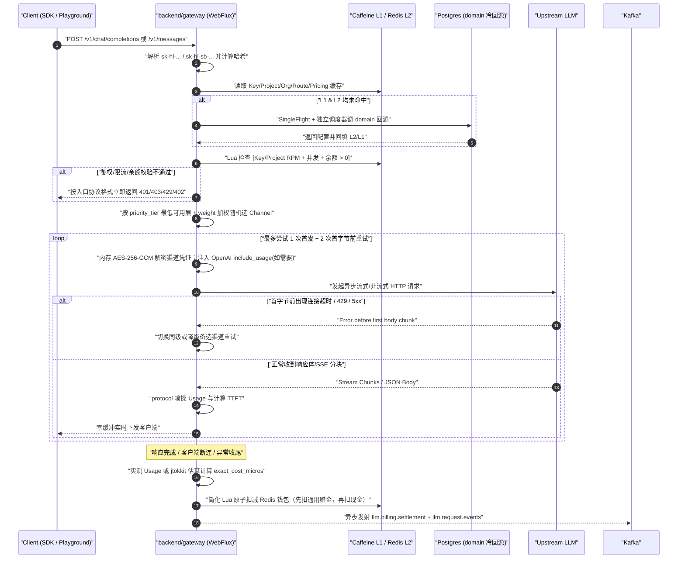

# HyperLLM 第一阶段（第三部分）详细设计：认证鉴权、Core REST API 与 Gateway MVP 运行契约

> 本文档是 **HyperLLM**（`app.pagefault.hyperllm`）继 [01-database-design.md](./01-database-design.md) 与 [02-dependencies-and-infra.md](./02-dependencies-and-infra.md) 之后的第一阶段（第三部分）后端运行契约，基于 `/grill-me` 对齐的 9 项核心决策，定义 **Phase 1 认证与加密规范**、**`console` / `admin` Core REST API 与统一错误体** 以及 **`gateway` / `protocol` MVP 同构代理、Debezium 失效联动与过渡期扣费记账机制**。

---

## 1. 已对齐 Phase 1 后端契约决策矩阵

| 决策域 | 最终对齐方案 | 工程约束与影响 |
| :--- | :--- | :--- |
| **开发者登录与开户** | 邮箱 + 密码（含邮箱验证码校验）先行；注册同事务初始化空间与钱包，并支持配置开关发放新手体验金 | 个人注册即自动建 `Personal Workspace`、`default` Project 与 `wallets`；OAuth 延后至 Phase 1 末或 Phase 2 |
| **JWT 与令牌传输** | 双域独立 `HS256` 签名；Access JWT 走 `Authorization: Bearer`，Refresh Token 走 `HttpOnly; SameSite=Lax` Cookie（家族轮换防重放） | Playground 临时凭证采用 Redis 不透明短令牌（`sk-hl-sb-...`，TTL 300s），避免与用户 JWT 密钥耦合 |
| **REST 响应与异常** | 成功直接返回业务 DTO / `PageResponse<T>`（HTTP `200`/`201`/`204`）；错误统一返回扩展 **RFC 9457 `ProblemDetail`** | 携带 `code`、`traceId`、`fieldErrors`，直接对齐 `springdoc-openapi` 与 `openapi-typescript` |
| **运营初始化与 MFA** | 启动器按环境变量幂等初始化首个 `SUPER_ADMIN`；`hyperllm.admin.mfa.required` 控制 TOTP 门禁 | 生产环境强制 `true`，本地 `dev` profile 可设为 `false` 以便快速联调 |
| **Gateway 协议范围** | **Phase 1 同构高保真透传**：`/v1/chat/completions`（OpenAI 兼容渠道）、`/v1/messages`（Anthropic 渠道）、`/v1/models` | `protocol` 模块先搭好 `Canonical IR` 骨架与流式 Usage 嗅探器，异构双向转译留至 Phase 3 |
| **配置缓存失效** | 控制面写库提交后主动刷新/清理对应 Redis L2 Key，并通过 **Debezium -> Kafka (`cdc.gateway.config`)** 广播驱逐 `gateway` 本地 Caffeine L1 | 与 Phase 2 正式 CDC 链路同构无返工；本地联调 Phase 1 完整失效链路需随 Compose 拉起 `--profile pipeline`（Debezium） |
| **过渡期扣费与记账** | 入口简化版 Redis Lua 余额校验/预扣（仅现金与通用赠金，暂不含资源包/多批代金券）+ 请求结束后发 **Kafka `llm.billing.settlement`** 异步落盘 Postgres `wallet_ledger`（`ON CONFLICT` 幂等） | 保持与 Phase 2 同构架构；测试充值通过 `admin` 测试加款接口完成 |
| **路由容灾、限流与事件** | `priority_tier` + `weight` 加权随机 + 首字节前切换重试（最多 2 次）；API Key / Project 级 Redis **RPM + 最大并发** 限流；发射请求宽表事件至 Kafka `llm.request.events` | 为 Phase 2 ClickHouse 报表与完整 TPM/四层限流做好数据与管道铺垫 |

---

## 2. 双控制面认证、JWT 与加解密规范

### 2.1 `console` 认证与开户初始化流程

1. **邮箱验证码与注册**：
   - `POST /api/v1/auth/email-codes`：生成 6 位数字验证码写入 Redis `gw:auth:otp:{purpose}:{lower_email}`（TTL 10 分钟，单邮箱 60s 冷却），本地 `dev` profile 支持日志输出/固定调试后门（禁止在 `prod` 开启）。
   - `POST /api/v1/auth/register`：校验邮箱验证码及密码强度（BCrypt 存储至 `user_identities`），在**单个 PostgreSQL 本地事务**内完成：
     1. 插入 `users`（`status = 'ACTIVE'`, `email_verified_at = now()`）与 `user_identities`（`provider = 'PASSWORD'`）；
     2. 创建默认组织 `organizations`（`name = 'Personal Workspace'`, `is_personal = true`, `tier_id = STANDARD`）；
     3. 插入 `org_members`（`role = 'OWNER'`）；
     4. 创建默认项目 `projects`（`name = 'default'`, `environment = 'PRODUCTION'`）并关联 `project_members`；
     5. 创建 `wallets`（若配置 `hyperllm.billing.signup-bonus-micros > 0`，同步写入 `bonus_balance_micros`、`total_bonus_granted_micros` 并记入 `wallet_ledger` (`BONUS_GRANT`)，同时预热 Redis `gw:wallet:{org_id}`）。
2. **登录与 Refresh Token 家族轮换**：
   - 登录成功签发 **Access JWT（15 分钟）** 返回于 JSON Body，并签发 **Refresh Token（14 天）** 写入 `refresh_tokens` 表（关联 `token_family_id`），通过 `Set-Cookie` 下发：
     - `Name`: `hl_console_rt`
     - `Path`: `/api/v1/auth`
     - `HttpOnly; SameSite=Lax; Secure`（本地 HTTP 开发可通过配置关闭 `Secure`）
   - 刷新时 `POST /api/v1/auth/refresh` 校验库内 `token_hash`：若该 Token 已被 `rotated_at` 消费过（疑似窃取重放），**立即吊销同一 `token_family_id` 下全部活跃 Refresh Token** 并返回 `401`。

### 2.2 `admin` 初始化与 MFA 门禁

1. **首个超级管理员引导**：
   - `backend/admin` 启动后执行 `ApplicationRunner`：检查 `admin_users` 表记录数，仅当为空且配置了 `HYPERLLM_BOOTSTRAP_ADMIN_EMAIL` 与 `HYPERLLM_BOOTSTRAP_ADMIN_PASSWORD` 时，幂等插入首个 `role = 'SUPER_ADMIN'` 账号。
2. **登录与 TOTP 开关**：
   - `POST /api/v1/admin/auth/login` 校验用户名/邮箱与密码，检查 `allowed_cidrs`（若非空）。
   - 当 `hyperllm.admin.mfa.required = true` 时：
     - 若管理员尚未绑定 TOTP，签发仅限调用 `/api/v1/admin/auth/mfa/setup` 的受限临时 JWT（`scope = 'MFA_SETUP'`，TTL 10 分钟）；
     - 若已绑定 TOTP，签发仅限调用 `/api/v1/admin/auth/mfa/verify` 的 `scope = 'MFA_VERIFY'` 令牌，验证 6 位动态码后方签发完整权限 Access JWT 与 `hl_admin_rt` Refresh Cookie（`Path: /api/v1/admin/auth`）。
   - 当 `hyperllm.admin.mfa.required = false`（仅限本地 `dev` profile）时，登录直接签发完整管理域令牌。

### 2.3 JWT Claims 规范（双域独立 `HS256`）

- **`console` Access JWT（密钥：`HYPERLLM_CONSOLE_JWT_SECRET`）**：
  - `iss`: `"hyperllm-console"`，`aud`: `"console-api"`，`sub`: `user_id` (UUID)
  - `email`: 用户邮箱，`type`: `"CONSOLE_ACCESS"`，`jti`、`iat`、`exp`（15 分钟）
  - **实时权限策略**：Access JWT 不长期缓存易变的组织角色列表；`console` 接口通过 `org_members` / `project_members`（配合轻量短期缓存）实时校验操作权限，确保成员被移除或降权后立即生效。
- **`admin` Access JWT（密钥：`HYPERLLM_ADMIN_JWT_SECRET`）**：
  - `iss`: `"hyperllm-admin"`，`aud`: `"admin-api"`，`sub`: `admin_user_id` (UUID)
  - `role`: `SUPER_ADMIN | OPS | FINANCE | AUDITOR`，`mfa`: `true | false`，`type`: `"ADMIN_ACCESS"`，`jti`、`iat`、`exp`（15 分钟）

### 2.4 API Key、Playground 临时凭证与 AES-256-GCM 编码规范

1. **客户 API Key 格式**：
   - 明文格式：`sk-hl-<8位可见前缀><40位高熵随机体>`（共 54 字符，随机部分使用密码学安全 `SecureRandom` + Base62 `[0-9A-Za-z]`）。
   - 存储字段：`key_prefix` 存前 12 位 + 末 4 位脱敏形式（如 `sk-hl-aB3x9K2m...Z8qW`）；`key_hash` 存小写十六进制 `HMAC-SHA256(raw_key, server_pepper)`，并记录 `pepper_version`（网关校验时支持按主/副双 Pepper 依次匹配）。
2. **Playground 临时凭证（Ephemeral Token）**：
   - 格式：`sk-hl-sb-<32位高熵随机串>`，由 `console` 校验用户在目标 Project 具备权限后生成并写入 Redis `gw:sandbox:{sha256_hash}`（TTL `300s`），载荷 JSON 包含：`org_id`、`project_id`、`user_id`、`allowed_models`、`expires_at`。
   - `frontend/console` 浏览器使用 `Authorization: Bearer sk-hl-sb-...` 直连 `gateway` 发起 SSE，同样计入对应 Org 扣费与 `llm.request.events`（`user_id` 字段非空）。
3. **上游渠道凭证 AES-256-GCM 二进制封装**：
   - 存储于 `channels.encrypted_credentials`（`BYTEA`）：
     `[1 byte key_version (0x01)] || [12 bytes random IV] || [ciphertext + 16 bytes GCM Auth Tag]`
   - **AAD 绑定**：`channel.id.toString().getBytes(UTF_8)`，杜绝密文被跨行复制到其他渠道记录中解密复用。

---

## 3. Core REST API 契约与错误规范

### 3.1 统一响应与 RFC 9457 错误体

1. **成功响应**：
   - 单实体或创建响应：直接返回 DTO JSON（HTTP `200` / `201`）；无内容操作（如吊销/删除/登出）返回 `204 No Content`。
   - 列表分页响应统一包装为 `PageResponse<T>`：
     ```json
     {
       "items": [],
       "page": 1,
       "pageSize": 20,
       "total": 100
     }
     ```
2. **错误响应（扩展 `ProblemDetail`，`Content-Type: application/problem+json`）**：
   ```json
   {
     "type": "https://hyperllm.dev/errors/key-revoked",
     "title": "API Key Revoked",
     "status": 403,
     "detail": "The specified API key has already been revoked.",
     "code": "KEY_ALREADY_REVOKED",
     "traceId": "019352b8c1e47b10a8c4e12f9a3d1001",
     "timestamp": "2026-10-02T01:30:00Z",
     "fieldErrors": []
   }
   ```
3. **错误码分段规范**：
   - `AUTH_*`（如 `AUTH_INVALID_CREDENTIALS`、`AUTH_TOKEN_EXPIRED`、`AUTH_MFA_REQUIRED`、`AUTH_FORBIDDEN`）
   - `TENANT_*`（如 `TENANT_ORG_NOT_FOUND`、`TENANT_PROJECT_DUPLICATE`、`TENANT_MEMBER_EXISTS`）
   - `KEY_*`（如 `KEY_NOT_FOUND`、`KEY_ALREADY_REVOKED`）
   - `CHANNEL_*` / `MODEL_*`（如 `MODEL_CODE_EXISTS`、`CHANNEL_PROBE_FAILED`、`PRICING_WINDOW_OVERLAP`）
   - `BILLING_*`（如 `BILLING_INSUFFICIENT_BALANCE`、`BILLING_INVALID_AMOUNT`）

### 3.2 `backend/console` Phase 1 Core REST API 清单（`/api/v1/*`）

| 域 | 方法与路径 | 鉴权 / RBAC | 核心职责 |
| :--- | :--- | :--- | :--- |
| **认证** | `POST /api/v1/auth/email-codes` | 公开（限流） | 发送注册/验证邮箱 OTP |
| **认证** | `POST /api/v1/auth/register` | 公开 | 注册用户并同事务建默认空间、项目、钱包 |
| **认证** | `POST /api/v1/auth/login` | 公开 | 校验凭据并签发 Access JWT + Refresh Cookie |
| **认证** | `POST /api/v1/auth/refresh` | Refresh Cookie | 令牌轮换与重放族检测 |
| **认证** | `POST /api/v1/auth/logout` | Console JWT | 吊销当前 Refresh 会话并清除 Cookie |
| **认证** | `GET /api/v1/auth/me` | Console JWT | 当前用户信息与所属组织/角色列表 |
| **组织** | `GET /api/v1/orgs` | Console JWT | 列出当前用户所属全部 Organization |
| **组织** | `POST /api/v1/orgs` | Console JWT | 新建组织（创建者自动为 `OWNER` 并建 `wallets`） |
| **组织** | `GET / PATCH /api/v1/orgs/{orgId}` | `OWNER` / `ADMIN`（PATCH） | 查询组织详情 / 修改名称 |
| **成员** | `GET /api/v1/orgs/{orgId}/members` | 组织成员 | 查询组织成员及授权项目 |
| **成员** | `PATCH / DELETE /api/v1/orgs/{orgId}/members/{memberId}` | `OWNER` / `ADMIN`（不可改 Owner） | 变更角色或移除成员（同步刷新项目授权） |
| **邀请** | `POST /api/v1/orgs/{orgId}/invitations` | `OWNER` / `ADMIN` | 发起成员邀请（支持预指定 `projectIds`） |
| **邀请** | `POST /api/v1/invitations/accept` | Console JWT | 接受组织邀请加入成员 |
| **项目** | `GET /api/v1/orgs/{orgId}/projects` | `OWNER`/`ADMIN`/`BILLING` 全量；`DEVELOPER` 仅授权项目 | 分页列出可见 Project |
| **项目** | `POST /api/v1/orgs/{orgId}/projects` | `OWNER` / `ADMIN` | 创建项目（配置白名单模型、月上限、RPM） |
| **项目** | `GET / PATCH / DELETE /api/v1/projects/{projectId}` | 查询按项目授权；改删需 `OWNER`/`ADMIN` | 项目详情、更新限流/白名单、软删除（同步清 Redis） |
| **项目** | `PUT /api/v1/projects/{projectId}/members` | `OWNER` / `ADMIN` | 配置 `DEVELOPER` 可访问的项目成员集合 |
| **Key** | `GET /api/v1/projects/{projectId}/api-keys` | `OWNER`/`ADMIN` 或所属 `DEVELOPER` | 列出项目下脱敏 Key 列表 |
| **Key** | `POST /api/v1/projects/{projectId}/api-keys` | `OWNER`/`ADMIN` 或所属 `DEVELOPER` | 签发新 Key（**仅本次返回明文 `rawKey`**，同步写 Redis） |
| **Key** | `PATCH / DELETE /api/v1/api-keys/{keyId}` | `OWNER`/`ADMIN` 或所属 `DEVELOPER` | 修改名称/限额/启停、吊销 Key（立即清 Redis 并经 CDC 驱逐 L1） |
| **目录** | `GET /api/v1/models` | Console JWT | 公开可见虚拟模型目录及当前生效多维定价 |
| **钱包** | `GET /api/v1/orgs/{orgId}/wallet` | `OWNER`/`ADMIN`/`BILLING` | 查看现金余额、赠金余额与告警阈值 |
| **钱包** | `GET /api/v1/orgs/{orgId}/wallet/ledger` | `OWNER`/`ADMIN`/`BILLING` | 分页查询 `wallet_ledger` 资金明细 |
| **沙盒** | `POST /api/v1/playground/ephemeral-token` | `OWNER`/`ADMIN`/`DEVELOPER`（需项目权限） | 换取 5 分钟 `sk-hl-sb-...` 临时调用凭证 |

### 3.3 `backend/admin` Phase 1 Core REST API 清单（`/api/v1/admin/*`）

| 域 | 方法与路径 | 角色要求 | 核心职责 |
| :--- | :--- | :--- | :--- |
| **认证** | `POST /api/v1/admin/auth/login` | 公开（可校验 CIDR） | 运营登录（返回完整 JWT 或 MFA 挑战令牌） |
| **认证** | `POST /api/v1/admin/auth/mfa/setup` | `MFA_SETUP` Token | 生成 TOTP Secret/二维码 URI 并验证首次绑定 |
| **认证** | `POST /api/v1/admin/auth/mfa/verify` | `MFA_VERIFY` Token | 校验 6 位 TOTP 码换取完整 Admin JWT |
| **认证** | `POST /api/v1/admin/auth/refresh` & `logout` | Admin JWT / Cookie | 刷新运营会话 / 退出吊销 |
| **供应商** | `GET /api/v1/admin/providers` | `SUPER_ADMIN` / `OPS` / `AUDITOR` | 查看预置供应商协议模板（OpenAI / Anthropic 等） |
| **渠道** | `GET / POST / PATCH / DELETE /api/v1/admin/channels` | `SUPER_ADMIN` / `OPS`（读含 `AUDITOR`） | 上游渠道 CRUD（密钥 AES-256-GCM 加密落盘，返回脱敏信息，变更同步刷 Redis） |
| **渠道** | `POST /api/v1/admin/channels/{channelId}/probe` | `SUPER_ADMIN` / `OPS` | 内存解密凭证向真实上游发最小探测请求验证连通性与延迟 |
| **模型** | `GET / POST / PATCH / DELETE /api/v1/admin/models` | `SUPER_ADMIN` / `OPS` | 虚拟模型 CRUD（能力标识、上下文窗口、状态） |
| **绑定** | `GET / PUT / DELETE /api/v1/admin/models/{modelId}/bindings` | `SUPER_ADMIN` / `OPS` | 配置虚拟模型绑定的渠道池（`priority_tier`、`weight`、`upstream_model_name`、采购成本覆写） |
| **定价** | `GET / POST /api/v1/admin/models/{modelId}/pricing-rules` | `SUPER_ADMIN` / `OPS` / `FINANCE` | 查询历史定价版本 / 发布新版本定价（校验时间窗不重叠并刷新路由缓存） |
| **租户** | `GET /api/v1/admin/orgs` & `PATCH /api/v1/admin/orgs/{orgId}/status` | `SUPER_ADMIN` / `OPS` / `FINANCE` | 租户检索、冻结/恢复组织状态 |
| **测试充值** | `POST /api/v1/admin/orgs/{orgId}/wallet/topup` | `SUPER_ADMIN` / `FINANCE` | **Phase 1 过渡加款接口**：支持入账测试现金或体验金，同事务更新 `wallets` + `wallet_ledger` 并同步更新 Redis `gw:wallet:{org_id}` |

---

## 4. Gateway MVP 代理链路、缓存同步与过渡记账契约

### 4.1 Phase 1 暴露端点与同构透传边界

| 端点 | 鉴权 Header 兼容 | Phase 1 路由匹配原则 |
| :--- | :--- | :--- |
| `POST /v1/chat/completions` | `Authorization: Bearer sk-hl-...` | 仅路由至绑定渠道中 `providers.protocol_family = 'OPENAI'` 的健康渠道，执行同构流式/非流式透传 |
| `POST /v1/messages` | `x-api-key: sk-hl-...`（兼容 `Authorization: Bearer`） | 仅路由至绑定渠道中 `providers.protocol_family = 'ANTHROPIC'` 的健康渠道，执行同构原生 SSE 透传 |
| `GET /v1/models` | `Authorization: Bearer` 或 `x-api-key` | 动态过滤当前 `api_key` / `project` 白名单与 `PUBLIC` 状态活跃模型并返回上下文与元数据 |

### 4.2 缓存同步与冷回源链路

1. **L2（Redis）主动刷新 + L1（Caffeine）Debezium CDC 失效**：
   - 控制面（`console` / `admin`）在事务提交修改 `api_keys`、`projects`、`organizations`、`channels`、`virtual_models`、`model_channel_bindings`、`pricing_rules` 后，主动删除或刷新对应 Redis L2 Key（`gw:cfg:key:{key_hash}`、`gw:cfg:route:{model_code}`），保证 L2 毫秒级最新。
   - 同时由 **Debezium Connect（`cdc.gateway.config`）** 捕获 PostgreSQL WAL 推送 Kafka；每个 `gateway` 实例以独立 Consumer Group（`hyperllm-gateway-{instanceId}`）实时消费配置变更事件，精准驱逐本地 Caffeine L1 缓存（辅以 L1 短 TTL 兜底）。
2. **冷缓存未命中回源（`domain` 复用）**：
   - 当请求命中 L1 + L2 双未命中（首次请求或 Redis 冷启动）时，`gateway` 通过 `Schedulers.boundedElastic()` / 虚拟线程调度器 + 进程内 `SingleFlight`（按缓存键合并并发查询）调用 `backend/domain`（jOOQ + JDBC）查询 Postgres，并将结果回填 Redis L2 与 Caffeine L1。

### 4.3 入口校验、路由选型与首字节前重试流



### 4.4 Phase 1 过渡期扣费、流式 Usage 兜底与异步写库规则

1. **简化版 Redis 余额校验与扣费 Lua**：
   - **入口准入**：校验 `gw:wallet:{org_id}` 中 `cash_micros + general_bonus_micros > 0`（Phase 1 暂不扣除多批过期代金券与资源包），并在 Lua 中原子校验 Key/Project 的 `RPM` 滑动窗口计数及当前并发租约 `INCR`（响应收尾时 `DECR`）。
   - **结束结算**：响应收尾（含流式结束、客户端中途断开或上游流中断）后计算：
     $$\text{RawCost} = \left\lceil \frac{\text{PromptTokens} \times P_{\text{in}} + \text{CompletionTokens} \times P_{\text{out}} + \text{CachedReadTokens} \times P_{\text{cache\_read}} + \text{CachedWriteTokens} \times P_{\text{cache\_write}} + \text{ReasoningTokens} \times P_{\text{reasoning}}}{1,000,000} \right\rceil$$
     $$\text{ExactCost} = \left\lceil \frac{\text{RawCost} \times \text{EffectiveDiscountBps}}{10,000} \right\rceil$$
   - 通过 Redis Lua 原子执行扣减：**优先扣减 `general_bonus_micros`，不足部分再扣减 `cash_micros`**（若发生单次并发微额透支，允许在本笔扣减后触发欠费拦截，Phase 2 引入完整 `Pre-hold/Settle` 彻底杜绝并发透支）。
2. **流式 Usage 捕获与兜底估算**：
   - OpenAI `/v1/chat/completions` 若客户端请求 `stream=true` 且未显式携带 `stream_options.include_usage=true`，`gateway` 自动在转发上游请求体中注入该字段；收尾时捕获最终 Usage 后，若原始请求未开启 `include_usage`，则剥离该末帧 Usage Chunk 不透传给客户端。
   - 若上游未返回 Usage 或流中途异常断连，`protocol` 使用 `jtokkit` 按已收到并下发给客户端的正文文本估算 `completion_tokens`，确保不漏记账。
3. **Kafka 异步双事件发射**：
   - **`llm.billing.settlement`**：包含 `request_id`、`event_created_at`（作为 `wallet_ledger` 分区键 `created_at`）、`org_id`、`project_id`、`api_key_id`、`cash_delta_micros`、`bonus_delta_micros`、`idempotency_key = "req:" + request_id`。`backend/admin` 消费者批量/准实时落盘 Postgres `wallet_ledger`（`ON CONFLICT (idempotency_key, created_at) DO NOTHING`）并原子扣减 `wallets` 行余额。
   - **`llm.request.events`**：发射标准 JSON 宽表事件，供 Phase 2 ClickHouse 消费入库（或直接由 Phase 1/2 开启 `--profile pipeline` 摄入）。

### 4.5 入口协议错误体映射规范

`gateway` 在未向下游输出任何 SSE 正文分块前发生鉴权、限流、余额不足或全部渠道重试失败时，必须按客户端请求的协议族返回标准格式：
- **OpenAI `/v1/chat/completions`**：
  ```json
  {
    "error": {
      "message": "Insufficient quota for this organization.",
      "type": "insufficient_quota",
      "param": null,
      "code": "BILLING_INSUFFICIENT_BALANCE"
    }
  }
  ```
- **Anthropic `/v1/messages`**：
  ```json
  {
    "type": "error",
    "error": {
      "type": "rate_limit_error",
      "message": "Rate limit exceeded for API key."
    }
  }
  ```
