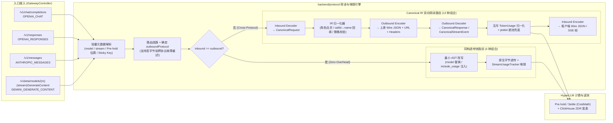
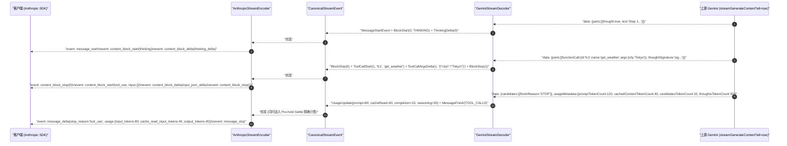

# HyperLLM Phase 3 协议调研与双向转译 Canonical IR 设计方案

> **文档定位**：本文档面向 HyperLLM Phase 3 的「多协议双向转译引擎」（见 [PROPOSAL.md](../PROPOSAL.md#13-协议矩阵与双向转译能力) 与 [TODO.md](../TODO.md#phase-3全协议双向转译智能路由与企业级治理)），基于各厂商**一手官方文档与官方 SDK 源码**完成四类文本生成协议的深度调研，并结合当前代码库基线设计基于 **Canonical IR（统一规范中间表示）** 的双向协议转换方案。
>
> **范围修正声明**：[PROPOSAL.md](../PROPOSAL.md#13-协议矩阵与双向转译能力) 与 [TODO.md](../TODO.md#phase-3全协议双向转译智能路由与企业级治理) 中曾将 `embeddings`、`images/generations`、`audio/*`、`rerank` 与 `count_tokens` 纳入 Phase 3 扩展列表。**现阶段明确收敛范围**：仅实现以下**四类「文本/图片输入 → 文本输出（含工具调用、结构化输出、思维链推理、提示词缓存、流式 SSE）」协议**的原生接入与双向互转，不涵盖文生图、Embedding、Rerank、Audio 等非文本输出模态：
> 1. **OpenAI Chat Completions**（`POST /v1/chat/completions`）
> 2. **OpenAI Responses**（`POST /v1/responses`）
> 3. **Anthropic Messages**（`POST /v1/messages`）
> 4. **Google Gemini GenerateContent**（`POST /v1beta/models/{model}:generateContent` 与 `:streamGenerateContent`）

---

## 已对齐核心决策矩阵

| 决策项 | 最终确认方案 | 工程约束与影响 |
| :--- | :--- | :--- |
| **协议实现范围** | 仅实现 4 类文本输出协议（支持文本 + 图片输入）：`OPENAI_CHAT`、`OPENAI_RESPONSES`、`ANTHROPIC_MESSAGES`、`GEMINI_GENERATE_CONTENT` | `embeddings`、`images/generations`、`audio/*`、`rerank`、`count_tokens` 延后，不纳入本阶段实现 |
| **推理 Token 单价兜底** | 在 `PricingResolver` 中，当 `reasoning_price_micros_1m == 0 && output_price_micros_1m > 0` 时，**确定性按 `output_price_micros_1m` 计费** | 与 `TokenUsage` 严格互斥口径配合，杜绝推理 Token 免费或双计费；仅当显式配置非零 `reasoning_price_micros_1m` 时采用独立单价 |
| **默认转译策略（`TranslationPolicy`）** | 默认启用 **`BEST_EFFORT`**（支持虚拟模型级切至 `STRICT`） | 允许安全降级（`temperature` 钳位、忽略非关键采样参数、OpenAI Chat 工具图片拆至后续 `user` 块）；对破坏正确性或 ZDR 的独占特性（`previous_response_id`、内置服务端工具、厂商私有 `file_id`、`cachedContent`）强制快速失败返回 `400` |
| **跨协议路由优先级** | **同 Tier 内严格同构优先**（Homomorphic-First） | 同一 `priority_tier` 内先仅在支持 `inboundProtocol` 的同构渠道子集内选路（零开销透传）；仅当该 Tier 同构渠道全部不可用/满载/被重试排除后，才降级至同 Tier 异构渠道，随后再进入下一 Tier（每 Tier 均遵守「同构优先、异构兜底」） |

---

## 目录

1. [一手资料来源索引](#1-一手资料来源索引)
2. [四类协议深度调研与关键差异矩阵](#2-四类协议深度调研与关键差异矩阵)
3. [当前代码库基线审计与现存缺口](#3-当前代码库基线审计与现存缺口)
4. [总体架构：双路径网关与 Hub-and-Spoke Canonical IR](#4-总体架构双路径网关与-hub-and-spoke-canonical-ir)
5. [Canonical IR 核心数据模型设计（Java 21）](#5-canonical-ir-核心数据模型设计java-21)
6. [双向协议映射规则与高危边界处理](#6-双向协议映射规则与高危边界处理)
7. [流式状态机（SSE / JSON Stream）双向转译设计](#7-流式状态机sse--json-stream双向转译设计)
8. [TokenUsage 严格互斥口径与计费对齐](#8-tokenusage-严格互斥口径与计费对齐)
9. [协议错误体、鉴权头与端点适配规范](#9-协议错误体鉴权头与端点适配规范)
10. [HyperLLM 各模块落地改造方案](#10-hyperllm-各模块落地改造方案)
11. [分阶段实施顺序与 4×4 验收测试矩阵](#11-分阶段实施顺序与-44-验收测试矩阵)

---

## 1. 一手资料来源索引

文中所有协议字段、状态枚举、Token 包含关系与错误规范均溯源至以下官方一手文档与官方 SDK 类型定义：

| 编号 | 协议 / 仓库 | 一手来源 |
| :--- | :--- | :--- |
| **[OAI-CHAT]** | OpenAI Chat Completions | OpenAI API Reference — Chat Completions (`https://platform.openai.com/docs/api-reference/chat`) 与 `openai/openai-python` (`src/openai/types/chat/`) |
| **[OAI-RESP]** | OpenAI Responses | OpenAI API Reference — Responses (`https://platform.openai.com/docs/api-reference/responses`)、Responses Streaming (`https://platform.openai.com/docs/api-reference/responses-streaming`) 与 `openai/openai-python` (`src/openai/types/responses/`) |
| **[OAI-MIG]** | OpenAI Responses 迁移与推理 | OpenAI Guides — Migrate to Responses API / Reasoning (`https://platform.openai.com/docs/guides/migrate-to-responses`, `https://platform.openai.com/docs/guides/reasoning`) |
| **[ANT-MSG]** | Anthropic Messages | Anthropic API Reference — Messages & Streaming (`https://docs.anthropic.com/en/api/messages`, `https://docs.anthropic.com/en/api/messages-streaming`) 与 `anthropics/anthropic-sdk-python` (`src/anthropic/types/`) |
| **[ANT-FEAT]** | Anthropic 思考/缓存/视觉/结构化/错误 | Anthropic Docs — Extended/Adaptive Thinking、Prompt Caching、Vision、Structured Outputs (`output_config`)、Errors (`https://docs.anthropic.com/en/docs/build-with-claude/`, `https://docs.anthropic.com/en/api/errors`) |
| **[GEM-API]** | Google Gemini GenerateContent | Google AI for Developers — GenerateContent REST Reference (`https://ai.google.dev/api/generate-content`, `https://ai.google.dev/api/caching`) 与 `googleapis/python-genai` |
| **[GEM-FEAT]** | Google Gemini 思考/签名/工具/结构化/图片 | Google AI for Developers — Thinking & Thought Signatures (`https://ai.google.dev/gemini-api/docs/thinking`, `https://ai.google.dev/gemini-api/docs/thought-signatures`)、Function Calling (`https://ai.google.dev/gemini-api/docs/function-calling`)、Structured Outputs (`https://ai.google.dev/gemini-api/docs/structured-output`)、Image Understanding (`https://ai.google.dev/gemini-api/docs/image-understanding`) |
| **[REPO]** | HyperLLM 现有代码 | 本仓库 `backend/protocol/`、`backend/gateway/`、`backend/domain/`、`backend/admin/` 与 `backend/common/` |

---

## 2. 四类协议深度调研与关键差异矩阵

### 2.1 端点、鉴权、模型定位与流式传输对比

| 维度 | OpenAI Chat Completions `[OAI-CHAT]` | OpenAI Responses `[OAI-RESP]` | Anthropic Messages `[ANT-MSG]` | Google Gemini `[GEM-API]` |
| :--- | :--- | :--- | :--- | :--- |
| **HTTP 端点** | `POST /v1/chat/completions` | `POST /v1/responses` | `POST /v1/messages` | 非流式：`POST /v1beta/models/{model}:generateContent`<br>流式：`POST /v1beta/models/{model}:streamGenerateContent?alt=sse` |
| **模型名位置** | Request Body `model` | Request Body `model` | Request Body `model` | **URL Path `{model}`**（Body 中无 `model` 字段） |
| **流式开关** | Body `stream: true` | Body `stream: true` | Body `stream: true` | **不同 Action 路径**（`:streamGenerateContent`），SSE 需 `?alt=sse`（无 `alt=sse` 返回 JSON 数组流 `[{...},{...}]`） |
| **鉴权方式** | `Authorization: Bearer <key>`（Azure 用 `api-key`） | `Authorization: Bearer <key>` | `x-api-key: <key>` + 必需 `anthropic-version: 2023-06-01`（可选 `anthropic-beta`） | `x-goog-api-key: <key>` 或查询参数 `?key=<key>`（Vertex AI 用 `Authorization: Bearer <GCP OAuth>`） |
| **SSE 帧格式** | 仅 `data: <json>\n\n`（无 `event:` 行），末尾发送 `data: [DONE]\n\n` | 具名事件 `event: <type>\ndata: <json>\n\n` + 单调递增 `sequence_number`，**无 `[DONE]`** | 具名事件 `event: <type>\ndata: <json>\n\n`，以 `event: message_stop` 终结，**无 `[DONE]`** | `?alt=sse` 时仅 `data: <GenerateContentResponse>\n\n`，**无 `[DONE]`** |
| **状态模型** | 无状态（全量 `messages`） | 支持无状态（`store: false`）或服务端有状态（`previous_response_id` / `conversation`） | 无状态（全量 `messages`） | 无状态（可选服务端 `cachedContent` 资源引用） |

---

### 2.2 对话结构、角色与系统指令

| 维度 | OpenAI Chat `[OAI-CHAT]` | OpenAI Responses `[OAI-RESP]` | Anthropic Messages `[ANT-MSG]` | Google Gemini `[GEM-API]` |
| :--- | :--- | :--- | :--- | :--- |
| **系统指令** | `messages[]` 中 `role: "system"` 或 `"developer"`（可多条） | 顶层 `instructions: string` **和/或** `input[]` 中 `role: "developer"` / `"system"` | 顶层 `system`: `string` 或 `[{type:"text", text, cache_control?}]` | 顶层 `systemInstruction`: `{ parts: [{ text }] }`（`role` 可省略） |
| **主输入字段** | `messages: ChatMessage[]` | `input: string \| InputItem[]`（扁平化 Item 流：含 `message`、`function_call`、`function_call_output`、`reasoning`） | `messages: MessageParam[]` | `contents: Content[]`（每项含 `role` 与 `parts[]`） |
| **角色枚举** | `system`, `developer`, `user`, `assistant`, `tool` | `developer`, `system`, `user`, `assistant`（工具调用与结果作为独立顶层 Item，无 `tool` role） | **仅 `user`, `assistant`**（工具结果作为 `tool_result` block 放入 `user` 消息） | **仅 `user`, `model`**（工具结果作为 `functionResponse` part 放入 `user` content） |
| **交替与首条约束** | 宽松（允许连续同角色、允许 assistant 开头） | 宽松（Item 流按顺序排列） | **严格**：首条必须为 `user`；同角色连续消息须合并；`tool_result` 必须紧跟对应 `assistant(tool_use)` | 推荐 `user` 起头且 `user`/`model` 交替（多轮连续同角色需合并） |

---

### 2.3 文本与图片输入（Vision）

| 维度 | OpenAI Chat `[OAI-CHAT]` | OpenAI Responses `[OAI-RESP]` | Anthropic Messages `[ANT-MSG][ANT-FEAT]` | Google Gemini `[GEM-API][GEM-FEAT]` |
| :--- | :--- | :--- | :--- | :--- |
| **文本输入块** | `content: string` 或 `{ type: "text", text }` | `input: string` 或消息内 `{ type: "input_text", text }`（历史助手消息内用 `output_text`） | `content: string` 或 `{ type: "text", text, cache_control? }` | `parts[]` 内 `{ text: "..." }` |
| **Base64 图片** | `{ type: "image_url", image_url: { url: "data:image/png;base64,...", detail?: "auto"\|"low"\|"high" } }` | `{ type: "input_image", image_url: "data:image/png;base64,...", detail: "auto"\|"low"\|"high"\|"original" }` （**注意：`image_url` 是纯字符串，不是嵌套对象！**） | `{ type: "image", source: { type: "base64", media_type: "image/jpeg"\|"image/png"\|"image/gif"\|"image/webp", data: "<raw base64>" } }`（**无 `data:` 前缀**） | `{ inlineData: { mimeType: "image/jpeg", data: "<raw base64>" } }`（2025/2026 起内联上限已提升至 100 MB `[GEM-FEAT]`） |
| **外部 HTTP(S) 图片 URL** | `{ type: "image_url", image_url: { url: "https://...", detail? } }` | `{ type: "input_image", image_url: "https://...", detail }` | `{ type: "image", source: { type: "url", url: "https://..." } }`（`URLImageSourceParam`，见 `anthropic-sdk-python` `[ANT-MSG]`） | `{ fileData: { mimeType?: "image/png", fileUri: "https://..." } }`（公开 HTTPS/签名 URL `[GEM-FEAT]`） |
| **厂商私有文件引用** | 不直接支持（图片走 `image_url`） | `{ type: "input_image", file_id: "file-...", detail }` | `{ type: "image", source: { type: "file", file_id: "..." } }`（Files API beta） | `{ fileData: { mimeType, fileUri: "https://generativelanguage.googleapis.com/v1beta/files/..." 或 "gs://..." } }` |
| **图片分辨率控制** | `image_url.detail`: `auto`/`low`/`high` | `detail`: `auto`/`low`/`high`/`original`（SDK schema 中为必填字段） | 无独立参数（按像素自动缩放） | `generationConfig.mediaResolution`（或 Part 级 `mediaResolution`） |

---

### 2.4 工具调用（Function / Tool Calling）

| 维度 | OpenAI Chat `[OAI-CHAT]` | OpenAI Responses `[OAI-RESP]` | Anthropic Messages `[ANT-MSG][ANT-FEAT]` | Google Gemini `[GEM-API][GEM-FEAT]` |
| :--- | :--- | :--- | :--- | :--- |
| **工具定义结构** | **嵌套**：`{ type: "function", function: { name, description?, parameters?, strict? } }` | **扁平**：`{ type: "function", name, description?, parameters?, strict? }` | `{ name, description?, input_schema, strict?, cache_control? }` | `tools: [{ functionDeclarations: [{ name, description?, parametersJsonSchema? \| parameters? }] }]` |
| **工具选择 `tool_choice`** | `"none" \| "auto" \| "required"` 或 `{ type: "function", function: { name } }`；顶层 `parallel_tool_calls: bool` | `"none" \| "auto" \| "required"` 或 `{ type: "function", name }`；顶层 `parallel_tool_calls: bool` | `{ type: "auto" \| "any" \| "none" \| "tool", name?, disable_parallel_tool_use?: bool }` | `toolConfig.functionCallingConfig`: `{ mode: "AUTO" \| "ANY" \| "NONE" \| "VALIDATED", allowedFunctionNames?: [...] }` |
| **模型发起调用（输出）** | `choices[0].message.tool_calls[]`: `{ id, type: "function", function: { name, arguments: "<JSON string>" } }` | 顶层 `output[]` Item: `{ type: "function_call", id: "fc_...", call_id: "call_...", name, arguments: "<JSON string>", status }` | `content[]` Block: `{ type: "tool_use", id: "toolu_...", name, input: <JSON Object> }` | `candidates[0].content.parts[]`: `{ functionCall: { id?, name, args: <JSON Object> }, thoughtSignature? }` |
| **回传工具结果（输入）** | 独立消息 `{ role: "tool", tool_call_id, content: string \| textParts[] }`（**不支持图片**） | 顶层 `input[]` Item: `{ type: "function_call_output", call_id, output: string \| [input_text\|input_image] }` | `user` 消息内 Block: `{ type: "tool_result", tool_use_id, content: string \| [text\|image], is_error?: bool }` | `user` content 内 Part: `{ functionResponse: { id?, name, response: <JSON Object>, parts?: [inlineData\|fileData] } }`（**`name` 必填，且 `response` 必须为 JSON Object！**） |
| **流式工具参数** | 增量 `delta.tool_calls[i].function.arguments`（JSON 片段字符串） | 增量 `response.function_call_arguments.delta`（JSON 片段字符串）→ `.done` | 增量 `content_block_delta` (`type: "input_json_delta"`, `partial_json`) | **默认单帧完整 JSON Object** `{ functionCall: { id, name, args: {...} } }` |
| **工具调用停止原因** | `finish_reason: "tool_calls"` | `status: "completed"`（需结合 `output[]` 含 `function_call` 判断） | `stop_reason: "tool_use"` | **`finishReason: "STOP"`**（需结合 `parts[]` 含 `functionCall` 判断！异常时为 `MALFORMED_FUNCTION_CALL`） |

---

### 2.5 思维链推理（Reasoning / Extended Thinking）与加密签名

| 维度 | OpenAI Chat `[OAI-CHAT]` | OpenAI Responses `[OAI-RESP][OAI-MIG]` | Anthropic Messages `[ANT-FEAT]` | Google Gemini `[GEM-FEAT]` |
| :--- | :--- | :--- | :--- | :--- |
| **请求推理控制** | 顶层 `reasoning_effort`: `"none"\|"minimal"\|"low"\|"medium"\|"high"\|"xhigh"` | 顶层 `reasoning: { effort?, summary?: "auto"\|"concise"\|"detailed" }` + `include: ["reasoning.encrypted_content"]` | 传统：`thinking: { type: "enabled", budget_tokens: N }`（`N >= 1024` 且 `< max_tokens`）；新版：`thinking: { type: "adaptive" }` + `output_config: { effort: "low"\|"medium"\|"high"\|"max" }`；关闭：`{ type: "disabled" }` | `generationConfig.thinkingConfig`: Gemini 3/4 用 `thinkingLevel`（`"minimal"\|"low"\|"medium"\|"high"\|"xhigh"`）；Gemini 2.5 用 `thinkingBudget`（`0` 关，`-1` 动态，`>0` 上限）；`includeThoughts: bool` |
| **输出思考内容** | 官方 OpenAI 不返回明文思考（仅计入 `reasoning_tokens`）；开源兼容实现（DeepSeek/vLLM）使用扩展字段 `reasoning_content` | `output[]` 含 `{ type: "reasoning", id, summary: [{ type: "summary_text", text }], encrypted_content? }` | `content[]` 含 `{ type: "thinking", thinking, signature }` 与安全遮蔽块 `{ type: "redacted_thinking", data }` | `parts[]` 含 `{ thought: true, text: "..." }`，以及附着于思考/回复/`functionCall` Part 上的 `thoughtSignature` |
| **多轮回传与签名要求** | 无加密签名字段（Google OpenAI 兼容层使用 `extra_content.google.thought_signature` 扩展） | `store: false`（ZDR）下多轮需将 `reasoning` Item（含 `encrypted_content`）按原序回传 | 启用 Thinking 的多轮工具循环中，**必须原样回传** assistant 的 `thinking`（含 `signature`）与 `redacted_thinking` 块，篡改将触发 `400` | Gemini 3/4 工具调用多轮中，**必须原样回传** `thoughtSignature`，缺失触发 `400 INVALID_ARGUMENT`；跨协议/历史迁移可使用官方兜底哨兵 `"skip_thought_signature_validator"` `[GEM-FEAT]` |
| **与其他参数冲突** | 部分推理模型忽略或限制 `temperature` / `top_p` | 同左 | 启用 Thinking 时：`temperature` 不可非 `1.0`、`top_p`/`top_k` 受限、`tool_choice` 不兼容 `any`/`tool` 强制模式 | `maxOutputTokens` 同时覆盖 `thoughtsTokenCount + candidatesTokenCount` |

---

### 2.6 结构化输出（Structured Outputs）与生成参数

| 维度 | OpenAI Chat `[OAI-CHAT]` | OpenAI Responses `[OAI-RESP]` | Anthropic Messages `[ANT-FEAT]` | Google Gemini `[GEM-API][GEM-FEAT]` |
| :--- | :--- | :--- | :--- | :--- |
| **JSON Schema 结构化输出** | `response_format: { type: "json_schema", json_schema: { name, description?, schema, strict? } }` | `text: { format: { type: "json_schema", name, description?, schema, strict? } }`（**扁平结构**） | `output_config: { format: { type: "json_schema", schema } }` | `generationConfig: { responseMimeType: "application/json", responseJsonSchema: <JSON Schema> }`（优先使用 `responseJsonSchema` 而非受限的 OpenAPI 子集 `responseSchema`） |
| **无 Schema JSON 模式** | `response_format: { type: "json_object" }` | `text: { format: { type: "json_object" } }` | **无原生无 Schema 模式** | `generationConfig: { responseMimeType: "application/json" }` |
| **最大输出 Token** | `max_completion_tokens`（推荐）或 `max_tokens`（旧），可选 | `max_output_tokens`，可选 | **`max_tokens` 必填**（`> 0`） | `generationConfig.maxOutputTokens`，可选 |
| **温度范围** | `[0.0, 2.0]` | `[0.0, 2.0]` | **`[0.0, 1.0]`** | `[0.0, 2.0]` |
| **停止序列** | `stop: string \| string[]`（最多 4 个） | **不支持** | `stop_sequences: string[]` | `generationConfig.stopSequences: string[]`（最多 5 个） |
| **其他常用采样参数** | `top_p`, `seed`, `presence_penalty`, `frequency_penalty`, `n`, `logprobs` | `top_p`, `top_logprobs`, `truncation`（不支持 `stop`/`n`/`penalties`） | `top_p`, `top_k`（不支持 `seed`/`n`/`penalties`） | `topP`, `topK`, `seed`, `presencePenalty`, `frequencyPenalty`, `candidateCount` |

---

### 2.7 提示词缓存（Prompt Caching）与 Token 计费口径

这是网关最容易产生**资金错账**的领域，四类协议的 Token 包含关系完全不同：

| 协议 | 输入总 Token 公式 | 缓存字段 | 输出总 Token 公式 | 思考 Token 是否含在输出中 |
| :--- | :--- | :--- | :--- | :--- |
| **OpenAI Chat** `[OAI-CHAT]` | `prompt_tokens`（**已包含** `cached_tokens`） | `prompt_tokens_details.cached_tokens`（读）<br>（部分兼容厂商含 `cache_write_tokens`） | `completion_tokens`（**已包含** `reasoning_tokens`） | **是**（`completion_tokens_details.reasoning_tokens` 为子集） |
| **OpenAI Responses** `[OAI-RESP]` | `input_tokens`（**已包含** `cached_tokens`） | `input_tokens_details.cached_tokens`（读）<br>（新版 SDK 含 `cache_write_tokens`） | `output_tokens`（**已包含** `reasoning_tokens`） | **是**（`output_tokens_details.reasoning_tokens` 为子集） |
| **Anthropic Messages** `[ANT-MSG][ANT-FEAT]` | `input_tokens + cache_read_input_tokens + cache_creation_input_tokens`（**互斥！**） | `cache_read_input_tokens`（读）<br>`cache_creation_input_tokens`（写，细分 `cache_creation.ephemeral_5m_input_tokens` / `ephemeral_1h_input_tokens`） | `output_tokens` | **是**（Anthropic 不单独拆分 `thinking_tokens` 字段） |
| **Google Gemini** `[GEM-API]` | `promptTokenCount + toolUsePromptTokenCount`（`promptTokenCount` **已包含** `cachedContentTokenCount`） | `cachedContentTokenCount`（读，隐式与显式均上报） | `candidatesTokenCount + thoughtsTokenCount`（**互斥！** `totalTokenCount = prompt + candidates + toolUsePrompt + thoughts`） | **否**（`candidatesTokenCount` **不含** `thoughtsTokenCount`！） |

缓存控制方式对比：
- **OpenAI Chat / Responses**：自动前缀缓存 + `prompt_cache_key`（路由亲和锚点）+ `prompt_cache_retention`（TTL 延长） `[OAI-MIG]`。
- **Anthropic Messages**：显式块级断点 `cache_control: { type: "ephemeral", ttl?: "5m" | "1h" }`（最多 4 个断点，按 `tools -> system -> messages` 顺序求值）或顶层自动缓存 `cache_control` `[ANT-FEAT]`。
- **Google Gemini**：自动隐式前缀缓存 + 显式服务端资源 `cachedContent: "cachedContents/..."`（跨厂商不可转译） `[GEM-API]`。

---

## 3. 当前代码库基线审计与现存缺口

对照 `backend/` 当前实现（Phase 1 + Phase 2 完成后），我们审计出以下 **8 处必须随 Phase 3 协议转译同步修复或升级的真实代码缺口**：

| # | 位置 | 现状问题 | 影响与修复方向 |
| :--- | :--- | :--- | :--- |
| **C1** | [OpenAiChatProtocolAdapter.java](../../backend/protocol/src/main/java/app/pagefault/hyperllm/protocol/adapter/OpenAiChatProtocolAdapter.java#L118-L125) 与 [CostMath.java](../../backend/common/src/main/java/app/pagefault/hyperllm/common/money/CostMath.java#L50-L55) | `CostMath.rawCostMicros` 将 5 个 Token 维度**按互斥相加计费**，但 `OpenAiChatProtocolAdapter.parseUsageNode` 直接把已包含 `cached_tokens` 的 `prompt_tokens` 与已包含 `reasoning_tokens` 的 `completion_tokens` 原样写入 `TokenUsage`。 | **OpenAI 缓存命中与推理 Token 存在双重计费风险**！必须在 IR `TokenUsage` 层强制执行严格互斥归一化（见第 8 节）。 |
| **C2** | [GatewayProxyService.java](../../backend/gateway/src/main/java/app/pagefault/hyperllm/gateway/proxy/GatewayProxyService.java#L628-L631) | `actualTokens(BillableUsage)` 计算为 `prompt + cacheRead + cacheWrite + completion`，**漏加 `reasoningTokens`**。 | 一旦 `completionTokens` 改为互斥口径，TPM/资源包计数会漏算推理 Token；需补上 `+ usage.reasoningTokens()`。 |
| **C3** | [GatewayProxyService.java](../../backend/gateway/src/main/java/app/pagefault/hyperllm/gateway/proxy/GatewayProxyService.java#L175-L204) | 强行过滤 `c.protocolFamily() == requiredFamily`，且 `ProtocolKind` 仅有 `OPENAI_CHAT` 与 `ANTHROPIC_MESSAGES`。 | 阻断了异构跨协议路由，也未区分 `OPENAI_CHAT` 与 `OPENAI_RESPONSES` 两种 OpenAI 线协议。 |
| **C4** | [V2__init_models_channels_pricing.sql](../../backend/domain/src/main/resources/db/migration/V2__init_models_channels_pricing.sql#L20-L25) 与 [GatewayProxyService.java](../../backend/gateway/src/main/java/app/pagefault/hyperllm/gateway/proxy/GatewayProxyService.java#L860-L869) | `ANTHROPIC` 的 `default_base_url` 为 `https://api.anthropic.com`（不含 `/v1`），但 `buildTargetUrl` 拼接 `base + "/messages"`，会拼出错误的 `/messages` 而非 `/v1/messages`；且 `OPENAI` 结束带 `/v1`，路径规范不统一。 | 统一按 `ProtocolKind` 的路径规范器（智能识别是否已含 `/v1` 或 `/v1beta`）生成上游 URL。 |
| **C5** | [GatewayProxyService.java](../../backend/gateway/src/main/java/app/pagefault/hyperllm/gateway/proxy/GatewayProxyService.java#L871-L878) 与 [V2__init_models_channels_pricing.sql](../../backend/domain/src/main/resources/db/migration/V2__init_models_channels_pricing.sql#L24) | `GOOGLE_GEMINI` 在 V2 中配置为 `auth_scheme = 'X_API_KEY'`，但 `applyUpstreamAuth` 对所有 `X_API_KEY` 硬编码注入 `x-api-key` + `anthropic-version: 2023-06-01`。 | 发往 Gemini 会因缺少 `x-goog-api-key` 鉴权失败；需按 `(authScheme, provider/protocol)` 注入正确鉴权头（同时支持 Azure `api-key`），入口 `extractToken` 同步支持 `x-goog-api-key` 与 `?key=`。 |
| **C6** | [GatewayController.java](../../backend/gateway/src/main/java/app/pagefault/hyperllm/gateway/controller/GatewayController.java#L20-L47) 与 [GatewayExceptionHandler.java](../../backend/gateway/src/main/java/app/pagefault/hyperllm/gateway/controller/GatewayExceptionHandler.java#L46-L51) | Controller 绑定在 `@RequestMapping("/v1")` 下，仅暴露 `/chat/completions`、`/messages`、`/models`；`ProtocolErrorFormatter` 仅支持 OpenAI Chat 和 Anthropic。 | 需新增 `POST /v1/responses` 与 `POST /v1beta/models/{modelAction}`（匹配 `:generateContent` / `:streamGenerateContent`），并补齐 Gemini 与 Responses 错误体格式化。 |
| **C7** | [TokenEstimator.java](../../backend/protocol/src/main/java/app/pagefault/hyperllm/protocol/tokenizer/TokenEstimator.java#L30-L49) | 仅按文本内容估算 Prompt Token，**完全忽略图片输入与 Tool Schema 定义**。 | 多图请求或重工具 Agent 请求会被严重低估 Pre-hold 金额与断流兜底用量；需升级为基于完整 `CanonicalRequest` 的多模态估算器。 |
| **C8** | [AdminChannelService.java](../../backend/admin/src/main/java/app/pagefault/hyperllm/admin/service/AdminChannelService.java#L156-L179) | 渠道探针仅分流 `ANTHROPIC` 与 `Bearer /models` 两条路径，未覆盖 `GEMINI`（`/v1beta/models` + `x-goog-api-key`）与 Anthropic `/v1/messages` 路径。 | 运营后台探测 Gemini / Anthropic 渠道将失败；需与网关共享上游端点/鉴权构建逻辑。 |

---

## 4. 总体架构：双路径网关与 Hub-and-Spoke Canonical IR

### 4.1 为什么采用 Hub-and-Spoke IR + 同构透传快路径？

对于 4 类协议（$N=4$），存在 $4 \times 4 = 16$ 种「入口协议 → 上游协议」组合：
- 若写两两直转，需要维护 $N(N-1) = 12$ 套请求转换器 + $12$ 套非流式响应转换器 + $12$ 套流式状态机 = **36 套复杂逻辑**，新增一个协议改动呈 $O(N)$ 爆炸。
- 采用 **Canonical IR 中心辐射（Hub-and-Spoke）架构**，只需实现 **4 个 `ProtocolCodec`**（每个包含 1 个 Request Decoder/Encoder + 1 个 Response Decoder/Encoder + 1 个 Stream Decoder/Encoder），总计 $2N$ 组对称映射，即可自动覆盖全部 12 种异构互转组合。
- 同时遵循 [PROPOSAL.md](../PROPOSAL.md#13-协议矩阵与双向转译能力) 确立的 **「同构透传优先（Zero-Overhead Passthrough）」**：当 `inboundProtocol == outboundProtocol` 时走零全量重序列化快路径，既守住 Phase 4 的网关附加延迟目标（`P99 < 15ms`），又在同构场景下 100% 保留各厂商独占高级特性（如 Responses 内置 `web_search`/`previous_response_id`、Anthropic 扩展 beta、Gemini `cachedContent`/`googleSearch`）。



### 4.2 关键设计亮点：与「首字节前重试」的无缝结合

注意 [GatewayProxyService.java](../../backend/gateway/src/main/java/app/pagefault/hyperllm/gateway/proxy/GatewayProxyService.java#L232-L263) 的重试循环特性：
- 入口在路由前只调用一次 `inboundCodec.decodeRequest(rawBody, inboundContext)`（或轻量元数据解析，在首次需要异构转译时懒解码并缓存 `CanonicalRequest` 供本次请求所有重试复用！）。
- **每一次 Attempt 选出候选 `GatewayChannelCandidate` 后，动态决定该 Attempt 的 `outboundProtocol`**：
  - 例如：客户端请求 `/v1/messages`（`ANTHROPIC_MESSAGES`），虚拟模型 `claude-sonnet-4-5` 的 Tier 1 是 Anthropic 直连渠道，Tier 2 是支持 OpenAI/Gemini 协议的备用聚合渠道。
  - Attempt 1 选中 Tier 1（`outboundProtocol = ANTHROPIC_MESSAGES`）→ 走**同构透传**；若首字节前收到 `429` 或 `529 overloaded_error`，立即触发重试！
  - Attempt 2 选中 Tier 2（`outboundProtocol = OPENAI_CHAT`）→ 自动无缝切换为 **Canonical IR 异构转译**，把结果转回 Anthropic SSE 返回给客户端，客户端完全无感！

### 4.3 上游目标线协议（`outboundProtocol`）判定与「同构优先」路由规则

针对 `ProtocolFamily.OPENAI` 同时包含 `OPENAI_CHAT` 和 `OPENAI_RESPONSES` 的现状，引入显式线协议能力判定（持久化方案见第 10.2 节）：
1. 若 `model_channel_bindings.upstream_protocol` 非空（例如 `o3-pro` 强制走 `OPENAI_RESPONSES`）：**优先采用绑定指定的协议**。
2. 否则，若 `inboundProtocol ∈ provider.supported_protocols`：**直接采用 `inboundProtocol`**（自动触发零开销同构透传！例如 OpenAI 官方渠道同时支持 `OPENAI_CHAT` 与 `OPENAI_RESPONSES`，客户端用哪套入口就透传到哪套上游）。
3. 否则：**采用 `provider.default_wire_protocol`**（自动触发 Canonical IR 异构转译！例如客户端用 `/v1/responses`，但路由到了仅支持 `OPENAI_CHAT` 的 DeepSeek/vLLM 渠道，自动走 `OPENAI_RESPONSES -> IR -> OPENAI_CHAT`）。

**跨协议渠道选择顺序（已确认：同 Tier 同构优先）**：
- `ChannelSelector` 按 `priority_tier` 升序遍历候选池；在**每一个 `priority_tier` 内部**，将未排除的健康候选拆分为两级子桶：
  1. **主桶（同构桶）**：解析后的 `outboundProtocol == inboundProtocol` 的渠道，按既有策略（权重 / 最低成本 / TTFT）选路，优先走零开销透传；
  2. **备桶（异构桶）**：`outboundProtocol != inboundProtocol` 的渠道（仅当 `virtual_models.allow_protocol_translation == true` 时纳入）。
- 仅当当前 Tier 的同构桶全部耗尽（无候选、上游容量满载、或首字节前重试已全部排除）时，才切入同 Tier 异构桶；同 Tier 异构桶亦耗尽时，再进入下一个 `priority_tier`（重复「同构桶 → 异构桶」顺序）。

---

## 5. Canonical IR 核心数据模型设计（Java 21）

利用 Java 21 的 `record` + `sealed interface` + 穷尽 `switch` 模式匹配，使 4 个 `ProtocolCodec` 的编解码在**编译期获得穷尽性检查**，杜绝漏处理某类 ContentPart 或 StreamEvent。所有 IR 对象**纯不可变、无 Spring/Netty 框架依赖**，严格驻留在 `backend/protocol`（`app.pagefault.hyperllm.protocol.ir`）中。

### 5.1 协议枚举与翻译策略

```java
public enum ProtocolKind {
    OPENAI_CHAT,              // POST /v1/chat/completions
    OPENAI_RESPONSES,         // POST /v1/responses
    ANTHROPIC_MESSAGES,       // POST /v1/messages
    GEMINI_GENERATE_CONTENT   // POST /v1beta/models/{model}:generateContent | :streamGenerateContent
}

public enum TranslationPolicy {
    /**
     * 生产默认：安全降级无语义破坏的参数（如 temperature 钳位、忽略 top_k、剥离跨厂商签名），
     * 但对会破坏业务正确性的独占特性（如 previous_response_id、内置服务端工具、厂商私有 file_id）快速失败返回 400。
     */
    BEST_EFFORT,
    /**
     * 严格模式：任何有损转换（如参数忽略、temperature 钳位、无 Schema json_object 降级）均拒绝并返回 400。
     */
    STRICT
}
```

### 5.2 请求 IR：`CanonicalRequest`

```java
public record CanonicalRequest(
        ProtocolKind inboundProtocol,
        String model,                                    // 虚拟模型名（Body 或 Gemini URL Path）
        boolean stream,
        List<CanonicalSystemPart> systemInstructions,    // 顶层系统/开发者指令块
        List<CanonicalTurn> turns,                       // 有序对话轮次
        List<CanonicalToolDefinition> tools,             // 自定义 Function 工具列表
        CanonicalToolChoice toolChoice,                  // 工具选择策略 + 并行开关
        CanonicalGenerationConfig generation,            // maxOutputTokens, temperature, topP, topK, stopSequences...
        CanonicalResponseFormat responseFormat,          // TEXT / JSON_OBJECT / JSON_SCHEMA
        CanonicalThinkingConfig thinking,                // 推理/思考模式与预算/强度
        CanonicalCacheConfig cache,                      // 缓存提示（Anthropic/OpenAI/Gemini）
        CanonicalProtocolOptions options,                // 客户端透传控制项（includeUsage, geminiAltSse, beta 等）
        List<UnsupportedFeatureFlag> vendorOnlyFeatures  // 解码时标记的不可跨厂商特性（同构透传允许，异构时按策略拦截）
) {}
```

#### 对话轮次与多态内容块（`CanonicalTurn` & `CanonicalContentPart`）

```java
public enum CanonicalRole {
    USER,
    ASSISTANT,
    TOOL,       // 独立工具结果轮（编码至 Anthropic/Gemini 时归并进 USER；编码至 Chat 时展开为 N 条 role=tool）
    DEVELOPER   // 仅用于保留 OpenAI 对话中间出现的 developer/system 消息位置
}

public record CanonicalSystemPart(
        String text,
        boolean developerPriority,   // 区分 OpenAI developer vs system
        CacheControl cacheControl    // 可选 Anthropic 缓存断点
) {}

public record CanonicalTurn(
        CanonicalRole role,
        List<CanonicalContentPart> parts
) {}

public sealed interface CanonicalContentPart permits
        TextPart,
        ImagePart,
        ThinkingPart,
        RedactedThinkingPart,
        ToolCallPart,
        ToolResultPart,
        RefusalPart {}
```

各 `CanonicalContentPart` 字段定义如下：

```java
public record TextPart(
        String text,
        CacheControl cacheControl
) implements CanonicalContentPart {}

public record ImagePart(
        ImageSource source,
        ImageDetail detail,          // AUTO, LOW, HIGH, ORIGINAL
        CacheControl cacheControl
) implements CanonicalContentPart {}

public sealed interface ImageSource permits Base64Image, UrlImage, FileRefImage {}

public record Base64Image(
        String mediaType,            // 标准化 IANA MIME，如 image/png, image/jpeg, image/webp, image/gif
        String base64Data            // 纯 Base64 字符串（不含 data:...;base64, 前缀）
) implements ImageSource {}

public record UrlImage(
        String url,                  // http(s)://...
        String mediaTypeHint         // 可选 MIME 提示（供 Gemini fileData.mimeType 使用）
) implements ImageSource {}

public record FileRefImage(
        ProtocolKind ownerProtocol,  // 归属协议（跨协议不可转换，异构时 Fail-Fast）
        String fileRef,              // OpenAI file_id / Anthropic file_id / Gemini fileUri (files/* 或 gs://)
        String mediaTypeHint
) implements ImageSource {}

public record ThinkingPart(
        String text,                 // 思考明文或摘要
        String signature,            // Anthropic signature 或 Gemini thoughtSignature（带 originProtocol 校验）
        String encryptedContent,     // OpenAI Responses reasoning.encrypted_content
        ProtocolKind originProtocol  // 签名/密文归属协议，跨厂商编码时必须剥离！
) implements CanonicalContentPart {}

public record RedactedThinkingPart(
        String opaqueData,           // Anthropic redacted_thinking.data 或纯密文 Responses reasoning
        ProtocolKind originProtocol
) implements CanonicalContentPart {}

public record ToolCallPart(
        String callId,               // 逻辑调用关联 ID（call_... / toolu_... / Gemini functionCall.id 或合成 ID）
        String itemId,               // 可选：OpenAI Responses 专属 item id（fc_...）
        String name,                 // 函数名
        JsonNode argumentsJson,      // 解析后的 JSON Object（供 Anthropic input / Gemini args）
        String rawArgumentsJson,     // 原始 JSON 字符串（供 OpenAI Chat/Responses 零损保真或容错）
        String thoughtSignature,     // 可选：Gemini 3/4 附着在 functionCall Part 上的签名
        ProtocolKind originProtocol
) implements CanonicalContentPart {}

public record ToolResultPart(
        String callId,               // 关联的 ToolCallPart.callId
        String toolName,             // 函数名（Gemini functionResponse 必填！由 IR 归一化器按 callId 自动回填）
        List<CanonicalContentPart> content, // 支持 TextPart 与 ImagePart（多模态工具返回！）
        boolean isError,
        CacheControl cacheControl
) implements CanonicalContentPart {}

public record RefusalPart(
        String refusal
) implements CanonicalContentPart {}
```

#### 工具、结构化输出、推理与缓存配置 IR

```java
public record CanonicalToolDefinition(
        String name,
        String description,
        JsonNode parametersSchema,   // 标准 JSON Schema ObjectNode（统一映射 parameters / input_schema / parametersJsonSchema）
        Boolean strict,              // OpenAI / Anthropic strict schema 校验
        CacheControl cacheControl
) {}

public record CanonicalToolChoice(
        ToolChoiceMode mode,         // OMITTED, AUTO, NONE, REQUIRED (Anthropic/Gemini ANY), SPECIFIC
        String specificToolName,     // 仅 mode == SPECIFIC 时非空
        Boolean parallelToolCalls    // null=默认, true=允许并行, false=禁止并行（Anthropic disable_parallel_tool_use=true）
) {}

public record CanonicalGenerationConfig(
        Integer maxOutputTokens,
        Double temperature,
        Double topP,
        Integer topK,
        List<String> stopSequences,
        Long seed,
        Double presencePenalty,
        Double frequencyPenalty,
        Integer candidateCount       // 默认 null/1；>1 仅 OpenAI Chat / Gemini 支持
) {}

public sealed interface CanonicalResponseFormat permits TextFormat, JsonObjectFormat, JsonSchemaFormat {}
public record TextFormat() implements CanonicalResponseFormat {}
public record JsonObjectFormat() implements CanonicalResponseFormat {}
public record JsonSchemaFormat(
        String name,                 // 缺省时默认 "response"（Anthropic/Gemini 无 name 时补默认值供 OpenAI 使用）
        String description,
        JsonNode schema,             // 完整 JSON Schema ObjectNode
        Boolean strict
) implements CanonicalResponseFormat {}

public record CanonicalThinkingConfig(
        ThinkingMode mode,           // OMITTED, DISABLED, ENABLED, ADAPTIVE
        ThinkingEffort effort,       // OMITTED, NONE, MINIMAL, LOW, MEDIUM, HIGH, XHIGH, MAX
        Integer budgetTokens,        // 显式预算（Anthropic enabled / Gemini 2.5）
        Boolean includeThoughts,     // 是否请求返回思考明文/摘要
        String summaryMode           // OpenAI Responses reasoning.summary: auto / concise / detailed
) {}

public record CacheControl(
        String type,                 // "ephemeral"
        String ttl                   // null ("5m") 或 "1h"
) {}

public record CanonicalCacheConfig(
        CacheControl topLevelCacheControl,  // Anthropic 自动缓存
        String promptCacheKey,              // OpenAI prompt_cache_key（同时可喂给 Phase 3 Sticky Session！）
        String promptCacheRetention,        // OpenAI prompt_cache_retention
        String geminiCachedContent          // Gemini cachedContent 资源名（同构专用）
) {}

public record UnsupportedFeatureFlag(
        String featureName,          // 如 "previous_response_id", "builtin_tool:web_search", "file_id", "cachedContent"
        String detail
) {}
```

### 5.3 非流式响应 IR：`CanonicalResponse`

```java
public enum CanonicalStopReason {
    END_TURN,
    TOOL_CALLS,
    MAX_TOKENS,
    STOP_SEQUENCE,
    CONTENT_FILTER,
    REFUSAL,
    MALFORMED_TOOL_CALL,
    ERROR
}

public record CanonicalResponse(
        String id,                           // 统一响应 ID（若上游缺失如 Gemini，由网关基于 requestId 生成）
        String virtualModel,                 // 回显给客户端的虚拟模型名（不泄露内部 upstreamModelName）
        long createdEpochSeconds,
        List<CanonicalContentPart> content,  // 有序输出块：Thinking / RedactedThinking / Text / Refusal / ToolCall
        CanonicalStopReason stopReason,
        String stopSequence,                 // 命中的停止序列（若有）
        TokenUsage usage,                    // 严格互斥五维 TokenUsage
        ProtocolKind upstreamProtocol
) {}
```

### 5.4 流式事件 IR：`CanonicalStreamEvent`

流式转译的核心是设计一套**无缓冲、低延迟、状态机友好**的事件代数，使任意上游流式块都能实时转化为目标协议的 SSE 帧：

```java
public sealed interface CanonicalStreamEvent permits
        MessageStartEvent,
        BlockStartEvent,
        TextDeltaEvent,
        ThinkingDeltaEvent,
        ThinkingSignatureDeltaEvent,
        RedactedThinkingEvent,
        RefusalDeltaEvent,
        ToolCallStartEvent,
        ToolCallArgsDeltaEvent,
        BlockStopEvent,
        UsageUpdateEvent,
        MessageFinishEvent,
        StreamErrorEvent {}

public enum BlockKind { TEXT, THINKING, REDACTED_THINKING, TOOL_CALL, REFUSAL }

public record MessageStartEvent(String responseId, String virtualModel, long createdEpochSeconds) implements CanonicalStreamEvent {}
public record BlockStartEvent(int blockIndex, BlockKind kind) implements CanonicalStreamEvent {}
public record TextDeltaEvent(int blockIndex, String textDelta) implements CanonicalStreamEvent {}
public record ThinkingDeltaEvent(int blockIndex, String thinkingDelta) implements CanonicalStreamEvent {}
public record ThinkingSignatureDeltaEvent(int blockIndex, String signatureDelta, ProtocolKind originProtocol) implements CanonicalStreamEvent {}
public record RedactedThinkingEvent(int blockIndex, String opaqueData, ProtocolKind originProtocol) implements CanonicalStreamEvent {}
public record RefusalDeltaEvent(int blockIndex, String refusalDelta) implements CanonicalStreamEvent {}
public record ToolCallStartEvent(int blockIndex, String callId, String itemId, String name, String thoughtSignature) implements CanonicalStreamEvent {}
public record ToolCallArgsDeltaEvent(int blockIndex, String callId, String partialJsonDelta) implements CanonicalStreamEvent {}
public record BlockStopEvent(int blockIndex) implements CanonicalStreamEvent {}
public record UsageUpdateEvent(TokenUsage usage, boolean cumulative) implements CanonicalStreamEvent {}
public record MessageFinishEvent(CanonicalStopReason stopReason, String stopSequence) implements CanonicalStreamEvent {}
public record StreamErrorEvent(String errorType, String message) implements CanonicalStreamEvent {}
```

---

## 6. 双向协议映射规则与高危边界处理

在编码至目标协议前，`CanonicalRequestNormalizer` 会对 `CanonicalRequest` 执行三项通用归一化（保证所有目标 Encoder 拿到干净一致的 IR）：
1. **`callId ↔ toolName` 双向关联回填**：按时间顺序扫描 `turns`，构建 `callId -> toolName` 映射表，自动补全来自 OpenAI/Anthropic 缺失 `toolName` 的 `ToolResultPart`；若历史来自旧版 Gemini 且缺失 `functionCall.id`，按 `(turnIdx, partIdx)` 生成确定性 `call_gem_<t>_<p>` 并按队列顺序回填对应的 `functionResponse`。
2. **Data URI 解析归一**：将 OpenAI Chat/Responses 中的 `data:<mime>;base64,<data>` 拆解为 `Base64Image(mediaType, base64Data)`；将 `http(s)://...` 统一为 `UrlImage(url, null)`。
3. **跨厂商不兼容特性守卫**：检查 `vendorOnlyFeatures` 与 `FileRefImage.ownerProtocol != outboundProtocol`，命中时在发往上游前立即抛出 `HyperLlmException(ErrorCode.PROTOCOL_UNSUPPORTED_FEATURE, ...)`（HTTP 400），避免无效扣费和上游晦涩报错。

### 6.1 高危边界处理清单（最易踩坑的 10 个场景）

| # | 高危场景 | 具体冲突 | 确定性处理方案 |
| :--- | :--- | :--- | :--- |
| **E1** | **Gemini `functionResponse` 强约束** `[GEM-API]` | Gemini 要求 `functionResponse.name` 必填，且 `functionResponse.response` 必须是 **JSON Object**（不能是字符串/数组/数字）。而 OpenAI/Anthropic 工具结果常为纯文本或数组且不含 `name`。 | 1) 通过归一化器回填 `toolName`（若确实找不到对应历史调用则报错 400）。<br>2) 文本若可解析为 `ObjectNode` 且 `isError=false`，直传；否则包装为 `{"output": <value>}`（`isError=true` 包装为 `{"error": <value>}`）。<br>3) `ToolResultPart` 内附带的图片放入 `functionResponse.parts[].inlineData` `[GEM-FEAT]`。 |
| **E2** | **OpenAI Chat `role: "tool"` 不支持图片** `[OAI-CHAT]` | Anthropic `tool_result`、OpenAI Responses `function_call_output`、Gemini `functionResponse.parts` 均支持在工具结果中返回图片，但 OpenAI Chat 的 `role: "tool"` 仅接受文本。 | `BEST_EFFORT`：工具文本保留在 `role: "tool"`，将该工具结果中的 `ImagePart` 提取为紧随其后的合成 `role: "user"` 消息（带标记 `[Tool <name> (<callId>) returned image]`）；`STRICT` 模式返回 400。 |
| **E3** | **Anthropic 严格角色交替与首条 `user` 约束** `[ANT-MSG]` | OpenAI/Gemini 允许连续同角色或工具结果与用户文本分开，Anthropic 要求首条必须为 `user` 且严格 `user`/`assistant` 交替，且 `tool_result` 必须紧接在对应 `assistant(tool_use)` 之后的 `user` 块首位。 | Anthropic Encoder 执行合并折叠：连续的 `USER`/`TOOL` 合并为单条 `user`（`tool_result` 排在文本/图片之前），连续 `ASSISTANT` 合并为单条 `assistant`；若首条为 `assistant` 则报错或按策略前置空/占位提示。 |
| **E4** | **Gemini 3/4 `thoughtSignature` 与跨协议多轮工具调用** `[GEM-FEAT]` | Gemini 3/4 在工具调用响应上附带 `thoughtSignature`，下一轮回传缺失会直接 `400 INVALID_ARGUMENT`。但标准 OpenAI Chat/Anthropic 客户端不会保留 Gemini 专属签名字段。 | 1) 向 OpenAI Chat 编码响应时，同步写入 Google 兼容扩展 `extra_content.google.thought_signature`（如客户端透传保留则优先复用）。<br>2) 编码发往 Gemini 的历史 `ToolCallPart` 若 `originProtocol != GEMINI` 或无有效签名，按 Google 官方文档注入哨兵 `"skip_thought_signature_validator"` `[GEM-FEAT]`（同时记录指标 `gateway_protocol_signature_fallback_total`）。 |
| **E5** | **加密思考块/签名跨厂商污染** `[OAI-MIG][ANT-FEAT][GEM-FEAT]` | Anthropic `thinking.signature`/`redacted_thinking`、OpenAI Responses `encrypted_content`、Gemini `thoughtSignature` 均为**厂商私密加密态**，发给其他厂商必报 `400`。 | 所有 `ThinkingPart` / `RedactedThinkingPart` 均打标 `originProtocol`：仅当 `originProtocol == outboundProtocol` 时原样透传签名/密文；跨厂商时**一律剥离签名与 `RedactedThinkingPart`**（`ThinkingPart` 明文默认在跨厂商历史中省略，避免污染目标模型上下文）。 |
| **E6** | **Anthropic `max_tokens` 必填与 `thinking` 冲突** `[ANT-FEAT]` | OpenAI/Gemini 请求经常不传 `max_tokens`；且 Anthropic 开启 `thinking` 时要求 `max_tokens > budget_tokens`、`temperature` 须省略或为 `1.0`、不支持 `tool_choice` 为 `any`/`tool`。 | 1) 缺 `maxOutputTokens` 时按 `VirtualModel.maxOutputTokens` 回填（兜底 `8192`）。<br>2) 开启 Thinking 时若 `maxOutputTokens <= budgetTokens`，自动抬升 `maxOutputTokens = budgetTokens + 4096`（不超过模型上限）；在 `BEST_EFFORT` 下自动剥离非 `1.0` 的 `temperature` 与 `top_p`/`top_k`；若同时请求强制 `tool_choice=REQUIRED/SPECIFIC`，降级或明确返回 400。 |
| **E7** | **Gemini 与 Responses 的 `TOOL_CALLS` 停止原因识别** `[OAI-RESP][GEM-API]` | Gemini 发起函数调用时 `finishReason` 仍为 `"STOP"`；OpenAI Responses 发起函数调用时 `status` 仍为 `"completed"`。若直接字面映射，转给 OpenAI Chat / Anthropic 会输出 `stop`/`end_turn`，导致 Agent 工具循环中断！ | 解码器在生成 `CanonicalStopReason` 时**必须检查是否包含 `ToolCallPart`**：当原始结束原因为 `STOP` / `completed` 且本次响应含至少一个 `ToolCallPart` 时，归一化为 `CanonicalStopReason.TOOL_CALLS`！ |
| **E8** | **OpenAI Responses 有状态特性与内置工具** `[OAI-RESP]` | `previous_response_id`、`conversation`、`background: true` 及服务端内置工具（`web_search`、`file_search`、`code_interpreter`、`computer_use`、`mcp`）依赖 OpenAI 服务端状态或执行器。 | 同构透传（`OPENAI_RESPONSES -> OPENAI_RESPONSES`）完全放行；**异构转译一律快速失败（400 `PROTOCOL_UNSUPPORTED_FEATURE`）**，严守 HyperLLM 默认 ZDR（零数据留存）不变量。 |
| **E9** | **外部图片 URL 的跨上游兼容性与 SSRF 防护** `[ANT-MSG][GEM-FEAT]` | 现行四类协议官方接口均已支持公开 HTTPS 图片 URL（OpenAI `image_url`、Anthropic `source.type="url"`、Gemini `fileData.fileUri`），但部分自建 vLLM / 私有云端点不支持外链拉取。 | 默认**直传 `UrlImage`**（零网关带宽/延迟开销）。仅当 Channel 显式开启 `inlineExternalImages=true` 时，才由网关下载转为 `Base64Image`，且**强制复用 Phase 2.10 的 SSRF 防护策略**（仅 HTTPS、解析后拦截内网/回环/元数据 IP、禁重定向、大小上限 10 MB、校验图片魔数）。 |
| **E10** | **Anthropic 无原生 `json_object` 与 `temperature` 范围差异** `[ANT-FEAT]` | OpenAI/Gemini 的 `temperature` 为 `[0, 2]`，Anthropic 为 `[0, 1]`；且 Anthropic 支持 `output_config.format.json_schema`，但无无 Schema 的 `json_object`。 | `temperature` 在 `BEST_EFFORT` 下钳位至 `[0.0, 1.0]`；`JsonObjectFormat` 发往 Anthropic 时，在 `BEST_EFFORT` 下向 `system` 追加严格 JSON 约束指令，在 `STRICT` 下返回 400。 |

### 6.2 推理配置（`CanonicalThinkingConfig`）双向映射矩阵

| Canonical IR 强度 (`ThinkingEffort`) | OpenAI Chat `reasoning_effort` | OpenAI Responses `reasoning.effort` | Anthropic（Adaptive 模型） `thinking` + `output_config.effort` | Anthropic（Manual `budget_tokens` 模型） | Gemini 3/4 `thinkingLevel` | Gemini 2.5 `thinkingBudget` |
| :--- | :--- | :--- | :--- | :--- | :--- | :--- |
| `DISABLED` / `NONE` | `"none"` | `"none"` | `{type:"disabled"}` | `{type:"disabled"}` | `"minimal"`（或省略） | `0` |
| `MINIMAL` | `"minimal"` | `"minimal"` | `adaptive` + `"low"` | `enabled`, `1024` | `"minimal"` | `1024` |
| `LOW` | `"low"` | `"low"` | `adaptive` + `"low"` | `enabled`, `2048` | `"low"` | `2048` |
| `MEDIUM` | `"medium"` | `"medium"` | `adaptive` + `"medium"` | `enabled`, `8192` | `"medium"` | `8192` |
| `HIGH` | `"high"` | `"high"` | `adaptive` + `"high"` | `enabled`, `16384` | `"high"` | `16384` |
| `XHIGH` / `MAX` | `"xhigh"`（不支持则 `"high"`） | `"xhigh"` | `adaptive` + `"max"` | `enabled`, `32768` | `"xhigh"`（不支持则 `"high"`） | `24576` |

> **模型代际感知**：利用 `virtual_models.metadata_json`（已有字段，见 `V2__init_models_channels_pricing.sql#L79`）声明目标模型的推理控制风格（例如 `"thinkingStyle": "ANTHROPIC_ADAPTIVE" | "ANTHROPIC_BUDGET" | "GEMINI_LEVEL" | "GEMINI_BUDGET" | "OPENAI_EFFORT"`），避免把已废弃的 `budget_tokens` 发给仅支持 `adaptive` 的新 Claude 模型，或把 `thinkingLevel` 发给仅支持 `thinkingBudget` 的 Gemini 2.5 模型！

### 6.3 停止原因（`CanonicalStopReason`）双向映射矩阵

| `CanonicalStopReason` | OpenAI Chat `finish_reason` | OpenAI Responses `status` + `incomplete_details` | Anthropic `stop_reason` | Gemini `finishReason` |
| :--- | :--- | :--- | :--- | :--- |
| `END_TURN` | `"stop"` | `status: "completed"` | `"end_turn"` | `"STOP"`（无 `functionCall`） |
| `TOOL_CALLS` | `"tool_calls"` | `status: "completed"`（含 `function_call`） | `"tool_use"` | `"STOP"`（含 `functionCall`） |
| `MAX_TOKENS` | `"length"` | `status: "incomplete"`, `reason: "max_output_tokens"` | `"max_tokens"` | `"MAX_TOKENS"` |
| `STOP_SEQUENCE` | `"stop"` | `status: "completed"` | `"stop_sequence"` | `"STOP"` |
| `CONTENT_FILTER` | `"content_filter"` | `status: "incomplete"`, `reason: "content_filter"` | `"refusal"` | `"SAFETY"` / `"RECITATION"` / `"BLOCKLIST"` / `"PROHIBITED_CONTENT"` / `"SPII"` / `promptFeedback.blockReason` |
| `REFUSAL` | `"stop"`（附 `message.refusal`） | `status: "completed"`（附 `refusal` part） | `"refusal"` | `"SAFETY"` |
| `MALFORMED_TOOL_CALL` | `"stop"` | `status: "failed"` | `"end_turn"` | `"MALFORMED_FUNCTION_CALL"` / `"UNEXPECTED_TOOL_CALL"` |

---

## 7. 流式状态机（SSE / JSON Stream）双向转译设计

### 7.1 响应式流式管线架构（零阻塞、严守背压）

在 WebFlux `GatewayProxyService.bridgeStreamingResponse` 中，将现有 `StreamUsageTracker` 抽象演进为统一的 `StreamBridge`（同构透传与异构转译共享同一个响应式管道接口）：

```java
public interface StreamBridge {
    /** 喂入上游字节块，返回 0..N 个可立即下发给客户端的完整帧字节数组 */
    List<byte[]> feed(byte[] upstreamChunk);

    /** 上游正常结束时刷出剩余状态机尾帧（如 BlockStop / message_stop / response.completed / [DONE]） */
    List<byte[]> complete();

    /** 流结束或中途断连时返回严格互斥的最终 TokenUsage（缺失时用 jtokkit 估算兜底） */
    TokenUsage finalizeUsage(boolean cleanCompletion);
}
```

对于异构转译，`TranslatingStreamBridge` 按固定三段串接：
```text
upstream byte[]
  ──▶ UpstreamStreamDecoder (拆帧 SseEventSplitter + 上游状态机 → List<CanonicalStreamEvent>)
  ──▶ StreamUsageAccumulator (截获 UsageUpdateEvent，并有界累积文本/思考/工具参数用于 jtokkit 断流兜底)
  ──▶ DownstreamStreamEncoder (客户端状态机 → List<byte[]> 原生 SSE / JSON 数组帧)
```

### 7.2 四个上游 Decoder 的关键状态机规则

| 上游 Decoder | 帧拆分器 | 必须处理的状态机细节 |
| :--- | :--- | :--- |
| **`OpenAiChatStreamDecoder`** | `SseEventSplitter` | 1) 始终向 OpenAI Chat 上游注入 `stream_options.include_usage=true`。<br>2) **延迟发射 `MessageFinishEvent`**：OpenAI 在第 $N$ 帧发 `finish_reason`，第 $N+1$ 帧才发纯 `usage` 帧，第 $N+2$ 帧发 `[DONE]`。Decoder 必须缓存 `pendingStopReason`，待收到 `usage` 或 `[DONE]` 时先发 `UsageUpdateEvent` 再发 `MessageFinishEvent`（否则 Anthropic/Responses 客户端会提前收到终结帧而丢失 Usage！）。<br>3) 支持按 `delta.tool_calls[i].index` 追踪并行工具调用，同时兼容开源上游的 `delta.reasoning_content`。 |
| **`OpenAiResponsesStreamDecoder`** | `SseEventSplitter` | 1) 按 `event.type` 映射：`response.created` → `MessageStartEvent`；`response.output_item.added` (`message`/`reasoning`/`function_call`) → `BlockStartEvent`/`ToolCallStartEvent`；`response.output_text.delta` → `TextDeltaEvent`；`response.reasoning_summary_text.delta` → `ThinkingDeltaEvent`；`response.function_call_arguments.delta` → `ToolCallArgsDeltaEvent`；`response.output_item.done` → `BlockStopEvent`；`response.completed`/`incomplete` → `UsageUpdateEvent` + `MessageFinishEvent`；`response.failed`/`error` → `StreamErrorEvent`。<br>2) 若 `response.completed` 的 `output[]` 包含 `function_call`，自动将 `stopReason` 判为 `TOOL_CALLS`。 |
| **`AnthropicStreamDecoder`** | `SseEventSplitter` | 1) `message_start` 同时产出 `MessageStartEvent` 与初始 `UsageUpdateEvent`（输入与缓存 Token）。<br>2) `content_block_start`（`text`/`thinking`/`redacted_thinking`/`tool_use`）→ `BlockStartEvent` / `ToolCallStartEvent` / `RedactedThinkingEvent`。<br>3) `content_block_delta` 分发 `text_delta`、`thinking_delta`、`signature_delta`、`input_json_delta`。<br>4) `message_delta` 产出最终 `UsageUpdateEvent`（与初始输入 Usage 合并）+ `MessageFinishEvent`；`ping` 静默忽略；`error` 映射 `StreamErrorEvent`。 |
| **`GeminiStreamDecoder`** | `SseEventSplitter`（上游强制附 `?alt=sse`） | 1) 首个含内容的 chunk 懒发射 `MessageStartEvent`。<br>2) 遍历 `candidates[0].content.parts[]`：按 `thought == true` / 普通 `text` / `functionCall` 的类型切换自动维护当前打开的 `blockIndex`（切换时自动补发 `BlockStopEvent` + 新 `BlockStartEvent`）。<br>3) `functionCall` 到达时一次性发射 `ToolCallStartEvent` + `ToolCallArgsDeltaEvent(serialize(args))` + `BlockStopEvent`。<br>4) 每帧的 `usageMetadata` 为累积值，覆盖更新 `UsageUpdateEvent(cumulative=true)`；收到 `finishReason`（或 `promptFeedback.blockReason`）时结合 `sawToolCall` 发射终结事件。 |

### 7.3 四个下游 Encoder 的关键状态机规则

| 下游 Encoder | 帧格式 | 必须保证的客户端协议不变量 |
| :--- | :--- | :--- |
| **`OpenAiChatStreamEncoder`** | `data: <json>\n\n` + 末尾 `data: [DONE]\n\n` | 1) 首帧发出 `delta: { role: "assistant", content: "" }`。<br>2) `ThinkingDeltaEvent` 按模型/配置输出为 `delta.reasoning_content`（兼容主流推理客户端）或省略。<br>3) `ToolCallStartEvent` / `ToolCallArgsDeltaEvent` 映射递增的 `tool_calls[toolIdx]`，首块携带 `id`/`type:"function"`/`function.name`。<br>4) `MessageFinishEvent` 发 `finish_reason` 帧；若客户端传了 `stream_options.include_usage=true`，紧接着发纯 `usage` 帧（`choices: []`）；最后固定发 `data: [DONE]\n\n`。 |
| **`OpenAiResponsesStreamEncoder`** | `event: <type>\ndata: <json>\n\n`（**无 `[DONE]`**） | 1) 维护严格递增的 `sequence_number`（从 `0` 起步）与 `output_index`。<br>2) 严格遵循生命周期：`response.created` → `response.in_progress` → 每个输出项的 `output_item.added` → (`content_part.added` / `reasoning_summary_part.added`) → `*.delta` → `*.done` → `content_part.done` → `output_item.done` → 终结事件 `response.completed` / `response.incomplete` / `response.failed`。<br>3) 内存累加已完成项构建最终完整 `response.output[]`，并在终结事件中附带完整 `response.usage`。 |
| **`AnthropicStreamEncoder`** | `event: <type>\ndata: <json>\n\n`（**无 `[DONE]`**） | 1) 严格遵循：`message_start` → (`content_block_start(index)` → `content_block_delta*` → `content_block_stop(index)`)* → `message_delta(stop_reason, usage)` → `message_stop`。<br>2) 若上游（如 OpenAI Chat）在 `MessageStartEvent` 时尚未给出输入 Token，`message_start.message.usage` 先填 `input_tokens: 0`，最终精确 Usage 随 `message_delta.usage` 补全。<br>3) 若上游交错发送两个并行 `ToolCallArgsDeltaEvent`，Anthropic 要求按块严格串行关闭，Encoder 对非当前活跃块做轻量局部缓冲，待当前块 `BlockStopEvent` 后依次刷出完整 `content_block_start` → `input_json_delta` → `content_block_stop`（确保任意 Anthropic SDK 解析 100% 合法！）。 |
| **`GeminiStreamEncoder`** | `?alt=sse`：`data: <json>\n\n`；<br>无 `alt=sse`：流式 JSON 数组 `[\n{...},\n{...}\n]` | 1) `TextDeltaEvent` 与 `ThinkingDeltaEvent` **零缓冲实时发射**单块 `GenerateContentResponse`（`{ text }` / `{ thought: true, text }`）。<br>2) **工具参数聚合缓冲**：因为 Gemini `functionCall.args` 必须为完整 JSON Object，Encoder 需按 `blockIndex` 累积 `ToolCallArgsDeltaEvent` 字符串片段，收到 `BlockStopEvent` 后解析为 `ObjectNode`（解析失败则封装错误或降级）并一次性发出含完整 `functionCall` 的 `GenerateContentResponse` chunk！<br>3) `MessageFinishEvent` 发射最终 `GenerateContentResponse` 携带 `finishReason` 与归一化后的 `usageMetadata`。 |

### 7.4 跨协议流式转译时序示例（Anthropic 客户端 ⇄ Gemini 上游）



---

## 8. TokenUsage 严格互斥口径与计费对齐

### 8.1 HyperLLM `TokenUsage` 铁律（Disjoint Invariant）

为彻底消除第 3 节审计出的 **C1（OpenAI 双重计费）** 与 **C2（TPM 漏算 reasoning）** 缺陷，将 [TokenUsage.java](../../backend/protocol/src/main/java/app/pagefault/hyperllm/protocol/ir/TokenUsage.java) 的五维语义正式锁定为**严格互斥桶**：

| 字段 | 严格互斥语义 | 对应定价维度（`CostMath`） |
| :--- | :--- | :--- |
| `promptTokens` | **未命中缓存**的常规输入 Token | `input_price_micros_1m` |
| `cachedReadTokens` | 缓存命中读取的输入 Token | `cache_read_price_micros_1m` |
| `cachedWriteTokens` | 缓存创建写入的输入 Token | `cache_write_price_micros_1m` |
| `completionTokens` | **不含独立思考链**的可见输出 Token | `output_price_micros_1m` |
| `reasoningTokens` | 独立上报的内部思考/推理 Token | `reasoning_price_micros_1m` |

并在 `TokenUsage` 上提供派生汇总方法：
- `totalInputTokens() = promptTokens + cachedReadTokens + cachedWriteTokens`
- `totalOutputTokens() = completionTokens + reasoningTokens`
- `totalTokens() = totalInputTokens() + totalOutputTokens()`

> **定价安全兜底（`PricingResolver`，已确认规则）**：对于推理模型（如 OpenAI o3/GPT-5、Gemini 2.5/3），当上游分离上报 `reasoningTokens > 0` 且当前生效定价中 `reasoning_price_micros_1m == 0 && output_price_micros_1m > 0` 时，`PricingResolver` **强制将有效推理单价回退为 `output_price_micros_1m`**（`effectiveReasoningPrice = reasoning > 0 ? reasoning : output`），与 OpenAI / Gemini 官方「推理 Token 默认按输出单价计费」一致；仅当运营显式配置非零 `reasoning_price_micros_1m` 时采用独立单价。此规则同样适用于阶梯定价与组织固定价覆盖。

### 8.2 四类协议 `Usage` 双向换算公式（代数恒等保证）

#### 上游 Wire → Canonical `TokenUsage`（Decode）

| 上游协议 | `promptTokens`（互斥） | `cachedReadTokens` | `cachedWriteTokens` | `completionTokens`（互斥） | `reasoningTokens` |
| :--- | :--- | :--- | :--- | :--- | :--- |
| **OpenAI Chat** | `max(0, prompt_tokens - cached - cache_write)` | `prompt_tokens_details.cached_tokens` | `prompt_tokens_details.cache_write_tokens` | `max(0, completion_tokens - reasoning)` | `completion_tokens_details.reasoning_tokens` |
| **OpenAI Responses** | `max(0, input_tokens - cached - cache_write)` | `input_tokens_details.cached_tokens` | `input_tokens_details.cache_write_tokens` | `max(0, output_tokens - reasoning)` | `output_tokens_details.reasoning_tokens` |
| **Anthropic Messages** | `input_tokens` | `cache_read_input_tokens` | `cache_creation_input_tokens` | `output_tokens` | `0` |
| **Google Gemini** | `max(0, promptTokenCount + toolUsePromptTokenCount - cached)` | `cachedContentTokenCount` | `0` | `candidatesTokenCount` | `thoughtsTokenCount` |

#### Canonical `TokenUsage` → 下游客户端 Wire（Encode）

| 客户端协议 | 输出字段映射 |
| :--- | :--- |
| **OpenAI Chat** | `prompt_tokens = totalInputTokens()`；`prompt_tokens_details.cached_tokens = cachedReadTokens`；`completion_tokens = totalOutputTokens()`；`completion_tokens_details.reasoning_tokens = reasoningTokens`；`total_tokens = totalTokens()` |
| **OpenAI Responses** | `input_tokens = totalInputTokens()`；`input_tokens_details.cached_tokens = cachedReadTokens`；`output_tokens = totalOutputTokens()`；`output_tokens_details.reasoning_tokens = reasoningTokens`；`total_tokens = totalTokens()` |
| **Anthropic Messages** | `input_tokens = promptTokens`；`cache_read_input_tokens = cachedReadTokens`；`cache_creation_input_tokens = cachedWriteTokens`；`output_tokens = totalOutputTokens()` |
| **Google Gemini** | `promptTokenCount = totalInputTokens()`；`cachedContentTokenCount = cachedReadTokens`（为 0 时省略）；`candidatesTokenCount = completionTokens`；`thoughtsTokenCount = reasoningTokens`（为 0 时省略）；`totalTokenCount = totalTokens()` |

### 8.3 多模态（文本 + 图片 + 工具）Token 估算器升级

升级 [TokenEstimator.java](../../backend/protocol/src/main/java/app/pagefault/hyperllm/protocol/tokenizer/TokenEstimator.java) 使其直接消费 `CanonicalRequest`，保证 Pre-hold 防穿仓与断流兜底准确：
1. **文本与工具**：统计 `systemInstructions` + `turns` 内所有 `TextPart` / `ThinkingPart` / `ToolCallPart`（名称与参数 JSON） / `ToolResultPart` 文本 + `tools` 定义 JSON Schema 文本（实测 Agent 场景下工具定义常占 2,000–10,000+ Prompt Token）。
2. **图片输入估算**：
   - `ImageDetail.LOW`：按 `85` tokens 估算。
   - `Base64Image`（`AUTO`/`HIGH`/`ORIGINAL`）：**零像素解码读取文件头**（仅解码前 ~32 字节读取 PNG IHDR / JPEG SOF / GIF / WebP 宽高），按通用保守网格公式估算：$\lceil \min(w, 2048)/512 \rceil \times \lceil \min(h, 2048)/512 \rceil \times 170 + 85$；头部解析失败时回退保守常量 `765` tokens/图。
   - `UrlImage` / `FileRefImage`（网关不下载图片字节）：按 `detail` 给保守估计（`LOW=85`，默认 `AUTO/HIGH=765`，`ORIGINAL=1105`）。

---

## 9. 协议错误体、鉴权头与端点适配规范

### 9.1 四类协议统一错误体（升级 `ProtocolErrorFormatter`）

扩展 [ProtocolErrorFormatter.java](../../backend/protocol/src/main/java/app/pagefault/hyperllm/protocol/format/ProtocolErrorFormatter.java)，同时覆盖网关前置报错（401/402/403/404/429/503）与**异构上游非 2xx 错误透译**（如上游 Gemini 返回 `400 INVALID_ARGUMENT`，转译回客户端所期望的 Anthropic/OpenAI 错误体！）：

| `ProtocolKind` | 错误 JSON 封装格式 | 典型错误类型 / Status 映射 |
| :--- | :--- | :--- |
| **`OPENAI_CHAT`** & **`OPENAI_RESPONSES`** `[OAI-CHAT][OAI-RESP]` | `{"error": {"message": "...", "type": "...", "param": null, "code": "..."}}` | `invalid_request_error`, `authentication_error`, `insufficient_quota`, `rate_limit_error`, `server_error`（Responses 流式失败则发 `event: response.failed` 或 `event: error`） |
| **`ANTHROPIC_MESSAGES`** `[ANT-FEAT]` | `{"type": "error", "error": {"type": "...", "message": "..."}}` | `invalid_request_error` (400), `authentication_error` (401), `billing_error` (402/余额不足), `permission_error` (403), `not_found_error` (404), `request_too_large` (413), `rate_limit_error` (429), `api_error` (500), `overloaded_error` (529/503) |
| **`GEMINI_GENERATE_CONTENT`** `[GEM-API]` | `{"error": {"code": 400, "message": "...", "status": "INVALID_ARGUMENT"}}` | `INVALID_ARGUMENT` (400), `UNAUTHENTICATED` (401), `PERMISSION_DENIED` (402/403), `NOT_FOUND` (404), `RESOURCE_EXHAUSTED` (429), `INTERNAL` (500), `UNAVAILABLE` (503) |

### 9.2 入口鉴权与端点路由扩展

- **入口 API Key 提取（`GatewayProxyService.extractToken`）**：
  1. `Authorization: Bearer <token>`（OpenAI Chat / Responses / 通用）
  2. `x-api-key: <token>`（Anthropic）
  3. `x-goog-api-key: <token>`（Google Gemini Header 鉴权 `[GEM-API]`）
  4. Query param `?key=<token>`（Google Gemini REST SDK 兼容，仅对 `/v1beta/models/**` 路径生效，且严禁把 `?key=` 写入任何访问日志或 Trace Tag！）
- **入口 Controller 路径设计（`GatewayController`）**：
  - 保留 `POST /v1/chat/completions`、`POST /v1/messages`、`GET /v1/models`。
  - 新增 `POST /v1/responses` → `ProtocolKind.OPENAI_RESPONSES`。
  - 新增独立 `GeminiGatewayController`（避免受 `/v1` 类级前缀约束）：
    - `POST /v1beta/models/{modelAction}`：解析 `{modelAction}` 后缀：
      - `*:generateContent` → `ProtocolKind.GEMINI_GENERATE_CONTENT`（`stream = false`）
      - `*:streamGenerateContent` → `ProtocolKind.GEMINI_GENERATE_CONTENT`（`stream = true`，读取 `?alt=sse` 标志写入 `CanonicalProtocolOptions.geminiAltSse`）
      - 其他未知后缀返回 Gemini 格式 `404 NOT_FOUND`。
- **上游 URL 与鉴权头构建器（`UpstreamEndpointResolver`）**：
  集中替换 `GatewayProxyService.buildTargetUrl` / `applyUpstreamAuth` 以及 `AdminChannelService.probeChannel` 的重复硬编码逻辑：
  - `OPENAI_CHAT`：若 `base` 已以 `/v1` 结尾则 `+ "/chat/completions"`，否则 `+ "/v1/chat/completions"`。
  - `OPENAI_RESPONSES`：若 `base` 已以 `/v1` 结尾则 `+ "/responses"`，否则 `+ "/v1/responses"`。
  - `ANTHROPIC_MESSAGES`：若 `base` 已以 `/v1` 结尾则 `+ "/messages"`，否则 `+ "/v1/messages"`（修复 C4！）；注入 `x-api-key` + `anthropic-version`（透传客户端或默认 `2023-06-01`）+ 可选白名单 `anthropic-beta`。
  - `GEMINI_GENERATE_CONTENT`：若 `base` 已以 `/v1beta` 或 `/v1` 结尾则直接拼 `/models/{upstreamModel}:{action}`，否则拼 `/v1beta/models/{upstreamModel}:{action}`；流式统一附 `?alt=sse`；鉴权按 `AuthScheme` 注入 `x-goog-api-key`（AI Studio）或 `Authorization: Bearer`（Vertex AI OAuth），绝不再误注 `anthropic-version`（修复 C5！）。

---

## 10. HyperLLM 各模块落地改造方案

### 10.1 `backend/protocol` 模块重构蓝图

```text
backend/protocol/src/main/java/app/pagefault/hyperllm/protocol/
├── ir/
│   ├── ProtocolKind.java                   # 4 类枚举
│   ├── TranslationPolicy.java              # BEST_EFFORT / STRICT
│   ├── CanonicalRequest.java               # 请求 IR 根对象
│   ├── CanonicalSystemPart.java
│   ├── CanonicalTurn.java & CanonicalRole.java
│   ├── CanonicalContentPart.java           # sealed interface + 7 个 record
│   ├── ImageSource.java                    # sealed interface + Base64/Url/FileRef
│   ├── CanonicalToolDefinition.java & CanonicalToolChoice.java
│   ├── CanonicalGenerationConfig.java
│   ├── CanonicalResponseFormat.java        # sealed interface
│   ├── CanonicalThinkingConfig.java
│   ├── CanonicalCacheConfig.java & CacheControl.java
│   ├── CanonicalResponse.java & CanonicalStopReason.java
│   ├── CanonicalStreamEvent.java           # sealed interface + 13 个事件 record
│   └── TokenUsage.java                     # 严格互斥五维 + totalInput/Output/Total 辅助方法
├── codec/
│   ├── ProtocolCodec.java                  # 核心 SPI（decode/encode Request/Response/Stream + Passthrough hooks）
│   ├── UpstreamStreamDecoder.java
│   ├── DownstreamStreamEncoder.java
│   ├── CanonicalRequestNormalizer.java     # callId↔name 回填 / Data URI 拆解 / 跨厂商特性守卫
│   ├── OpenAiChatCodec.java
│   ├── OpenAiResponsesCodec.java
│   ├── AnthropicMessagesCodec.java
│   ├── GeminiGenerateContentCodec.java
│   ├── SseEventSplitter.java               # 复用现有按字节安全拆帧器
│   └── JsonArrayStreamFormatter.java       # Gemini 非 alt=sse 客户端兼容输出
├── translate/
│   ├── ProtocolTranslator.java             # 双路径总入口（自动分流同构透传 vs Canonical IR 转译）
│   ├── ProtocolRegistry.java               # 4 Codec 注册中心
│   ├── StreamBridge.java                   # 统一流式桥接接口（取代旧 StreamUsageTracker）
│   ├── PassthroughStreamBridge.java
│   └── TranslatingStreamBridge.java        # UpstreamDecoder → UsageAccumulator → DownstreamEncoder
├── format/
│   └── ProtocolErrorFormatter.java         # 4 协议原生错误体 + 上游错误跨协议转译
├── tokenizer/
│   ├── TokenEstimator.java                 # 升级支持 CanonicalRequest（文本 + 工具 Schema + 图片尺寸头估算）
│   └── ImageDimensionProbe.java            # 零依赖轻量 PNG/JPEG/WebP/GIF 宽高探测
└── billing/
    └── UsageCostCalculator.java            # 保持调用 CostMath，接收严格互斥 TokenUsage
```

### 10.2 `backend/domain` 增量迁移（严守 T10 不可修改历史迁移）

当前最新迁移为 `V8__alert_delivery_and_reconciliation.sql`，因此新增 **`V9__protocol_wire_capabilities.sql`** 并执行 `./backend/mvnw -f backend/pom.xml compile -pl common,domain -Pjooq` 重新生成 jOOQ 代码：

1. `providers` 表追加：
   - `supported_protocols VARCHAR(32)[] NOT NULL`（例如 `OPENAI` → `ARRAY['OPENAI_CHAT','OPENAI_RESPONSES']`；`DEEPSEEK`/`VLLM` → `ARRAY['OPENAI_CHAT']`；`ANTHROPIC`/`AWS_BEDROCK` → `ARRAY['ANTHROPIC_MESSAGES']`；`GOOGLE_GEMINI`/`VERTEX_AI` → `ARRAY['GEMINI_GENERATE_CONTENT']`）。
   - `default_wire_protocol VARCHAR(32) NOT NULL`（同上枚举约束）。
   - 修正 `auth_scheme` CHECK 约束新增 `'X_GOOG_API_KEY'`，并将种子行 `GOOGLE_GEMINI` 更新为 `'X_GOOG_API_KEY'`。
2. `model_channel_bindings` 表追加：
   - `upstream_protocol VARCHAR(32) NULL`（单条绑定可显式指定，如强制走 `OPENAI_RESPONSES`）。
   - `inline_external_images BOOLEAN NOT NULL DEFAULT FALSE`（是否启用带 SSRF 校验的外链图片内联）。
3. `virtual_models` 表追加：
   - `allow_protocol_translation BOOLEAN NOT NULL DEFAULT TRUE`（控制该虚拟模型是否允许跨协议路由）。
   - `translation_policy VARCHAR(16) NOT NULL DEFAULT 'BEST_EFFORT' CHECK (translation_policy IN ('BEST_EFFORT','STRICT'))`。
4. 扩展 `GatewayChannelCandidate` record 及 `JooqGatewayRouteRepository` 查询与 Redis L2 序列化快照（同步更新控制面缓存刷新逻辑以遵守 T9）。

### 10.3 `backend/gateway` 与 `backend/admin` 改动点

- **`GatewayProxyService`**：
  1. 去除第 197 行 `c.protocolFamily() == requiredFamily` 硬过滤；当 `vm.allowProtocolTranslation() == false` 时仅保留支持 `inboundProtocol` 的渠道；当开启跨协议转译时，`ChannelSelector` 在每个 `priority_tier` 内**严格优先选择同构渠道**（零开销透传），仅当同 Tier 同构渠道全部耗尽/熔断/满载时才切入同 Tier 异构渠道，随后再降级至下一 Tier。
  2. 在 `dispatchWithRetry` 每次 Attempt 中，由 `ProtocolTranslator` 根据 `(inboundProtocol, outboundProtocol)` 动态生成 `PreparedUpstreamRequest` 与 `StreamBridge`（支持首字节前跨协议故障切换！）。
  3. 同步修复 `actualTokens(BillableUsage)` 漏算 `reasoningTokens`（C2），并在 `PricingResolver` 中落实 `reasoningPrice == 0 && outputPrice > 0 -> outputPrice` 确定性回退规则。
  4. 新增 Micrometer 指标标签：`gateway_protocol_translations_total{inbound, outbound, stream, outcome}` 与 `gateway_protocol_signature_fallback_total`。
- **`GatewayController` & `GeminiGatewayController` & `GatewayExceptionHandler`**：
  - 暴露 4 套端点与对应协议错误体格式化；确保 `?key=` 鉴权参数在日志与指标中自动脱敏。
- **`AdminChannelService`**：
  - 复用 `UpstreamEndpointResolver`，补全 Gemini `/v1beta/models`（`x-goog-api-key`）与 Anthropic `/v1/messages` 探针。

---

## 11. 分阶段实施顺序与 4×4 验收测试矩阵

建议按以下 5 个可独立合入与验证的迭代落地，避免一次性大改难以定位问题：

| 迭代 | 交付内容 | 核心验收手段 |
| :--- | :--- | :--- |
| **P3-1：IR 底座与 Usage 口径修正** | 落地 `ir/` 全部类型、`TokenUsage` 互斥归一化（修复 C1/C2）、`TokenEstimator` 图片与工具估算、`ProtocolErrorFormatter` 4 协议支持 | 单元测试断言 4 协议 `TokenUsage` 往返恒等、`CostMath` 零双计费、图片宽高头零依赖解析与 Pre-hold 估算准确 |
| **P3-2：四协议 Codec 与同构透传** | 实现 `OpenAiChatCodec`、`OpenAiResponsesCodec`、`AnthropicMessagesCodec`、`GeminiGenerateContentCodec` 及其各自同构透传路径 | 四协议独立单测：请求解析、响应 Usage 提取、分片 UTF-8 SSE 流拆帧与 `jtokkit` 断流兜底 |
| **P3-3：Canonical IR 双向转译引擎** | 实现 `CanonicalRequestNormalizer`、`ProtocolTranslator`、`TranslatingStreamBridge` 及全部 4 个 Decoder/Encoder 状态机 | **4×4 Golden-Fixture 双向矩阵单测**（16 组全覆盖，见下表） |
| **P3-4：DB V9、Gateway 端点与跨协议重试** | Flyway `V9` + `-Pjooq`、新增 `/v1/responses` 与 `/v1beta/models/{m}:*` 端点、`UpstreamEndpointResolver`（修复 C4/C5/C8）、接入跨协议路由与首字节前故障切换 | WireMock + Testcontainers `GatewayE2EIntegrationTest`：验证 4 入口直连、异构转译计费落账、Tier 1 同构 429 → Tier 2 异构 200 无感切换 |
| **P3-5：OpenAPI 与联调脚本更新** | 更新 [docs/openapi/gateway-api.yaml](../openapi/gateway-api.yaml) 与端到端 smoke 脚本 | `mvn verify` 全绿 + OpenAPI 3.1 schema 校验通过 |

### 4×4 双向转译核心测试用例矩阵（P3-3 必测场景）

对全部 **12 组异构方向**（`Chat ↔ Responses`、`Chat ↔ Anthropic`、`Chat ↔ Gemini`、`Responses ↔ Anthropic`、`Responses ↔ Gemini`、`Anthropic ↔ Gemini`）均须覆盖以下 8 类场景（非流式 + 流式 SSE 各一套）：

1. **基础多轮 + 系统指令**：含多条 `system`/`developer`、中英文多字节 UTF-8 跨 TCP Chunk 切割。
2. **多模态视觉输入**：Base64 PNG/JPEG 与 HTTPS URL 混排、多图输入、`detail` 参数映射。
3. **工具调用全闭环**：并行多工具调用、多轮回传结果（含 `is_error=true` 与多模态图片工具结果）、验证 `callId ↔ toolName` 自动回填与 Gemini `functionResponse.response` Object 包装，以及 `stopReason = TOOL_CALLS` 准确翻译。
4. **思维链推理与签名隔离**：验证努力度/预算映射、同厂商签名保留、跨厂商签名与 `redacted_thinking` 剥离、面向 Gemini 3/4 缺失签名时注入 `"skip_thought_signature_validator"`。
5. **结构化输出**：严格 `json_schema` 在四协议间互转（嵌套 `json_schema` vs 扁平 `text.format` vs `output_config.format` vs `responseJsonSchema`）。
6. **流式状态机极限边界**：OpenAI 尾帧 `usage` 延迟抵达、Anthropic 交错工具调用重排、Gemini 工具参数聚合缓冲、流中途断连触发 `jtokkit` 兜底结算。
7. **TokenUsage 互斥计费一致**：断言跨协议翻译后客户端收到的 `usage` 与网关结算写入 `wallet_ledger` / `llm_request_events` 的五维 Token 完全一致，零双计费。
8. **Fail-Fast 不兼容特性**：异构场景传入 `previous_response_id`、OpenAI 内置 `web_search`、厂商私有 `file_id`、Gemini `cachedContent`，断言请求前即返回客户端原生格式的 `400` 错误且零预占残留。
