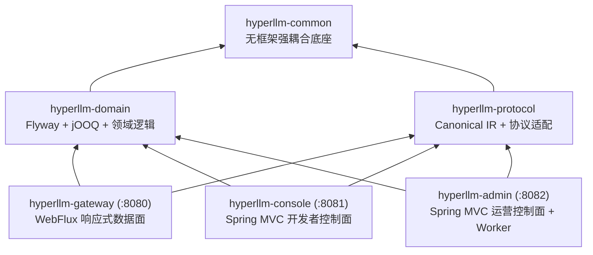

# 第 2 课：工程结构、模块依赖与架构红线

> **本课目标**：把仓库里每一个顶层目录和 Maven 模块的职责边界印在脑子里，搞懂“为什么这样分层”以及“哪 6 条架构红线绝对不能碰”。

---

## 1. 仓库顶层目录地图

```text
HyperLLM/
├── AGENTS.md / CLAUDE.md          # AI 协作规范与架构红线速查
├── README.md / README_zh-CN.md    # 项目对外门面文档（中英文）
├── CONTRIBUTING.md / LICENSE      # 贡献规范与 Apache-2.0 许可
├── .env.example                   # 全栈环境变量模板
├── backend/                       # Java 21 LTS + Spring Boot 3.5.16 多模块 Maven 工程
│   ├── pom.xml                    # 父 POM：统一版本锁定、Surefire/Failsafe 测试分组
│   ├── common/                    # [库] 纯原语、加解密、错误码、事件契约、12 个 Redis Lua 脚本
│   ├── domain/                    # [库] Flyway V1–V8 SQL、jOOQ 生成代码、领域 Record、35 组仓储、定价与分摊引擎
│   ├── protocol/                  # [库] Canonical IR、OpenAI/Anthropic 协议适配器、SSE Usage 嗅探、jtokkit 兜底
│   ├── gateway/                   # [应用 :8080] WebFlux 响应式数据面网关
│   ├── console/                   # [应用 :8081] Spring MVC 开发者控制台 + 支付下单/回调
│   └── admin/                     # [应用 :8082] Spring MVC 运营后台 + 异步账本/分析/告警/对账引擎
├── frontend/
│   ├── console/                   # [应用 :3000] Next.js 16 + React 19 开发者门户与控制台
│   └── admin/                     # [应用 :3001] Next.js 16 + React 19 独立运营后台
├── infra/                         # Docker Compose、ClickHouse DDL、Debezium Connector、Kafka、OTel/Prometheus、WireMock
├── scripts/e2e/                   # 活栈端到端联调脚本（phase1-smoke.sh / phase2-smoke.sh）
└── docs/
    ├── PROPOSAL.md / TODO.md      # 原始系统规划蓝图与分阶段交付清单
    ├── FRONTEND_DESIGN_SPEC.md    # 前端视觉、组件、动效与 BFF 强规范
    ├── design/                    # 原始分阶段深度设计文档（01–04 系列）
    ├── openapi/                   # OpenAPI 3.1.0 契约文档（Gateway / Console / Admin）
    └── onboarding/                # 新手接管实战手册（你正在阅读的系列）
```

---

## 2. 后端 6 个 Maven 模块的依赖拓扑与职责



### 逐模块速览

1. **`backend/common`（`app.pagefault.hyperllm.common`）**
   - **纯原语与跨服务共享契约**：
     - 金额：`MicroUsd`、`CostMath`
     - ID：`UuidV7`（基于 `uuid-creator` 时间有序主键）
     - 加解密：`AesGcmCipher`、`HmacSha256`、`ApiKeyGenerator`
     - 通用模型：`ErrorCode`（70+ 精确错误码）、`HyperLlmException`、`PageQuery` / `PageResponse`、`CidrMatcher`
     - 跨服务通信契约：`KafkaTopics`、`GatewayRedisKeys`、`BillingMoneyEvent`、`LlmRequestEvent`、`SandboxTokenPayload`
     - 幂等框架：`@Idempotent`、`IdempotencyExecutor`、`RedisIdempotencyStore`
     - 实时钱包读取与积压信号：`LiveWalletReader`、`LedgerLagSignal`、`LegacyBonusBatch`
     - **核心资产**：`src/main/resources/lua/` 下的 **12 个原子 Redis Lua 脚本**（网关与控制面共享同一套脚本源，杜绝逻辑分叉）。

2. **`backend/domain`（`app.pagefault.hyperllm.domain`）**
   - **唯一数据库迁移与持久化归属地**：
     - Flyway 脚本全部位于 `src/main/resources/db/migration/V1`–`V8`。
     - jOOQ 生成的强类型表/记录类位于 `src/main/generated`（由 `build-helper-maven-plugin` 加入编译源路径）。
     - 不可变 Java `record` 领域实体（`model/auth`、`model/tenant`、`model/routing`、`model/billing`、`model/payment`）与 39 个领域枚举（`model/enums`）。
     - 35 组 `Repository` 接口及对应的 `Jooq*Repository` 实现（通过 `HyperLlmDomainAutoConfiguration` 自动装配）。
     - 纯 Java 计价与抵扣核心：`PricingResolver`（组织协议价 + 版本化单价 + 阶梯规则）与 `EntitlementAllocator`（三顺位抵扣算法）与 `WalletCreditOutbox`。

3. **`backend/protocol`（`app.pagefault.hyperllm.protocol`）**
   - 解耦客户端入站协议与上游出站协议：
     - `CanonicalChatRequest` / `CanonicalMessage` / `TokenUsage` / `PreparedUpstreamRequest`
     - `OpenAiChatProtocolAdapter`、`AnthropicMessagesProtocolAdapter`、`ProtocolRegistry`
     - `SseEventSplitter`（容错跨 TCP 分片拆帧）、`StreamUsageTracker`、`TokenEstimator`（`jtokkit` 估算兜底）
     - `ProtocolErrorFormatter`（把内部 `ErrorCode` 翻译为原生 OpenAI / Anthropic JSON 错误体）。

4. **`backend/gateway`（`:8080`，WebFlux + Reactor Netty）**
   - 专注万级并发流式代理热路径：
     - **缓存优先**：`Caffeine L1` → `Lettuce Reactive Redis L2` → `SingleFlight` + 虚拟线程冷回源 `domain`。
     - **实时计费与限流**：`PreHoldService`、`ProjectBudgetService`、`ChannelCapacityService`、`OutboxWriter`、`OutboxAdmissionGate`、`LedgerHealthGate`。
     - **配置热更新**：`DebeziumConfigCdcConsumer`（每个实例使用独立随机 `group-id` 广播消费 `cdc.gateway.config`，亚秒级驱逐 L1）。

5. **`backend/console`（`:8081`，Spring MVC + Java 21 虚拟线程）**
   - 面向外部开发者/企业租户的自助控制面：注册登录、Org/Project 双层 RBAC、API Key 签发、实时钱包、支付下单（Stripe/支付宝/微信支付）与异步回调验签、兑换码核销、用量查询、告警规则配置、Playground 临时凭证签发。

6. **`backend/admin`（`:8082`，Spring MVC + Java 21 虚拟线程）**
   - 兼具两大职责：
     - **运营管理 API**：独立管理员登录 + TOTP MFA、Provider/Channel/Model/Binding/Pricing CRUD、租户治理、SKU/代金券/退款/异常管理、毛利报表、对账与告警查询。
     - **平台后台异步引擎（Worker 域）**：`BillingSettlementConsumer`（消费 `cdc.billing` 折叠账本与投影 Redis）、`RequestEventConsumer` + `UsageRollupJob`（ClickHouse 摄入与版本化小时聚合）、`AlertSamplerJob` + `AlertDeliveryJob`、`ReconciliationJob`、`LedgerLagMonitorJob`、`OutboxPurgeJob`、`OutboxRedeliveryJob`、`BatchExpiryJob`、`PartitionMaintenanceJob`。

---

## 3. 三个关键的“为什么这样设计？”

### Q1：为什么 `gateway` 直接依赖 `domain`（JDBC/jOOQ），而不是通过 HTTP 调控制面？
- **热路径 99.99%+ 不碰数据库**：所有 API Key、模型路由、定价与实时余额都在 `Caffeine L1` + `Redis L2` 中非阻塞命中。
- **冷缓存未命中时减少一跳网络与故障面**：首次访问或缓存失效时，`gateway` 通过 `GatewayConfiguration` 中定义的 **`domainFallbackScheduler`（`Executors.newVirtualThreadPerTaskExecutor()`）** 把阻塞 JDBC 查询完全切出 Netty EventLoop，并用进程内 `SingleFlight` 合并同一键的并发冷回源，避免缓存击穿。
- **连接池预算严格受控**：`gateway/application.yml` 中业务冷回源 Hikari 池固定 `maximum-pool-size: 6`，再加 `OutboxDataSourceConfiguration` 的独立 2 连接专供 Outbox 单写者，**单实例总连接数严格 ≤ 8**，不会在水平扩容时打爆 PostgreSQL 连接数。

### Q2：为什么控制面拆成 `console` 与 `admin` 两个独立应用？
- **安全域物理隔离**：开发者面向公网开放注册，而运营后台掌控上游供应商明文密钥录入、调账、定价与全平台毛利，生产环境应部署在内网/VPN 后并强制 TOTP MFA + CIDR 白名单。
- **独立密钥与 Cookie**：即使 `console` 侧发生漏洞，也无法伪造 `admin` JWT（密钥、Issuer、Audience、Cookie 路径全隔离）。

### Q3：为什么异步消费者与定时任务先放在 `admin`，而不是一开始拆第 7 个 `worker` 模块？
- 在 Phase 1–2 期间减少本地开发与部署进程数量；各异步域（`consumer/`、`analytics/`、`alert/`、`reconcile/`、`maintenance/`）在包结构与配置开关上已高度解耦，未来进入 Phase 4 按吞吐量需要独立水平扩缩容时，可平滑拆分为独立的 `backend/worker` 模块或通过独立 Spring Profile 无 HTTP 启动。

---

## 4. 绝对不可违背的 6 条架构红线

接管仓库后，每次写代码或 Code Review 都必须核对以下 6 条红线（同步记录在 [AGENTS.md](../../AGENTS.md)）：

| # | 红线 | 正确做法 | 违反后果 |
| :---: | :--- | :--- | :--- |
| **1** | **金额纯整型 `micro-USD`** | 所有金额使用 `long`（`1 USD = 1_000_000 micros`），乘除与向上取整统一走 `MicroUsd` / `CostMath` | 浮点精度漂移导致账本对账失败、资损 |
| **2** | **主键统一 `UuidV7`** | 所有持久化表主键在应用层用 `UuidV7.next()` 生成 | 随机 UUIDv4 导致 B-tree 页分裂，尤其会让 `outbox_events` 写放大且破坏区间水位删除 |
| **3** | **敏感凭据分层加密** | 上游密钥/TOTP/调试载荷用 `AesGcmCipher`（`[1B ver][12B IV][cipher+tag]`）绑定显式 AAD（`channel_id` / `admin_id` / `project_id:request_id`）；客户 Key 和兑换码只存加盐 `HmacSha256` 摘要 | 密文跨行替换攻击、数据库/WAL/Redis 泄露明文 |
| **4** | **双域 JWT 严格隔离** | `console` 与 `admin` 永不共享 JWT 密钥、`iss`、`aud` 或 Cookie | 权限边界被击穿 |
| **5** | **Flyway 归属与 `-Pjooq` 生成** | 只允许 `console` 与 `admin` 开启 `spring.flyway.enabled=true`；`gateway` 永远 `false`；**绝不手改** `backend/domain/src/main/generated` | 多节点迁移锁冲突、jOOQ 元数据与真实表结构漂移 |
| **6** | **Gateway 绝不阻塞 EventLoop** | 任何 JDBC / 阻塞 IO 必须调度到 `domainFallbackScheduler`（虚拟线程）或独立后台线程 | Netty EventLoop 卡死导致整个网关高并发雪崩 |

---

**下一课**：[第 3 课：数据存储全景（PostgreSQL V1–V8 + jOOQ + Redis 键空间 + ClickHouse OLAP）](./03-domain-data-model-and-storage.md)
