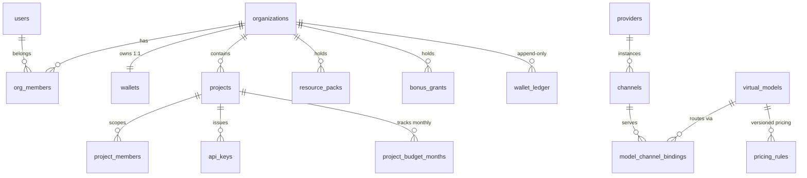

# 第 3 课：数据存储全景（PostgreSQL V1–V8 + jOOQ + Redis 键空间 + ClickHouse OLAP）

> **本课目标**：建立完整的数据地形图——知道每一类数据存在哪、谁是权威源、PostgreSQL 的 `V1`–`V8` 迁移怎么演进、如何用 `-Pjooq` 改表、以及 Redis 和 ClickHouse 分别管什么。

---

## 1. 三引擎分工总览

HyperLLM 刻意让三种存储引擎各自做最擅长的事，绝不互相越界：

| 引擎 | 角色 | 存什么 | 关键特性 |
| :--- | :--- | :--- | :--- |
| **PostgreSQL 16** | **OLTP 持久真值源 + 唯一重建依据** | 用户、租户、路由/定价配置、append-only `wallet_ledger`、折叠快照、支付订单、Outbox、告警与对账记录 | `wal_level=logical`（供 Debezium CDC）、UUIDv7 主键、`TIMESTAMPTZ` (UTC)、乐观锁 `version`、按月 `RANGE` 分区 |
| **Redis 7 (AOF)** | **实时余额权威 + L2 缓存 + 原子状态机** | 活跃租户的实时余额/赠金/资源包镜像、Pre-hold 预占租约、四层滑动窗口限流、项目月预算、配置 L2 缓存、OTP 与 Playground 临时凭证 | 12 个原子 Lua 脚本、滑动 TTL（300s）、缺失键哨兵纪律、不可跨槽（单实例/按租户分 cell） |
| **ClickHouse 24** | **ZDR 高吞吐 OLAP 报表仓库** | `llm_request_events`（请求元数据宽表，365 天 TTL）、`usage_hourly` + `usage_hourly_published`（版本化小时聚合）、`llm_debug_payloads`（Opt-in 加密调试样本，1–7 天 TTL） | 默认严格 **ZDR（零 Prompt/Completion 落盘）**、TDigest 分位数（P50/P90/P99 TTFT & Duration） |

---

## 2. PostgreSQL Flyway `V1`–`V8` 迁移脉络

所有 SQL 脚本集中在 `backend/domain/src/main/resources/db/migration/`。按时间演进一目了然：

| 迁移脚本 | 新增/变更的核心表 | 承载的业务域 |
| :--- | :--- | :--- |
| `V1__init_auth_and_tenants.sql` | `users`, `user_identities`, `refresh_tokens`, `admin_users`, `admin_sessions`, `customer_tiers`, `organizations`, `org_members`, `org_invitations`, `projects`, `project_members`, `api_keys` | 双域账号隔离、客户等级（预置 `STANDARD`）、`Org -> Project -> API Key` 多租户与双层 RBAC |
| `V2__init_models_channels_pricing.sql` | `providers`, `channels`, `virtual_models`, `model_channel_bindings`, `pricing_rules` | 上游供应商/加密渠道池、虚拟模型目录、分级权重绑定、版本化多维定价 |
| `V3__init_wallets_ledger_and_audit.sql` | `wallets`, `wallet_ledger`（按月分区）, `audit_logs`（按月分区）+ 分区建表存储过程 | 钱包快照、append-only 不可变资金账本、运营审计日志 |
| `V4__init_commercial_billing_outbox.sql` | `payment_orders`, `resource_packs`, `vouchers`, `redemption_codes`, `bonus_grants`, `org_model_pricing_overrides`, `notification_endpoints`, `billing_alert_rules`, `outbox_events` | 商业化权益（资源包/赠金/代金券/大客户协议价）、支付订单、告警配置与 Debezium Outbox |
| `V4_1__add_wallet_ledger_hold_id.sql` | `wallet_ledger` 增加 `hold_id` 等关联列 | 追溯每笔账本与网关预占租约的对应关系 |
| `V4_2__billing_authority_columns.sql` | `outbox_events` 设 `fillfactor=100` 并移除二级索引；`wallet_ledger` 增 `shortfall_micros`, `settled_after_reclaim`；`wallets` 增 `last_applied_event_id`；新建 `outbox_watermark` | Redis 权威层落地：单行水位表、折叠位置追踪、极端穿仓/回收后补扣记录 |
| `V4_3__grant_ledger_type.sql` | 扩展 `wallet_ledger.ledger_type` 约束 | 支持 `PACK_GRANT` 等发放类账本类型 |
| `V5__payment_catalog_and_references.sql` | `resource_pack_skus`, `payment_notifications`, `payment_anomalies`, `voucher_code_batches` 及订单/兑换码外键补全 | 完整支付网关回调留痕、异常工单、SKU 商品目录与兑换码批次管理 |
| `V6__project_monthly_budgets.sql` | `project_budget_months` 及账本扩展 | Project 按 UTC 自然月维度的预算折叠与 `CONFIRMED` / `UNVERIFIED` 状态机 |
| `V7__analytics_ingestion_control.sql` | `analytics_ingest_positions`, `analytics_hours`, `analytics_rejects` | ClickHouse 消费位点控制、脏小时重算队列、坏消息拒收登记 |
| `V8__alert_delivery_and_reconciliation.sql` | `notification_deliveries`, `reconciliation_findings` | 告警投递重试队列、自动对账 P1/P2/P3 差异工单表 |

### 核心领域实体关系（简化 ER）



### 必须理解的 4 个 PostgreSQL 建模约定

1. **按月分区表（`wallet_ledger`、`audit_logs`）**：
   - 分区键为 `created_at`，因此主键为复合主键 `(id, created_at)`，幂等唯一约束为 `(idempotency_key, created_at)`。
   - 未来月份的分区由 `backend/admin` 中的 `PartitionMaintenanceJob` 定期自动预建，避免月初零点写入报 `no partition of relation found`。
2. **乐观锁 `version`**：
   - 所有可变实体表带 `version BIGINT NOT NULL DEFAULT 0`。更新语句统一带 `WHERE id = ? AND version = ?`，返回影响行数为 `0` 时抛 `ErrorCode.CONFLICT_OPTIMISTIC_LOCK`（HTTP `409`）。
3. **软删除 `deleted_at`**：
   - 核心配置表不物理删除，查询统一带 `deleted_at IS NULL`，并在唯一索引上使用部分唯一索引（`WHERE deleted_at IS NULL`）允许删除后重建同名资源。
4. **`outbox_events` 是传输表而非历史表**：
   - 详见第 5 课：UUIDv7 有序主键 + 零二级索引 + `fillfactor = 100` + 按 `outbox_watermark` 定期批量删除。

---

## 3. Flyway + jOOQ 改表标准 5 步工作流

HyperLLM 使用 **jOOQ** 而不是 JPA/Hibernate，原因是动态分页查询、按月分区表、原生 `ON CONFLICT`、显式行锁（`FOR UPDATE`）和 `JSONB` 映射需要 100% 可预测的 SQL。

修改数据库表结构时，严格按以下 5 步操作：

1. **新增迁移脚本**：在 `backend/domain/src/main/resources/db/migration/` 下按序新增 `V9__<descriptive_name>.sql`（**永远不要修改已合并发布的旧 `V*.sql`**）。
2. **运行 `-Pjooq` 生成代码（需启动 Docker）**：
   ```bash
   ./backend/mvnw -f backend/pom.xml compile -pl common,domain -Pjooq
   ```
   Maven 会自动通过 Testcontainers 拉起临时 PostgreSQL 16，跑完所有 Flyway 脚本，再由 jOOQ Codegen 重新生成 `backend/domain/src/main/generated/` 下的表与记录类。
3. **更新纯 Java `record` 模型与 `Repository`**：在 `domain/model/...`、`domain/repository/...` 及 `domain/repository/jooq/Jooq*Repository.java` 中同步字段。
4. **注意 Debezium Config CDC 白名单**：如果你新增的表需要热推给 `gateway` 缓存，记得同步检查 `infra/debezium/hyperllm-config-connector.json` 的 `table.include.list`。
5. **运行 `domain` 集成测试**：
   ```bash
   ./backend/mvnw -f backend/pom.xml verify -pl domain
   ```

---

## 4. Redis 完整键空间速查（权威定义见 `GatewayRedisKeys.java`）

所有 Redis 键由 `backend/common/.../cache/GatewayRedisKeys.java` 统一构造，严禁在业务代码里手拼散落字符串。

| 键模式 | Redis 类型 | 用途 | 生命周期 / TTL |
| :--- | :--- | :--- | :--- |
| `gw:cfg:key:{keyHash}` | String (JSON) | API Key + Org/Project/Tier 上下文 L2 缓存 | 1800s + 控制面主动删/CDC 驱逐 |
| `gw:cfg:route:{modelCode}` | String (JSON) | 虚拟模型 + 渠道候选池（密文凭据）+ 生效定价 | 1800s + CDC 驱逐 |
| `gw:cfg:override:{orgId}:{modelId}` | String (JSON) | 组织级单模型协议价覆盖 | 1800s + CDC 驱逐 |
| `gw:wallet:{orgId}` | Hash | `cash_micros`, `held_cash_micros`, `status`, `ledger_generation` | **滑动 TTL 300s** |
| `gw:pack:{orgId}:{modelCode}` / `gw:pack:item:{packId}` | ZSET + Hash | 按到期时间排序的资源包索引与逐批次余量/冻结 | **滑动 TTL 300s** |
| `gw:bonus:{orgId}` / `gw:bonus:item:{grantId}` | ZSET + Hash | 按到期时间排序的赠金批次索引与逐批次余量/冻结 | **滑动 TTL 300s** |
| `gw:hold:{holdId}` / `gw:holds:exp` / `gw:hold:done:{holdId}` | Hash / ZSET / String | 在途预占租约、全局到期回收队列、结算终态幂等标记 | `hold` 2×租约；`done` 12×租约 |
| `gw:settle:evt:{eventId}` / `gw:settle:proof:{eventId}` / `gw:settle:pending` / `gw:settle:owners` / `gw:settle:waiting:{orgId}` | String / ZSET / Hash / Set | 实扣事件副本、镜像代际证明与待确认工单（L1–L4 巡检依据） | 副本保留 1 小时，确认后清理 |
| `gw:ledger:pos:{orgId}` | Hash | `produced` / `debit_version` / `credit_version` 折叠水位围栏 | 无 TTL |
| `gw:health:ledger-lag` / `:armed` | String | `admin` 发布的账本消费积压健康信号（OK/WARN/DEGRADED） | 短 TTL，心跳刷新 |
| `gw:wallet:idem:{eventId}` | String | 发放类事件投影幂等标记 | 24 小时 |
| `gw:rl:{win\|cnt\|tok}:{scope}:{id}` & `gw:rl:conc:{scope}:{id}` | ZSET / Hash / String | API Key / Project / Org 滚动 1 秒桶 RPM/TPM 与并发计数 | 随窗口过期 |
| `gw:rl:ch:{win\|cnt\|tok\|conc}:{channelId}` | ZSET / Hash / String | 上游 Channel 共享容量保护 | 随窗口过期 |
| `gw:budget:proj:{projectId}:{YYYY-MM}` & `gw:alert:budget:{projectId}:{YYYY-MM}` | Hash / String | Project 月度预算权威计数 & 拒载告警证据 | 按月生命周期 |
| `gw:auth:otp:{purpose}:{email}` / `gw:sandbox:{sha256}` | String | 邮箱 OTP 验证码（10m）与 Playground 临时凭证（5m） | 固定短 TTL |

> **集群部署关键注意**：`prehold_snapshot.lua` 会先 `ZRANGE` 拿到 `packId`/`grantId`，再在脚本内动态拼接 `gw:pack:item:{id}` 访问——这种跨 key 访问与 Redis Cluster 哈希槽不兼容。因此计费 Redis 实例在生产必须按单节点主从（Sentinel）或按租户分 **Cell** 部署，而非把一个租户分散在 Redis Cluster 槽中。

---

## 5. ClickHouse OLAP 与版本化小时聚合设计

DDL 定义同时维护在 `infra/clickhouse/init/01-init-olap.sql`（容器首次初始化）与 `backend/admin/src/main/resources/db/clickhouse/analytics-schema.sql`（服务启动自动幂等升级——**改表时务必两处同步！**）。

### 为什么弃用传统增量物化视图，改为「版本化小时发布」？

Kafka 消费是 **At-Least-Once（至少一次）**。如果像传统方案那样在 `llm_request_events` 上挂一个 `AggregatingMergeTree` 增量物化视图，一旦消费者重启重放了一批消息，同一条请求就会被累加两次，报表金额直接翻倍。

HyperLLM 的解决方案非常优雅（见 `admin/analytics/`）：
1. **`RequestEventConsumer`** 批量消费 `llm.request.events`：
   - 写入 `llm_request_events` 时附带 `kafka_partition` 与 `kafka_offset`；
   - 在 PostgreSQL 事务中更新 `analytics_ingest_positions` 位点，并把受影响的小时标记为脏（写入 `analytics_hours`）；坏消息记入 `analytics_rejects` 供运营查看。
2. **`UsageRollupJob`** 周期拉取脏小时：
   - 对该小时内所有 `kafka_offset <= committed` 的事实按 `request_id` 去重，生成一个新的单调版本号 `version`，写入 `usage_hourly`；
   - **全部写完后**，才向 `usage_hourly_published` 写入 `(hour_bucket, version)` 完成原子发布。
3. **读路径**（`ConsoleUsageService` / `AdminAnalyticsService`）：
   - 查询时只 JOIN `usage_hourly_published` 中每小时最新的已发布 `version`。因此即使 Rollup 中途崩溃，未发布版本对用户完全不可见，重复投递也永远不会导致报表虚高！
4. **默认 ZDR 红线**：
   - `llm_request_events` 仅含结构化用量、延迟与费用列，**没有任何 Prompt/Completion 正文字段**；只有显式开启 Opt-in 调试的项目才会把 AES-256-GCM 密文写入隔离表 `llm_debug_payloads`，由原生 `TTL expires_at DELETE` 到期物理清除。

---

**下一课**：[第 4 课：数据面 Gateway 请求全生命周期](./04-gateway-request-lifecycle.md)
