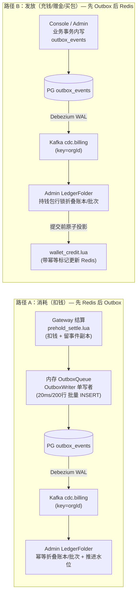

# 第 5 课：核心难点精讲——Redis 权威层、Pre-hold/Settle、Outbox 与资金一致性

> **本课目标**：这是 HyperLLM **最核心、最容易踩坑、也最有工程含金量**的模块。学完本课，你将彻底明白：
> - 为什么 Redis 是活跃期间的余额权威？
> - 为什么必须用滑动 TTL + 缺失键哨兵？
> - 三顺位扣费 + 12 个 Lua 脚本如何协作？
> - 为什么「扣钱」与「给钱」的写入顺序截然相反？
> - 极端故障（网关 OOM、Kafka 积压、Outbox 写失败）时钱为什么既不超卖也不丢账？

---

## 1. 六条不可绕过的核心基线（B1–B6）与三层数据归属

修改任何与余额、权益、账本相关的代码前，先背熟这 6 条基线（详见 [04-phase2-design.md](../design/04-phase2-design.md)）：

| 编号 | 基线 |
| :---: | :--- |
| **B1** | **键存活期间，Redis 是余额与余量的唯一权威来源**（涵盖现金、赠金批次、资源包） |
| **B2** | 钱包与批次镜像采用**滑动 TTL（300s）**，持续访问时续期；空闲后才自然过期 |
| **B3** | Gateway、Console、Admin 单租户读取一律 **hit-Redis / miss-DB** |
| **B4** | **写路径按方向分叉**：**扣钱先动 Redis 再写 Outbox；给钱先写 Outbox 再改 Redis** |
| **B5** | Redis miss 时按**租户维度整体加载**（钱包 + 所有活跃赠金批次 + 资源包余量），且只补缺失键、绝不覆盖已存在的键 |
| **B6** | 批量租户列表（如 Admin 租户页）直接 `LEFT JOIN wallets` 读已确认快照；单租户详情才读 Redis 实时态（展示余额/冻结/可用） |

### 三层数据归属

1. **Redis（实时权威）**：持有当前现金、逐批次赠金/资源包余量、在途冻结 `held_*`、限流与预算。**请求路径禁止查 PG 批次表决定还能花多少。**
2. **PostgreSQL `wallet_ledger`（唯一重建依据）**：append-only、按事件 ID 幂等的逐笔资金流水，含完整 `allocation_detail_json`、`hold_id`、`shortfall_micros`、`settled_after_reclaim`。
3. **PostgreSQL `wallets` / `resource_packs` / `bonus_grants`（折叠快照）**：由 `admin` 的 `LedgerFolder` 消费 `cdc.billing` 逐笔折叠维护的派生态。它允许落后 Redis 一个消费延迟（lag），仅用于冷加载、租户列表和对账基线。

---

## 2. 为什么必须用「滑动 TTL + 缺失键哨兵 + 键级互斥」？

新手常问：“为什么不给 `gw:wallet:{orgId}` 设一个固定 5 分钟 TTL，过期了重新加载？”

**固定 TTL 会造成灾难性的“半截键”故障**：
1. 一个耗时较长的流式请求跨过了固定 TTL 边界，`gw:wallet:{orgId}` 消失；
2. 流结束时，结算 Lua 脚本对已经不存在的 `gw:wallet:{orgId}` 执行 `HINCRBY`，Redis 自动建出一个**只有金额字段、没有 `status` 字段的半截 Hash**；
3. 下一个请求进来读到 `status == ""`，直接误判 `ORG_SUSPENDED`——**整个客户组织被彻底锁死**，而且因为键刚被新建，TTL 重新计时，不会自愈！

**HyperLLM 的三道组合拳彻底根治这一类并发状态损坏**：
1. **滑动 TTL + 6 个全量续期点**：只要触碰钱包/批次键族（准入 `prehold_admit`、心跳 `prehold_renew`、结算 `prehold_settle`、释放 `prehold_release`、冷加载 `load_tenant`、实时读 `prehold_snapshot`）全部续期 300s，并由网关本地按每键 **60 秒节流**减少 AOF 写放大。于是键**只会在组织彻底空闲 300 秒后消失**——此时在途请求早已结束、消费者早已追平。
2. **缺失键哨兵纪律**：**任何 Lua 扣减脚本严禁对不存在的键执行 `HINCRBY`/`HSET`**！必须先 `EXISTS` 检查；若缺失则立刻返回 `MISS_WALLET` / `MISS_ENTITLEMENTS`，应用层触发 `SingleFlight` 冷加载后重试一次。
3. **只补缺失的加载互斥（`load_tenant.lua`）**：加载脚本对每个目标键先 `EXISTS`，**已存在的键直接跳过，绝不覆盖**。结合上一条规则：键缺失时只有加载能创建，键存在时只有 delta 能修改——**加载与扣费在结构上永远不会交错覆盖！**

---

## 3. 定价解析与三顺位确定性抵扣

每次准入和结算都复用 `backend/domain` 里的纯 Java 无状态引擎，确保两边算法 100% 一致：

### ① 定价解析（`PricingResolver`）
优先级从高到低：
1. **组织级单模型协议价**（`org_model_pricing_overrides`）：支持 `FIXED_PRICING`（整套固定单价）或 `DISCOUNT_BPS`（万分比折扣，如 `9500` = 95 折）。
2. **模型版本化定价**（`pricing_rules`，按 `effective_from <= now < effective_to` 命中）× 组织/等级折扣倍率；支持阶梯上下文定价（`TieredPricingRules`）。
3. 所有乘法与除以 `1_000_000` 均使用 `MicroUsd` / `CostMath` **向上取整（Ceiling）**，且若模型无生效定价规则，准入直接拒载 `503 MODEL_PRICING_MISSING`（绝不免费放行）。

### ② 三顺位抵扣（`EntitlementAllocator`）
拿到 `prehold_snapshot.lua` 返回的实时可花费状态（每批次可用 = `remaining - held`）后，严格按以下顺序分摊：
1. **第一顺位：定向资源包（`PACK`）** — 适用当前模型、未过期（按 `expires_at` 最早优先），支持按 `TOKENS` 或 `CALLS` 单位扣减。
2. **第二顺位：赠金批次（`BONUS`）** — 适用当前模型（或通用赠金）、未过期（按 `expires_at` 最早优先，含兼容期 `LegacyBonusBatch` 兜底桶）。
3. **第三顺位：现金余额（`CASH`）** — 扣除 `cash_micros - held_cash_micros`。
4. 若三顺位全部用尽仍不足：准入阶段直接返回 `402 BILLING_INSUFFICIENT_BALANCE`；结算阶段若实耗意外超过预占且余额不够，现金腿下限钳制为 `0`（不出现负余额），差额记入 `shortfall_micros` 供对账追踪。

---

## 4. 12 个 Redis Lua 脚本速查表

所有脚本位于 `backend/common/src/main/resources/lua/`，接管时按调用链路分组记忆最轻松：

| 分组 | 脚本名 | 干什么用 |
| :--- | :--- | :--- |
| **冷加载与快照** | `prehold_snapshot.lua` | 一次 RTT 读取租户钱包 + 该模型可用资源包 + 未过期赠金批次（按 `score > now` 过滤），并支持续期或 `PERSIST` |
| | `load_tenant.lua` | 原子补齐缺失的钱包/批次镜像键并写 `ledger_generation` 与 300s TTL；已存在键绝不覆盖，同时返回冷重建偏差观测值 |
| | `budget_init.lua` | 仅当项目月预算键缺失时，从 PG `project_budget_months` 原子安装当月已确认金额与 `CONFIRMED`/`UNVERIFIED` 状态 |
| **准入、续期与结算** | `prehold_admit.lua` | **最重的核心脚本**：一次性原子校验并写入 API Key/Project/Org 滚动窗口 RPM/TPM/并发 + Project 月度预算预占 + 逐批次 PACK/BONUS/CASH 冻结 + `gw:hold:{id}` 租约与 `gw:holds:exp` |
| | `prehold_renew.lua` | 流式心跳续期：延长 `gw:hold`、并发计数，以及 `gw:wallet` 和本单冻结的各批次 item 键的滑动 TTL |
| | `prehold_mark_served.lua` | 首字节下发前写入 `served = 1`，区分“未交付可全退”与“已交付需按兜底腿扣费” |
| | `prehold_settle.lua` | 终态结算：按实测用量重分摊，释放冻结、实扣各批次与现金、校正 TPM 窗口、写 `gw:hold:done` 幂等标记，并**原子写入 `gw:settle:evt` 事件副本 + `gw:settle:proof` 证明 + `gw:settle:pending` 待确认工单** |
| **通道保护** | `channel_capacity.lua` | 校验/扣减或释放单个上游 Channel 自身的 RPM/TPM/并发容量 |
| **发放投影** | `wallet_credit.lua` | 在 SQL 钱包行锁内将已授权的充值/赠金/资源包投影到存活 Redis 镜像；用 `credit_version` 围栏挡住并发过期的冷加载，用 `gw:wallet:idem:{eventId}` 防重复加钱 |
| **一致性与工单** | `settlement_worklist.lua` | 消费者确认入账后清理 `gw:settle:pending` / `owners` / `waiting` / `evt` / `proof`，或将工单推迟到下次重试时间 |
| | `settlement_fence_snapshot.lua` | 消费者提交 SQL 折叠时推进 `gw:ledger:pos:{orgId}` 的 `debit_version` 围栏 |
| | `settlement_check_proof.lua` | L3 工单补 `ADJUST` 前校验所有受影响镜像键的 `ledger_generation` 是否仍是当初扣款那一代，防误补重复账 |

---

## 5. 写路径分叉铁律：扣钱先动钱，给钱先记账

### 为什么要分叉？
- **消耗（扣钱）**：追求毫秒级高并发与防并发超卖，因此必须在 Redis Lua 里先原子扣款；随后只需入内存队列 `OutboxQueue`，由单写者 `OutboxWriter`（独占 2 个连接池连接，每 20ms 或满 200 行批量 `INSERT`）写入 `outbox_events`。
- **发放（充钱/兑换码/人工充值）**：用户付了真金白银**绝不允许丢失**！所以先在 PostgreSQL 业务事务内把订单状态更新和 `outbox_events` 授权原子提交，返回 `202 Accepted`（或标记 `fulfillmentStatus=PENDING`）；随后 Debezium 投递至同一条 `cdc.billing`（按 `orgId` 分区保证同一租户的扣款与加款顺序），由 `LedgerFolder` 折叠 `wallet_ledger` 并通过 `wallet_credit.lua` 投影到 Redis。

---

## 6. 故障兜底、背压闸门与 L1–L4 对账阶梯

接管系统后，你一定要看懂以下 4 套保护机制——它们决定了为什么线上不会把库打挂也不会丢账：

1. **Outbox 极致追加优化 + 准入闸门（`OutboxAdmissionGate`）**：
   - `outbox_events` 使用 UUIDv7 主键、`fillfactor = 100`、**零二级索引**，纯右端追加无页分裂。
   - `OutboxPurgeJob` 每 30 秒只删 `id <= outbox_watermark` 的已确认行（表体积稳态极小）。
   - **反压 503**：一旦 `OutboxQueue` 满、水位持续 > 50% 达 30 秒，或 1 分钟内写失败率 > 1%（且尝试 ≥ 50 行），该 Gateway 实例立即关闭准入，新请求在扣钱前返回 `503 OUTBOX_UNAVAILABLE` + `Retry-After`；**已经结算的请求仍正常向客户端返回 200**，其丢失的写库由事件副本巡检兜底。
2. **消费积压监视器与全局重建闸门（`LedgerLagMonitorJob` + `LedgerHealthGate`）**：
   - `admin` 周期检查账本消费滞后，写入 `gw:health:ledger-lag`（`OK` / `WARN` / `DEGRADED`）。
   - 当状态为 `DEGRADED` 时：Gateway 对所有触碰到的热键改为 `PERSIST`（暂不让它过期），**已存在热键的组织照常 200 服务**；但若某冷组织刚好键缺失、试图从落后太多的 PG 重建余额时，Gateway 拒绝盲目重建，直接返回 `503 LEDGER_BACKLOG` + `Retry-After`，防止客户花掉已经花过但还没落库的钱！
3. **僵尸预占回收（`HoldReclaimScheduler`）**：
   - 如果 Gateway 节点突然 OOM/宕机导致在途请求没跑到 `Settle`，`gw:holds:exp` ZSET 里超时的 `holdId` 会被惰性扫描及 `admin` 后台定时回收：若未发首字节（`served = 0`）全额释放冻结；若已发首字节（`served = 1`），按准入时冻结的 prompt 兜底腿扣费并释放其余冻结。
4. **未确认结算 L1–L4 阶梯工单（`OutboxRedeliveryJob` + `SettlementWorklist`）**：
   - 每笔 `prehold_settle.lua` 都在 Redis 留存一份 1 小时有效期的事件副本与镜像代际证明（`gw:settle:evt` / `proof`）。
   - 若某笔消费迟迟未被 `LedgerFolder` 确认：
     - **L1**：检查 Outbox 是否在途并重投；
     - **L2**：从 Redis 事件副本补插 `outbox_events` 修复投递；
     - **L3**：在 `settlement_check_proof.lua` 验证代际一致且水位允许时补记 `ADJUST`；
     - **L4**：超过期限无条件关闭工单，落盘审计并触发 P1 告警交运营处理。

---

**下一课**：[第 6 课：双控制面（Console & Admin）、鉴权安全、支付、限流预算与运维后台](./06-control-planes-auth-payments-and-ops.md)
