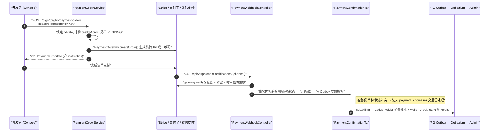

# 第 6 课：双控制面（Console & Admin）、鉴权安全、支付、限流预算与运维后台

> **本课目标**：吃透两个 Spring MVC 控制面服务（`backend/console :8081` 与 `backend/admin :8082`）的认证隔离、RBAC 权限模型、支付履约链路、四层限流/项目预算、告警投递与自动对账引擎。

---

## 1. 双域 JWT 认证、Cookie 轮换与 TOTP MFA

`console` 与 `admin` 在账号表、过滤器、JWT 校验器与 Cookie 路径上完全物理隔离：

| 对比项 | `backend/console` (`:8081`) | `backend/admin` (`:8082`) |
| :--- | :--- | :--- |
| 账号与会话表 | `users`, `user_identities`, `refresh_tokens` | `admin_users`, `admin_sessions` |
| 认证过滤器 | `ConsoleAuthFilter` | `AdminAuthFilter` |
| JWT 服务与声明 | `ConsoleJwtService` (`iss=hyperllm-console`, `aud=console-api`, `type=CONSOLE_ACCESS`) | `AdminJwtService` (`iss=hyperllm-admin`, `aud=admin-api`, `type=ADMIN_ACCESS` / `ADMIN_MFA_CHALLENGE`) |
| Refresh Cookie | `hl_console_rt` (`HttpOnly`, `SameSite=Lax`, `Path=/api/v1/auth`) | `hl_admin_rt` (`HttpOnly`, `SameSite=Lax`, `Path=/api/v1/admin/auth`) |
| 额外安全防线 | 邮箱 OTP 注册、Refresh Token 家族轮换防重放 | CIDR 来源 IP 白名单、TOTP MFA 两阶段挑战令牌（`MFA_SETUP` / `MFA_VERIFY`） |

### ⚠️ 两个极易踩的认证细节

1. **Refresh Token 重放检测（`AUTH_TOKEN_REUSE_DETECTED`）**：
   - `POST /api/v1/auth/refresh` 每次都会签发新 Refresh Token 并立即标记旧 Token 为已轮换。如果同一个旧 Cookie 被并发提交两次，后端会判定疑似盗用，直接吊销整个令牌家族并返回 `401 AUTH_TOKEN_REUSE_DETECTED`！因此任何前端或自动化脚本调用 `/refresh` 都必须加单飞锁（见第 7 课）。
2. **Admin MFA 挑战令牌的作用域隔离**：
   - 当 `HYPERLLM_ADMIN_MFA_REQUIRED=true` 时，`/api/v1/admin/auth/login` 不会签发正式 `accessToken`，而是返回 `challengeToken`（`type=ADMIN_MFA_CHALLENGE`）及 `mfaAction`（首次为 `MFA_SETUP`，已绑定为 `MFA_VERIFY`）。
   - `AdminAuthFilter` 严格检查路径：只有 `/mfa/setup` 接受 `scope=MFA_SETUP`，只有 `/mfa/verify` 接受 `scope=MFA_VERIFY`，其余 `/api/v1/admin/**` 只接受完整的 `ADMIN_ACCESS`。

---

## 2. 双层 RBAC 权限模型

### ① Console（`ConsoleRbacService`）
采用 **Organization 角色 + Project 成员** 双层隔离：
- **Org 角色（`OrgRole`）**：`OWNER`、`ADMIN`、`DEVELOPER`、`BILLING`
  - `OWNER`：全权限（组织设置、成员与角色、财务充值、Project 与 Key）
  - `ADMIN`：组织与成员管理（不可修改 `OWNER`）、Project 创建与预算设置、Key 管理、全项目用量查看
  - `DEVELOPER`：**仅限已加入 `project_members` 的 Project** 内的 Key 管理、Playground 与用量查看（`ConsoleUsageService` 会强制按所属项目过滤）
  - `BILLING`：钱包查看、充值下单、兑换码核销、账本与用量查看，无权创建 Project 或签发 Key
- **注册即开箱**：`ConsoleAuthService.register()` 在同一 PostgreSQL 事务内自动创建 `users` + `user_identities` + `Personal Workspace`（`OWNER`）+ `default` Project + `wallets` + 注册体验金 Outbox 授权。

### ② Admin（`AdminRole`）
由 `AdminRequestContext.requireRole(...)` 在每个控制器入口显式校验：
- `SUPER_ADMIN`：全权限（启动时由 `SuperAdminBootstrapRunner` 根据环境变量自动幂等引导）
- `OPS`：供应商/渠道/探针、虚拟模型/绑定/定价、SKU/代金券、租户状态与运维巡检
- `FINANCE`：定价发布、租户状态与人工充值、SKU/代金券、支付异常处置与退款
- `AUDITOR`：只读查看各类配置、租户、订单、异常与报表

---

## 3. 支付网关、兑换码与资源包履约闭环

代码位于 `backend/console/.../payment/` 与 `backend/admin/.../service/AdminBillingService.java`：

### 关键工程细节
- **三渠道适配器**：`StripePaymentGateway`（USD Checkout）、`AlipayPaymentGateway`（CNY 电脑网站支付 RSA2）、`WechatPaymentGateway`（CNY API v3 Native + AEAD 解密），统一实现 `PaymentGateway` 接口。
- **幂等下单**：客户端必传 `Idempotency-Key`。同键同条款重放直接返回原订单；同键但金额/类型/SKU 不同则抛 `409 PAYMENT_ORDER_CONFLICT`。
- **异常闭环（`PaymentAnomalyWriter`）**：回调验签失败、实付金额或币种与订单不符、重复外部流水冲突等情况绝不静默丢弃，全部落入 `payment_anomalies`，运营在 Admin 后台排查并调用 `/payment-anomalies/{id}/resolve` 结案。
- **兑换码核销（`VoucherRedemptionService`）**：兑换码原文仅在 Admin 批量生成时返回一次，数据库只存 `HMAC-SHA256(code, voucherCodePepper)`；核销接口在事务内写 Outbox 发放授权并返回 `202 Accepted`（附带 `grantEventId`）。

---

## 4. 四层限流与 Project 月度预算

### 四层分布式限流（Redis 1 秒滑动桶）
1. **API Key 级**：RPM、TPM、最大并发（`prehold_admit.lua`）
2. **Project 级**：项目汇总 RPM、TPM、最大并发（`prehold_admit.lua`）
3. **Organization 级**：租户最大并发保护（`prehold_admit.lua`）
4. **Upstream Channel 级**：上游账号自身 RPM/TPM/并发保护（`channel_capacity.lua`，超载时在网关内部无感换下一健康渠道，避免触发上游 429）

> 特别注意：TPM 在准入时先按 `estimatedTokens` 预记入当前秒桶，请求结算时 `prehold_settle.lua` 会按真实消耗 Token 差额校正一次（借助 `gw:rl:adj:{holdId}` 确保最多校正一次）。

### Project 月度预算状态机（UTC 自然月）
- Redis 键 `gw:budget:proj:{projectId}:{YYYY-MM}` 维护当月 `used_micros`、`held_micros`、`hard_cap_micros`、`soft_cap_micros` 与 `state`。
- **软上限（`monthlySoftCapMicros`）**：不拦流量，由 `admin` 的 `AlertSamplerJob` 采样触发 `PROJECT_SOFT_CAP` 告警。
- **硬上限（`monthlyHardCapMicros`）**：准入时在 `prehold_admit.lua` 内原子拦截并返回 `429 PROJECT_BUDGET_EXCEEDED`，同时往 `gw:alert:budget:{projectId}:{month}` 写证据供告警采样器发 `PROJECT_HARD_CAP` 通知（Gateway 自身永不直接发 HTTP Webhook 或邮件）。
- **`UNVERIFIED` 安全锁**：若当月某笔结算因极端异常无法确定精确金额，该月在 `project_budget_months` 标记为 `UNVERIFIED`；带硬上限的项目会拒绝准入并返回 `503 PROJECT_BUDGET_UNAVAILABLE`，直到运营核实后调用 `POST /api/v1/admin/reconciliation/orgs/{orgId}/projects/{projectId}/budget/{month}/resolve` 确认当月已用金额后解封！

---

## 5. 告警投递与自动对账后台作业（均位于 `backend/admin`）

接管 `backend/admin` 时，要清楚它除了 HTTP Controller 外，还运行着 **8 个核心后台任务**：

| 任务类 | 位置 | 职责 |
| :--- | :--- | :--- |
| `BillingSettlementConsumer` | `admin/consumer/` | 消费 `cdc.billing`（`ack-mode: manual`！），调独立 Bean `LedgerFolder.fold()`（避免 `@Transactional` 自调用失效）折叠账本、推进 `outbox_watermark`、清理工单 |
| `RequestEventConsumer` & `UsageRollupJob` | `admin/analytics/` | 消费 `llm.request.events` 写 ClickHouse 事实表、标记脏小时并周期发布去重版本化的 `usage_hourly` |
| `LedgerLagMonitorJob` | `admin/maintenance/` | 监测账本消费积压，发布 `gw:health:ledger-lag` 信号驱动 Gateway 降级保护 |
| `OutboxPurgeJob` | `admin/maintenance/` | 每 30 秒按 `outbox_watermark` 分批删除已确认的 `outbox_events`（24h 停滞兜底 + P1 告警） |
| `OutboxRedeliveryJob` | `admin/maintenance/` | 扫描 `gw:settle:pending` 推进 L1–L4 工单，自动修复丢失的消费 Outbox |
| `BatchExpiryJob` & `PartitionMaintenanceJob` | `admin/maintenance/` | 过期赠金批写 `BONUS_EXPIRE`；自动预建未来月份 `wallet_ledger` 与 `audit_logs` 分区 |
| `AlertSamplerJob` & `AlertDeliveryJob` | `admin/alert/` | 采样低余额/项目软硬预算规则（遵守 `cooldownMinutes`），经 `WebhookSender`（HTTPS + 禁重定向 + DNS/SSRF 校验 + HMAC 时间戳签名）或 `EmailSender`（SMTP）带退避重试投递 |
| `ReconciliationJob` | `admin/reconcile/` | 周期执行四项核对（账本折叠 vs 快照、快照 vs Redis 实态、批次和 vs 赠金快照、`shortfall`/`settledAfterReclaim`），无事件证据解释的差额记入 `reconciliation_findings` 并打 P1 告警 |

---

**下一课**：[第 7 课：双独立 Next.js 16 前端架构与 BFF 开发指南](./07-frontend-and-bff-guide.md)
