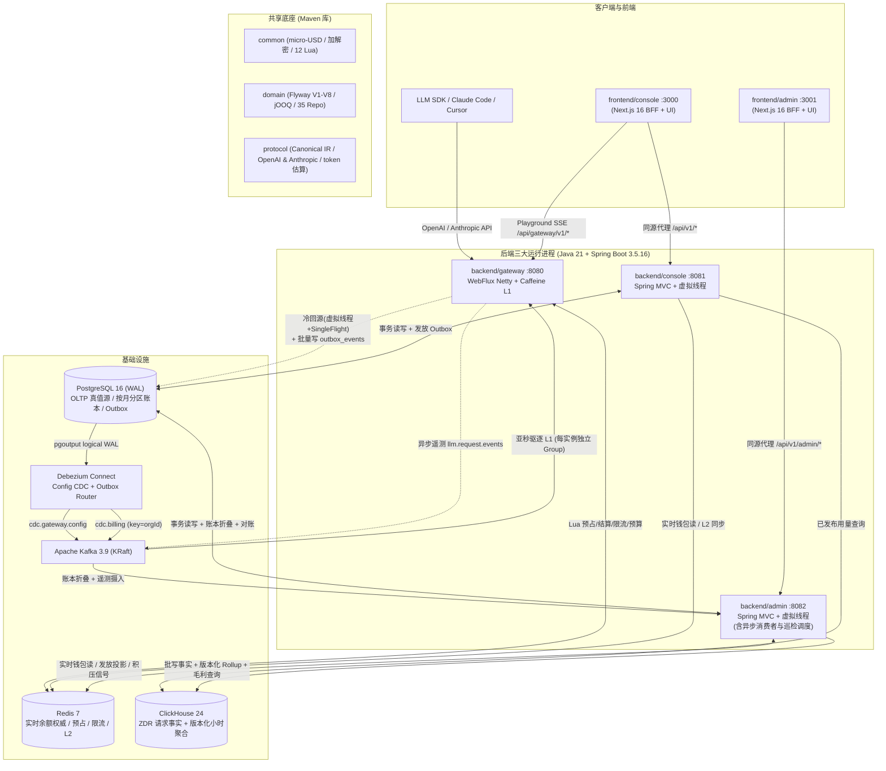

# HyperLLM 新手接管手册（Onboarding Guide）

欢迎接管 **HyperLLM**（`app.pagefault.hyperllm`）！

本目录是专为**首次接触或接管本仓库的工程师**编写的循序渐进式实战手册。仓库现有的 `docs/PROPOSAL.md` 与 `docs/design/*.md` 是原始架构设计稿（篇幅大、按开发阶段演进）；而本手册站在**当前代码全局视角**，把环境搭建、模块边界、数据库与缓存、Gateway 请求链路、Redis 计费权威层与 Outbox 一致性、双控制面与支付/分析/告警/对账、双前端以及故障排查拆成 **8 课**，带你一步一步彻底吃透每一个设计细节与避坑红线。

---

## 推荐学习路线（3 天上手计划）

| 天数 | 章节 | 学完你能做到什么 |
| :--- | :--- | :--- |
| **Day 1 上午** | [第 1 课：环境搭建与首次全链路跑通](./01-local-setup-and-first-run.md) | 拉起 Docker Compose 基础设施与 3 后端 + 2 前端，跑通单元测试、集成测试与 `phase2-smoke.sh` 活栈验证 |
| **Day 1 下午** | [第 2 课：工程结构、模块依赖与架构红线](./02-repo-architecture-and-invariants.md) | 看懂 6 个后端 Maven 模块 + 2 个 Next.js 前端的依赖拓扑，牢记 6 条不可违背的工程红线 |
| **Day 1 傍晚** | [第 3 课：数据存储全景（PG + jOOQ + Redis + ClickHouse）](./03-domain-data-model-and-storage.md) | 掌握 `V1`–`V8` 表结构演进、`-Pjooq` 生成流、Redis 全键空间与 ClickHouse 版本化聚合 |
| **Day 2 上午** | [第 4 课：数据面 Gateway 请求全生命周期](./04-gateway-request-lifecycle.md) | 沿着 `GatewayProxyService` 走完认证、三级缓存、CDC 亚秒失效、协议适配、加权路由与首字节前重试 |
| **Day 2 下午** | [第 5 课：核心难点——Redis 权威层、Pre-hold/Settle 与 Outbox](./05-billing-redis-authority-and-outbox.md) | 彻底理解为什么有 B1–B6 基线、滑动 TTL、12 个 Lua 脚本、读写路径分叉、反压 503 与 L1–L4 对账工单 |
| **Day 3 上午** | [第 6 课：双控制面、鉴权安全、支付、报表与运维后台](./06-control-planes-auth-payments-and-ops.md) | 掌握双域 JWT + TOTP MFA、双层 RBAC、三渠道支付验签履约、四层限流/项目预算、告警与自动对账 |
| **Day 3 下午** | [第 7 课：双独立 Next.js 16 前端与 BFF 指南](./07-frontend-and-bff-guide.md) | 理解同源代理 Route Handler、Single-Flight 刷新锁、Playground SSE 流与提交前四项门禁 |
| **Day 3 随时查阅** | [第 8 课：测试体系、故障排查 Runbook 与二次开发清单](./08-testing-debugging-and-extending.md) | 遇到报错按 Runbook 秒级定位，按标准化 Checklist 安全扩展新表、新接口、新协议或新支付渠道 |

> **配套 API 契约**：所有 HTTP 接口的完整 OpenAPI 3.1 定义已整理在 [docs/openapi/](../openapi/README.md)（包含 [gateway-api.yaml](../openapi/gateway-api.yaml)、[console-api.yaml](../openapi/console-api.yaml)、[admin-api.yaml](../openapi/admin-api.yaml)）。

---

## 一张图建立全局心智模型

---

## 新手第一天必须记住的 5 句话

1. **金额永远是整数 `micro-USD`（`long`）**：`1 USD = 1,000,000 micros`，向上取整用 `MicroUsd` / `CostMath`，绝不碰 `float`/`double`。
2. **扣钱先动 Redis，给钱先写 Outbox**：消耗在 Redis Lua 原子扣完后批量异步写 `outbox_events`；充值/赠金/资源包先在 PostgreSQL 业务事务内写 `outbox_events`，经 Debezium `cdc.billing` 由 `LedgerFolder` 折叠账本并幂等投影到 Redis。
3. **Gateway 绝不阻塞 Netty EventLoop，也绝不跑 Flyway**：`gateway` 保留 `spring.flyway.enabled=false`，冷回源通过 `domainFallbackScheduler`（虚拟线程）+ `SingleFlight` 执行，数据库连接池总额严格限制在 8（冷回源 6 + Outbox 单写者 2）。
4. **`backend/domain/src/main/generated` 禁止手改**：凡是改动 `V*.sql`，必须通过 `./backend/mvnw -f backend/pom.xml compile -pl common,domain -Pjooq` 重新生成。
5. **双控制面彻底隔离**：`console`（`:8081`）与 `admin`（`:8082`）拥有独立的用户表、JWT 密钥、Issuer、Audience 与 Refresh Cookie，严禁混用。

准备好了？直接进入 **[第 1 课：环境搭建、基础设施启动与首次全链路跑通](./01-local-setup-and-first-run.md)**！
